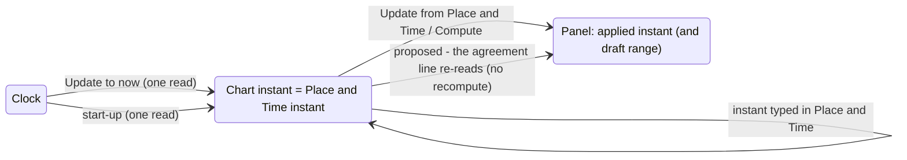

# The frozen chart instant, stated

**Sprint 51, issue #556 - a study ahead of #259.** How the chart states
the observer and the frozen UTC instant it is drawn for, and how a
reader learns when the chart, Place and Time and the Solar System
panels agree. This document measures, proposes and stops for the
owner's rulings; no production furniture is built here. The evidence is
`docs/studies/chart-instant/` (`make chart-instant-study`): production
pages with the proposed box drawn over them, its sizes and displacements
in `platform.md`, and schematic drawings of the panel and two-screen
proposals.

Boundaries, from the owner: UTC only - no local civil time, no named
zone; no polling, animation or live-sky behaviour; the laptop Controller
with the chart on an external monitor is a first-class workflow.

## 1. What the atlas does today

Read from the code (the survey's file references are kept on #556):

- **The page never states its instant or its observer.** The title
  block's lines are the title, the centre, the facts and the closer-field
  note; the spoken description and the exported sheet's description say
  nothing of time either. A chart with the Sun, the Moon or a planet on
  it is a frozen page whose moment is invisible on the page itself.
- **One instant owns the chart.** `MeridianModule` holds the observer -
  place and instant - "a frozen instant; there is no clock here". The
  application reads the clock once at start-up; `PlaceStore` remembers
  the place and never the instant; **Now** in the Place and Time panel
  reads the clock once and replaces the instant. The dialog and the
  Controller's Chart tab host the same panel, under its note *The chart
  is drawn for that instant and stays there. Nothing ticks.* Changing
  the instant repaints the module's geometry without rebuilding the
  scene.
- **The bodies follow it at paint time.** The Solar System and Jovian
  modules read the Place and Time observer every paint, so the chart's
  Sun, Moon, Mercury, Venus and Jupiter are always at the chart's
  instant.
- **The panels do not.** Each body's session reads the Place and Time
  observer only when its panel *applies* - *Compute*, the view buttons,
  Enter in a range field, and *Update from Place and Time*, which does
  exactly what Compute does. The dialogs also apply when they come to
  the front; the Controller's groups never apply on their own. A group's
  observer note shows the observer read at its last apply, and nothing
  anywhere says when that differs from the chart. *Update from Place and
  Time* sits last in each Controller group, below the result card.
- **The view report** already states `instant-utc` and the observer
  while Place and Time is attached.
- **Furniture** is the renderer's own: the title block in the lower
  left, the stellar-magnitude key in the upper right (off by default).
  Grid figures and names yield to both. No module can contribute
  furniture.
- Two stale words found in passing, not fixed here: View ▸ Solar
  System's explanation still begins "The Sun and the Moon"; a comment in
  `JUranometriaMain` still says Mercury has neither switch nor button.

## 2. Three instants, today and proposed

The chart and Place and Time share **one** instant; a panel holds the
instant it last applied (and, for a range, its own draft range); the
clock is read only when a reader asks.

What each action reads and changes, proposed:

| action | reads | changes | never changes |
|---|---|---|---|
| **Update to now** (the box, the Place and Time panel, the Solar System tab's line) | the clock, once | the chart instant (Place and Time's) | place, centre, field, limit, target, selection, emphasis, any panel's result or range |
| **Update from Place and Time** (each panel) | the chart instant and place | that panel's result | the chart instant, every other panel |
| typing an instant in Place and Time | - | the chart instant | as Update to now |
| navigation, export, reopening the Controller or a dialog, restart | - | nothing (restart: the new session's own start-up read) | the instant |

## 3. What was measured

The box (`platform.md`) is **162 × 87 px** at the title block's own face,
margin and padding: a heading, the observer, the UTC instant, the local
sidereal time and one action. On the 900 px pages it fits the **lower
right** everywhere; on the 520 px narrow page and the 600 px letterboxed
page the lower right meets the title block, and the **upper right** -
free while the magnitude key is off - takes it. Displacement is small
where it matters: in the lower right the box would push aside **1-2**
grid figures and cover **0-3** stars on the 8° and 3° pages; on the 60°
overview it covers 47 stars in the lower right against 94 in the upper
right and 62 in the upper left. The globe's corners are paper and the
box displaces nothing there.

## 4. The proposals, for the rulings

1. **When a page states its instant.** The box is drawn whenever a
   time-dependent layer is switched on - an observer line (meridian,
   mathematical horizon, zenith, their letters and ticks) or a Solar
   System body on the chart - whether or not its ink falls on the page in
   view, so panning never makes the box come and go; and never
   otherwise, so every page with no such layer on stays byte for byte as
   released. *Alternative for the ruling:* only while such ink is on the
   page (the dense page shows the difference). A Chart Options switch to
   hide the box is **not** proposed: a page that depends on its instant
   should say so.

2. **What the box says.** Heading *Place and Time* / *Sted og tid*; the
   observer to two decimals with hemisphere letters (*59.91° N · 10.75° E*
   / *Ø*); the instant to the second, written as Place and Time writes it,
   with *UTC* (*2026-08-15 06:00:00 UTC*); the local sidereal time to the
   minute (*LST 04h 17m* / *Stjernetid 04h 17m*); one action. No civil
   time, no zone, no offset inferred from longitude.

3. **Where it goes, and how modules ask.** The chart owns placement: a
   fixed order of corners - **lower right**, then **upper right** while the
   magnitude key is off, then **upper left** - and the first that fits
   inside the margins and meets no furniture that will draw takes the box;
   none, and the box is refused, as the title block is. The title block
   keeps the lower left and the key the upper right; when the key is on
   and the lower right is too narrow, the box goes to the upper left.
   Grid figures and names yield to the box as they yield to the title
   block. A module contributes **typed furniture** - a role, its lines as
   text, an optional action identity - never a graphics context, a
   rectangle, a colour or a component; the chart allocates, lays out,
   inks, hit-tests and speaks it. Removing the module removes the box and
   leaves the page byte for byte. Later modules join the same order
   without knowing one another.

4. **The actions.** The box offers one action, **Update to now**, which
   reads the clock once and replaces the chart instant - the same action
   as Place and Time's **Now**, which is proposed to be **renamed *Update
   to now*** so the one action has one name everywhere (*sub-ruling*).
   *Update from Place and Time* stays a panel action and keeps its name:
   it re-reads the chart instant and place into that panel. Neither action
   follows the clock afterwards; nothing polls.

5. **Agreement, said where the reader is.** Every Solar System panel - the
   five Controller groups and their dialogs - opens with an **agreement
   line**, read again whenever Place and Time changes (a subscription, not
   a recompute):
   - *Same instant as the chart: 2026-08-15 06:00:00 UTC* when they agree;
   - *Chart: … / This table: …* with **Update from Place and Time** beside
     it when they differ (`panel-differs-en.png`);
   - in *Over a range*, *This range: from … to …; the chart is at …*,
     without calling it a difference.
   The button moves from the foot of the group into that line; the
   observer note keeps saying what the result was computed for.

6. **Screen and paper.** On screen the box is furniture with one framed
   action. On an exported sheet the action is not drawn - it cannot be
   pressed - and the last line says *The chart is frozen at this instant.*
   (`sheet-static.png`); the sheet's description gains one sentence with
   the observer and the UTC instant when the box is drawn.

7. **Spoken, keyed and reported.** The chart's spoken description gains
   *Place and Time: 59.91° N, 10.75° E, 2026-08-15 06:00:00 UTC, local
   sidereal time 04h 17m* when the box is drawn. The action is an
   accessible action of the chart and a chart-keyboard command - the chart
   keys' prefix, then a free letter (today A, Q, V, W, X and Z are free;
   N, the obvious one, is taken by constellation names; proposed **W**,
   *when*) - with a focus ring drawn by the
   chart and the action's explanation on hover. The view report gains
   `furniture: place-and-time <corner>`; it already reports the instant.

8. **What is kept.** Unchanged: the place is remembered, the instant
   never - each start reads the clock once; a panel's result and range
   belong to the session; navigation, export, reopening the Controller or
   a dialog never change the instant; only *Update to now* or a typed
   instant does.

9. **Two screens.** The Controller's Solar System tab opens with one line
   - *Chart: 2026-08-15 06:00:00 UTC* with **Update to now** - so a reader
   at the laptop knows what the chart on the other screen is frozen at
   without visiting the Chart tab, and each group's agreement line tells
   them whether its table is the chart's moment
   (`checkpoint-two-screens.png`).

10. **The order of work.** #259 builds the typed-furniture seam, the box,
    its allocation, action, accessibility and paper treatment, and the
    agreement lines, behind this document's rulings; the two stale words
    of section 1 can travel with it.

## 5. What #259 must prove (the mutation cases)

| mutation | what must catch it |
|---|---|
| polling: anything that reads the clock or repaints on a timer | an injected clock counted; holding it still and waiting changes no value and requests no repaint |
| several clock reads for one *Update to now* | one activation reads the injected clock exactly once, by pointer, keyboard and accessible action alike |
| *Update to now* rebuilding the scene | the same scene and inventory instances after the update; no catalogue query |
| accidental navigation | centre, field, limit, target, selection, working set and emphasis equal before and after |
| a stale instant persisted | a restart's instant is its own start-up read, never a stored one; the place returns |
| a dead keyboard action | the chart-keyboard command updates the instant on the real route |
| a module drawing its own furniture | removing the module recovers the page byte for byte; the module's contribution carries no graphics |
| furniture collision | every allocation on the study's pages meets no furniture, and grid figures yield |
| an agreement line that recomputes | changing Place and Time changes the line's words and no panel's result |
| civil time from longitude | no wording names a zone or an offset |

## 6. Not in this issue

No production furniture, no local civil time, named zone, device
location, UT1 service, rise/set table, observing plan, bookmark, server
work or new planet. #537, #557 and the rest of Sprint 51 wait.
