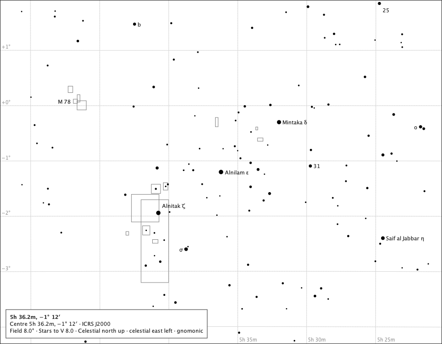
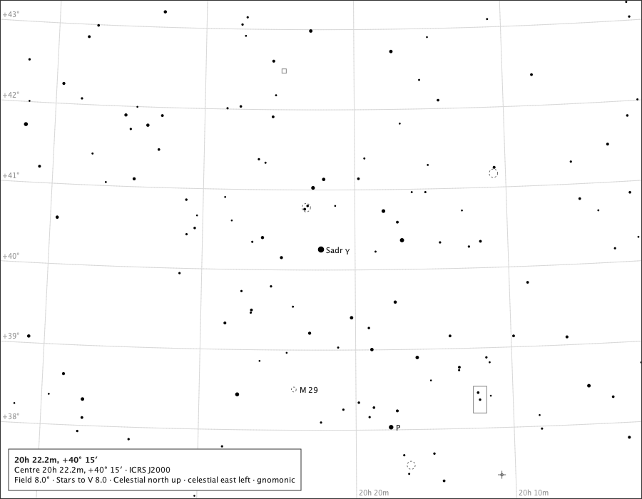
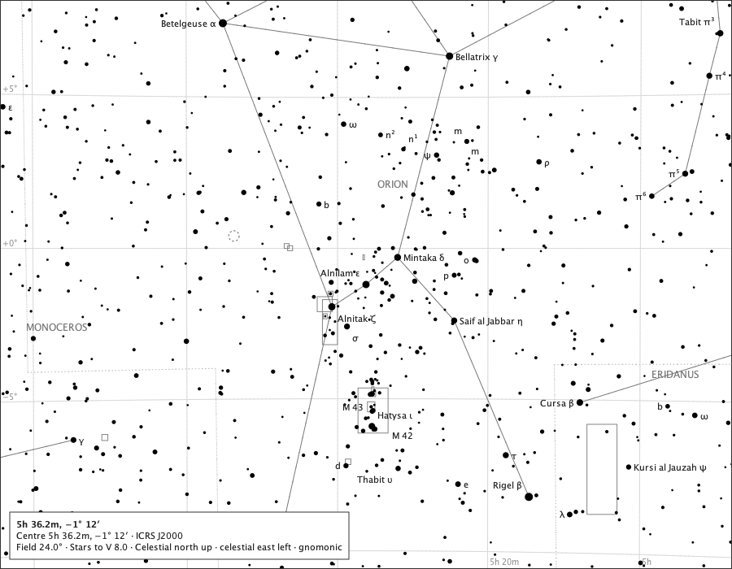
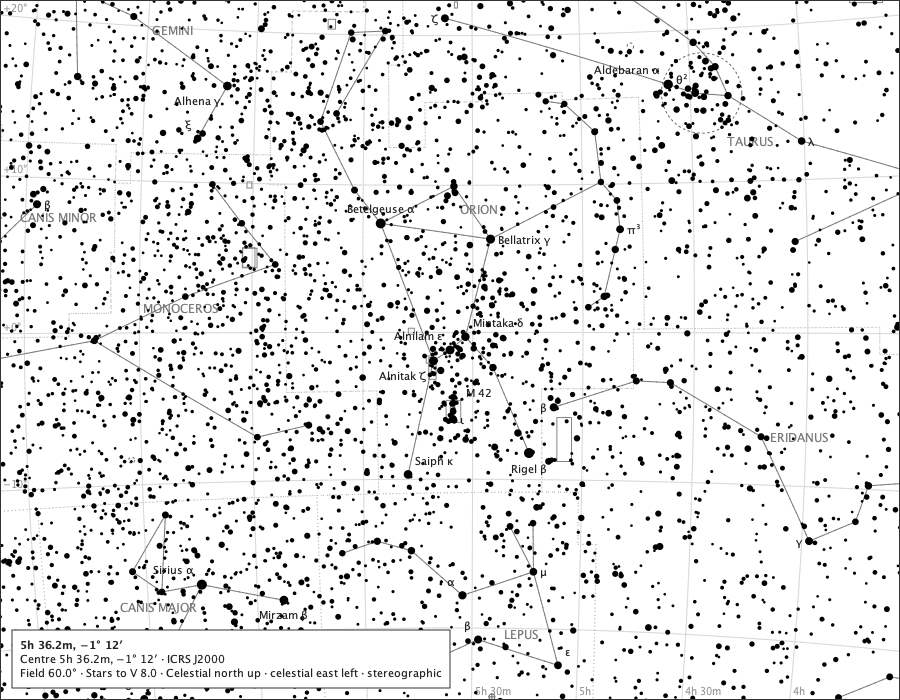
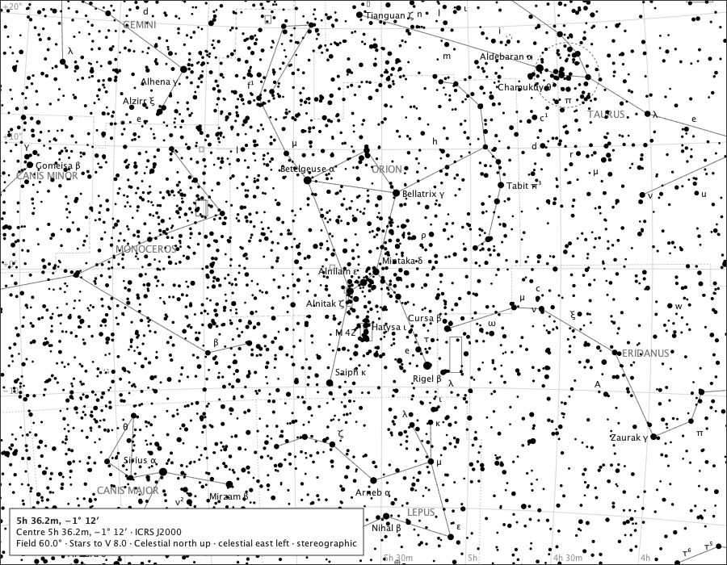

# All star identities where they fit, as built

Sprint 51, issue #558, to the rulings on #557 (`docs/decisions/star-identity-density.md`). Each page is the production `ChartComponent` at 900 × 700 px, limit V 8, drawn with the released default options and again with *All star identities where they fit* on. The released page's labels keep their places; each star they name is written in full; further identities take only free room. How many labels each page draws is in `platform.md`. Regenerate with `make all-star-identities`.

## aries-8

Aries at 8°, centred on Mesarthim - the issue's case: `γ¹` becomes *Mesarthim γ¹*.

Released:

With all star identities:

## orion-8

Orion's belt at 8°.

Released:

With all star identities:

## cygnus-8

Cygnus at 8°, in the Milky Way.

Released:

With all star identities:

## eridanus-8

Eridanus at 8°, sparse.

Released:

With all star identities:

## orion-24

Orion at 24°: the M 42 labels stay legible - nothing is forced over another.

Released:

With all star identities:

## orion-60

Orion at 60°: names and letters where they fit, and no bare Flamsteed numbers above 12°.

Released:

With all star identities:

