# Bookmarks: the measured architecture and interface study (#497)

Generated by `make bookmarks-study` (`juranometria.tool.BookmarkStudyMain`) from the atlas as it is at the study head. The owner's rulings of 2026-11-02 on #497 fix the product semantics; this report measures what they need from the code and proves the proposed document. The proposal and its reasoning are `docs/decisions/bookmarks.md`. Every interface word shown is a proposal; no application class reads or writes a bookmark.

## 1. The geometric view, as the atlas holds it

`ChartViewState` holds a centre (ICRS/J2000 degrees), a field width, a magnitude limit, an optional target label and identity, and a projection that must agree with the field. There is no orientation state: every page is drawn celestial north up, east left. The projection is the field's, so a bookmark stores the field and never the projection:

| field | projection the atlas derives | default magnitude limit for the field |
|---|---|---|
| 180° | ORTHOGRAPHIC | V 5 |
| 120° | STEREOGRAPHIC | V 4 |
| 90° | STEREOGRAPHIC | V 4 |
| 60° | STEREOGRAPHIC | V 5 |
| 42° | GNOMONIC | V 8 |
| 36° | GNOMONIC | V 8 |
| 24° | GNOMONIC | V 8 |
| 18° | GNOMONIC | V 8 |
| 12° | GNOMONIC | V 8 |
| 8° | GNOMONIC | V 8 |
| 6° | GNOMONIC | V 8 |
| 4° | GNOMONIC | V 8 |
| 3° | GNOMONIC | V 8 |
| 2° | GNOMONIC | V 8 |
| 1° | GNOMONIC | V 8 |
| 0.5° | GNOMONIC | V 8 |
| 0.25° | GNOMONIC | V 8 |

The magnitude limit is part of the view state but, by the ruling, it is the reader's current choice and is not restored. Opening a view through the controller's own `recenter(centre, field)` keeps the reader's limit and lowers it only where the new field's default is brighter - the atlas's existing rule for any field change. Measured with a real `ChartViewController`, starting at M31's default page with the limit set by the reader's own steps:

| reader's limit before | open at 180° | open at 120° | open at 24° | open at 8° | open at 1° | open at 0.25° |
|---|---|---|---|---|---|---|
| V 8 | V 5 | V 4 | V 8 | V 8 | V 8 | V 8 |
| V 6 | V 5 | V 4 | V 6 | V 6 | V 6 | V 6 |
| V 4 | V 4 | V 4 | V 4 | V 4 | V 4 | V 4 |

A closer field (0.5°, 0.25°) is accepted by `recenter` like any step: the controller applies it whether or not a planet offers it, because the offer is consulted only by the closer-field step. A bookmark opening at a closer field must therefore ask the same offer the step asks (the decision record proposes: at the closer field only where the page offers it, otherwise at 1°, stated).

The field is the page's horizontal extent; the vertical extent is the window's. The same view in a shorter window shows less sky above and below the centre, so a subject near the saved page's top or bottom edge may be off a smaller page. For a gnomonic page the half-height in degrees is close to field × height ÷ width ÷ 2:

| field | 1200 × 800 px | 900 × 700 px | 900 × 500 px |
|---|---|---|---|
| 24° | ±8.00° | ±9.33° | ±6.67° |
| 8° | ±2.67° | ±3.11° | ±2.22° |
| 1° | ±0.33° | ±0.39° | ±0.28° |

## 2. Subject identities

A subject is stored as a kind and the atlas's own language-independent identity; display text is never stored. Resolved here through the atlas's search and its page words, so every identity below is the catalogue's or the module's, not typed:

| asked for | kind | stored identity | the catalogue's label, in either language |
|---|---|---|---|
| M 42 | deep-sky | `NGC 1976` | M 42 |
| M 33 | deep-sky | `NGC 598` | M 33 |
| Aldebaran | star | `TYC 1266-1416-1` | Aldebaran · α Tau · V 1.0 |
| Regulus | star | `TYC 833-1381-1` | Regulus · α Leo · V 1.4 |
| Spica | star | `TYC 5547-1518-1` | Spica · α Vir · V 1.0 |
| Antares | star | `TYC 6803-2158-1` | Antares · α Sco · V 1.1 |
| Alcyone | star | `TYC 1800-2202-1` | Alcyone · η Tau · V 2.8 |

The search labels are the catalogue's names; a Norwegian chart names a constellation in Norwegian, but a star's proper name and an NGC/Messier designation are the same words in both languages, which is why the stored identity is the catalogue's and the shown name is looked up each time.

| body identity | selectable on the chart today | English | Norsk bokmål |
|---|---|---|---|
| `sun` | yes | Sun | Solen |
| `moon` | yes | Moon | Månen |
| `mercury` | yes | Mercury | Merkur |
| `venus` | yes | Venus | Venus |
| `mars` | yes | Mars | Mars |
| `jovian.jupiter` | yes | Jupiter | Jupiter |
| `saturn` | yes | Saturn | Saturn |
| `uranus` | yes | Uranus | Uranus |
| `neptune` | yes | Neptune | Neptun |
| `mars.phobos` | no | Phobos | Phobos |
| `mars.deimos` | no | Deimos | Deimos |
| `jovian.io` | no | Io | Io |
| `jovian.europa` | no | Europa | Europa |
| `jovian.ganymede` | no | Ganymede | Ganymedes |
| `jovian.callisto` | no | Callisto | Callisto |
| `saturn.titan` | no | Titan | Titan |
| `uranus.titania` | no | Titania | Titania |
| `neptune.triton` | no | Triton | Triton |

No planetary moon is selectable today (each module refuses it until a ruling makes it so), so a moon may be a bookmark subject - made visible with its planet - but not its primary. Stars are Tycho-2 identities and deep-sky objects OpenNGC identities; M 31 and NGC 224 are one object, stored once, as the catalogue's own identity.

## 3. The instants the examples use

Every instant is cited from a committed fixture or measured here by the atlas's own services for Oslo (59.913° N, 10.752° E), never typed:

| example | instant | how it was found |
|---|---|---|
| Venus's 2012 transit | 2012-06-06T01:00:00Z | cited: `docs/studies/venus/venus-events.txt`, `2012-inferior-conjunction` |
| the Moon and Venus | 2026-08-16T05:44:00Z | measured: smallest topocentric separation, 2.36°, within 15 days of the cited 2026 eastern elongation |
| the Moon and Alcyone | 2026-11-24T11:54:00Z | measured: smallest topocentric separation in 2026 among Aldebaran, Regulus, Spica, Antares and Alcyone, 0.079° from the Moon's centre against its 0.275° radius - an occultation from Oslo |
| Jupiter and its moons | 2026-06-29T23:57:00Z | cited: `moon-events-2026.txt`, `full-moon-june` (any instant serves; this one is cited) |
| an observation note | 2026-06-21T21:55:00Z | cited: `moon-events-2026.txt`, `first-quarter-june`, standing in for a time the user confirms |

## 4. The version-1 document and its round trips

Every required example is in one library, `examples/library.json` (5223 bytes, 8 bookmarks in 2 folders). Written, read, written again: **identical, byte for byte**; the domain read back equals the domain written: **yes**.

| example (#497) | title | subjects, in user order | primary | time | place | note |
|---|---|---|---|---|---|---|
| a chart position, nothing else | Orion's sword, wide | — | — | — | — | — |
| M33 alone | M33 | `NGC 598` | `NGC 598` | — | — | — |
| a reusable observing field, time deliberately absent | Andromeda to Triangulum field | `NGC 598` | — | — | — | yes |
| the Moon and Venus | The Moon with Venus | `moon`, `venus` | `moon` | event 2026-08-16T05:44:00Z | — | — |
| the Moon and a named star | The Moon at Alcyone | `moon`, `TYC 1800-2202-1` | `moon` | event 2026-11-24T11:54:00Z | 59.913, 10.752 | — |
| a conjunction / transit at an instant | Venus crossing the Sun, 2012 | `venus`, `sun` | `venus` | event 2012-06-06T01:00:00Z | — | yes |
| Jupiter and selected Galilean moons | Jupiter with Io and Europa | `jovian.jupiter`, `jovian.io`, `jovian.europa` | `jovian.jupiter` | event 2026-06-29T23:57:00Z | — | — |
| an observation note with a confirmed time | Moon from the balcony | `moon` | `moon` | observation 2026-06-21T21:55:00Z | 59.913, 10.752 | yes |

One bookmark, as the document stores it (the Moon and the named star):

```json
{
  "format": "juranometria-bookmarks",
  "version": 1,
  "writtenBy": "6.2.0-study",
  "root": [
    {
      "type": "bookmark",
      "id": "48368364-60a1-3876-9e86-80209e6f8175",
      "title": "The Moon at Alcyone",
      "view": {
        "ra": 56.893713,
        "dec": 24.029342,
        "field": 2
      },
      "subjects": [
        {
          "kind": "body",
          "id": "moon"
        },
        {
          "kind": "star",
          "id": "TYC 1800-2202-1"
        }
      ],
      "primary": {
        "kind": "body",
        "id": "moon"
      },
      "time": {
        "instant": "2026-11-24T11:54:00Z",
        "purpose": "event"
      },
      "place": {
        "latitude": 59.913,
        "eastLongitude": 10.752
      }
    }
  ]
}
```

The titles above are the user's own words and stay as typed in any language; the subjects are identities, shown in the interface's language at each reading. The root folder has no stored title: it is the permanent *Bookmarks* / *Bokmerker* and is named by the interface.

## 5. Failure, migration and future-version cases

Each document below is read by the proposed reader. *Usable* means the library opens; kept records are written back unchanged and reported. The reader never throws on content and never rewrites what it did not understand.

| document | read as | bookmarks usable | records kept | why |
|---|---|---|---|---|
| the examples, unchanged | usable | 8 | 0 | — |
| an interrupted write: the document cut in half | malformed | — | — | the document ends early at character 2610 |
| not ours: another program's JSON | not a bookmark document | — | — | the document does not say it is "juranometria-bookmarks" |
| a byte-order mark before the document | malformed | — | — | a byte-order mark before the document at character 0 |
| a future schema (version 2) | newer (version 2) | — | — | never reinterpreted, never written; the library is read-only until a newer JUranometria opens it |
| a record of an unknown type (a later "separator") | usable | 8 | 1 | an unknown type "separator" |
| a view whose field is not a step (7°) | usable | 7 | 1 | a view whose field is not one of the atlas's steps |
| a primary that is not among the subjects | usable | 8 | 1 | a primary that is not one of the subjects |
| a time in local civil form, no zone | usable | 7 | 1 | a time whose instant is not stated in UTC |
| an unknown subject identity (a star a later catalogue dropped) | usable | 8 | 0 | the identity is kept as stored; whether it resolves is decided when the bookmark opens (section 6), never at reading |
| the same id twice | usable | 7 | 1 | the id 50f4bbed-d155-319e-9863-ce13b98f10a9 twice |

## 6. The restoration matrix, measured

Each row opens a bookmark through the proposed procedure on the atlas's own `ChartViewController`, `ChartContextHolder` and `WorkingSelection`: the view through `recenter(centre, field[, label, identity])`, the stored place and instant through one `install` of the observer built from the current one, and the primary - if any - through the working selection, as search does. Before every row the chart is at the same state: M31's page, the reader's limit V 6, Oslo at 2026-03-20T21:33:00Z, and the star Aldebaran selected. *same* means the value was not touched.

| stored place | stored time | primary | centre | field | limit | place | instant | context installs | selection |
|---|---|---|---|---|---|---|---|---|---|
| no | no | no | restored | 2° | same (V 6) | same | same | 0 | same |
| no | no | yes | restored | 2° | same (V 6) | same | same | 0 | `moon` |
| no | yes | no | restored | 2° | same (V 6) | same | 2026-11-24T11:54:00Z | 1 | same |
| no | yes | yes | restored | 2° | same (V 6) | same | 2026-11-24T11:54:00Z | 1 | `moon` |
| yes | no | no | restored | 2° | same (V 6) | 78.223, 15.647 | same | 1 | same |
| yes | no | yes | restored | 2° | same (V 6) | 78.223, 15.647 | same | 1 | `moon` |
| yes | yes | no | restored | 2° | same (V 6) | 78.223, 15.647 | 2026-11-24T11:54:00Z | 1 | same |
| yes | yes | yes | restored | 2° | same (V 6) | 78.223, 15.647 | 2026-11-24T11:54:00Z | 1 | `moon` |

Measured: the view always changes; the reader's limit is never raised; the place and the instant change only when stored, in one installation of the chart context (one redraw, one revision), and each leaves the other as it was; the selection changes only when a primary is stored. Chart Options, the grids, the labels and every Solar System switch are not touched by any row: the procedure has no route to them. Making a subject visible (the Moon's switch here) is a separate, stated step the decision record proposes for subjects the current options would hide.

## 7. The local document: write, backup and recovery

The proposed write, the export sheet's own precedent extended with a last-known-good backup: (1) write the whole document to a temporary file beside it and force it to the disk; (2) if the current document reads as usable, copy it over `bookmarks.json.bak`; (3) move the temporary file onto `bookmarks.json` atomically, refusing - never copying - where the file system cannot move atomically. Walked here on a scratch folder with the write stopped at each point, then the next start read as the proposed start reads it:

| the write stopped | `bookmarks.json` afterwards | `.bak` afterwards | stray temporary file | the next start opens |
|---|---|---|---|---|
| not at all | the new library | the previous library | none | the new library |
| after the temporary file was written | the previous library | none | yes - deleted unread at the next start | the previous library |
| after the backup was copied | the previous library | the previous library | yes - deleted unread at the next start | the previous library |
| at the move (no atomic move on this file system) | the previous library | the previous library | yes - deleted unread at the next start | the previous library |
| (the main document damaged by something else; a backup exists) | damaged | the new library | none | nothing yet: the damaged document is kept and the backup (the new library) is offered, to be restored only on the reader's yes |
| (a later JUranometria wrote version 3) | version 3 | none | none | nothing: version 3 is newer; read-only notice, file untouched |

Measured: no stop leaves the reader without a usable library; the previous library is either still the document or the backup; a damaged or newer document is never overwritten by the start that found it.

Where the document lives (none of these folders exists for JUranometria today; the atlas keeps everything else in one Preferences node and writes no other user file):

| system | folder | document |
|---|---|---|
| macOS | `~/Library/Application Support/JUranometria/` | `bookmarks.json` |
| Windows | `%APPDATA%\JUranometria\` | `bookmarks.json` |
| Linux and others | `$XDG_DATA_HOME/juranometria/`, else `~/.local/share/juranometria/` | `bookmarks.json` |

## 8. Export, backup and restore, exactly

Export writes the library's canonical text - kept records included - to a file the reader chooses, through the export sheet's own temporary-file-and-atomic-move placement and its replace question. Restore reads a chosen file, refuses anything that is not a usable version-1 library, shows a summary, keeps the current library beside the document, and replaces it only on the reader's yes. Measured on a scratch folder:

| step | result |
|---|---|
| the summary restore shows | 8 bookmarks, 2 folders, 0 records needing attention, written by 6.2.0-study |
| export, then restore of that export | the document is the exported library, byte for byte |
| undo the restore from the kept library | the document is the library from before the restore, byte for byte |
| restore from a malformed, foreign or newer file | refused before anything is touched; the reason is shown |

## 9. The proposed surfaces

Drawn from unwired Swing components under the atlas's own theme, in both languages; the words are proposals (table below). Sizes are this desktop's and stand in `platform.md`.

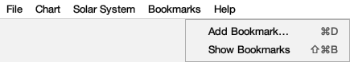

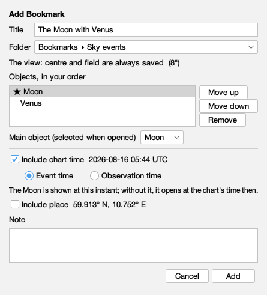

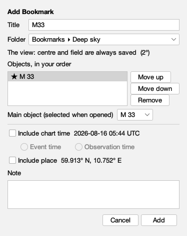

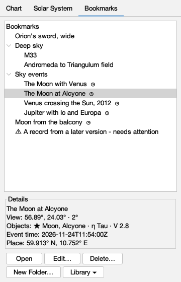

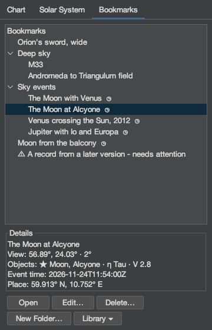

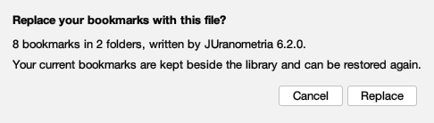

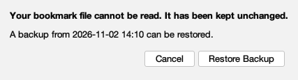

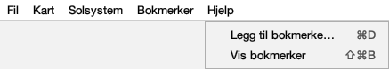

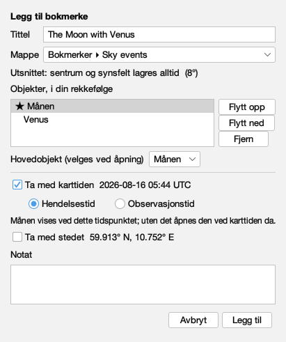

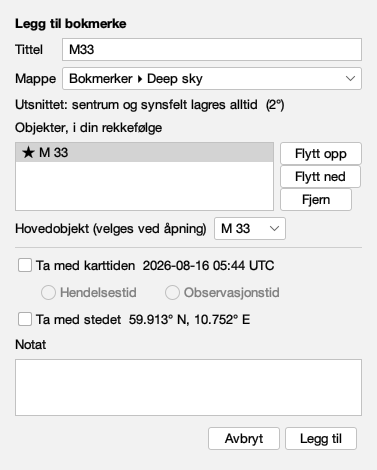

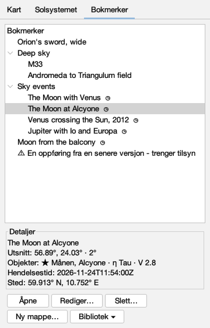

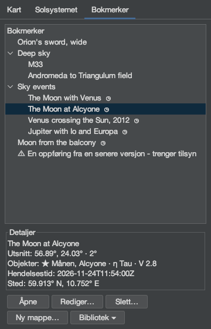

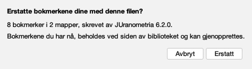

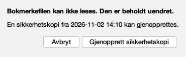

| key | English | Norsk bokmål |
|---|---|---|
| menu | Bookmarks | Bokmerker |
| add | Add Bookmark… | Legg til bokmerke… |
| show | Show Bookmarks | Vis bokmerker |
| addTitle | Add Bookmark | Legg til bokmerke |
| title | Title | Tittel |
| folder | Folder | Mappe |
| root | Bookmarks | Bokmerker |
| subjects | Objects, in your order | Objekter, i din rekkefølge |
| primary | Main object (selected when opened) | Hovedobjekt (velges ved åpning) |
| none | None | Ingen |
| up | Move up | Flytt opp |
| down | Move down | Flytt ned |
| remove | Remove | Fjern |
| view | The view: centre and field are always saved | Utsnittet: sentrum og synsfelt lagres alltid |
| time | Include chart time | Ta med karttiden |
| event | Event time | Hendelsestid |
| observation | Observation time | Observasjonstid |
| place | Include place | Ta med stedet |
| dynamicNote | The Moon is shown at this instant; without it, it opens at the chart's time then. | Månen vises ved dette tidspunktet; uten det åpnes den ved karttiden da. |
| note | Note | Notat |
| cancel | Cancel | Avbryt |
| ok | Add | Legg til |
| tab | Bookmarks | Bokmerker |
| open | Open | Åpne |
| edit | Edit… | Rediger… |
| newFolder | New Folder… | Ny mappe… |
| delete | Delete… | Slett… |
| library | Library | Bibliotek |
| export | Export Bookmarks… | Eksporter bokmerker… |
| restore | Restore from File… | Gjenopprett fra fil… |
| attention | needs attention | trenger tilsyn |
| details | Details | Detaljer |
| unresolved | not found in this catalogue - kept as stored | ikke funnet i denne katalogen - beholdt slik den ble lagret |
| restoreTitle | Restore Bookmarks | Gjenopprett bokmerker |
| restoreQuestion | Replace your bookmarks with this file? | Erstatte bokmerkene dine med denne filen? |
| restoreSummary | {0} bookmarks in {1} folders, written by JUranometria {2}. | {0} bokmerker i {1} mapper, skrevet av JUranometria {2}. |
| restoreKeep | Your current bookmarks are kept beside the library and can be restored again. | Bokmerkene du har nå, beholdes ved siden av biblioteket og kan gjenopprettes. |
| restoreYes | Replace | Erstatt |
| damaged | Your bookmark file cannot be read. It has been kept unchanged. | Bokmerkefilen kan ikke leses. Den er beholdt uendret. |
| damagedOffer | A backup from {0} can be restored. | En sikkerhetskopi fra {0} kan gjenopprettes. |
| damagedYes | Restore Backup | Gjenopprett sikkerhetskopi |
| newer | These bookmarks were saved by a newer JUranometria and are shown read-only. | Disse bokmerkene ble lagret av en nyere JUranometria og vises skrivebeskyttet. |

