# Place and Time's box, as built

Sprint 51, issue #259, to the rulings on #556 (`docs/decisions/chart-instant.md`). Every page below is the production `ChartComponent` under a production `ChartModuleHost`, the Place and Time module attached and its box offered as the application offers it; the corner, the layout, the ink and every collision are the renderer's. The sample instant is Venus's cited 2026 greatest eastern elongation (2026-08-15 06:00:00 UTC, from `docs/studies/venus/venus-events.txt`), the observer Oslo at sea level. The box's size and what it displaced are in `platform.md`. Regenerate with `make chart-instant-furniture`.

## What the box says

| line | English | Norwegian |
|---|---|---|
| heading | Place and Time | Sted og tid |
| 1 | 59.91° N · 10.75° E | 59.91° N · 10.75° Ø |
| 2 | 2026-08-15 06:00:00 UTC | 2026-08-15 06:00:00 UTC |
| 3 | LST 04h 17m | Stjernetid 04h 17m |
| control on screen | Update to now | Oppdater til nå |
| on paper instead | The chart is frozen at this instant. | Kartet er frosset ved dette tidspunktet. |

Spoken with the page: "Place and Time: 59.91° N, 10.75° E, 2026-08-15 06:00:00 UTC, local sidereal time 04h 17m."

## The pages

### default-8

The released opening page, nothing drawn for the instant: no box, the page as released. No box.

### sparse-lines-8

Sparse: Eridanus on Oslo's meridian, the meridian and the mathematical horizon crossing the page. The box stands in the lower right.

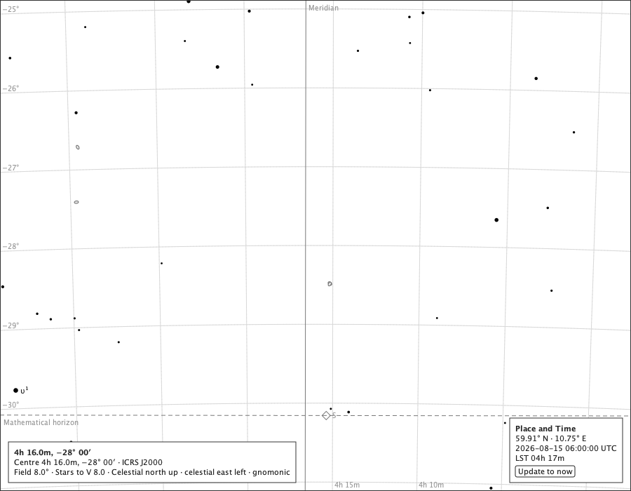

### sparse-lines-8-dark

The same on the black sky. The box stands in the lower right.

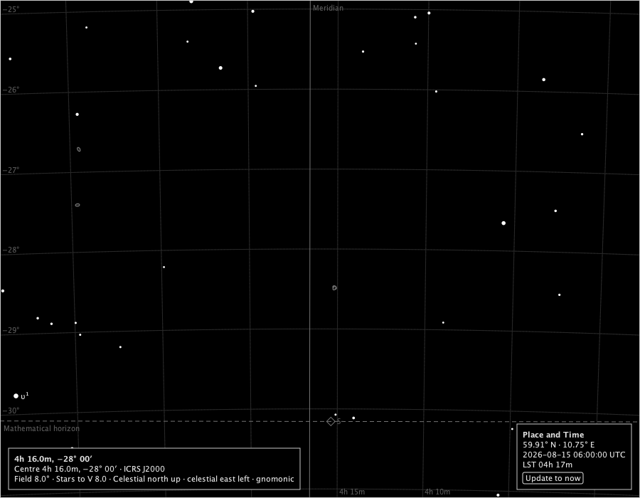

### sparse-lines-8-nb

The same in Norwegian. The box stands in the lower right.

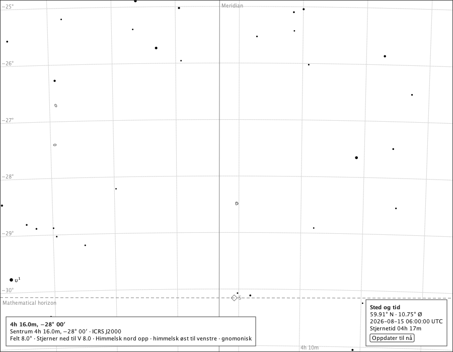

### dense-lines-8

Dense: the Milky Way in Sagittarius, the lines on but off this page - the box is drawn all the same (ruling 1). The box stands in the lower right.

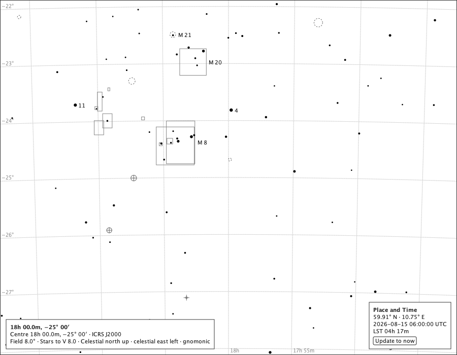

### venus-3

Venus alone at 3°, the lines off: a body makes the page depend on its instant. The box stands in the lower right.

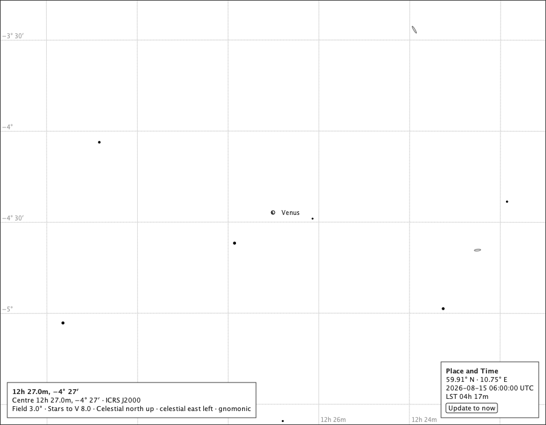

### wide-lines-60

Wide: a 60° overview page with the lines on. The box stands in the lower right.

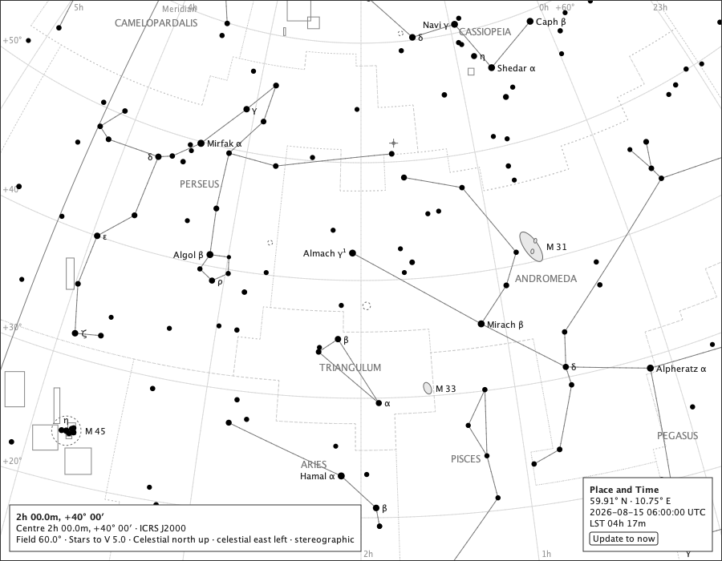

### narrow-lines-8

Narrow: a 520 px window - the lower right meets the title block, so the upper right. The box stands in the upper right.

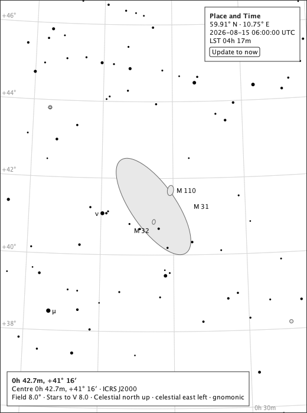

### narrow-key-lines-8

Narrow with the stellar-magnitude key holding the upper right: the upper left. The box stands in the upper left.

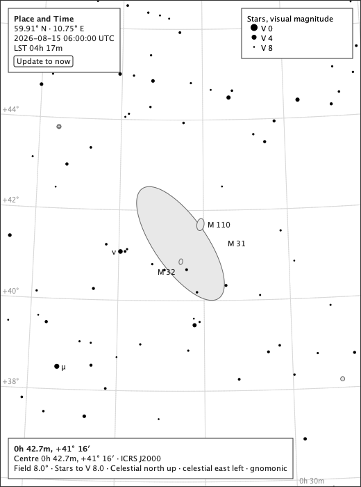

### polar-lines-8

Polar: two degrees from the celestial pole. The box stands in the lower right.

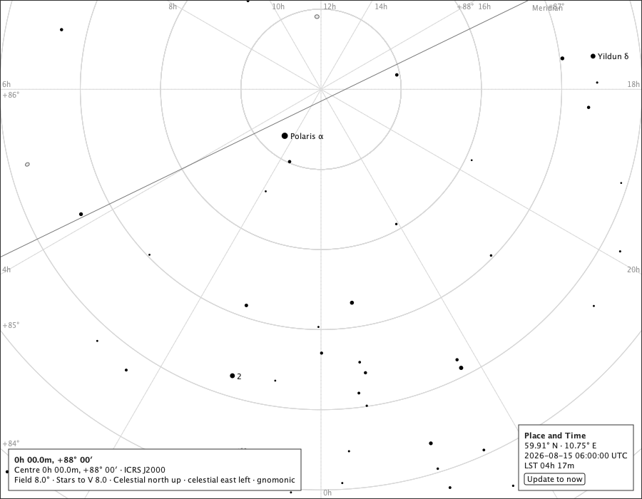

### globe-lines-180

The celestial globe with the lines on. The box stands in the lower right.

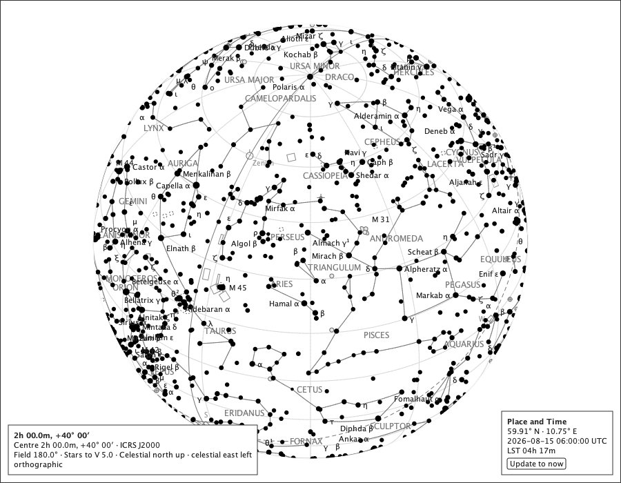

### letterbox-lines-120

Letterboxed: a 120° page in a 600 × 1900 window, on the light theme's band. The box stands in the upper right. The page is 1697 px tall in a 1900 px window.

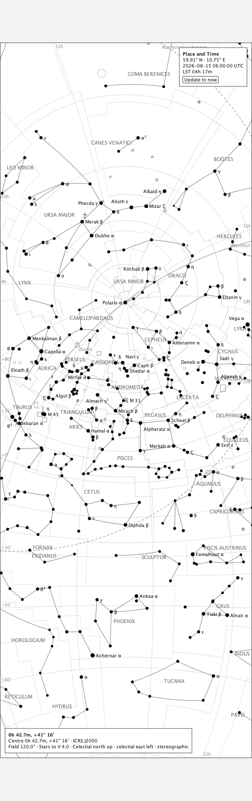

### letterbox-lines-120-dark-theme

The same on the dark theme's band: the band is the application's, the page and its box the chart's. The box stands in the upper right. The page is 1697 px tall in a 1900 px window.

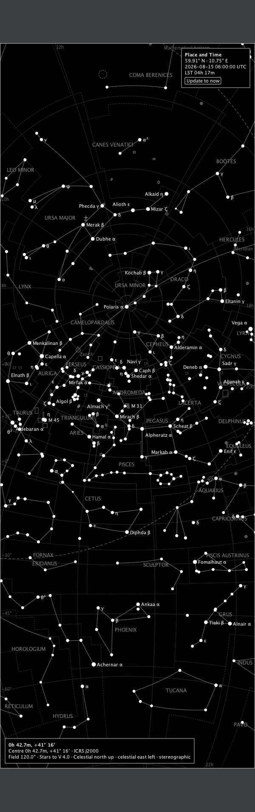

## On paper

The sparse page exported to A4: the box carries no control - it cannot be pressed - and says *The chart is frozen at this instant.* in its place. The sheet's own description ends: "The chart is drawn for 59.91° N, 10.75° E at 2026-08-15 06:00:00 UTC, and is frozen at that instant."

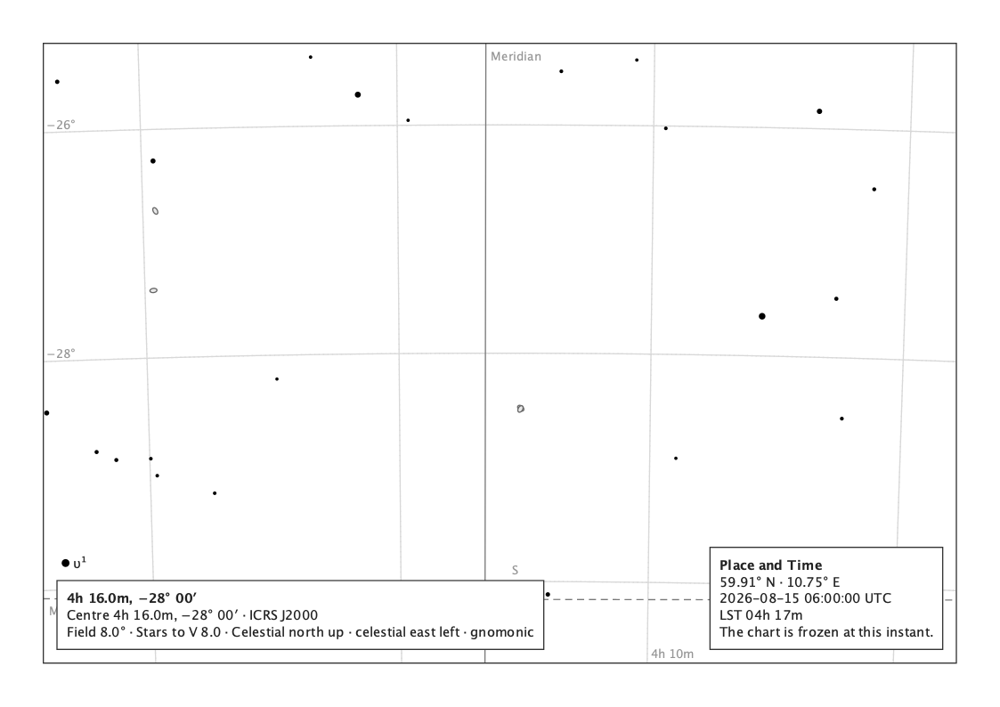

