# The frozen chart instant: measurements and mock-ups

Sprint 51, issue #556, a study ahead of #259. Every page below is the production `ChartComponent` over the bundled catalogue with the Place and Time module attached as the application attaches it; the proposed **Place and Time box** is drawn by this study over the finished page in the title block's own margin, padding and face, and marked STUDY - no production furniture exists. The sample instant is Venus's cited 2026 greatest eastern elongation (2026-08-15 06:00:00 UTC, from `docs/studies/venus/venus-events.txt`), the observer Oslo at sea level. The box's size and what each corner would displace are in `platform.md`. Regenerate with `make chart-instant-study`.

## 1. When a page states its instant

The catalogue's stars, the grid, the figures and the boundaries are J2000 and do not depend on the instant. A page depends on it only through what the Place and Time module or a Solar System body contributes: the meridian, the mathematical horizon, the zenith, their cardinal letters and altitude ticks, or a body. The proposal tested here: **the box is drawn whenever a time-dependent layer is switched on** - an observer line or a body on the chart - whether or not its ink falls on the page in view, so that panning never makes the box come and go; and never otherwise, so every page with no such layer on stays byte for byte as it is. (The alternative - only while such ink is on the page - is measured by the same cases: the dense page below has the lines on but off the page.)

## 2. The box on production pages

Proposed content (English / Norwegian): a heading, the observer, the frozen UTC instant and the local sidereal time, then one on-screen action. No civil time, no zone, nothing that ticks.

| line | English | Norwegian |
|---|---|---|
| 1 | Place and Time | Sted og tid |
| 2 | 59.91° N · 10.75° E | 59.91° N · 10.75° Ø |
| 3 | 2026-08-15 06:00:00 UTC | 2026-08-15 06:00:00 UTC |
| 4 | LST 04h 17m | Stjernetid 04h 17m |
| 5 | [ Update to now ] | [ Oppdater til nå ] |

Each page below draws the box in the corner the proposed allocation gives it - the lower right first, the upper right while the magnitude key is off, then the upper left. The box is drawn over the finished page, so a grid figure or a name under it is covered here; in production it would yield to the box exactly as it yields to the title block today. `platform.md` gives, for every page, whether the box fits each of the three corners the title block leaves and how many grid figures and stars it would displace there.

### default-8

The released opening page, nothing time-dependent drawn: the rule draws no box. (No box: nothing on the page depends on the instant.)

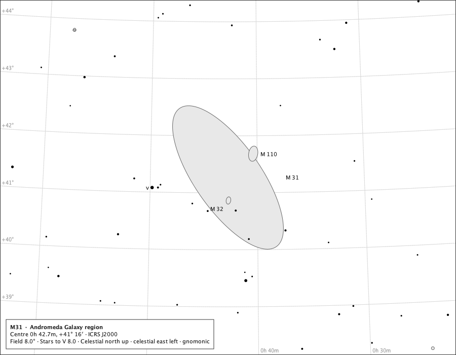

### sparse-lines-8

Sparse: Eridanus on Oslo's meridian at the sample instant, the meridian and the mathematical horizon crossing the page. The box stands in the lower right.

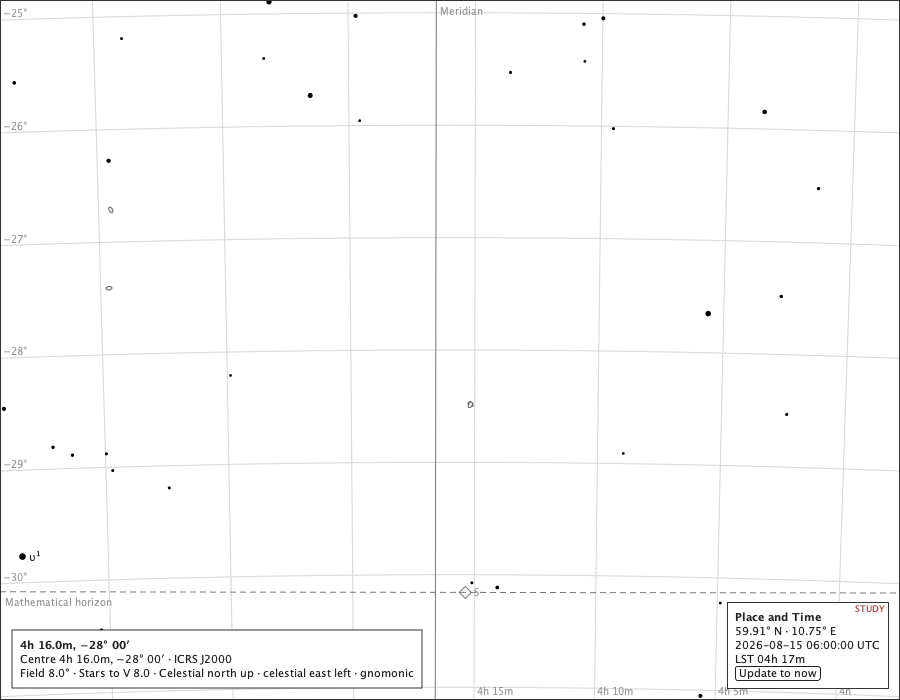

### sparse-lines-8-dark

The same on the black sky. The box stands in the lower right.

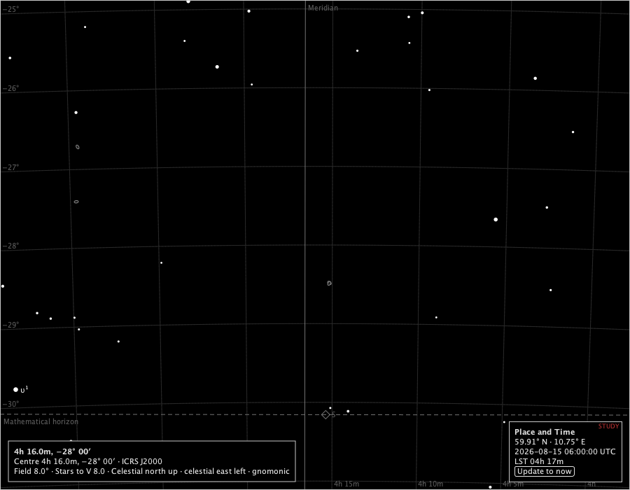

### sparse-lines-8-nb

The same in Norwegian. The box stands in the lower right.

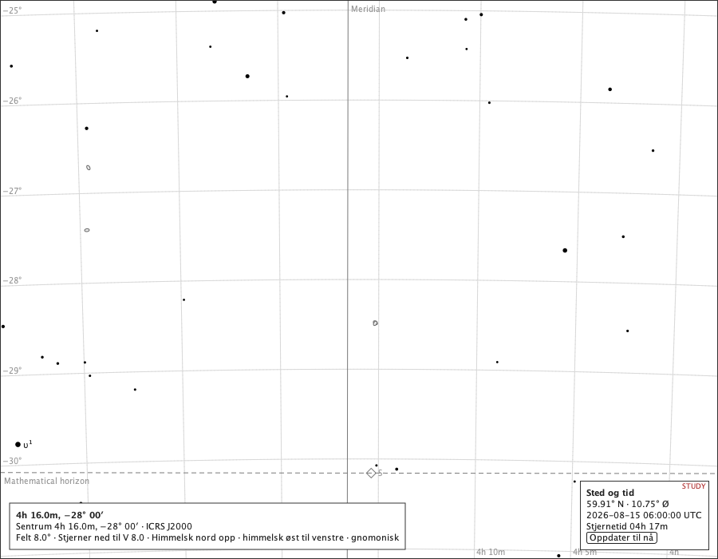

### dense-lines-8

Dense: the Milky Way in Sagittarius with the lines switched on - off this page at the sample instant, so the rule's choice shows. The box stands in the lower right.

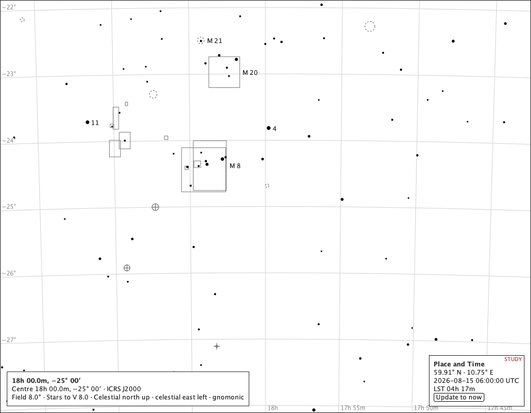

### venus-3

A Solar System body: Venus at the sample instant, 3°, the lines off - the body alone makes the page time-dependent. The box stands in the lower right.

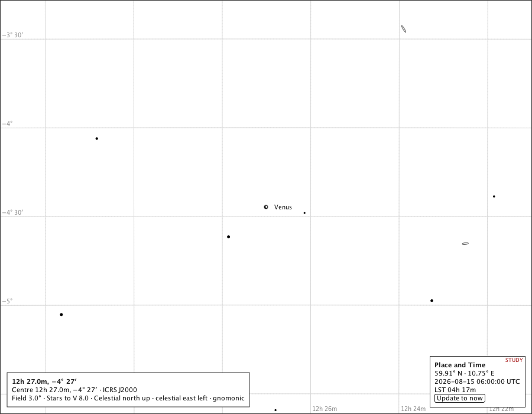

### wide-lines-60

Wide: a 60° overview page with the lines on. The box stands in the lower right.

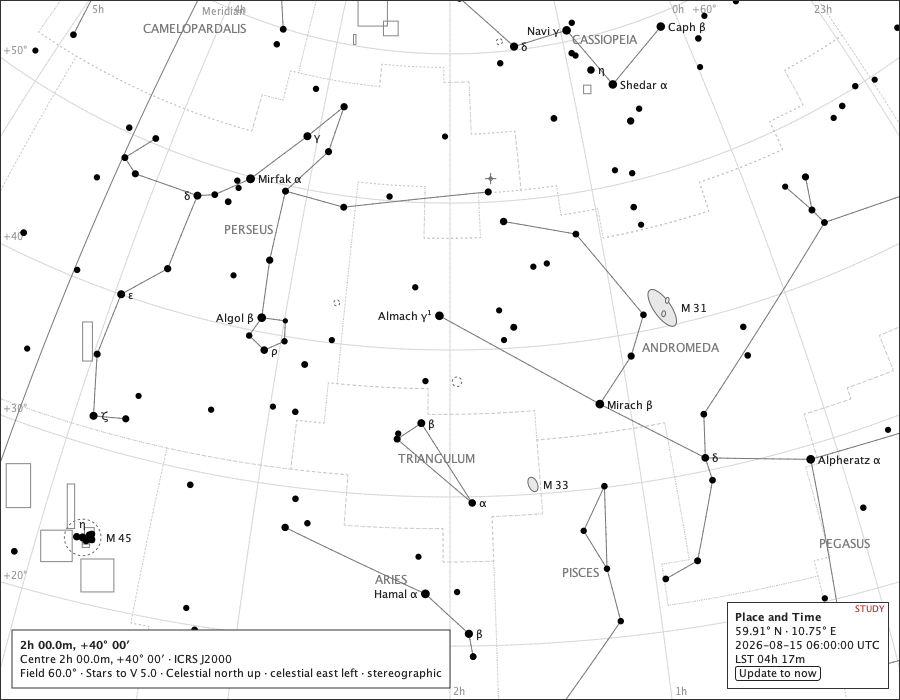

### narrow-lines-8

Narrow: a 520 px wide window. The box stands in the upper right.

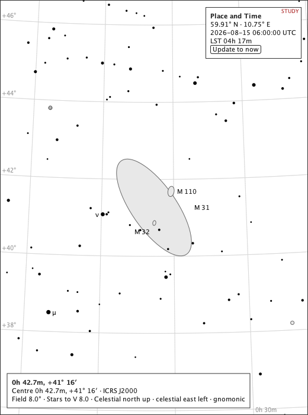

### polar-lines-8

Polar: centred two degrees from the celestial pole. The box stands in the lower right.

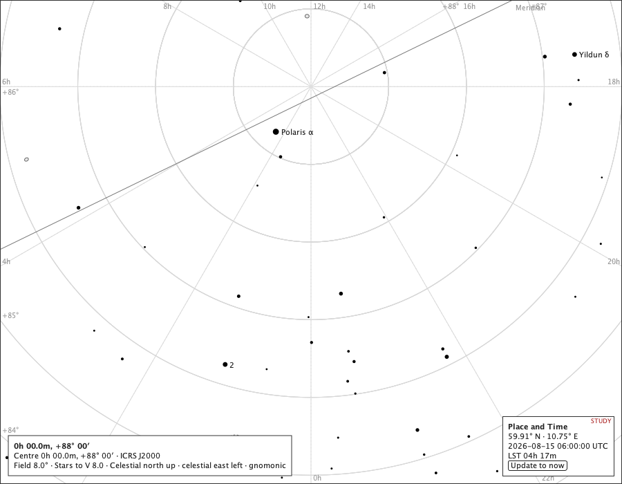

### globe-lines-180

The celestial globe with the lines on. The box stands in the lower right.

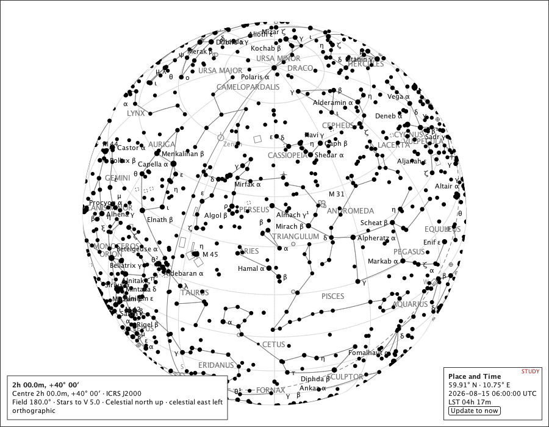

### letterbox-lines-120

Letterboxed: a 120° overview page in a tall 600 × 1900 window, the page shorter than the component. The box stands in the upper right. The page is letterboxed: 1697 px tall in a 1900 px window.

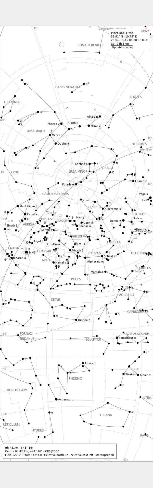

## 3. The exported sheet

On paper the action cannot be pressed, so it is not drawn: the box keeps the observer, the instant and the sidereal time, and says the page is frozen there. The sheet's description would carry the same sentence (section 5 of the decision).

| line | on paper (English) |
|---|---|
| 1 | Place and Time |
| 2 | 59.91° N · 10.75° E |
| 3 | 2026-08-15 06:00:00 UTC |
| 4 | LST 04h 17m |
| 5 | The chart is frozen at this instant. |

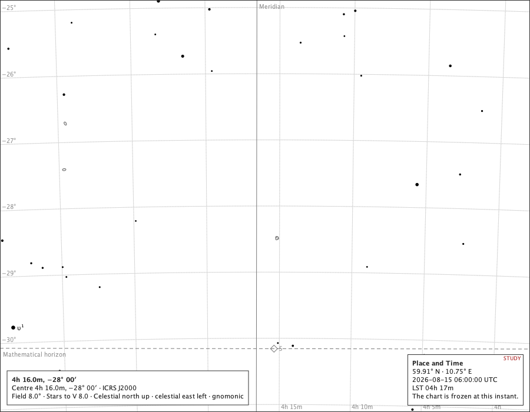

## 4. The panels, schematic

Not photographs: schematic drawings of the proposal for a Solar System group in the Controller, in the order the rows would stand. Today a group's observer note shows the observer read at its last Compute, with *Update from Place and Time* last in the group; nothing says when that differs from the chart. Proposed: an agreement line at the top of every group, read from Place and Time whenever it changes - never recomputing on its own - with the update action beside it.

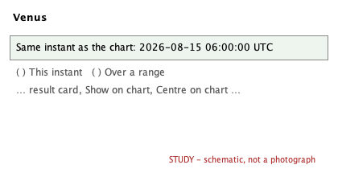

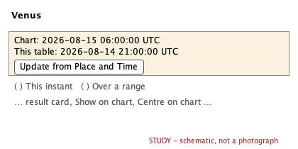

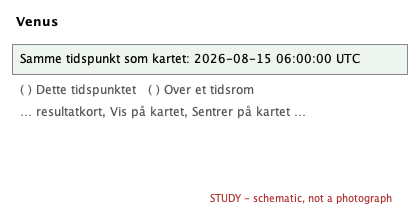

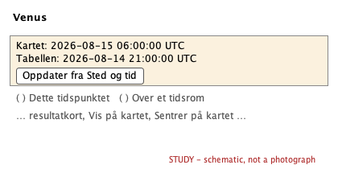

## 5. The laptop Controller and the external chart, schematic

The arrangement the owner works in: the Controller on the laptop's screen, the chart on an external monitor. Proposed: the chart's box carries the instant where the page is read, and the Controller's Solar System tab opens with one line naming the chart's instant and offering *Update to now*, so a reader at the laptop never has to visit the Chart tab to learn what the chart is frozen at.

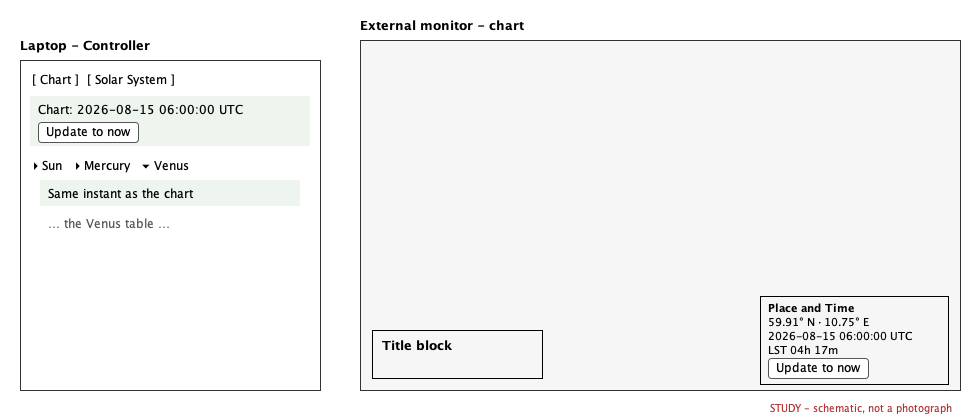

