# The closer fields' foundations

Sprint 50, issue #543 (part of #481). The four foundations ruling 5 on #539 requires before any surface offers 0.5° or 0.25°, proven on production pages: the production `ChartComponent` over the bundled catalogue, set to a state at the field. The view state now holds the two closer fields, but its zoom-in still stops at 1°; nothing a reader can press reaches them until #544. The instants are the cited rows in `docs/studies/mercury/mercury-events.txt` and `docs/studies/venus/venus-events.txt`; positions are the services' for Oslo at sea level. Where names and grid figures found room is in `platform.md`. Regenerate with `make closer-fields-study`.

## 1. The field's words on every surface

The ladder's forms are unchanged - one decimal in the title block and the spoken description, whole degrees in the toolbar, the export's description and its file name - and a closer field prints to its own precision in all of them (`FieldWidthText`). The Pleiades, V 8.0.

| field | title block (en) | title block (nb-NO) | spoken | toolbar | export description | file name | view report |
|---:|---|---|---|---|---|---|---|
| 1° | Field 1.0° | Felt 1.0° | Field 1.0 degrees wide, gnomonic projection. | Field 1° · Stars to V 8.0 | Field 1 degrees wide, gnomonic. | `juranometria-3h-47-0m-24-07-1deg.png` | `field-degrees: 1.0` |
| 0.5° | Field 0.5° | Felt 0.5° | Field 0.5 degrees wide, gnomonic projection. | Field 0.5° · Stars to V 8.0 | Field 0.5 degrees wide, gnomonic. | `juranometria-3h-47-0m-24-07-0.5deg.png` | `field-degrees: 0.5` |
| 0.25° | Field 0.25° | Felt 0.25° | Field 0.25 degrees wide, gnomonic projection. | Field 0.25° · Stars to V 8.0 | Field 0.25 degrees wide, gnomonic. | `juranometria-3h-47-0m-24-07-0.25deg.png` | `field-degrees: 0.25` |

## 2. The grid's finer steps

The ladder's finest steps (1m of time, 15′ of arc) are a page apart at a closer field. Below the floor the same spacing rule (at least 110 px between lines at the page centre) is offered 15s and 30s of time and 2′, 5′ and 10′ of arc first; a ladder page never is, so no released grid moves. Meridians and parallels counted on the page; their figures' placement is in `platform.md`.

| field | RA step | Dec step | meridians | parallels |
|---:|---|---|---:|---:|
| 1° | 1m | 15′ | 5 | 4 |
| 0.5° | 30s | 5′ | 5 | 4 |
| 0.25° | 15s | 2′ | 5 | 6 |

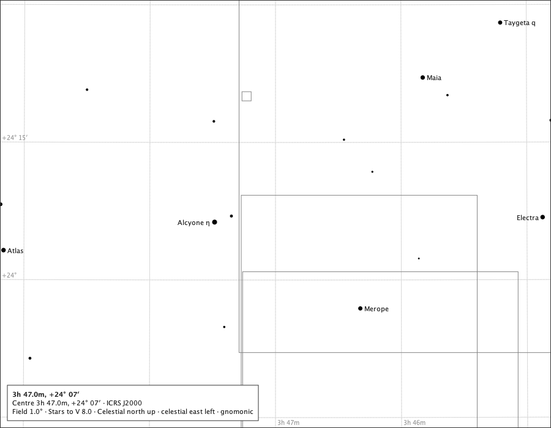

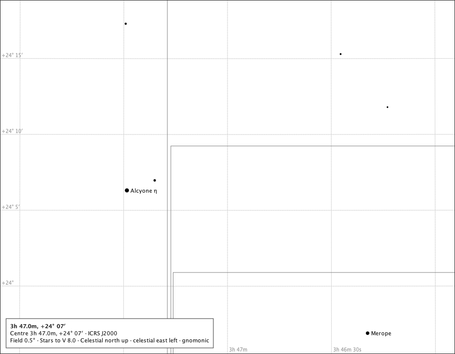

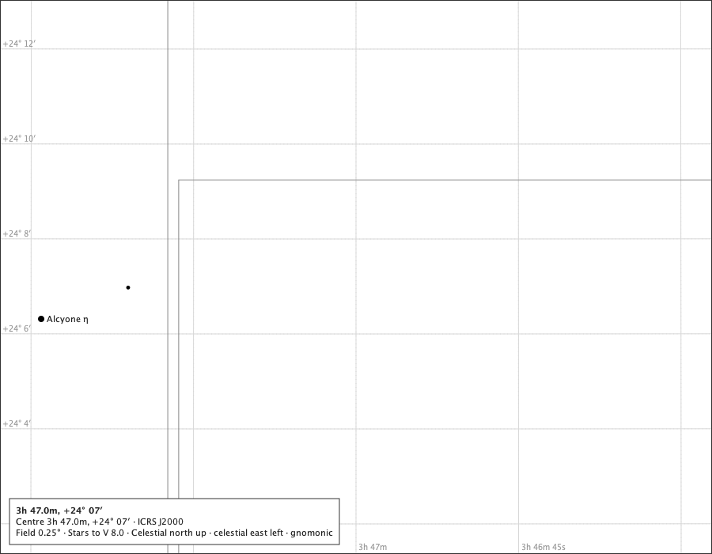

## 3. The catalogue at the page's own field

The #539 study drew its closer pages from the 1° page's stars. Production asks the catalogue for the closer page itself: its own corners plus the catalogue's object margin, about its own centre. Stars returned by that query, and those of them that land on the page.

| page | field | stars queried | stars on the page |
|---|---:|---:|---:|
| the Pleiades | 1° | 156 | 17 |
| the Pleiades | 0.5° | 149 | 6 |
| the Pleiades | 0.25° | 142 | 2 |

## 4. Mercury and Venus at the closer fields

### 4.1 Mercury at its 2026 greatest eastern elongation, 2026-02-19T18:00:00Z, Oslo

Centred on the body; rule M's mark is 6 px, and the true disc takes over where it is the larger.

| field | stars queried | stars on the page | drawn |
|---:|---:|---:|---|
| 1° | 93 | 1 | Mercury symbol 6.0 px |
| 0.5° | 85 | 0 | Mercury symbol 6.0 px |
| 0.25° | 78 | 0 | Mercury disc 7.2 px |

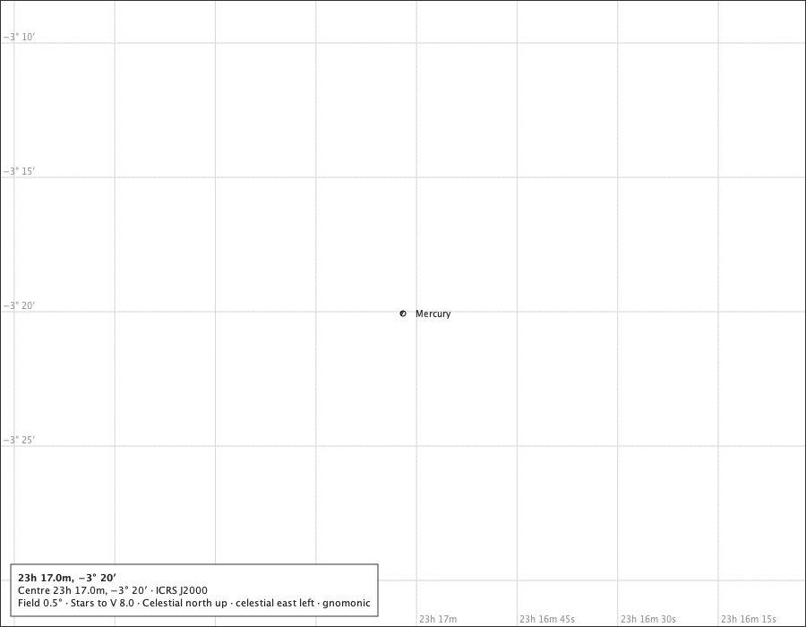

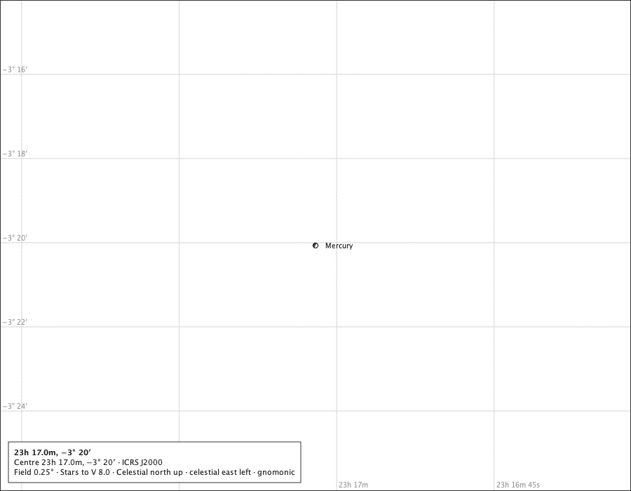

### 4.2 Venus three weeks before its 2026 inferior conjunction, 2026-10-03T03:00:00Z, Oslo

Centred on the body; rule M's mark is 6 px, and the true disc takes over where it is the larger.

| field | stars queried | stars on the page | drawn |
|---:|---:|---:|---|
| 1° | 79 | 1 | Venus disc 12.4 px |
| 0.5° | 69 | 0 | Venus disc 24.8 px |
| 0.25° | 66 | 0 | Venus disc 49.6 px |

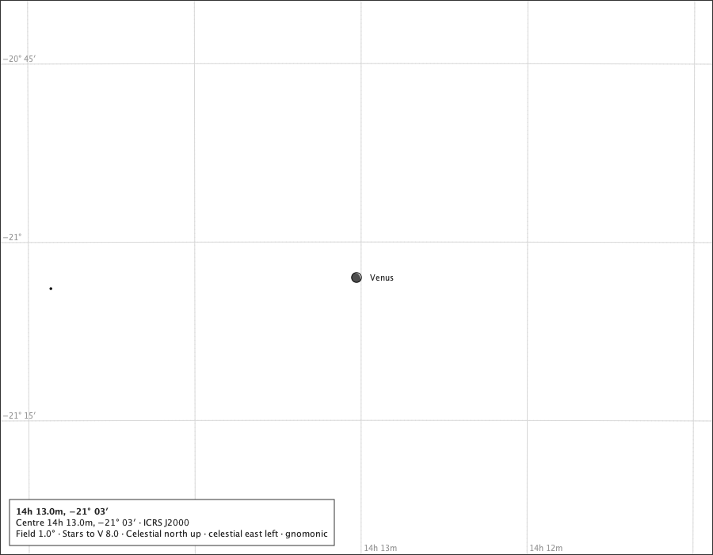

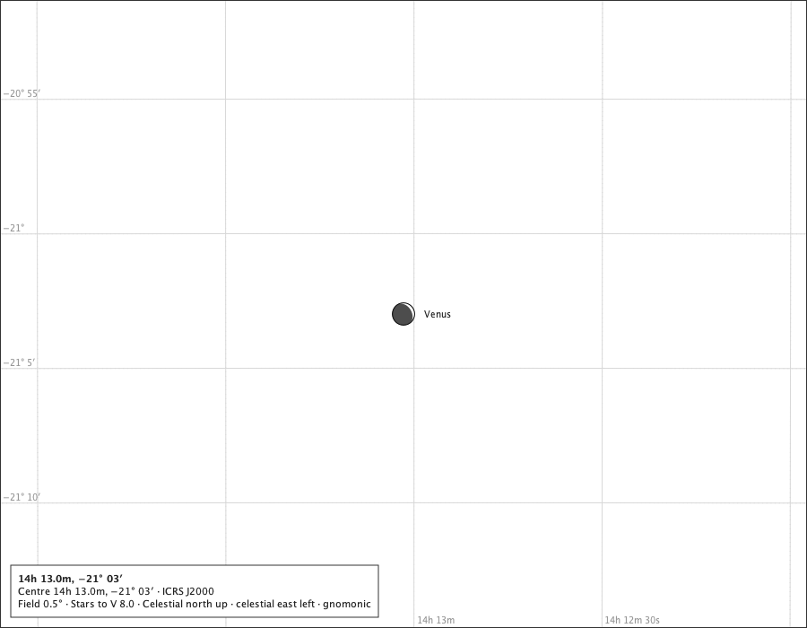

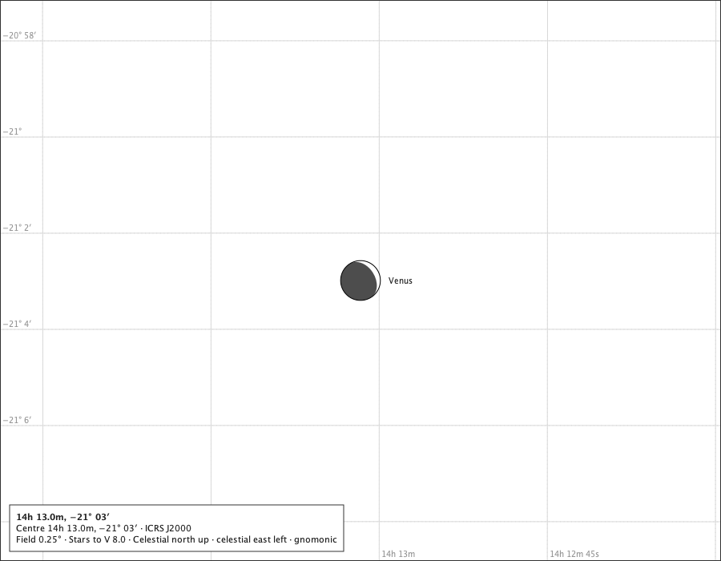

### 4.3 The 2019 transit of Mercury, greatest transit, 2019-11-11T15:20:00Z, Oslo

Centred on the body; rule M's mark is 6 px, and the true disc takes over where it is the larger. For #544: at 0.25° the page lies wholly inside the Sun's disc - its ring is off the page and its ground is the page's - so what reads is Mercury and the Sun's centre dot, capped by #541; nothing on the page itself says the reader is looking at the Sun.

| field | stars queried | stars on the page | drawn |
|---:|---:|---:|---|
| 1° | 96 | 1 | Sun disc 484.4 px; Mercury symbol 6.0 px, mercury.inFront |
| 0.5° | 83 | 0 | Sun disc 968.9 px; Mercury symbol 6.0 px, mercury.inFront |
| 0.25° | 77 | 0 | Sun disc 1937.8 px; Mercury disc 10.0 px, mercury.inFront |

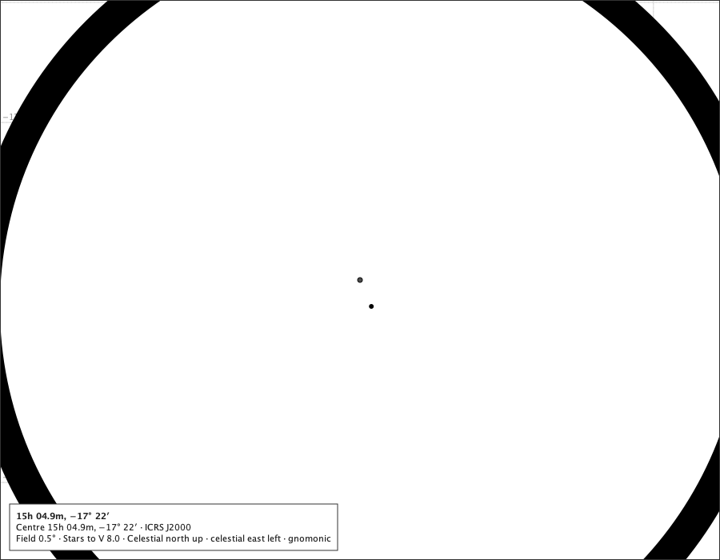

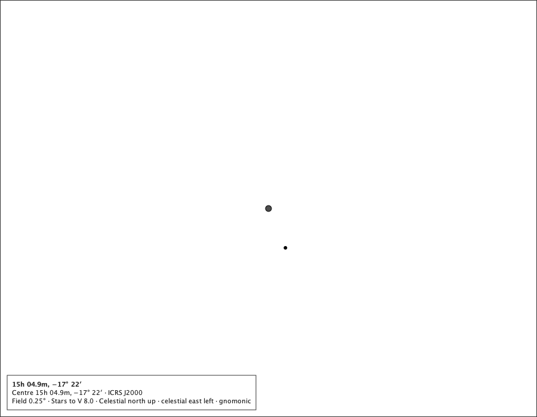

## 5. Zoom from a closer field, and what is kept

The same controller calls the toolbar, the View menu, the shortcuts and the wheel make. From a state at 0.25°: zoom in is unavailable - the ladder's zoom-in is never the closer step - and zoom out walks back through 0.5° to the floor and up the ladder, the centre and the reader's limit carried.

| step | field | toolbar | zoom in | zoom out | wheel in at a pointer |
|---|---:|---|---|---|---|
| start | 0.25° | Field 0.25° · Stars to V 8.0 | unavailable | available | AT_BOUND |
| zoom out | 0.5° | Field 0.5° · Stars to V 8.0 | unavailable | available | AT_BOUND |
| zoom out | 1° | Field 1° · Stars to V 8.0 | unavailable | available | AT_BOUND |
| zoom out | 2° | Field 2° · Stars to V 8.0 | available | available | a ladder step |

Nothing persists the view: a new controller - every start - opens at the released default, 8° on M31 (held), so a closer field is never saved.

## 6. The exported sheet at 0.25°

Mercury's 2026 greatest eastern elongation at 0.25°, recorded by `ChartSheet` with the screen's own reference and bodies layers (`SheetInk`), A4, written at 150 dpi for the record. It says of itself:

> 23h 17.0m, −3° 20′. Centre RA 349.2584, Dec -3.3344 (ICRS/J2000). Field 0.25 degrees wide, gnomonic. Stars to V 8.0. A4 landscape, 297.0 x 210.0 mm, 12.7 mm margins, chart 271.6 x 184.6 mm. Ground: white-paper.

and would be offered as `juranometria-23h-17-0m-3-20-0.25deg.png`.

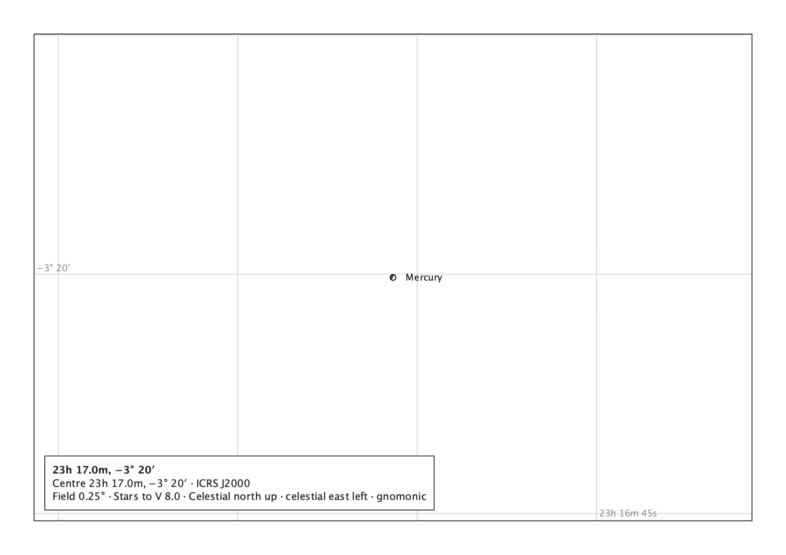

