# Complete figures under an absolute stellar limit: the measurements

Sprint 58, issue #571, road #698 - the owner's amended direction of 2026-11-07: *complete constellation figures; absolute stellar magnitude limit; no exceptional anchor stars.* No production behaviour changes. Each page is painted by the production renderer **as built** (today: a star a visible figure is drawn to is kept however faint, #307) and **as proposed** (the same page with every star fainter than its limit removed from the scene before painting, so nothing faint can be kept while the figure lines, drawn from the stored geometry, stay complete). Regenerate with `make complete-figures-study`.

A *hidden endpoint* is a figure endpoint on the paper with no star drawn at it. *Mistakable* counts hidden endpoints with an unrelated drawn star within 6 px, which a reader might take for the node. *Click selects a star* counts hidden endpoints where a click, through the production hit test, selects a star.

## 1. The pages, as built and as proposed

| page | limit | endpoints on paper | with a star, as built | with a star, as proposed | segments with one / two hidden ends | faint stars kept today (faintest) | mistakable | click selects a star, as built / as proposed |
|---|---:|---:|---:|---:|---:|---:|---:|---:|
| orion-60 | V 5.0 | 72 | 72 | 72 | 0 / 0 | 0 | 0 | 0 / 0 |
| orion-90 | V 4.0 | 121 | 121 | 78 | 37 / 22 | 43 (V 4.88) | 0 | 43 / 0 |
| orion-120 | V 4.0 | 190 | 190 | 114 | 59 / 40 | 76 (V 6.54) | 1 | 76 / 1 |
| ursa-major-120 | V 4.0 | 147 | 147 | 91 | 41 / 29 | 58 (V 6.58) | 0 | 56 / 1 |
| globe | V 5.0 | 373 | 373 | 352 | 21 / 8 | 22 (V 6.54) | 4 | 21 / 6 |

### orion-60

Orion on the 60° overview, at its default limit. As built, 0 stars are drawn fainter than the page's limit of V 5.0 because a figure ends on them; as proposed, none is, and 0 endpoints show the line meeting the sky with no node.

| as built | as proposed |
|---|---|
|  | 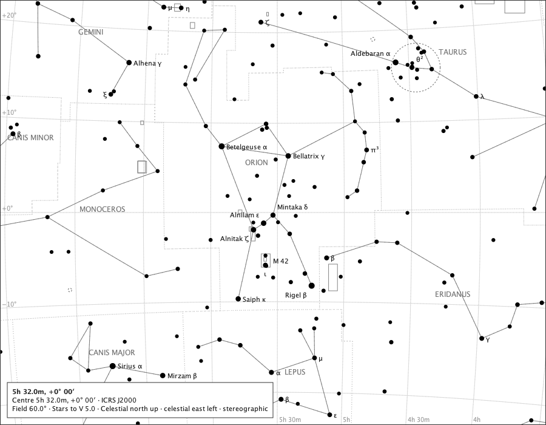 |

### orion-90

Orion on the 90° overview, at its default limit. As built, 43 stars are drawn fainter than the page's limit of V 4.0 because a figure ends on them; as proposed, none is, and 43 endpoints show the line meeting the sky with no node.

| as built | as proposed |
|---|---|
| 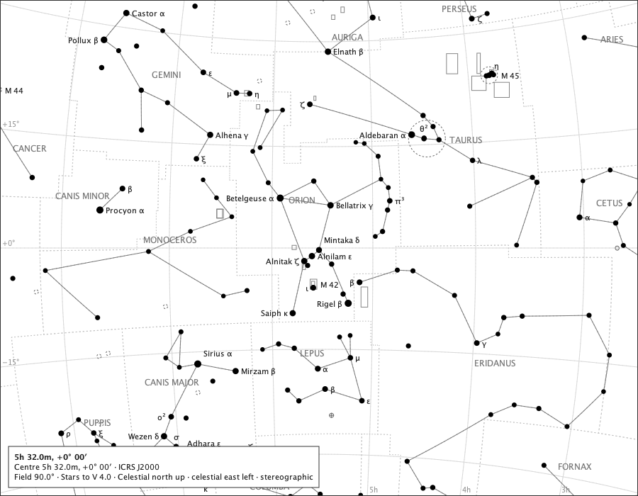 |  |

### orion-120

Orion on the 120° overview, at its default limit. As built, 76 stars are drawn fainter than the page's limit of V 4.0 because a figure ends on them; as proposed, none is, and 76 endpoints show the line meeting the sky with no node.

| as built | as proposed |
|---|---|
| 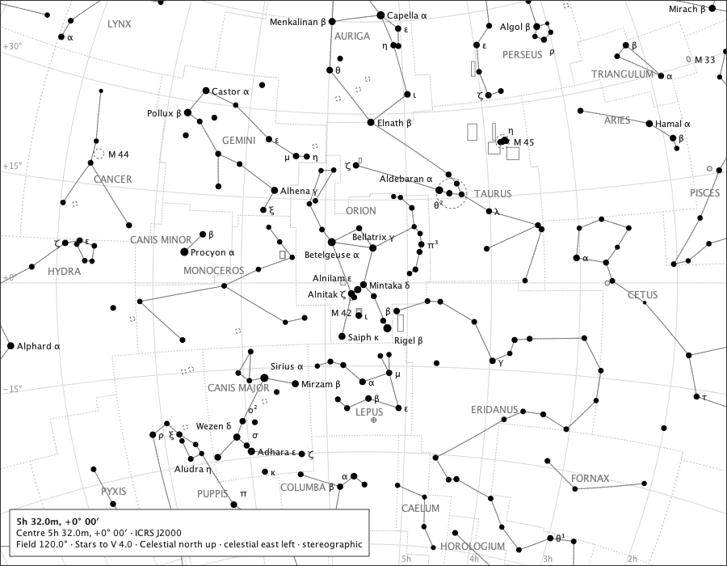 |  |

### ursa-major-120

Ursa Major on the 120° overview, at its default limit. As built, 58 stars are drawn fainter than the page's limit of V 4.0 because a figure ends on them; as proposed, none is, and 56 endpoints show the line meeting the sky with no node.

| as built | as proposed |
|---|---|
| 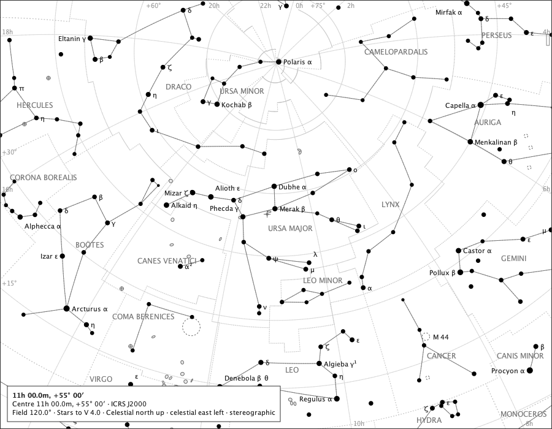 | 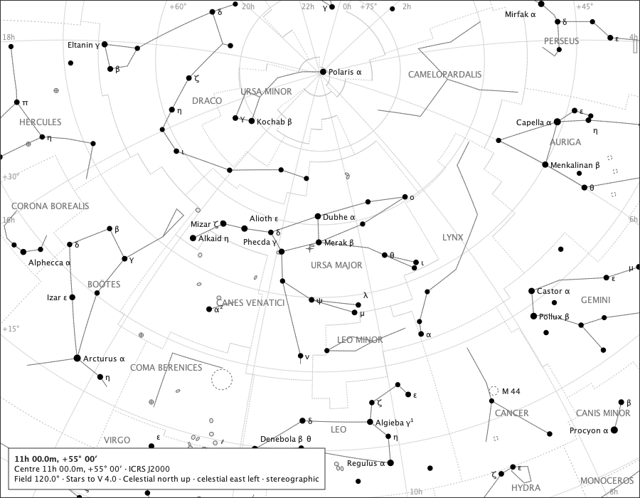 |

### globe

The celestial globe over Orion, at its default limit. As built, 22 stars are drawn fainter than the page's limit of V 5.0 because a figure ends on them; as proposed, none is, and 21 endpoints show the line meeting the sky with no node.

| as built | as proposed |
|---|---|
| 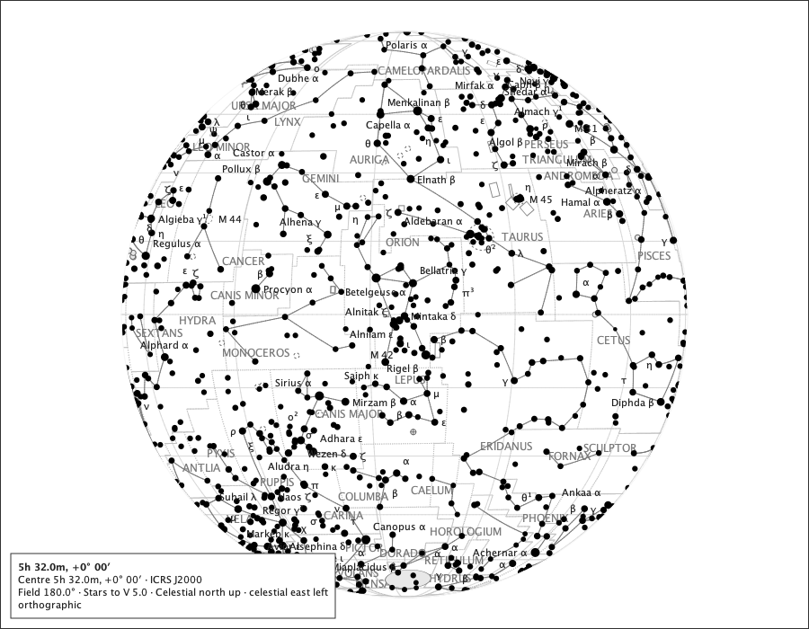 | 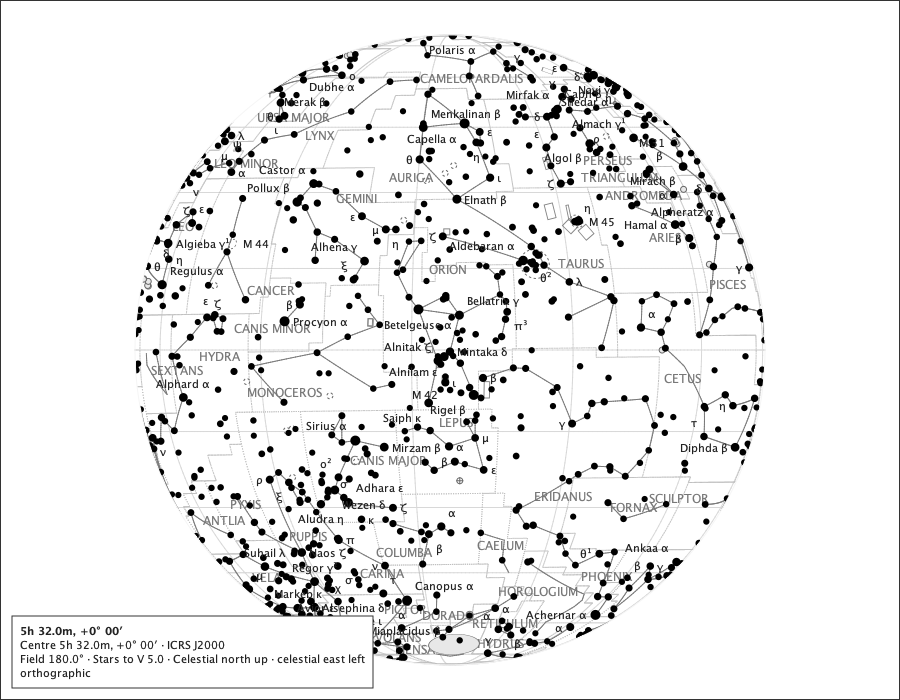 |

## 2. Raising the limit, as proposed

Orion at 120°, the reader pressing **+** from V 4 to V 7: each step admits stars through the ordinary stellar path, and endpoints gain their nodes.

| limit | endpoints with a star | hidden endpoints |
|---:|---:|---:|
| V 4.0 | 114 | 76 |
| V 5.0 | 186 | 4 |
| V 6.0 | 189 | 1 |
| V 7.0 | 190 | 0 |

| V 4.0 | V 5.0 | V 6.0 | V 7.0 |
|---|---|---|---|
| 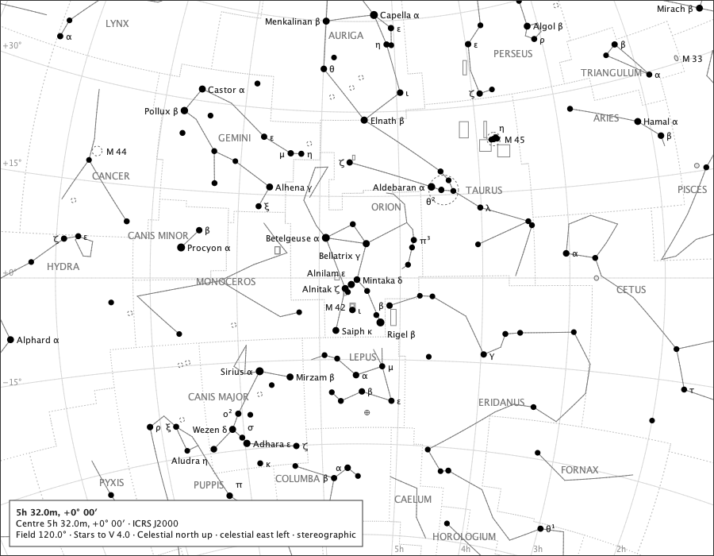 | 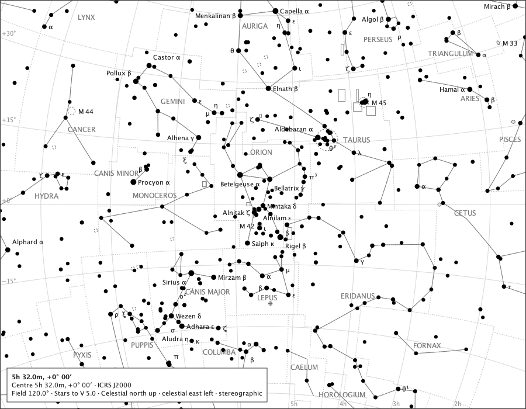 | 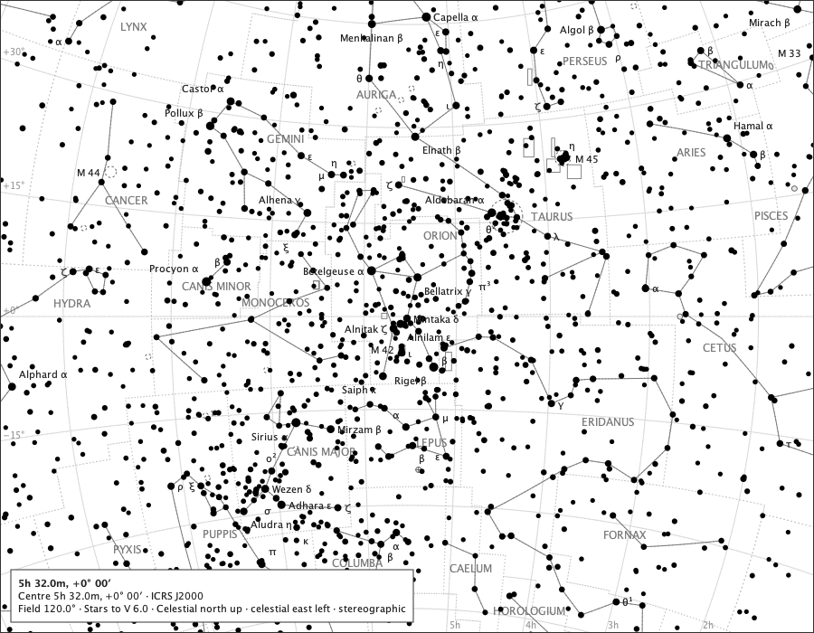 | 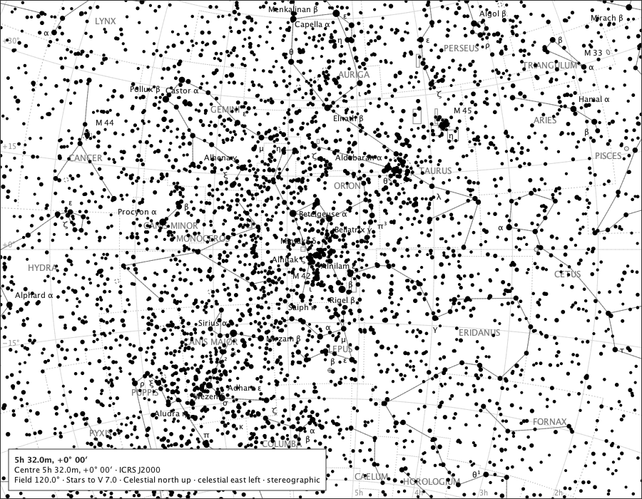 |

## 3. Emphasis on the figures, as proposed

Orion at 90° with the constellation figures raised by Emphasis: the raised lines reach the hidden endpoints exactly as the ordinary lines do.

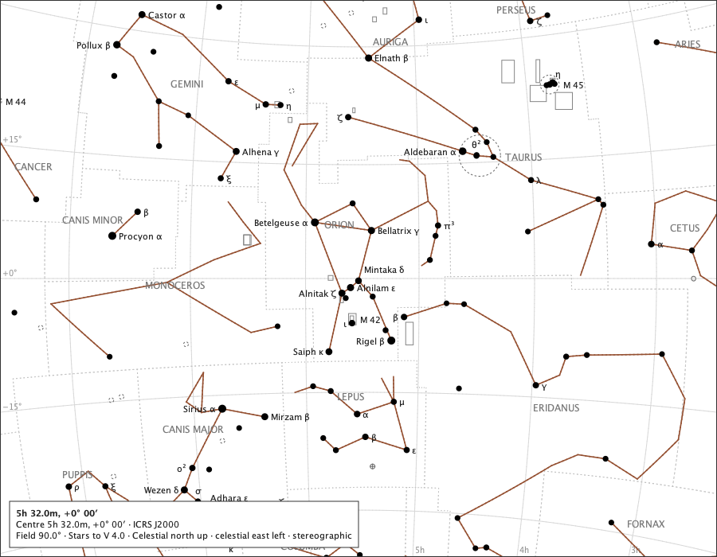

## 4. Below a horizon, as proposed

Orion at 90° with Subdue below horizon on, the zenith placed at RA 83°, Dec +60° (a placement for the study, not an observer): the lines are subdued below the horizon by the ordinary rule, hidden endpoints or not.

## 5. What the page says

The page's spoken description, as built and as proposed, is the same: "5h 32.0m, +0° 00′. Centre RA 83.0000, Dec +0.0000 (ICRS J2000). Field 120.0 degrees wide, stereographic projection. Stars to V 4.0. Celestial north is up, and celestial east is left." Neither names the figures' hidden endpoints; whether the page should say how many there are is the owner's question (decision record, choice D-4).

## 6. The magnitude key and paper, as proposed

Orion at 120°, limit V 4.0: the faintest drawn star is V 6.54 as built and V 4.00 as proposed - within the limit the key states.

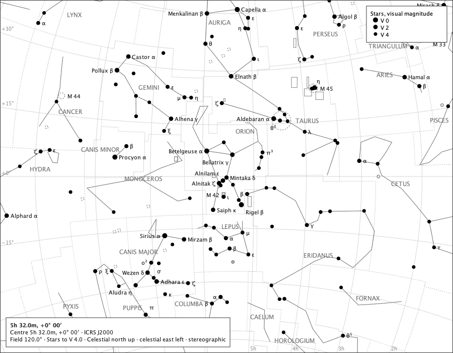

The same page on A4, as proposed: the lines complete, no star beyond the limit.

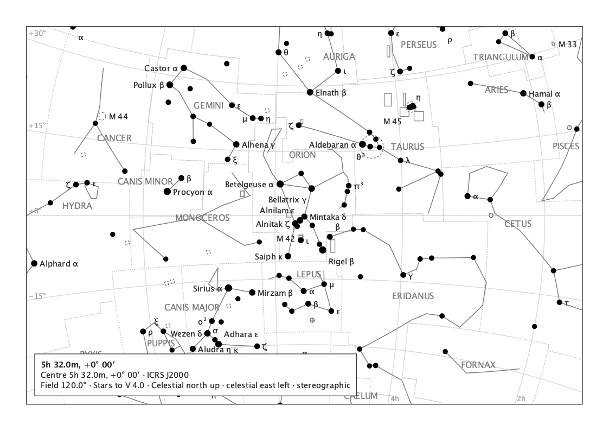

## 7. What the proposal changes, and does not

- **The magnitude limit becomes literally true**: as proposed, no drawn star on any page above is fainter than its limit (section 6), and the magnitude key's promise holds.
- **The figure lines do not move**: they are drawn from the stored figure geometry; both paintings carry the same lines.
- **A hidden endpoint is nothing to click**: as built, a click there selects the kept faint star; as proposed, it selects no star (table, last column), unless an ordinary drawn star is itself within reach.
- **Raising the limit admits each node through the ordinary stellar path**, mark, identity and label policy alike (section 2).
- **Turning figures off changes only the lines**: as proposed, the star population is the same with figures on or off; as built, turning figures off drops the kept faint stars.

