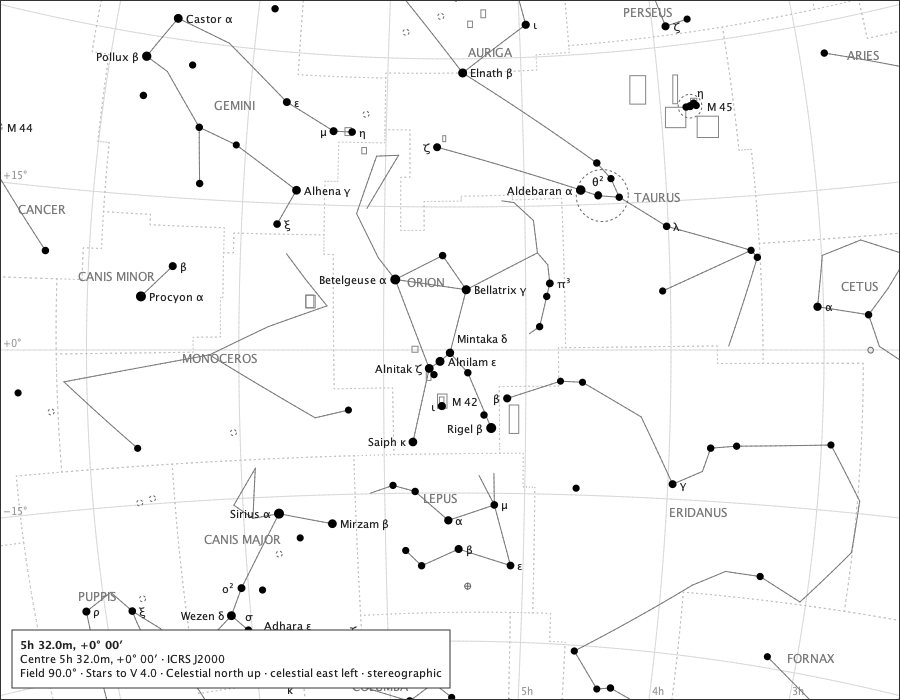

# Complete figures under an absolute stellar limit: the measurements

Sprint 58, issue #571, road #698, ruled D-1 to D-7 (`docs/decisions/complete-figures.md`): *complete constellation figures; absolute stellar magnitude limit; no exceptional anchor stars.* Every page is painted by the production renderer. Regenerate with `make complete-figures-study`.

A *hidden endpoint* is a figure endpoint on the paper with no star drawn at it. *Mistakable* counts hidden endpoints with an unrelated drawn star within 6 px, which a reader might take for the node. *Click selects a star* counts hidden endpoints where a click, through the production hit test, selects a star, which only an ordinary drawn star within reach can do. *Report* is the view report's `figure-endpoints-below-limit` count, which leaves out endpoints under the page's frame and those with no star in the pack.

## 1. The pages

| page | limit | endpoints on paper | with a star | segments with one / two hidden ends | stars drawn beyond the limit | mistakable | click selects a star | report |
|---|---:|---:|---:|---:|---:|---:|---:|---:|
| orion-60 | V 5.0 | 72 | 72 | 0 / 0 | 0 | 0 | 0 | 0 |
| orion-90 | V 4.0 | 121 | 78 | 37 / 22 | 0 | 0 | 0 | 42 |
| orion-120 | V 4.0 | 190 | 114 | 59 / 40 | 0 | 1 | 1 | 75 |
| ursa-major-120 | V 4.0 | 147 | 91 | 41 / 29 | 0 | 0 | 1 | 55 |
| globe | V 5.0 | 373 | 352 | 21 / 8 | 0 | 4 | 6 | 21 |

Before #571 the same pages kept every such star, however faint: 43 on Orion at 90° (to V 4.88), 76 on Orion at 120° (to V 6.54), 58 on Ursa Major at 120° (to V 6.58) and 22 on the globe (to V 6.54), each selectable by a click. Those paintings stand side by side in this report at commit `f593dd5a`.

### orion-60

Orion on the 60° overview, at its default limit.

### orion-90

Orion on the 90° overview, at its default limit.

### orion-120

Orion on the 120° overview, at its default limit.

### ursa-major-120

Ursa Major on the 120° overview, at its default limit.

### globe

The celestial globe over Orion, at its default limit.

## 2. Raising the limit

Orion at 120°, the reader pressing **+** from V 4 to V 7: each step admits stars through the ordinary stellar path, and endpoints gain their nodes.

| limit | endpoints with a star | hidden endpoints |
|---:|---:|---:|
| V 4.0 | 114 | 76 |
| V 5.0 | 186 | 4 |
| V 6.0 | 189 | 1 |
| V 7.0 | 190 | 0 |

| V 4.0 | V 5.0 | V 6.0 | V 7.0 |
|---|---|---|---|
|  |  |  |  |

## 3. Emphasis on the figures

Orion at 90° with the constellation figures raised by Emphasis: the raised lines reach the hidden endpoints exactly as the ordinary lines do.

## 4. Below a horizon

Orion at 90° with Subdue below horizon on, the zenith placed at RA 83°, Dec +60° (a placement for the study, not an observer): the lines are subdued below the horizon by the ordinary rule, hidden endpoints or not.

## 5. What the page says

The page's spoken description names the limit and not the stars: "5h 32.0m, +0° 00′. Centre RA 83.0000, Dec +0.0000 (ICRS J2000). Field 120.0 degrees wide, stereographic projection. Stars to V 4.0. Celestial north is up, and celestial east is left." Hidden endpoints are not spoken (D-4); the count stands only in the view report, when it is not zero.

## 6. The magnitude key and paper

Orion at 120°, limit V 4.0: the faintest drawn star is V 4.00 - within the limit the key states.

The same page on A4: the lines complete, no star beyond the limit.

## 7. Figures on and off

Orion at 120°: the stars drawn with the figures on and off are the same 139 stars; switching the figures changes only the lines.

