# Guide the chart and explain the selection: the measurements

Sprint 57, issue #690, road #689. A measured study: it changes no production behaviour. Every pan below is solved by the production grab solver and every page is drawn by the production chart; the drag modes and the box's words are the study's proposal (`docs/decisions/guide-and-explain.md`). Sizes that depend on this desktop's fonts are in `platform.md`. Regenerate with `make guide-and-explain-study`.

## 1. Pointer navigation, through the production solver

Each gesture starts at the page centre of a 900 × 700 px page and passes 20 waypoints - the straight line to its end with a hand's wobble of ±12 px across it - solved one by one against the press-time grab exactly as production's drag solves them. *Grab off target* is how far the grabbed sky ends from the pixel the mode asked for, to the hundredth of a pixel. *Probe* is a star that stood 200 px above the press: how far it ends up moved vertically, and horizontally, on the page. *Modifier* is a free drag with the proposed modifier held: the axis is decided at the first movement of at least 4 px, from its larger component, and kept for that drag.

| page | gesture | mode | Δα (°) | Δδ (°) | grab off target (px) | probe ↕ (px) | probe ↔ (px) | solves | held at a pole | refused |
|---|---|---|---:|---:|---:|---:|---:|---:|---:|---:|
| m42-8 | mostly across | free | 1.788 | 0.264 | 0.00 | 29.9 | 200.6 | 20 | 0 | 0 |
| m42-8 | mostly across | horizontal | 1.788 | -0.003 | 0.00 | -0.1 | 200.6 | 20 | 0 | 0 |
| m42-8 | mostly across | vertical | 0.000 | 0.267 | 0.00 | 30.0 | 0.0 | 20 | 0 | 0 |
| m42-8 | mostly across | locked | 0.000 | 0.000 | 0.00 | 0.0 | 0.0 | 0 | 0 | 0 |
| m42-8 | mostly across | modifier (horizontal) | 1.788 | -0.003 | 0.00 | -0.1 | 200.6 | 20 | 0 | 0 |
| m42-8 | mostly up | free | 0.179 | -1.602 | 0.00 | -180.3 | 20.1 | 20 | 0 | 0 |
| m42-8 | mostly up | horizontal | 0.179 | 0.000 | 0.00 | 0.0 | 20.1 | 20 | 0 | 0 |
| m42-8 | mostly up | vertical | 0.000 | -1.602 | 0.00 | -180.3 | 0.0 | 20 | 0 | 0 |
| m42-8 | mostly up | locked | 0.000 | 0.000 | 0.00 | 0.0 | 0.0 | 0 | 0 | 0 |
| m42-8 | mostly up | modifier (vertical) | 0.000 | -1.602 | 0.00 | -180.3 | 0.0 | 20 | 0 | 0 |
| dec60-8 | mostly across | free | 3.562 | 0.315 | 0.00 | 30.2 | 189.2 | 20 | 0 | 0 |
| dec60-8 | mostly across | horizontal | 3.562 | 0.048 | 0.00 | 0.2 | 189.2 | 20 | 0 | 0 |
| dec60-8 | mostly across | vertical | 0.000 | 0.267 | 0.00 | 30.0 | 0.0 | 20 | 0 | 0 |
| dec60-8 | mostly across | locked | 0.000 | 0.000 | 0.00 | 0.0 | 0.0 | 0 | 0 | 0 |
| dec60-8 | mostly across | modifier (horizontal) | 3.562 | 0.048 | 0.00 | 0.2 | 189.2 | 20 | 0 | 0 |
| dec60-8 | mostly up | free | 0.356 | -1.602 | 0.00 | -180.3 | 18.9 | 20 | 0 | 0 |
| dec60-8 | mostly up | horizontal | 0.356 | 0.000 | 0.00 | 0.0 | 18.9 | 20 | 0 | 0 |
| dec60-8 | mostly up | vertical | 0.000 | -1.602 | 0.00 | -180.3 | 0.0 | 20 | 0 | 0 |
| dec60-8 | mostly up | locked | 0.000 | 0.000 | 0.00 | 0.0 | 0.0 | 0 | 0 | 0 |
| dec60-8 | mostly up | modifier (vertical) | 0.000 | -1.602 | 0.00 | -180.3 | 0.0 | 20 | 0 | 0 |
| polar-8 | mostly across | free | 20.880 | 0.594 | 0.00 | 43.0 | 128.9 | 20 | 0 | 0 |
| polar-8 | mostly across | horizontal | 20.880 | 0.327 | 0.00 | 13.0 | 128.9 | 20 | 0 | 0 |
| polar-8 | mostly across | vertical | 0.000 | 0.267 | 0.00 | 30.0 | 0.0 | 20 | 0 | 0 |
| polar-8 | mostly across | locked | 0.000 | 0.000 | 0.00 | 0.0 | 0.0 | 0 | 0 | 0 |
| polar-8 | mostly across | modifier (horizontal) | 20.880 | 0.327 | 0.00 | 13.0 | 128.9 | 20 | 0 | 0 |
| polar-8 | mostly up | free | 2.043 | -1.599 | 0.00 | -180.2 | 12.9 | 20 | 0 | 0 |
| polar-8 | mostly up | horizontal | 2.044 | 0.003 | 0.00 | 0.1 | 12.9 | 20 | 0 | 0 |
| polar-8 | mostly up | vertical | 0.000 | -1.602 | 0.00 | -180.3 | 0.0 | 20 | 0 | 0 |
| polar-8 | mostly up | locked | 0.000 | 0.000 | 0.00 | 0.0 | 0.0 | 0 | 0 | 0 |
| polar-8 | mostly up | modifier (vertical) | 0.000 | -1.602 | 0.00 | -180.3 | 0.0 | 20 | 0 | 0 |
| overview-60 | mostly across | free | 17.847 | 3.473 | 0.00 | 33.1 | 155.6 | 20 | 0 | 0 |
| overview-60 | mostly across | horizontal | 17.853 | 1.398 | 0.00 | 2.6 | 156.3 | 20 | 0 | 0 |
| overview-60 | mostly across | vertical | 0.000 | 2.047 | 0.00 | 30.4 | 0.0 | 20 | 0 | 0 |
| overview-60 | mostly across | locked | 0.000 | 0.000 | 0.00 | 0.0 | 0.0 | 0 | 0 | 0 |
| overview-60 | mostly across | modifier (horizontal) | 17.853 | 1.398 | 0.00 | 2.6 | 156.3 | 20 | 0 | 0 |
| overview-60 | mostly up | free | 1.761 | -12.224 | 0.00 | -184.9 | 16.1 | 20 | 0 | 0 |
| overview-60 | mostly up | horizontal | 1.781 | 0.014 | 0.00 | 0.0 | 15.7 | 20 | 0 | 0 |
| overview-60 | mostly up | vertical | 0.000 | -12.235 | 0.00 | -184.9 | 0.0 | 20 | 0 | 0 |
| overview-60 | mostly up | locked | 0.000 | 0.000 | 0.00 | 0.0 | 0.0 | 0 | 0 | 0 |
| overview-60 | mostly up | modifier (vertical) | 0.000 | -12.235 | 0.00 | -184.9 | 0.0 | 20 | 0 | 0 |
| globe-180 | mostly across | free | 55.979 | 23.386 | 0.00 | 90.2 | 48.0 | 20 | 0 | 0 |
| globe-180 | mostly across | horizontal | 55.979 | 16.305 | 0.00 | 55.2 | 48.0 | 20 | 0 | 0 |
| globe-180 | mostly across | vertical | 0.000 | 5.465 | 0.00 | 24.1 | 0.0 | 20 | 0 | 0 |
| globe-180 | mostly across | locked | 0.000 | 0.000 | 0.00 | 0.0 | 0.0 | 0 | 0 | 0 |
| globe-180 | mostly across | modifier (horizontal) | 55.979 | 16.305 | 0.00 | 55.2 | 48.0 | 20 | 0 | 0 |
| globe-180 | mostly up | free | 4.754 | -34.833 | 0.00 | -103.2 | 4.8 | 20 | 0 | 0 |
| globe-180 | mostly up | horizontal | 4.754 | 0.097 | 0.00 | 0.3 | 4.8 | 20 | 0 | 0 |
| globe-180 | mostly up | vertical | 0.000 | -34.850 | 0.00 | -103.2 | 0.0 | 20 | 0 | 0 |
| globe-180 | mostly up | locked | 0.000 | 0.000 | 0.00 | 0.0 | 0.0 | 0 | 0 | 0 |
| globe-180 | mostly up | modifier (vertical) | 0.000 | -34.850 | 0.00 | -103.2 | 0.0 | 20 | 0 | 0 |

Read across a row: under *horizontal* the grabbed sky stays exactly on the press row (the wobble is gone), yet the probe star 200 px above it still moves up or down the page wherever the page's north-up grid is not parallel to the screen's rows - most at the polar page, the overview and the globe. A horizontal-only drag keeps a *screen row*, never a parallel of declination, and never the ecliptic or the equator. *Locked* never pans. *Held at a pole* counts waypoints the solver held to its feasibility boundary near a pole - the production rule, unchanged by any mode.

### How the modifier decides its axis

| first movement past the threshold (px) | axis |
|---|---|
| (5, 4) | horizontal |
| (4, 5) | vertical |
| (3, 3) | horizontal |
| (-6, 2) | horizontal |
| (1, -7) | vertical |
| (-4, -4) | horizontal |

A tie goes to horizontal. The axis is decided once; a drag that turns later keeps the axis it started with, so the reader is never surprised mid-gesture.

## 2. The shortcut and modifier inventory

Every keystroke the application binds (`Shortcuts.all()`), written portably: *Menu* is Command on macOS and Ctrl elsewhere.

| id | label | keys |
|---|---|---|
| export | Export chart sheet | Menu+E |
| inspector | Inspector | Menu+I |
| zoomIn | Zoom in | Menu+= |
| zoomOut | Zoom out | Menu+- |
| chartToolbar | Chart toolbar | Menu+Shift+T |
| CoordinatesDialog | Centre on coordinates | Menu+L |
| AddBookmarkDialog | Add bookmark | Menu+D |
| BookmarksPanel | Show bookmarks | Menu+Shift+B |

The chart keyboard (Menu+K, then one letter) uses B C D E F G H I J K L M N O P R S T U W Y; the letters still free are A Q V X Z.

On the chart itself, as read from the code: a press with the menu modifier adds to the selection (`SelectInteraction.toggleModifierMask`); the drag ignores every modifier, so a menu-modifier drag pans today; Shift and Alt (Option) have no meaning on the chart, the secondary button pans nothing and opens nothing, and the wheel ignores modifiers. There is no keyboard panning at all, so a pointer-only rule leaves no keyboard path to reconcile.

## 3. The field ladder and its projections

Read from the production controller by zooming out from its narrowest ordinary field to its widest; the projection is a property of the field (`ChartProjection.forField`). Every field pans through the one drag path, so a drag mode applies to all of them unless a ruling says otherwise.

| projection | fields |
|---|---|
| gnomonic | 1°, 2°, 3°, 4°, 6°, 8°, 12°, 18°, 24°, 36°, 42° |
| stereographic | 60°, 90°, 120° |
| orthographic | 180° |

## 4. The proposed Pointer navigation section

A sketch, not production: the Controller's own collapsible section (`CompanionSection`) holding four exclusive choices and one sentence, at the companion's default width of 360 px. *Free* is chosen, as it would be at every start.

| words | English | Norwegian (for the owner's review) |
|---|---|---|
| section | Pointer navigation | Navigering med pekeren |
| free | Free | Fri |
| horizontal | Horizontal only | Bare vannrett |
| vertical | Vertical only | Bare loddrett |
| locked | Locked | Låst |
| hint | Dragging moves the page across or up and down the screen, not along a line in the sky. Hold Shift while you drag to keep that one drag to its main direction. | Når du drar, flyttes siden bortover eller opp og ned på skjermen, ikke langs en linje på himmelen. Hold Skift mens du drar for å holde det ene draget i hovedretningen. |
| locked.explain | Dragging does not move the chart; clicking still selects. | Å dra flytter ikke kartet; et klikk velger fortsatt. |
| time | for {0} UTC | for {0} UTC |
| magnitude.visual | V {0} | V {0} |
| magnitude.blue | B {0} | B {0} |
| family.GALAXIES | galaxy | galakse |
| family.OPEN_CLUSTERS | open cluster | åpen stjernehop |
| family.GLOBULAR_CLUSTERS | globular cluster | kulehop |
| family.NEBULAE | nebula | tåke |
| family.PLANETARY_NEBULAE | planetary nebula | planetarisk tåke |
| spoken | Selected: {0} | Valgt: {0} |

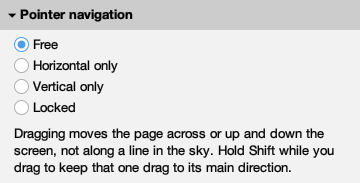

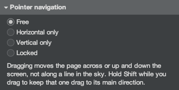

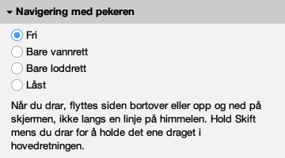

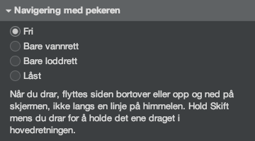

## 5. The box for the last selected object, on production pages

Each page is a production `ChartComponent` under a production `ChartModuleHost`, the subject selected through the host's working selection (so the ordinary selection mark is production's), and the box offered by a study-only module through `ChartServices.furnish`. The corner is production's ruled order (ruling 3 on #556: lower right, upper right while the magnitude key does not hold it, upper left); the words are the study's. Bodies are drawn for Venus's cited 2026 greatest eastern elongation (2026-08-15 06:00:00 UTC, `docs/studies/venus/venus-events.txt`), seen from Oslo.

The rule each page follows, as proposed: a box appears exactly when the subject is on the page - drawn, or marked with the working cross because a chart option or the magnitude limit keeps it from being drawn - and never for empty sky.

### star-named-8

A named star: Betelgeuse at 8°. A box is drawn; its corner depends on this desktop's fonts and stands in `platform.md`.

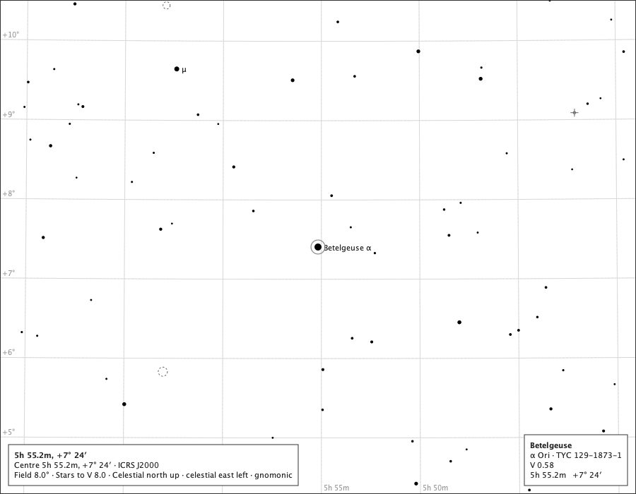

> **Betelgeuse**  
> α Ori · TYC 129-1873-1  
> V 0.58  
> 5h 55.2m   +7° 24′  

### star-named-8-nb

The same in Norwegian. A box is drawn; its corner depends on this desktop's fonts and stands in `platform.md`.

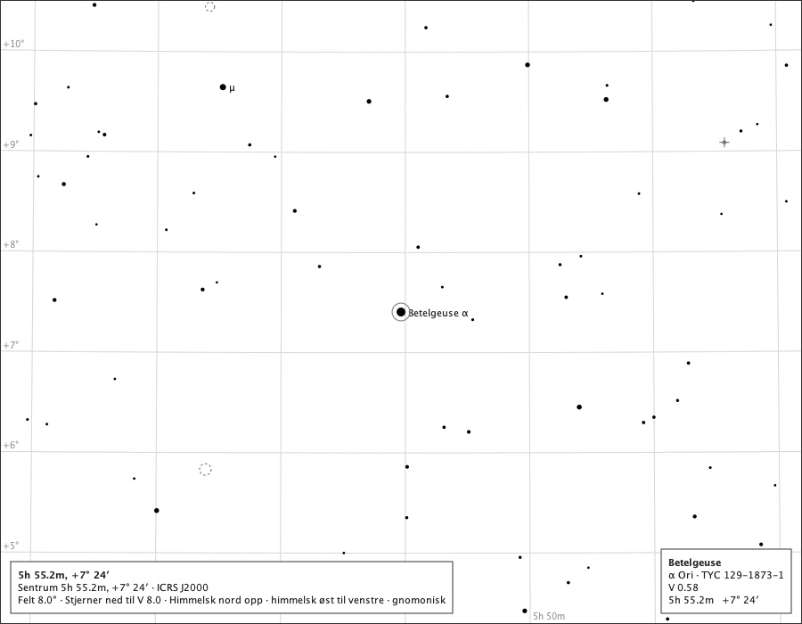

> **Betelgeuse**  
> α Ori · TYC 129-1873-1  
> V 0.58  
> 5h 55.2m   +7° 24′  

### star-catalogue-4

A star with a catalogue identity only: the brightest such star on Betelgeuse's 4° page. (TYC 128-1551-2.) A box is drawn; its corner depends on this desktop's fonts and stands in `platform.md`.

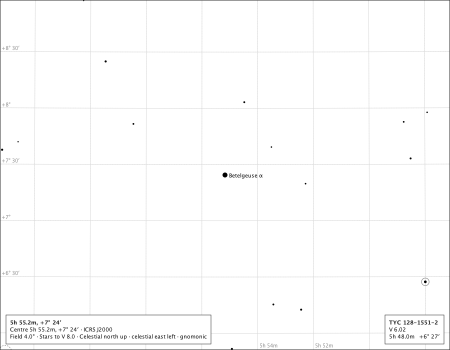

> **TYC 128-1551-2**  
> V 6.02  
> 5h 48.0m   +6° 27′  

### deep-sky-8

A deep-sky object: M 42 at 8°. A box is drawn; its corner depends on this desktop's fonts and stands in `platform.md`.

> **M 42**  
> NGC 1976 · nebula  
> V 4.00  
> 5h 35.3m   −5° 23′  

### deep-sky-8-nb

The same in Norwegian. A box is drawn; its corner depends on this desktop's fonts and stands in `platform.md`.

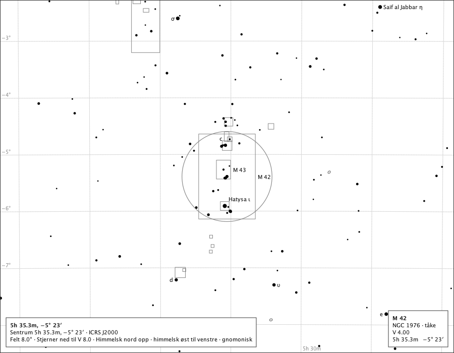

> **M 42**  
> NGC 1976 · tåke  
> V 4.00  
> 5h 35.3m   −5° 23′  

### deep-sky-8-black

The same on the black sky. A box is drawn; its corner depends on this desktop's fonts and stands in `platform.md`.

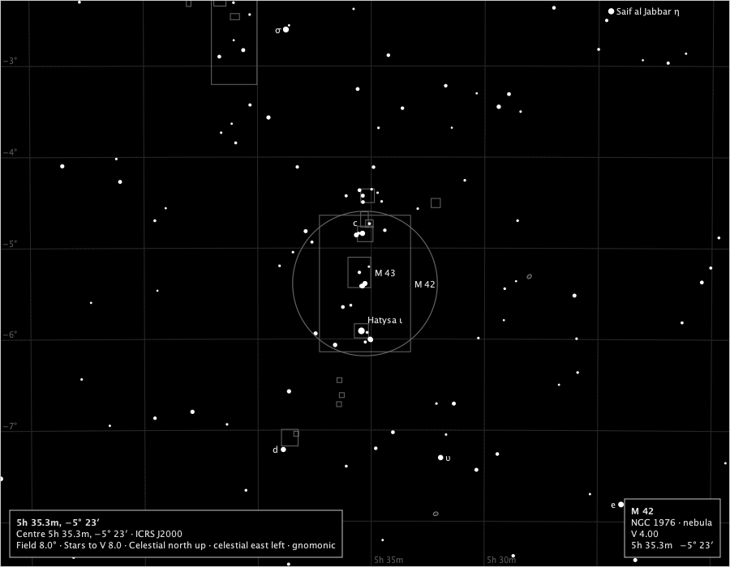

> **M 42**  
> NGC 1976 · nebula  
> V 4.00  
> 5h 35.3m   −5° 23′  

### refused-label

A deep-sky object whose label the page refuses (star labels are almost never refused; deep-sky labels often are): the first page of 8 tried (the Pleiades at 2° and 4°, then Betelgeuse, Antares and Deneb at 18° and at 36°) with such an object - 2° at RA 56.869°, Dec 24.105°. (Mel022.) A box is drawn; its corner depends on this desktop's fonts and stands in `platform.md`.

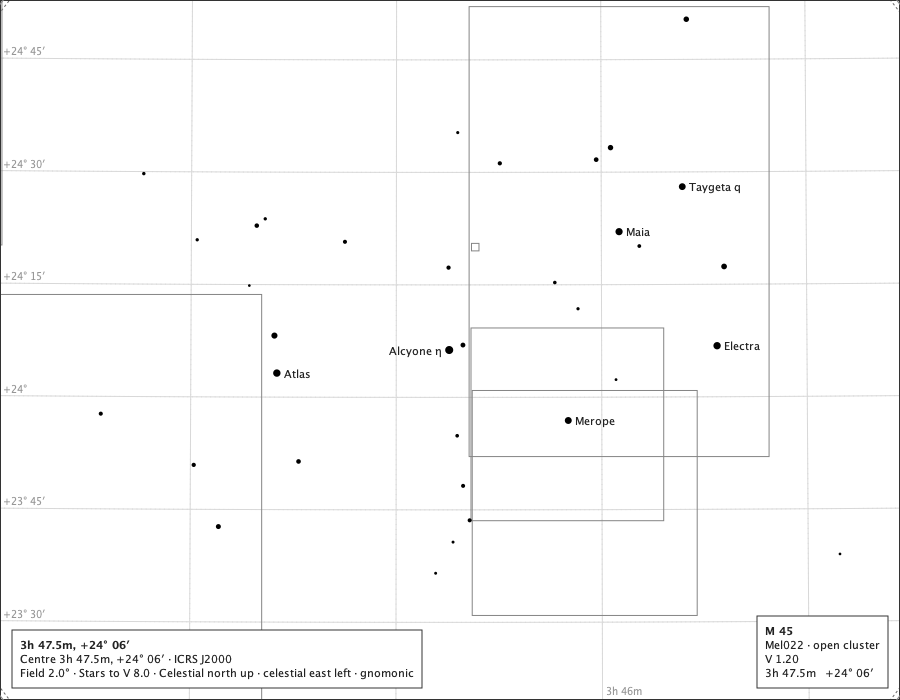

> **M 45**  
> Mel022 · open cluster  
> V 1.20  
> 3h 47.5m   +24° 06′  

### narrow-8

Narrow: M 42 in a 520 px window. A box is drawn; its corner depends on this desktop's fonts and stands in `platform.md`.

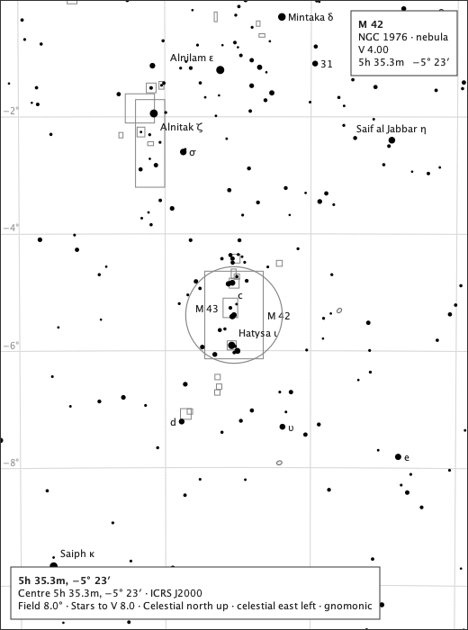

> **M 42**  
> NGC 1976 · nebula  
> V 4.00  
> 5h 35.3m   −5° 23′  

### narrow-8-nb

The same in Norwegian. A box is drawn; its corner depends on this desktop's fonts and stands in `platform.md`.

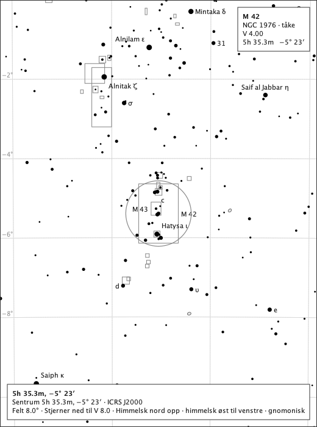

> **M 42**  
> NGC 1976 · tåke  
> V 4.00  
> 5h 35.3m   −5° 23′  

### narrow-key-8

Narrow with the magnitude key on. A box is drawn; its corner depends on this desktop's fonts and stands in `platform.md`.

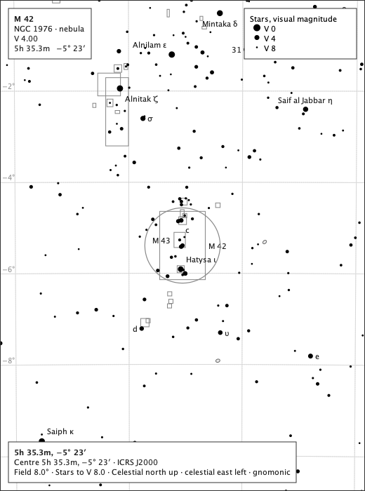

> **M 42**  
> NGC 1976 · nebula  
> V 4.00  
> 5h 35.3m   −5° 23′  

### wide-60

Wide: M 42 on the 60° overview. A box is drawn; its corner depends on this desktop's fonts and stands in `platform.md`.

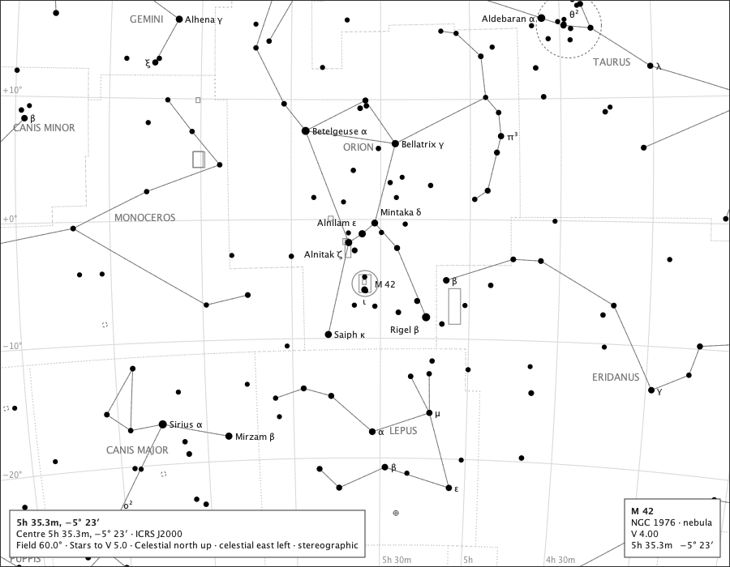

> **M 42**  
> NGC 1976 · nebula  
> V 4.00  
> 5h 35.3m   −5° 23′  

### globe-180

The celestial globe, M 42 selected. A box is drawn; its corner depends on this desktop's fonts and stands in `platform.md`.

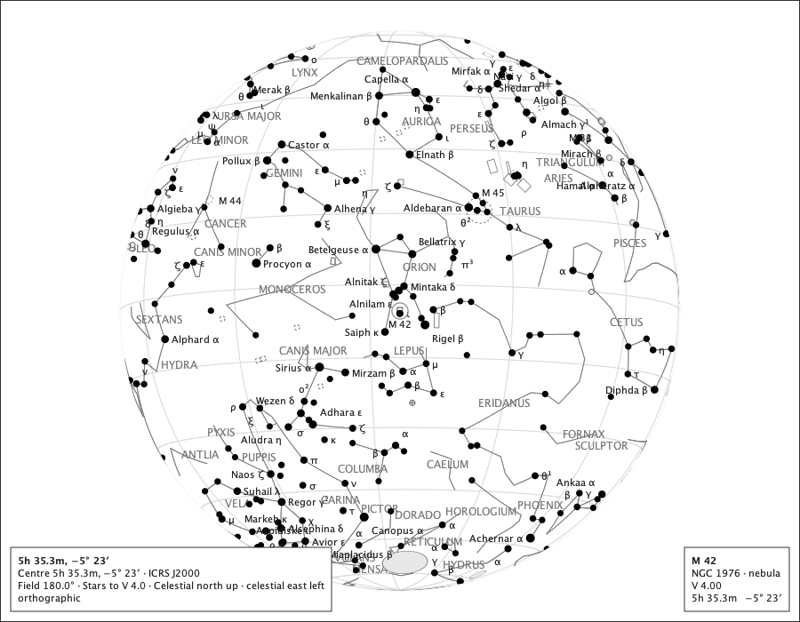

> **M 42**  
> NGC 1976 · nebula  
> V 4.00  
> 5h 35.3m   −5° 23′  

### letterbox-120

Letterboxed: a 120° page in a 600 × 1900 window. A box is drawn; its corner depends on this desktop's fonts and stands in `platform.md`. The page is 1697 px tall in a 1900 px window.

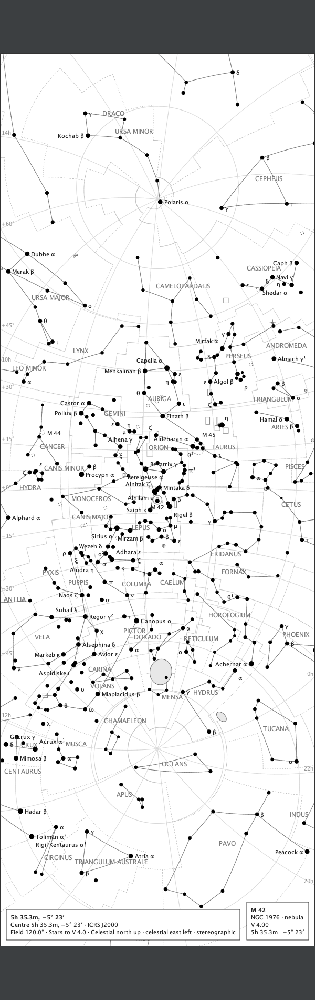

> **M 42**  
> NGC 1976 · nebula  
> V 4.00  
> 5h 35.3m   −5° 23′  

### letterbox-120-nb

The same in Norwegian. A box is drawn; its corner depends on this desktop's fonts and stands in `platform.md`. The page is 1697 px tall in a 1900 px window.

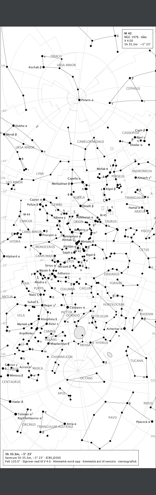

> **M 42**  
> NGC 1976 · tåke  
> V 4.00  
> 5h 35.3m   −5° 23′  

### off-page-8

M 42 selected, then the page panned to RA 120°: the subject has left the page, so has the box. No box.

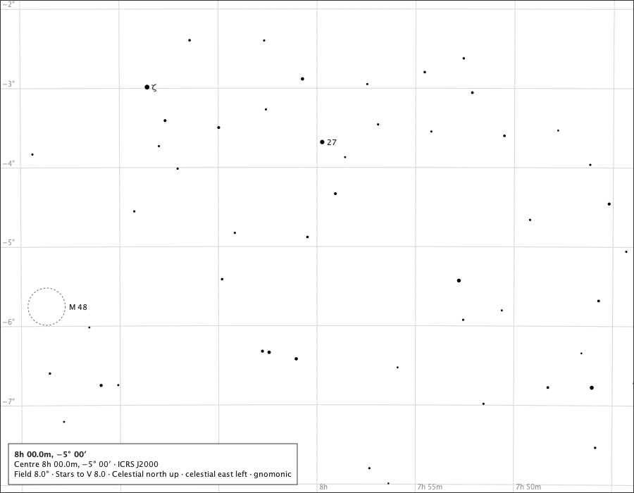

The subject NGC 1976 is not on this page.

### back-on-page-8

Panned back: the box returns with the subject. A box is drawn; its corner depends on this desktop's fonts and stands in `platform.md`.

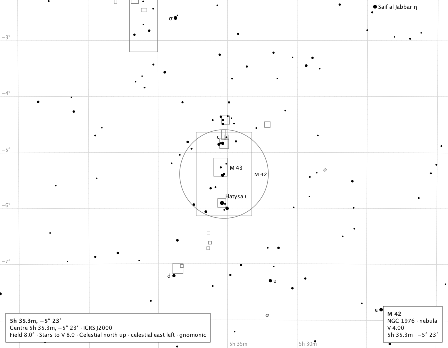

> **M 42**  
> NGC 1976 · nebula  
> V 4.00  
> 5h 35.3m   −5° 23′  

### moon-chart-time

The Moon at chart time, at 3°. A box is drawn; its corner depends on this desktop's fonts and stands in `platform.md`.

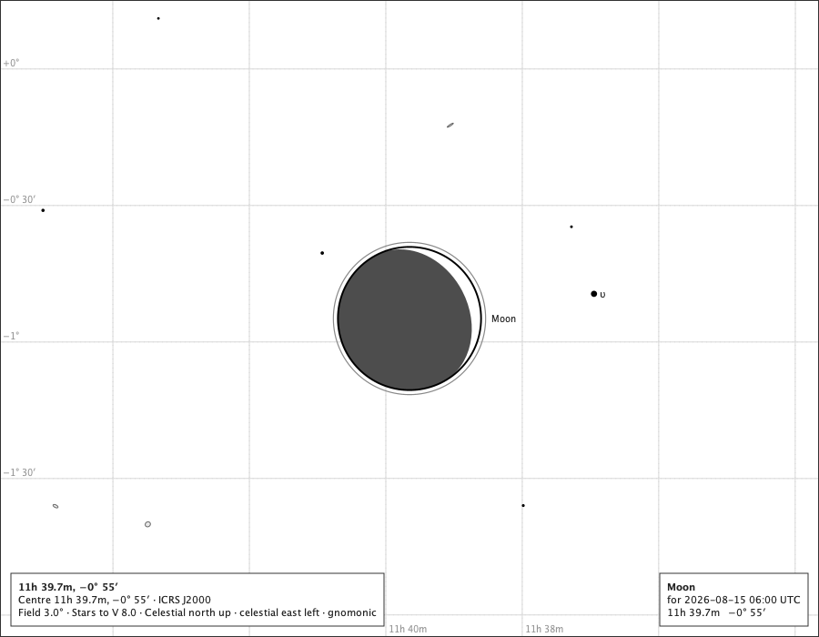

> **Moon**  
> for 2026-08-15 06:00 UTC  
> 11h 39.7m   −0° 55′  

### venus-chart-time

Venus at chart time, at 3°. A box is drawn; its corner depends on this desktop's fonts and stands in `platform.md`.

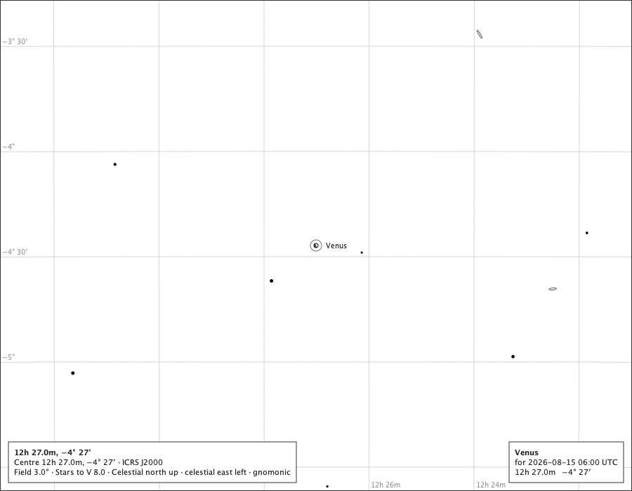

> **Venus**  
> for 2026-08-15 06:00 UTC  
> 12h 27.0m   −4° 27′  

### below-horizon

A body below the drawn horizon, with the mathematical horizon on: the first of sun, moon, venus, mercury, mars standing below it at the instant - moon. A box is drawn; its corner depends on this desktop's fonts and stands in `platform.md`.

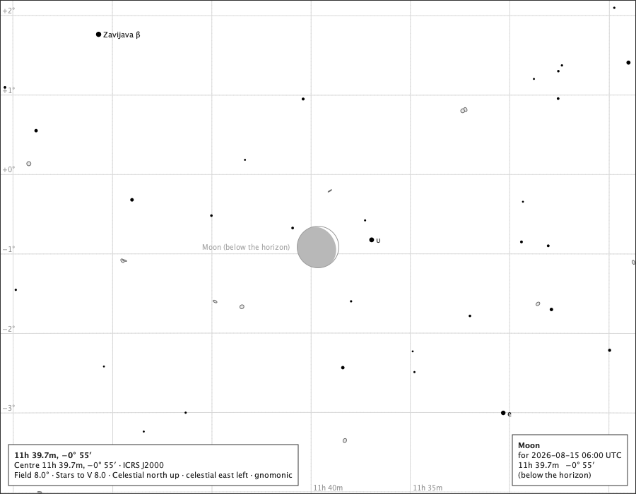

> **Moon**  
> for 2026-08-15 06:00 UTC  
> 11h 39.7m   −0° 55′  
> (below the horizon)  

### What the selection model admits

A constellation is not a selection: `Selection` holds stars, deep-sky objects, empty sky and Solar System occurrences, and no constellation kind, so no constellation box is drawn. Planetary moons are drawn but not selectable, so none is described either.

## 6. Two sketches of what the proposal adds

Marked as sketches: each is a production page carrying no box of the study's, with the study's own drawing over it, so the labels beneath do not yield as production's would.

### sketch-upper-left-8

Sketch: the box preferring the upper left, Betelgeuse at 8°.

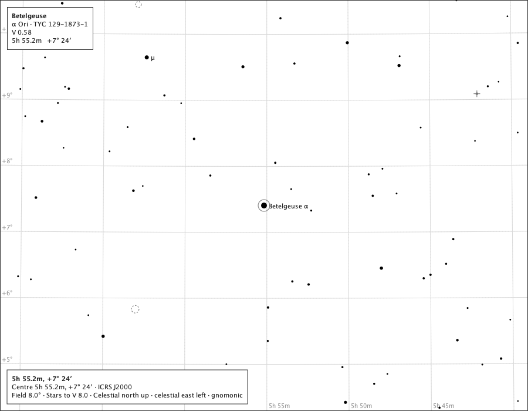

### sketch-body-mark

Sketch: the ordinary selection ring around a selected body, which production does not draw today - Venus at 3°, the box in the upper left.

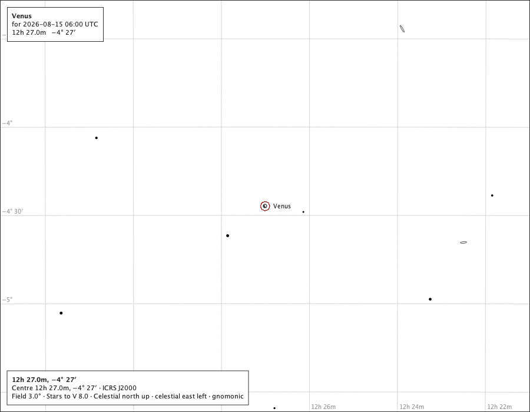

## 7. On paper

M 42 at 8° exported to A4 with the working selection included. The box travels to paper through the chart's own furniture path (no control on it); the SVG carries its heading as text: yes; the PDF and the PNG are replays of the same recording.

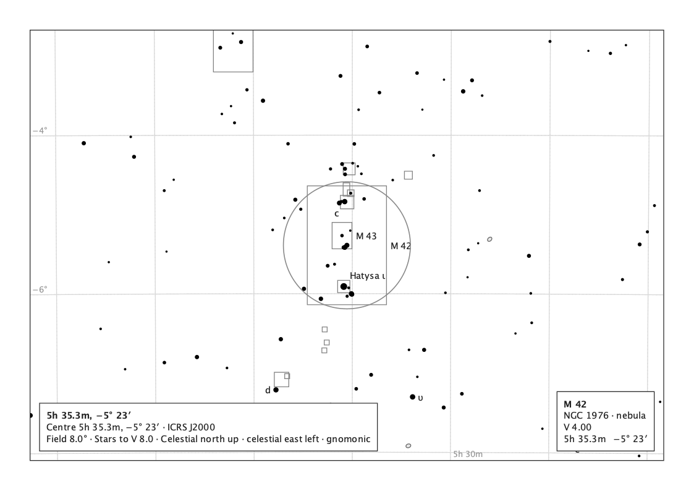

Exported **without** the working selection - today's default (`ExportSheetSession`) - the sheet still carries the box, but not the ring: the two PNG sheets differ in 1745 pixels, all of them the mark. Box and mark part company on paper unless the export rule changes.

## 8. Clean chart

Clean chart today hides the chart toolbar and nothing else (`ChartChromeStore`, key `chartToolbarShown`; ruled in `docs/decisions/clean-chart-controls.md`: it "touches nothing else"). Furniture is not chrome: the title block and Place and Time's box stay on a clean chart. Hiding the selection box with Clean chart would be the first page furniture the clean-chart switch reaches.

