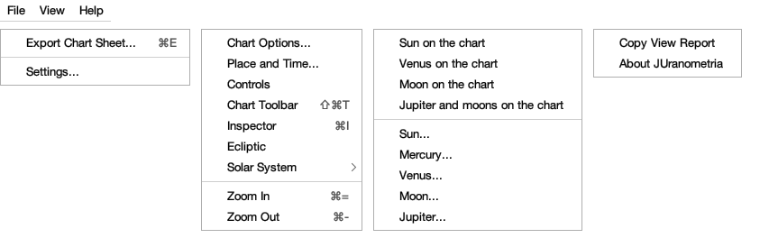
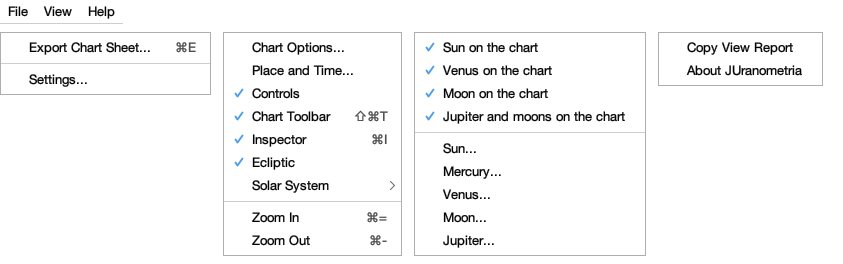
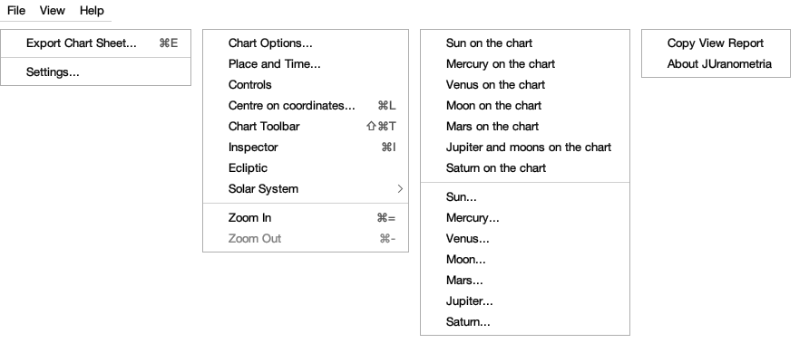
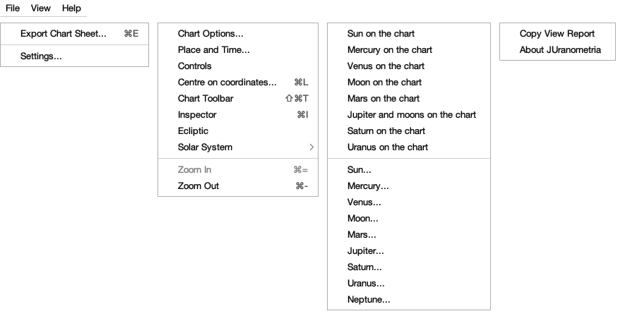
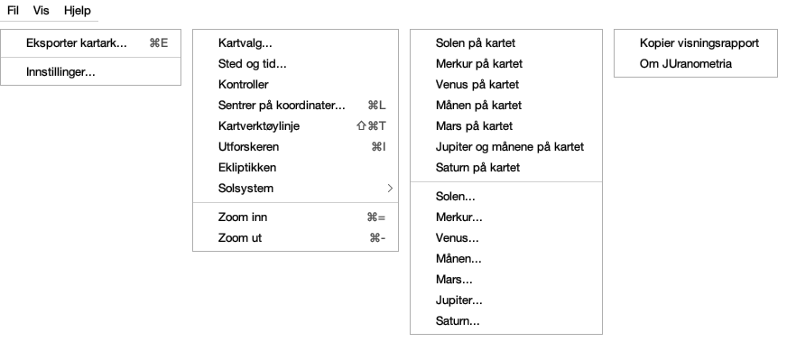
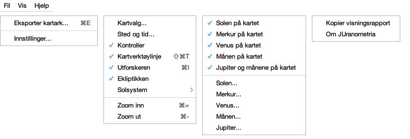
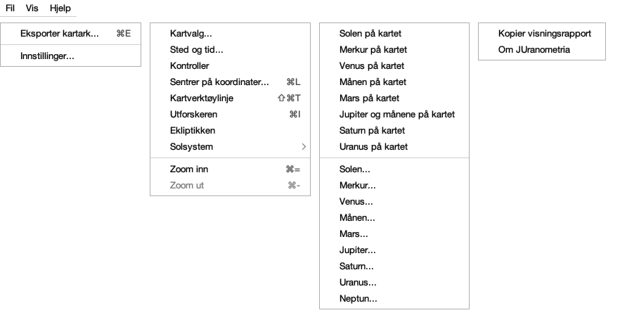
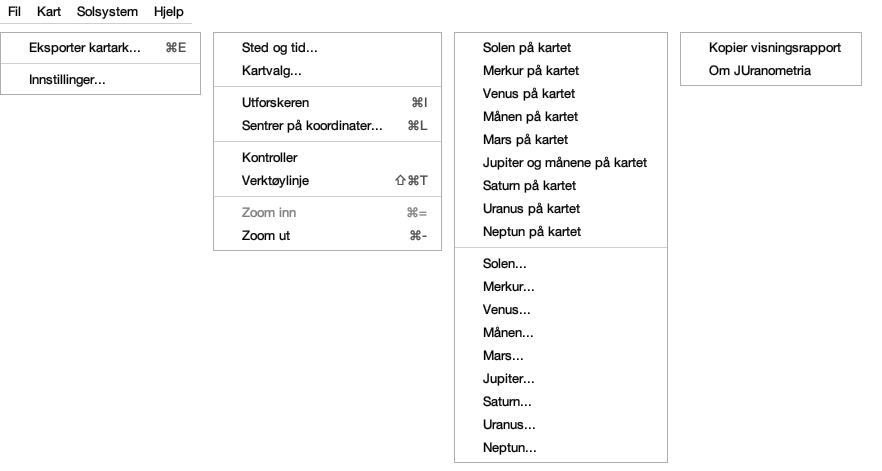

# Every word the menu bar says

Issue #350. Generated by
`juranometria.tool.MenuSheetMain` from compiled
application classes and their classpath resources,
composed through `AtlasChrome` from a stored language
choice. Packaged acceptance separately verifies that
the interface language resources ship in the
application image.

**Norsk bokmål — reviewed.** A person who reads the language has been through these surfaces and said these are the words an atlas should use. This is linguistic judgement, not corroboration against a source: unlike the constellation names next door, these are original translations written for this application and there is no citation to check them against. Recorded in `nb-NO.manifest`, and read from there rather than written here.

## Four channels, not three

Labels, accessible names and accessible descriptions
are interface language. **Accelerators** are platform
notation, spelled by the desktop, and appear in no
translated value. **Mnemonics** are language data: a
mnemonic marks a letter inside the item's own
displayed word, so `C` belongs to *Chart Options* and
`K` to *Kartvalg*. They are listed separately below
because an inventory that read only the first three
missed all five of them.

The access letters below are read from each live
menu item and validated against the label it actually
displays. They are **listed rather than underlined**
in these macOS captures, because this look and feel
does not paint mnemonic underlines: the live component
value is the evidence, and an underline drawn into the
image would be a marking the platform never shows.

There are **no tooltips** anywhere on this surface, in
either language. That is deliberate: a tooltip over an
open menu would cover the thing it explains.

## English (`en`)

### All three menus, nothing checked

Bar packed 843 × 287 px; widest popup 232 px.

| channel | words |
|---|---|
| menu label \| File |
| menu spoken name \| File menu |
| menu spoken description \| Exporting the chart and changing application settings |
| item label \| Export Chart Sheet... |
| item spoken name \| Export Chart Sheet |
| item spoken description \| Exports this chart as an SVG, PDF or PNG sheet |
| item accelerator (platform notation) \| ⌘E |
| item access letter (language) \| E |
| item label \| Settings... |
| item spoken name \| Settings |
| item spoken description \| Opens the window for appearance and for the languages used by the application and chart |
| menu label \| View |
| menu spoken name \| View menu |
| menu spoken description \| What the chart draws, where you are looking from, and how far out |
| item label \| Chart Options... |
| item spoken name \| Chart Options |
| item spoken description \| Opens the window that chooses what the chart draws and labels. Chart shortcuts begin with ⌘K. |
| item access letter (language) \| C |
| item label \| Place and Time... |
| item spoken name \| Place and Time |
| item spoken description \| Opens the window that sets your location and the instant used to draw the meridian, horizon and zenith |
| item access letter (language) \| P |
| item label \| Controls |
| item spoken name \| Controls |
| item spoken description \| Shows or hides the JUranometria Controller window, which keeps the chart's controls beside the chart; it opens again where you left it, and starts closed. |
| item access letter (language) \| R |
| item label \| Chart Toolbar |
| item spoken name \| Chart Toolbar |
| item spoken description \| Shows or hides the chart window's toolbar. Its controls remain in the JUranometria Controller window; the chart keeps its centre, field and everything it draws. |
| item accelerator (platform notation) \| ⌘+⇧T |
| item access letter (language) \| T |
| item label \| Inspector |
| item spoken name \| Inspector |
| item spoken description \| Shows or hides the panel that describes the selected mark and what is on this page |
| item accelerator (platform notation) \| ⌘I |
| item access letter (language) \| I |
| item label \| Ecliptic |
| item spoken name \| Ecliptic |
| item spoken description \| Shows or hides the ecliptic and its equinox and solstice marks. The chart shortcut is ⌘K then I. |
| submenu label \| Solar System |
| submenu spoken name \| Solar System menu |
| submenu spoken description \| The Sun, Mercury, Venus, the Moon, Jupiter and Saturn: whether each is drawn on the chart, and their tables |
| submenu access letter (language) \| Y |
| item label \| Sun on the chart |
| item spoken name \| Sun on the chart |
| item spoken description \| Shows or hides the Sun on the chart, drawn at its true size where it stands for the place and instant set in Place and Time; below a drawn horizon it is dimmed and says so. |
| item access letter (language) \| U |
| item label \| Mercury on the chart |
| item spoken name \| Mercury on the chart |
| item spoken description \| Shows or hides Mercury on the chart where it stands for the place and instant set in Place and Time, phased as the table says, at its true size or as a 6-pixel cartographic symbol, whichever is larger. Hidden until you ask. |
| item label \| Venus on the chart |
| item spoken name \| Venus on the chart |
| item spoken description \| Shows or hides Venus on the chart where it stands for the place and instant set in Place and Time, phased as the table says, at its true size or as a 6-pixel cartographic symbol, whichever is larger. Hidden until you ask. |
| item label \| Moon on the chart |
| item spoken name \| Moon on the chart |
| item spoken description \| Shows or hides the Moon on the chart, drawn at its true size where it stands for the place and instant set in Place and Time, lit on the side the Moon table states; below a drawn horizon it is dimmed and says so. |
| item access letter (language) \| O |
| item label \| Jupiter and moons on the chart |
| item spoken name \| Jupiter and moons on the chart |
| item spoken description \| Shows or hides Jupiter on the chart where it stands for the place and instant set in Place and Time: at its true size once that is at least 6 pixels across, otherwise as a 6-pixel cartographic symbol, not its apparent diameter; below a drawn horizon it is dimmed and says so. Io, Europa, Ganymede and Callisto are drawn as 3-pixel symbols at their own places: a filled dot clear of Jupiter, a dot ringed in the page's ground in front of it, a hollow ring in its shadow, and nothing behind it; at wider fields only the moons whose marks can be told apart are drawn. |
| item label \| Sun... |
| item hover \| Where the Sun is, for the place and instant set in Place and Time |
| item spoken name \| Sun table |
| item spoken description \| Opens a table of the Sun's computed position, height above the horizon, distance and apparent size for the observing place and instant set in Place and Time, at that instant or over a range of instants. Nothing is drawn on the chart. |
| item access letter (language) \| S |
| item label \| Mercury... |
| item hover \| Where Mercury is, for the place and instant set in Place and Time |
| item spoken name \| Mercury table |
| item spoken description \| Opens a table of Mercury's computed position, height above the horizon, distance, apparent size, illuminated fraction, phase and lit side for the observing place and instant set in Place and Time, at that instant or over a range of instants. |
| item label \| Venus... |
| item hover \| Where Venus is, for the place and instant set in Place and Time |
| item spoken name \| Venus table |
| item spoken description \| Opens a table of Venus's computed position, height above the horizon, distance, apparent size, illuminated fraction, phase and lit side for the observing place and instant set in Place and Time, at that instant or over a range of instants. |
| item access letter (language) \| V |
| item label \| Moon... |
| item hover \| Where the Moon is, for the place and instant set in Place and Time |
| item spoken name \| Moon table |
| item spoken description \| Opens a table of the Moon's computed position, height above the horizon, distance, apparent size, illuminated fraction, phase and lit side for the observing place and instant set in Place and Time, at that instant or over a range of instants. |
| item access letter (language) \| M |
| item label \| Jupiter... |
| item hover \| Where Jupiter and its four large moons are, for the place and instant set in Place and Time |
| item spoken name \| Jupiter table |
| item spoken description \| Opens a table of Jupiter's computed position, height, distance, size and pole, and of where Io, Europa, Ganymede and Callisto stand beside it - clear of Jupiter, in front of it, behind it or in its shadow - for the observing place and instant set in Place and Time, at that instant or over a range of instants. The chart draws Jupiter only while Jupiter and moons on the chart is on. |
| item access letter (language) \| J |
| item label \| Zoom In |
| item spoken name \| Zoom In |
| item spoken description \| Shows a narrower field, with fainter stars on it |
| item accelerator (platform notation) \| ⌘= |
| item label \| Zoom Out |
| item spoken name \| Zoom Out |
| item spoken description \| Shows a wider field, with fewer stars on it |
| item accelerator (platform notation) \| ⌘- |
| menu label \| Help |
| menu spoken name \| Help menu |
| menu spoken description \| Information about this application and what it is built on |
| item label \| Copy View Report |
| item hover \| Copies a text description of this view, including the observing place and instant from Place and Time |
| item spoken name \| Copy View Report |
| item spoken description \| Copies a text description of this view to the clipboard, including the observing place and instant stated in Place and Time. Nothing is sent, saved or remembered. |
| item label \| About JUranometria |
| item spoken name \| About JUranometria |
| item spoken description \| Opens the window with the application's name, version and the software and data it is built on |

### View with Inspector and Ecliptic on

Bar packed 843 × 287 px; widest popup 232 px.

| channel | words |
|---|---|
| menu label \| File |
| menu spoken name \| File menu |
| menu spoken description \| Exporting the chart and changing application settings |
| item label \| Export Chart Sheet... |
| item spoken name \| Export Chart Sheet |
| item spoken description \| Exports this chart as an SVG, PDF or PNG sheet |
| item accelerator (platform notation) \| ⌘E |
| item access letter (language) \| E |
| item label \| Settings... |
| item spoken name \| Settings |
| item spoken description \| Opens the window for appearance and for the languages used by the application and chart |
| menu label \| View |
| menu spoken name \| View menu |
| menu spoken description \| What the chart draws, where you are looking from, and how far out |
| item label \| Chart Options... |
| item spoken name \| Chart Options |
| item spoken description \| Opens the window that chooses what the chart draws and labels. Chart shortcuts begin with ⌘K. |
| item access letter (language) \| C |
| item label \| Place and Time... |
| item spoken name \| Place and Time |
| item spoken description \| Opens the window that sets your location and the instant used to draw the meridian, horizon and zenith |
| item access letter (language) \| P |
| item label [checked] \| Controls |
| item spoken name \| Controls |
| item spoken description \| Shows or hides the JUranometria Controller window, which keeps the chart's controls beside the chart; it opens again where you left it, and starts closed. |
| item access letter (language) \| R |
| item label [checked] \| Chart Toolbar |
| item spoken name \| Chart Toolbar |
| item spoken description \| Shows or hides the chart window's toolbar. Its controls remain in the JUranometria Controller window; the chart keeps its centre, field and everything it draws. |
| item accelerator (platform notation) \| ⌘+⇧T |
| item access letter (language) \| T |
| item label [checked] \| Inspector |
| item spoken name \| Inspector |
| item spoken description \| Shows or hides the panel that describes the selected mark and what is on this page |
| item accelerator (platform notation) \| ⌘I |
| item access letter (language) \| I |
| item label [checked] \| Ecliptic |
| item spoken name \| Ecliptic |
| item spoken description \| Shows or hides the ecliptic and its equinox and solstice marks. The chart shortcut is ⌘K then I. |
| submenu label \| Solar System |
| submenu spoken name \| Solar System menu |
| submenu spoken description \| The Sun, Mercury, Venus, the Moon, Jupiter and Saturn: whether each is drawn on the chart, and their tables |
| submenu access letter (language) \| Y |
| item label [checked] \| Sun on the chart |
| item spoken name \| Sun on the chart |
| item spoken description \| Shows or hides the Sun on the chart, drawn at its true size where it stands for the place and instant set in Place and Time; below a drawn horizon it is dimmed and says so. |
| item access letter (language) \| U |
| item label [checked] \| Mercury on the chart |
| item spoken name \| Mercury on the chart |
| item spoken description \| Shows or hides Mercury on the chart where it stands for the place and instant set in Place and Time, phased as the table says, at its true size or as a 6-pixel cartographic symbol, whichever is larger. Hidden until you ask. |
| item label [checked] \| Venus on the chart |
| item spoken name \| Venus on the chart |
| item spoken description \| Shows or hides Venus on the chart where it stands for the place and instant set in Place and Time, phased as the table says, at its true size or as a 6-pixel cartographic symbol, whichever is larger. Hidden until you ask. |
| item label [checked] \| Moon on the chart |
| item spoken name \| Moon on the chart |
| item spoken description \| Shows or hides the Moon on the chart, drawn at its true size where it stands for the place and instant set in Place and Time, lit on the side the Moon table states; below a drawn horizon it is dimmed and says so. |
| item access letter (language) \| O |
| item label [checked] \| Jupiter and moons on the chart |
| item spoken name \| Jupiter and moons on the chart |
| item spoken description \| Shows or hides Jupiter on the chart where it stands for the place and instant set in Place and Time: at its true size once that is at least 6 pixels across, otherwise as a 6-pixel cartographic symbol, not its apparent diameter; below a drawn horizon it is dimmed and says so. Io, Europa, Ganymede and Callisto are drawn as 3-pixel symbols at their own places: a filled dot clear of Jupiter, a dot ringed in the page's ground in front of it, a hollow ring in its shadow, and nothing behind it; at wider fields only the moons whose marks can be told apart are drawn. |
| item label \| Sun... |
| item hover \| Where the Sun is, for the place and instant set in Place and Time |
| item spoken name \| Sun table |
| item spoken description \| Opens a table of the Sun's computed position, height above the horizon, distance and apparent size for the observing place and instant set in Place and Time, at that instant or over a range of instants. Nothing is drawn on the chart. |
| item access letter (language) \| S |
| item label \| Mercury... |
| item hover \| Where Mercury is, for the place and instant set in Place and Time |
| item spoken name \| Mercury table |
| item spoken description \| Opens a table of Mercury's computed position, height above the horizon, distance, apparent size, illuminated fraction, phase and lit side for the observing place and instant set in Place and Time, at that instant or over a range of instants. |
| item label \| Venus... |
| item hover \| Where Venus is, for the place and instant set in Place and Time |
| item spoken name \| Venus table |
| item spoken description \| Opens a table of Venus's computed position, height above the horizon, distance, apparent size, illuminated fraction, phase and lit side for the observing place and instant set in Place and Time, at that instant or over a range of instants. |
| item access letter (language) \| V |
| item label \| Moon... |
| item hover \| Where the Moon is, for the place and instant set in Place and Time |
| item spoken name \| Moon table |
| item spoken description \| Opens a table of the Moon's computed position, height above the horizon, distance, apparent size, illuminated fraction, phase and lit side for the observing place and instant set in Place and Time, at that instant or over a range of instants. |
| item access letter (language) \| M |
| item label \| Jupiter... |
| item hover \| Where Jupiter and its four large moons are, for the place and instant set in Place and Time |
| item spoken name \| Jupiter table |
| item spoken description \| Opens a table of Jupiter's computed position, height, distance, size and pole, and of where Io, Europa, Ganymede and Callisto stand beside it - clear of Jupiter, in front of it, behind it or in its shadow - for the observing place and instant set in Place and Time, at that instant or over a range of instants. The chart draws Jupiter only while Jupiter and moons on the chart is on. |
| item access letter (language) \| J |
| item label \| Zoom In |
| item spoken name \| Zoom In |
| item spoken description \| Shows a narrower field, with fainter stars on it |
| item accelerator (platform notation) \| ⌘= |
| item label \| Zoom Out |
| item spoken name \| Zoom Out |
| item spoken description \| Shows a wider field, with fewer stars on it |
| item accelerator (platform notation) \| ⌘- |
| menu label \| Help |
| menu spoken name \| Help menu |
| menu spoken description \| Information about this application and what it is built on |
| item label \| Copy View Report |
| item hover \| Copies a text description of this view, including the observing place and instant from Place and Time |
| item spoken name \| Copy View Report |
| item spoken description \| Copies a text description of this view to the clipboard, including the observing place and instant stated in Place and Time. Nothing is sent, saved or remembered. |
| item label \| About JUranometria |
| item spoken name \| About JUranometria |
| item spoken description \| Opens the window with the application's name, version and the software and data it is built on |

### View at the widest field

Bar packed 843 × 287 px; widest popup 232 px.

| channel | words |
|---|---|
| menu label \| File |
| menu spoken name \| File menu |
| menu spoken description \| Exporting the chart and changing application settings |
| item label \| Export Chart Sheet... |
| item spoken name \| Export Chart Sheet |
| item spoken description \| Exports this chart as an SVG, PDF or PNG sheet |
| item accelerator (platform notation) \| ⌘E |
| item access letter (language) \| E |
| item label \| Settings... |
| item spoken name \| Settings |
| item spoken description \| Opens the window for appearance and for the languages used by the application and chart |
| menu label \| View |
| menu spoken name \| View menu |
| menu spoken description \| What the chart draws, where you are looking from, and how far out |
| item label \| Chart Options... |
| item spoken name \| Chart Options |
| item spoken description \| Opens the window that chooses what the chart draws and labels. Chart shortcuts begin with ⌘K. |
| item access letter (language) \| C |
| item label \| Place and Time... |
| item spoken name \| Place and Time |
| item spoken description \| Opens the window that sets your location and the instant used to draw the meridian, horizon and zenith |
| item access letter (language) \| P |
| item label \| Controls |
| item spoken name \| Controls |
| item spoken description \| Shows or hides the JUranometria Controller window, which keeps the chart's controls beside the chart; it opens again where you left it, and starts closed. |
| item access letter (language) \| R |
| item label \| Chart Toolbar |
| item spoken name \| Chart Toolbar |
| item spoken description \| Shows or hides the chart window's toolbar. Its controls remain in the JUranometria Controller window; the chart keeps its centre, field and everything it draws. |
| item accelerator (platform notation) \| ⌘+⇧T |
| item access letter (language) \| T |
| item label \| Inspector |
| item spoken name \| Inspector |
| item spoken description \| Shows or hides the panel that describes the selected mark and what is on this page |
| item accelerator (platform notation) \| ⌘I |
| item access letter (language) \| I |
| item label \| Ecliptic |
| item spoken name \| Ecliptic |
| item spoken description \| Shows or hides the ecliptic and its equinox and solstice marks. The chart shortcut is ⌘K then I. |
| submenu label \| Solar System |
| submenu spoken name \| Solar System menu |
| submenu spoken description \| The Sun, Mercury, Venus, the Moon, Jupiter and Saturn: whether each is drawn on the chart, and their tables |
| submenu access letter (language) \| Y |
| item label \| Sun on the chart |
| item spoken name \| Sun on the chart |
| item spoken description \| Shows or hides the Sun on the chart, drawn at its true size where it stands for the place and instant set in Place and Time; below a drawn horizon it is dimmed and says so. |
| item access letter (language) \| U |
| item label \| Mercury on the chart |
| item spoken name \| Mercury on the chart |
| item spoken description \| Shows or hides Mercury on the chart where it stands for the place and instant set in Place and Time, phased as the table says, at its true size or as a 6-pixel cartographic symbol, whichever is larger. Hidden until you ask. |
| item label \| Venus on the chart |
| item spoken name \| Venus on the chart |
| item spoken description \| Shows or hides Venus on the chart where it stands for the place and instant set in Place and Time, phased as the table says, at its true size or as a 6-pixel cartographic symbol, whichever is larger. Hidden until you ask. |
| item label \| Moon on the chart |
| item spoken name \| Moon on the chart |
| item spoken description \| Shows or hides the Moon on the chart, drawn at its true size where it stands for the place and instant set in Place and Time, lit on the side the Moon table states; below a drawn horizon it is dimmed and says so. |
| item access letter (language) \| O |
| item label \| Jupiter and moons on the chart |
| item spoken name \| Jupiter and moons on the chart |
| item spoken description \| Shows or hides Jupiter on the chart where it stands for the place and instant set in Place and Time: at its true size once that is at least 6 pixels across, otherwise as a 6-pixel cartographic symbol, not its apparent diameter; below a drawn horizon it is dimmed and says so. Io, Europa, Ganymede and Callisto are drawn as 3-pixel symbols at their own places: a filled dot clear of Jupiter, a dot ringed in the page's ground in front of it, a hollow ring in its shadow, and nothing behind it; at wider fields only the moons whose marks can be told apart are drawn. |
| item label \| Sun... |
| item hover \| Where the Sun is, for the place and instant set in Place and Time |
| item spoken name \| Sun table |
| item spoken description \| Opens a table of the Sun's computed position, height above the horizon, distance and apparent size for the observing place and instant set in Place and Time, at that instant or over a range of instants. Nothing is drawn on the chart. |
| item access letter (language) \| S |
| item label \| Mercury... |
| item hover \| Where Mercury is, for the place and instant set in Place and Time |
| item spoken name \| Mercury table |
| item spoken description \| Opens a table of Mercury's computed position, height above the horizon, distance, apparent size, illuminated fraction, phase and lit side for the observing place and instant set in Place and Time, at that instant or over a range of instants. |
| item label \| Venus... |
| item hover \| Where Venus is, for the place and instant set in Place and Time |
| item spoken name \| Venus table |
| item spoken description \| Opens a table of Venus's computed position, height above the horizon, distance, apparent size, illuminated fraction, phase and lit side for the observing place and instant set in Place and Time, at that instant or over a range of instants. |
| item access letter (language) \| V |
| item label \| Moon... |
| item hover \| Where the Moon is, for the place and instant set in Place and Time |
| item spoken name \| Moon table |
| item spoken description \| Opens a table of the Moon's computed position, height above the horizon, distance, apparent size, illuminated fraction, phase and lit side for the observing place and instant set in Place and Time, at that instant or over a range of instants. |
| item access letter (language) \| M |
| item label \| Jupiter... |
| item hover \| Where Jupiter and its four large moons are, for the place and instant set in Place and Time |
| item spoken name \| Jupiter table |
| item spoken description \| Opens a table of Jupiter's computed position, height, distance, size and pole, and of where Io, Europa, Ganymede and Callisto stand beside it - clear of Jupiter, in front of it, behind it or in its shadow - for the observing place and instant set in Place and Time, at that instant or over a range of instants. The chart draws Jupiter only while Jupiter and moons on the chart is on. |
| item access letter (language) \| J |
| item label \| Zoom In |
| item spoken name \| Zoom In |
| item spoken description \| Shows a narrower field, with fainter stars on it |
| item accelerator (platform notation) \| ⌘= |
| item label [unavailable] \| Zoom Out |
| item spoken name [unavailable] \| Zoom Out |
| item spoken description [unavailable] \| Unavailable: this is the widest field the atlas draws |
| item accelerator (platform notation) \| ⌘- |
| menu label \| Help |
| menu spoken name \| Help menu |
| menu spoken description \| Information about this application and what it is built on |
| item label \| Copy View Report |
| item hover \| Copies a text description of this view, including the observing place and instant from Place and Time |
| item spoken name \| Copy View Report |
| item spoken description \| Copies a text description of this view to the clipboard, including the observing place and instant stated in Place and Time. Nothing is sent, saved or remembered. |
| item label \| About JUranometria |
| item spoken name \| About JUranometria |
| item spoken description \| Opens the window with the application's name, version and the software and data it is built on |

### View at the narrowest field

Bar packed 843 × 287 px; widest popup 232 px.

| channel | words |
|---|---|
| menu label \| File |
| menu spoken name \| File menu |
| menu spoken description \| Exporting the chart and changing application settings |
| item label \| Export Chart Sheet... |
| item spoken name \| Export Chart Sheet |
| item spoken description \| Exports this chart as an SVG, PDF or PNG sheet |
| item accelerator (platform notation) \| ⌘E |
| item access letter (language) \| E |
| item label \| Settings... |
| item spoken name \| Settings |
| item spoken description \| Opens the window for appearance and for the languages used by the application and chart |
| menu label \| View |
| menu spoken name \| View menu |
| menu spoken description \| What the chart draws, where you are looking from, and how far out |
| item label \| Chart Options... |
| item spoken name \| Chart Options |
| item spoken description \| Opens the window that chooses what the chart draws and labels. Chart shortcuts begin with ⌘K. |
| item access letter (language) \| C |
| item label \| Place and Time... |
| item spoken name \| Place and Time |
| item spoken description \| Opens the window that sets your location and the instant used to draw the meridian, horizon and zenith |
| item access letter (language) \| P |
| item label \| Controls |
| item spoken name \| Controls |
| item spoken description \| Shows or hides the JUranometria Controller window, which keeps the chart's controls beside the chart; it opens again where you left it, and starts closed. |
| item access letter (language) \| R |
| item label \| Chart Toolbar |
| item spoken name \| Chart Toolbar |
| item spoken description \| Shows or hides the chart window's toolbar. Its controls remain in the JUranometria Controller window; the chart keeps its centre, field and everything it draws. |
| item accelerator (platform notation) \| ⌘+⇧T |
| item access letter (language) \| T |
| item label \| Inspector |
| item spoken name \| Inspector |
| item spoken description \| Shows or hides the panel that describes the selected mark and what is on this page |
| item accelerator (platform notation) \| ⌘I |
| item access letter (language) \| I |
| item label \| Ecliptic |
| item spoken name \| Ecliptic |
| item spoken description \| Shows or hides the ecliptic and its equinox and solstice marks. The chart shortcut is ⌘K then I. |
| submenu label \| Solar System |
| submenu spoken name \| Solar System menu |
| submenu spoken description \| The Sun, Mercury, Venus, the Moon, Jupiter and Saturn: whether each is drawn on the chart, and their tables |
| submenu access letter (language) \| Y |
| item label \| Sun on the chart |
| item spoken name \| Sun on the chart |
| item spoken description \| Shows or hides the Sun on the chart, drawn at its true size where it stands for the place and instant set in Place and Time; below a drawn horizon it is dimmed and says so. |
| item access letter (language) \| U |
| item label \| Mercury on the chart |
| item spoken name \| Mercury on the chart |
| item spoken description \| Shows or hides Mercury on the chart where it stands for the place and instant set in Place and Time, phased as the table says, at its true size or as a 6-pixel cartographic symbol, whichever is larger. Hidden until you ask. |
| item label \| Venus on the chart |
| item spoken name \| Venus on the chart |
| item spoken description \| Shows or hides Venus on the chart where it stands for the place and instant set in Place and Time, phased as the table says, at its true size or as a 6-pixel cartographic symbol, whichever is larger. Hidden until you ask. |
| item label \| Moon on the chart |
| item spoken name \| Moon on the chart |
| item spoken description \| Shows or hides the Moon on the chart, drawn at its true size where it stands for the place and instant set in Place and Time, lit on the side the Moon table states; below a drawn horizon it is dimmed and says so. |
| item access letter (language) \| O |
| item label \| Jupiter and moons on the chart |
| item spoken name \| Jupiter and moons on the chart |
| item spoken description \| Shows or hides Jupiter on the chart where it stands for the place and instant set in Place and Time: at its true size once that is at least 6 pixels across, otherwise as a 6-pixel cartographic symbol, not its apparent diameter; below a drawn horizon it is dimmed and says so. Io, Europa, Ganymede and Callisto are drawn as 3-pixel symbols at their own places: a filled dot clear of Jupiter, a dot ringed in the page's ground in front of it, a hollow ring in its shadow, and nothing behind it; at wider fields only the moons whose marks can be told apart are drawn. |
| item label \| Sun... |
| item hover \| Where the Sun is, for the place and instant set in Place and Time |
| item spoken name \| Sun table |
| item spoken description \| Opens a table of the Sun's computed position, height above the horizon, distance and apparent size for the observing place and instant set in Place and Time, at that instant or over a range of instants. Nothing is drawn on the chart. |
| item access letter (language) \| S |
| item label \| Mercury... |
| item hover \| Where Mercury is, for the place and instant set in Place and Time |
| item spoken name \| Mercury table |
| item spoken description \| Opens a table of Mercury's computed position, height above the horizon, distance, apparent size, illuminated fraction, phase and lit side for the observing place and instant set in Place and Time, at that instant or over a range of instants. |
| item label \| Venus... |
| item hover \| Where Venus is, for the place and instant set in Place and Time |
| item spoken name \| Venus table |
| item spoken description \| Opens a table of Venus's computed position, height above the horizon, distance, apparent size, illuminated fraction, phase and lit side for the observing place and instant set in Place and Time, at that instant or over a range of instants. |
| item access letter (language) \| V |
| item label \| Moon... |
| item hover \| Where the Moon is, for the place and instant set in Place and Time |
| item spoken name \| Moon table |
| item spoken description \| Opens a table of the Moon's computed position, height above the horizon, distance, apparent size, illuminated fraction, phase and lit side for the observing place and instant set in Place and Time, at that instant or over a range of instants. |
| item access letter (language) \| M |
| item label \| Jupiter... |
| item hover \| Where Jupiter and its four large moons are, for the place and instant set in Place and Time |
| item spoken name \| Jupiter table |
| item spoken description \| Opens a table of Jupiter's computed position, height, distance, size and pole, and of where Io, Europa, Ganymede and Callisto stand beside it - clear of Jupiter, in front of it, behind it or in its shadow - for the observing place and instant set in Place and Time, at that instant or over a range of instants. The chart draws Jupiter only while Jupiter and moons on the chart is on. |
| item access letter (language) \| J |
| item label [unavailable] \| Zoom In |
| item spoken name [unavailable] \| Zoom In |
| item spoken description [unavailable] \| Unavailable: a closer field is offered only when Mercury, Venus, Jupiter or Saturn, shown on the chart, is on the page the step would show |
| item accelerator (platform notation) \| ⌘= |
| item label \| Zoom Out |
| item spoken name \| Zoom Out |
| item spoken description \| Shows a wider field, with fewer stars on it |
| item accelerator (platform notation) \| ⌘- |
| menu label \| Help |
| menu spoken name \| Help menu |
| menu spoken description \| Information about this application and what it is built on |
| item label \| Copy View Report |
| item hover \| Copies a text description of this view, including the observing place and instant from Place and Time |
| item spoken name \| Copy View Report |
| item spoken description \| Copies a text description of this view to the clipboard, including the observing place and instant stated in Place and Time. Nothing is sent, saved or remembered. |
| item label \| About JUranometria |
| item spoken name \| About JUranometria |
| item spoken description \| Opens the window with the application's name, version and the software and data it is built on |

## Norsk bokmål (`nb-NO`)

### All three menus, nothing checked

Bar packed 844 × 287 px; widest popup 214 px.

| channel | words |
|---|---|
| menu label \| Fil |
| menu spoken name \| Fil-menyen |
| menu spoken description \| Eksport av kartet og endring av innstillinger for programmet |
| item label \| Eksporter kartark... |
| item spoken name \| Eksporter kartark |
| item spoken description \| Eksporterer dette kartet som et kartark i SVG-, PDF- eller PNG-format |
| item accelerator (platform notation) \| ⌘E |
| item access letter (language) \| E |
| item label \| Innstillinger... |
| item spoken name \| Innstillinger |
| item spoken description \| Åpner vinduet for utseende og for språkene programmet og kartet bruker |
| menu label \| Vis |
| menu spoken name \| Vis-menyen |
| menu spoken description \| Hva kartet tegner, hvor du ser fra, og hvor langt ut |
| item label \| Kartvalg... |
| item spoken name \| Kartvalg |
| item spoken description \| Åpner vinduet som velger hva kartet tegner og merker. Hurtigtaster for kartet begynner med ⌘K. |
| item access letter (language) \| K |
| item label \| Sted og tid... |
| item spoken name \| Sted og tid |
| item spoken description \| Åpner vinduet der du velger stedet og tidspunktet som brukes når meridianen, horisonten og senit tegnes |
| item access letter (language) \| S |
| item label \| Kontroller |
| item spoken name \| Kontroller |
| item spoken description \| Viser eller skjuler vinduet JUranometria Kontroller, som har kartets kontroller ved siden av kartet; det åpnes igjen der du forlot det, og starter lukket. |
| item access letter (language) \| R |
| item label \| Kartverktøylinje |
| item spoken name \| Kartverktøylinje |
| item spoken description \| Viser eller skjuler verktøylinjen i kartvinduet. Kontrollene finnes fortsatt i vinduet JUranometria Kontroller; kartet beholder sentrum, synsfelt og alt det tegner. |
| item accelerator (platform notation) \| ⌘+⇧T |
| item access letter (language) \| V |
| item label \| Utforskeren |
| item spoken name \| Utforskeren |
| item spoken description \| Viser eller skjuler panelet som beskriver det valgte merket og hva som finnes på denne siden |
| item accelerator (platform notation) \| ⌘I |
| item access letter (language) \| U |
| item label \| Ekliptikken |
| item spoken name \| Ekliptikken |
| item spoken description \| Viser eller skjuler ekliptikken og merkene for jevndøgn og solverv. Hurtigtasten for kartet er ⌘K deretter I. |
| submenu label \| Solsystem |
| submenu spoken name \| Solsystem-meny |
| submenu spoken description \| Solen, Merkur, Venus, Månen, Jupiter og Saturn: om hver av dem tegnes på kartet, og tabellene deres |
| submenu access letter (language) \| Y |
| item label \| Solen på kartet |
| item spoken name \| Solen på kartet |
| item spoken description \| Viser eller skjuler Solen på kartet, tegnet i sann størrelse der den står for stedet og tidspunktet satt i Sted og tid; under en tegnet horisont dempes den og sier fra. |
| item access letter (language) \| T |
| item label \| Merkur på kartet |
| item spoken name \| Merkur på kartet |
| item spoken description \| Viser eller skjuler Merkur på kartet der den står for stedet og tidspunktet satt i Sted og tid, med fasen slik tabellen oppgir den, i sann størrelse eller som et kartografisk symbol på 6 piksler, det som er størst. Skjult til du ber om det. |
| item label \| Venus på kartet |
| item spoken name \| Venus på kartet |
| item spoken description \| Viser eller skjuler Venus på kartet der den står for stedet og tidspunktet satt i Sted og tid, med fasen slik tabellen oppgir den, i sann størrelse eller som et kartografisk symbol på 6 piksler, det som er størst. Skjult til du ber om den. |
| item label \| Månen på kartet |
| item spoken name \| Månen på kartet |
| item spoken description \| Viser eller skjuler Månen på kartet, tegnet i sann størrelse der den står for stedet og tidspunktet satt i Sted og tid, opplyst på den siden Månetabellen oppgir; under en tegnet horisont dempes den og sier fra. |
| item access letter (language) \| N |
| item label \| Jupiter og månene på kartet |
| item spoken name \| Jupiter og månene på kartet |
| item spoken description \| Viser eller skjuler Jupiter på kartet der den står for stedet og tidspunktet satt i Sted og tid: i sann størrelse når den er minst 6 piksler bred, ellers som et kartografisk symbol på 6 piksler, ikke den tilsynelatende diameteren; under en tegnet horisont dempes den og sier fra. Io, Europa, Ganymedes og Callisto tegnes som symboler på 3 piksler der de står: en fylt prikk klar av Jupiter, en prikk med en ring i sidens bunnfarge foran den, en hul ring i skyggen, og ingenting bak den; i videre felt tegnes bare de månene som kan skilles fra hverandre. |
| item access letter (language) \| P |
| item label \| Solen... |
| item hover \| Hvor Solen er, for stedet og tidspunktet satt i Sted og tid |
| item spoken name \| Soltabell |
| item spoken description \| Åpner en tabell over Solens beregnede posisjon, høyde over horisonten, avstand og tilsynelatende størrelse for observasjonsstedet og tidspunktet satt i Sted og tid, ved det tidspunktet eller over et tidsrom. Ingenting tegnes på kartet. |
| item access letter (language) \| O |
| item label \| Merkur... |
| item hover \| Hvor Merkur er, for stedet og tidspunktet satt i Sted og tid |
| item spoken name \| Merkurtabell |
| item spoken description \| Åpner en tabell over Merkurs beregnede posisjon, høyde over horisonten, avstand, tilsynelatende størrelse, belyst andel, fase og belyst side for observasjonsstedet og tidspunktet satt i Sted og tid, ved det tidspunktet eller over et tidsrom. |
| item label \| Venus... |
| item hover \| Hvor Venus er, for stedet og tidspunktet satt i Sted og tid |
| item spoken name \| Venustabell |
| item spoken description \| Åpner en tabell over Venus' beregnede posisjon, høyde over horisonten, avstand, tilsynelatende størrelse, belyst andel, fase og belyst side for observasjonsstedet og tidspunktet satt i Sted og tid, ved det tidspunktet eller over et tidsrom. |
| item label \| Månen... |
| item hover \| Hvor Månen er, for stedet og tidspunktet satt i Sted og tid |
| item spoken name \| Månetabell |
| item spoken description \| Åpner en tabell over Månens beregnede posisjon, høyde over horisonten, avstand, tilsynelatende størrelse, belyst andel, fase og belyst side for observasjonsstedet og tidspunktet satt i Sted og tid, ved det tidspunktet eller over et tidsrom. |
| item access letter (language) \| M |
| item label \| Jupiter... |
| item hover \| Hvor Jupiter og de fire store månene er, for stedet og tidspunktet satt i Sted og tid |
| item spoken name \| Jupitertabell |
| item spoken description \| Åpner en tabell over Jupiters beregnede posisjon, høyde, avstand, størrelse og pol, og over hvor Io, Europa, Ganymedes og Callisto står ved siden av - klar av Jupiter, foran, bak eller i skyggen - for observasjonsstedet og tidspunktet satt i Sted og tid, ved det tidspunktet eller over et tidsrom. Kartet tegner Jupiter bare mens Jupiter og månene på kartet er på. |
| item access letter (language) \| J |
| item label \| Zoom inn |
| item spoken name \| Zoom inn |
| item spoken description \| Viser et smalere synsfelt med svakere stjerner |
| item accelerator (platform notation) \| ⌘= |
| item label \| Zoom ut |
| item spoken name \| Zoom ut |
| item spoken description \| Viser et større synsfelt med færre stjerner |
| item accelerator (platform notation) \| ⌘- |
| menu label \| Hjelp |
| menu spoken name \| Hjelp-menyen |
| menu spoken description \| Informasjon om dette programmet og hva det er bygd på |
| item label \| Kopier visningsrapport |
| item hover \| Kopierer en tekstbeskrivelse av denne visningen, med observasjonsstedet og tidspunktet fra Sted og tid |
| item spoken name \| Kopier visningsrapport |
| item spoken description \| Kopierer en tekstbeskrivelse av denne visningen til utklippstavlen, med observasjonsstedet og tidspunktet som er oppgitt i Sted og tid. Ingenting sendes, lagres eller huskes. |
| item label \| Om JUranometria |
| item spoken name \| Om JUranometria |
| item spoken description \| Åpner vinduet med programmets navn, versjon og programvaren og dataene det er bygd på |

### View with Inspector and Ecliptic on

Bar packed 844 × 287 px; widest popup 214 px.

| channel | words |
|---|---|
| menu label \| Fil |
| menu spoken name \| Fil-menyen |
| menu spoken description \| Eksport av kartet og endring av innstillinger for programmet |
| item label \| Eksporter kartark... |
| item spoken name \| Eksporter kartark |
| item spoken description \| Eksporterer dette kartet som et kartark i SVG-, PDF- eller PNG-format |
| item accelerator (platform notation) \| ⌘E |
| item access letter (language) \| E |
| item label \| Innstillinger... |
| item spoken name \| Innstillinger |
| item spoken description \| Åpner vinduet for utseende og for språkene programmet og kartet bruker |
| menu label \| Vis |
| menu spoken name \| Vis-menyen |
| menu spoken description \| Hva kartet tegner, hvor du ser fra, og hvor langt ut |
| item label \| Kartvalg... |
| item spoken name \| Kartvalg |
| item spoken description \| Åpner vinduet som velger hva kartet tegner og merker. Hurtigtaster for kartet begynner med ⌘K. |
| item access letter (language) \| K |
| item label \| Sted og tid... |
| item spoken name \| Sted og tid |
| item spoken description \| Åpner vinduet der du velger stedet og tidspunktet som brukes når meridianen, horisonten og senit tegnes |
| item access letter (language) \| S |
| item label [checked] \| Kontroller |
| item spoken name \| Kontroller |
| item spoken description \| Viser eller skjuler vinduet JUranometria Kontroller, som har kartets kontroller ved siden av kartet; det åpnes igjen der du forlot det, og starter lukket. |
| item access letter (language) \| R |
| item label [checked] \| Kartverktøylinje |
| item spoken name \| Kartverktøylinje |
| item spoken description \| Viser eller skjuler verktøylinjen i kartvinduet. Kontrollene finnes fortsatt i vinduet JUranometria Kontroller; kartet beholder sentrum, synsfelt og alt det tegner. |
| item accelerator (platform notation) \| ⌘+⇧T |
| item access letter (language) \| V |
| item label [checked] \| Utforskeren |
| item spoken name \| Utforskeren |
| item spoken description \| Viser eller skjuler panelet som beskriver det valgte merket og hva som finnes på denne siden |
| item accelerator (platform notation) \| ⌘I |
| item access letter (language) \| U |
| item label [checked] \| Ekliptikken |
| item spoken name \| Ekliptikken |
| item spoken description \| Viser eller skjuler ekliptikken og merkene for jevndøgn og solverv. Hurtigtasten for kartet er ⌘K deretter I. |
| submenu label \| Solsystem |
| submenu spoken name \| Solsystem-meny |
| submenu spoken description \| Solen, Merkur, Venus, Månen, Jupiter og Saturn: om hver av dem tegnes på kartet, og tabellene deres |
| submenu access letter (language) \| Y |
| item label [checked] \| Solen på kartet |
| item spoken name \| Solen på kartet |
| item spoken description \| Viser eller skjuler Solen på kartet, tegnet i sann størrelse der den står for stedet og tidspunktet satt i Sted og tid; under en tegnet horisont dempes den og sier fra. |
| item access letter (language) \| T |
| item label [checked] \| Merkur på kartet |
| item spoken name \| Merkur på kartet |
| item spoken description \| Viser eller skjuler Merkur på kartet der den står for stedet og tidspunktet satt i Sted og tid, med fasen slik tabellen oppgir den, i sann størrelse eller som et kartografisk symbol på 6 piksler, det som er størst. Skjult til du ber om det. |
| item label [checked] \| Venus på kartet |
| item spoken name \| Venus på kartet |
| item spoken description \| Viser eller skjuler Venus på kartet der den står for stedet og tidspunktet satt i Sted og tid, med fasen slik tabellen oppgir den, i sann størrelse eller som et kartografisk symbol på 6 piksler, det som er størst. Skjult til du ber om den. |
| item label [checked] \| Månen på kartet |
| item spoken name \| Månen på kartet |
| item spoken description \| Viser eller skjuler Månen på kartet, tegnet i sann størrelse der den står for stedet og tidspunktet satt i Sted og tid, opplyst på den siden Månetabellen oppgir; under en tegnet horisont dempes den og sier fra. |
| item access letter (language) \| N |
| item label [checked] \| Jupiter og månene på kartet |
| item spoken name \| Jupiter og månene på kartet |
| item spoken description \| Viser eller skjuler Jupiter på kartet der den står for stedet og tidspunktet satt i Sted og tid: i sann størrelse når den er minst 6 piksler bred, ellers som et kartografisk symbol på 6 piksler, ikke den tilsynelatende diameteren; under en tegnet horisont dempes den og sier fra. Io, Europa, Ganymedes og Callisto tegnes som symboler på 3 piksler der de står: en fylt prikk klar av Jupiter, en prikk med en ring i sidens bunnfarge foran den, en hul ring i skyggen, og ingenting bak den; i videre felt tegnes bare de månene som kan skilles fra hverandre. |
| item access letter (language) \| P |
| item label \| Solen... |
| item hover \| Hvor Solen er, for stedet og tidspunktet satt i Sted og tid |
| item spoken name \| Soltabell |
| item spoken description \| Åpner en tabell over Solens beregnede posisjon, høyde over horisonten, avstand og tilsynelatende størrelse for observasjonsstedet og tidspunktet satt i Sted og tid, ved det tidspunktet eller over et tidsrom. Ingenting tegnes på kartet. |
| item access letter (language) \| O |
| item label \| Merkur... |
| item hover \| Hvor Merkur er, for stedet og tidspunktet satt i Sted og tid |
| item spoken name \| Merkurtabell |
| item spoken description \| Åpner en tabell over Merkurs beregnede posisjon, høyde over horisonten, avstand, tilsynelatende størrelse, belyst andel, fase og belyst side for observasjonsstedet og tidspunktet satt i Sted og tid, ved det tidspunktet eller over et tidsrom. |
| item label \| Venus... |
| item hover \| Hvor Venus er, for stedet og tidspunktet satt i Sted og tid |
| item spoken name \| Venustabell |
| item spoken description \| Åpner en tabell over Venus' beregnede posisjon, høyde over horisonten, avstand, tilsynelatende størrelse, belyst andel, fase og belyst side for observasjonsstedet og tidspunktet satt i Sted og tid, ved det tidspunktet eller over et tidsrom. |
| item label \| Månen... |
| item hover \| Hvor Månen er, for stedet og tidspunktet satt i Sted og tid |
| item spoken name \| Månetabell |
| item spoken description \| Åpner en tabell over Månens beregnede posisjon, høyde over horisonten, avstand, tilsynelatende størrelse, belyst andel, fase og belyst side for observasjonsstedet og tidspunktet satt i Sted og tid, ved det tidspunktet eller over et tidsrom. |
| item access letter (language) \| M |
| item label \| Jupiter... |
| item hover \| Hvor Jupiter og de fire store månene er, for stedet og tidspunktet satt i Sted og tid |
| item spoken name \| Jupitertabell |
| item spoken description \| Åpner en tabell over Jupiters beregnede posisjon, høyde, avstand, størrelse og pol, og over hvor Io, Europa, Ganymedes og Callisto står ved siden av - klar av Jupiter, foran, bak eller i skyggen - for observasjonsstedet og tidspunktet satt i Sted og tid, ved det tidspunktet eller over et tidsrom. Kartet tegner Jupiter bare mens Jupiter og månene på kartet er på. |
| item access letter (language) \| J |
| item label \| Zoom inn |
| item spoken name \| Zoom inn |
| item spoken description \| Viser et smalere synsfelt med svakere stjerner |
| item accelerator (platform notation) \| ⌘= |
| item label \| Zoom ut |
| item spoken name \| Zoom ut |
| item spoken description \| Viser et større synsfelt med færre stjerner |
| item accelerator (platform notation) \| ⌘- |
| menu label \| Hjelp |
| menu spoken name \| Hjelp-menyen |
| menu spoken description \| Informasjon om dette programmet og hva det er bygd på |
| item label \| Kopier visningsrapport |
| item hover \| Kopierer en tekstbeskrivelse av denne visningen, med observasjonsstedet og tidspunktet fra Sted og tid |
| item spoken name \| Kopier visningsrapport |
| item spoken description \| Kopierer en tekstbeskrivelse av denne visningen til utklippstavlen, med observasjonsstedet og tidspunktet som er oppgitt i Sted og tid. Ingenting sendes, lagres eller huskes. |
| item label \| Om JUranometria |
| item spoken name \| Om JUranometria |
| item spoken description \| Åpner vinduet med programmets navn, versjon og programvaren og dataene det er bygd på |

### View at the widest field

Bar packed 844 × 287 px; widest popup 214 px.

| channel | words |
|---|---|
| menu label \| Fil |
| menu spoken name \| Fil-menyen |
| menu spoken description \| Eksport av kartet og endring av innstillinger for programmet |
| item label \| Eksporter kartark... |
| item spoken name \| Eksporter kartark |
| item spoken description \| Eksporterer dette kartet som et kartark i SVG-, PDF- eller PNG-format |
| item accelerator (platform notation) \| ⌘E |
| item access letter (language) \| E |
| item label \| Innstillinger... |
| item spoken name \| Innstillinger |
| item spoken description \| Åpner vinduet for utseende og for språkene programmet og kartet bruker |
| menu label \| Vis |
| menu spoken name \| Vis-menyen |
| menu spoken description \| Hva kartet tegner, hvor du ser fra, og hvor langt ut |
| item label \| Kartvalg... |
| item spoken name \| Kartvalg |
| item spoken description \| Åpner vinduet som velger hva kartet tegner og merker. Hurtigtaster for kartet begynner med ⌘K. |
| item access letter (language) \| K |
| item label \| Sted og tid... |
| item spoken name \| Sted og tid |
| item spoken description \| Åpner vinduet der du velger stedet og tidspunktet som brukes når meridianen, horisonten og senit tegnes |
| item access letter (language) \| S |
| item label \| Kontroller |
| item spoken name \| Kontroller |
| item spoken description \| Viser eller skjuler vinduet JUranometria Kontroller, som har kartets kontroller ved siden av kartet; det åpnes igjen der du forlot det, og starter lukket. |
| item access letter (language) \| R |
| item label \| Kartverktøylinje |
| item spoken name \| Kartverktøylinje |
| item spoken description \| Viser eller skjuler verktøylinjen i kartvinduet. Kontrollene finnes fortsatt i vinduet JUranometria Kontroller; kartet beholder sentrum, synsfelt og alt det tegner. |
| item accelerator (platform notation) \| ⌘+⇧T |
| item access letter (language) \| V |
| item label \| Utforskeren |
| item spoken name \| Utforskeren |
| item spoken description \| Viser eller skjuler panelet som beskriver det valgte merket og hva som finnes på denne siden |
| item accelerator (platform notation) \| ⌘I |
| item access letter (language) \| U |
| item label \| Ekliptikken |
| item spoken name \| Ekliptikken |
| item spoken description \| Viser eller skjuler ekliptikken og merkene for jevndøgn og solverv. Hurtigtasten for kartet er ⌘K deretter I. |
| submenu label \| Solsystem |
| submenu spoken name \| Solsystem-meny |
| submenu spoken description \| Solen, Merkur, Venus, Månen, Jupiter og Saturn: om hver av dem tegnes på kartet, og tabellene deres |
| submenu access letter (language) \| Y |
| item label \| Solen på kartet |
| item spoken name \| Solen på kartet |
| item spoken description \| Viser eller skjuler Solen på kartet, tegnet i sann størrelse der den står for stedet og tidspunktet satt i Sted og tid; under en tegnet horisont dempes den og sier fra. |
| item access letter (language) \| T |
| item label \| Merkur på kartet |
| item spoken name \| Merkur på kartet |
| item spoken description \| Viser eller skjuler Merkur på kartet der den står for stedet og tidspunktet satt i Sted og tid, med fasen slik tabellen oppgir den, i sann størrelse eller som et kartografisk symbol på 6 piksler, det som er størst. Skjult til du ber om det. |
| item label \| Venus på kartet |
| item spoken name \| Venus på kartet |
| item spoken description \| Viser eller skjuler Venus på kartet der den står for stedet og tidspunktet satt i Sted og tid, med fasen slik tabellen oppgir den, i sann størrelse eller som et kartografisk symbol på 6 piksler, det som er størst. Skjult til du ber om den. |
| item label \| Månen på kartet |
| item spoken name \| Månen på kartet |
| item spoken description \| Viser eller skjuler Månen på kartet, tegnet i sann størrelse der den står for stedet og tidspunktet satt i Sted og tid, opplyst på den siden Månetabellen oppgir; under en tegnet horisont dempes den og sier fra. |
| item access letter (language) \| N |
| item label \| Jupiter og månene på kartet |
| item spoken name \| Jupiter og månene på kartet |
| item spoken description \| Viser eller skjuler Jupiter på kartet der den står for stedet og tidspunktet satt i Sted og tid: i sann størrelse når den er minst 6 piksler bred, ellers som et kartografisk symbol på 6 piksler, ikke den tilsynelatende diameteren; under en tegnet horisont dempes den og sier fra. Io, Europa, Ganymedes og Callisto tegnes som symboler på 3 piksler der de står: en fylt prikk klar av Jupiter, en prikk med en ring i sidens bunnfarge foran den, en hul ring i skyggen, og ingenting bak den; i videre felt tegnes bare de månene som kan skilles fra hverandre. |
| item access letter (language) \| P |
| item label \| Solen... |
| item hover \| Hvor Solen er, for stedet og tidspunktet satt i Sted og tid |
| item spoken name \| Soltabell |
| item spoken description \| Åpner en tabell over Solens beregnede posisjon, høyde over horisonten, avstand og tilsynelatende størrelse for observasjonsstedet og tidspunktet satt i Sted og tid, ved det tidspunktet eller over et tidsrom. Ingenting tegnes på kartet. |
| item access letter (language) \| O |
| item label \| Merkur... |
| item hover \| Hvor Merkur er, for stedet og tidspunktet satt i Sted og tid |
| item spoken name \| Merkurtabell |
| item spoken description \| Åpner en tabell over Merkurs beregnede posisjon, høyde over horisonten, avstand, tilsynelatende størrelse, belyst andel, fase og belyst side for observasjonsstedet og tidspunktet satt i Sted og tid, ved det tidspunktet eller over et tidsrom. |
| item label \| Venus... |
| item hover \| Hvor Venus er, for stedet og tidspunktet satt i Sted og tid |
| item spoken name \| Venustabell |
| item spoken description \| Åpner en tabell over Venus' beregnede posisjon, høyde over horisonten, avstand, tilsynelatende størrelse, belyst andel, fase og belyst side for observasjonsstedet og tidspunktet satt i Sted og tid, ved det tidspunktet eller over et tidsrom. |
| item label \| Månen... |
| item hover \| Hvor Månen er, for stedet og tidspunktet satt i Sted og tid |
| item spoken name \| Månetabell |
| item spoken description \| Åpner en tabell over Månens beregnede posisjon, høyde over horisonten, avstand, tilsynelatende størrelse, belyst andel, fase og belyst side for observasjonsstedet og tidspunktet satt i Sted og tid, ved det tidspunktet eller over et tidsrom. |
| item access letter (language) \| M |
| item label \| Jupiter... |
| item hover \| Hvor Jupiter og de fire store månene er, for stedet og tidspunktet satt i Sted og tid |
| item spoken name \| Jupitertabell |
| item spoken description \| Åpner en tabell over Jupiters beregnede posisjon, høyde, avstand, størrelse og pol, og over hvor Io, Europa, Ganymedes og Callisto står ved siden av - klar av Jupiter, foran, bak eller i skyggen - for observasjonsstedet og tidspunktet satt i Sted og tid, ved det tidspunktet eller over et tidsrom. Kartet tegner Jupiter bare mens Jupiter og månene på kartet er på. |
| item access letter (language) \| J |
| item label \| Zoom inn |
| item spoken name \| Zoom inn |
| item spoken description \| Viser et smalere synsfelt med svakere stjerner |
| item accelerator (platform notation) \| ⌘= |
| item label [unavailable] \| Zoom ut |
| item spoken name [unavailable] \| Zoom ut |
| item spoken description [unavailable] \| Utilgjengelig: dette er atlasets største synsfelt |
| item accelerator (platform notation) \| ⌘- |
| menu label \| Hjelp |
| menu spoken name \| Hjelp-menyen |
| menu spoken description \| Informasjon om dette programmet og hva det er bygd på |
| item label \| Kopier visningsrapport |
| item hover \| Kopierer en tekstbeskrivelse av denne visningen, med observasjonsstedet og tidspunktet fra Sted og tid |
| item spoken name \| Kopier visningsrapport |
| item spoken description \| Kopierer en tekstbeskrivelse av denne visningen til utklippstavlen, med observasjonsstedet og tidspunktet som er oppgitt i Sted og tid. Ingenting sendes, lagres eller huskes. |
| item label \| Om JUranometria |
| item spoken name \| Om JUranometria |
| item spoken description \| Åpner vinduet med programmets navn, versjon og programvaren og dataene det er bygd på |

### View at the narrowest field

Bar packed 844 × 287 px; widest popup 214 px.

| channel | words |
|---|---|
| menu label \| Fil |
| menu spoken name \| Fil-menyen |
| menu spoken description \| Eksport av kartet og endring av innstillinger for programmet |
| item label \| Eksporter kartark... |
| item spoken name \| Eksporter kartark |
| item spoken description \| Eksporterer dette kartet som et kartark i SVG-, PDF- eller PNG-format |
| item accelerator (platform notation) \| ⌘E |
| item access letter (language) \| E |
| item label \| Innstillinger... |
| item spoken name \| Innstillinger |
| item spoken description \| Åpner vinduet for utseende og for språkene programmet og kartet bruker |
| menu label \| Vis |
| menu spoken name \| Vis-menyen |
| menu spoken description \| Hva kartet tegner, hvor du ser fra, og hvor langt ut |
| item label \| Kartvalg... |
| item spoken name \| Kartvalg |
| item spoken description \| Åpner vinduet som velger hva kartet tegner og merker. Hurtigtaster for kartet begynner med ⌘K. |
| item access letter (language) \| K |
| item label \| Sted og tid... |
| item spoken name \| Sted og tid |
| item spoken description \| Åpner vinduet der du velger stedet og tidspunktet som brukes når meridianen, horisonten og senit tegnes |
| item access letter (language) \| S |
| item label \| Kontroller |
| item spoken name \| Kontroller |
| item spoken description \| Viser eller skjuler vinduet JUranometria Kontroller, som har kartets kontroller ved siden av kartet; det åpnes igjen der du forlot det, og starter lukket. |
| item access letter (language) \| R |
| item label \| Kartverktøylinje |
| item spoken name \| Kartverktøylinje |
| item spoken description \| Viser eller skjuler verktøylinjen i kartvinduet. Kontrollene finnes fortsatt i vinduet JUranometria Kontroller; kartet beholder sentrum, synsfelt og alt det tegner. |
| item accelerator (platform notation) \| ⌘+⇧T |
| item access letter (language) \| V |
| item label \| Utforskeren |
| item spoken name \| Utforskeren |
| item spoken description \| Viser eller skjuler panelet som beskriver det valgte merket og hva som finnes på denne siden |
| item accelerator (platform notation) \| ⌘I |
| item access letter (language) \| U |
| item label \| Ekliptikken |
| item spoken name \| Ekliptikken |
| item spoken description \| Viser eller skjuler ekliptikken og merkene for jevndøgn og solverv. Hurtigtasten for kartet er ⌘K deretter I. |
| submenu label \| Solsystem |
| submenu spoken name \| Solsystem-meny |
| submenu spoken description \| Solen, Merkur, Venus, Månen, Jupiter og Saturn: om hver av dem tegnes på kartet, og tabellene deres |
| submenu access letter (language) \| Y |
| item label \| Solen på kartet |
| item spoken name \| Solen på kartet |
| item spoken description \| Viser eller skjuler Solen på kartet, tegnet i sann størrelse der den står for stedet og tidspunktet satt i Sted og tid; under en tegnet horisont dempes den og sier fra. |
| item access letter (language) \| T |
| item label \| Merkur på kartet |
| item spoken name \| Merkur på kartet |
| item spoken description \| Viser eller skjuler Merkur på kartet der den står for stedet og tidspunktet satt i Sted og tid, med fasen slik tabellen oppgir den, i sann størrelse eller som et kartografisk symbol på 6 piksler, det som er størst. Skjult til du ber om det. |
| item label \| Venus på kartet |
| item spoken name \| Venus på kartet |
| item spoken description \| Viser eller skjuler Venus på kartet der den står for stedet og tidspunktet satt i Sted og tid, med fasen slik tabellen oppgir den, i sann størrelse eller som et kartografisk symbol på 6 piksler, det som er størst. Skjult til du ber om den. |
| item label \| Månen på kartet |
| item spoken name \| Månen på kartet |
| item spoken description \| Viser eller skjuler Månen på kartet, tegnet i sann størrelse der den står for stedet og tidspunktet satt i Sted og tid, opplyst på den siden Månetabellen oppgir; under en tegnet horisont dempes den og sier fra. |
| item access letter (language) \| N |
| item label \| Jupiter og månene på kartet |
| item spoken name \| Jupiter og månene på kartet |
| item spoken description \| Viser eller skjuler Jupiter på kartet der den står for stedet og tidspunktet satt i Sted og tid: i sann størrelse når den er minst 6 piksler bred, ellers som et kartografisk symbol på 6 piksler, ikke den tilsynelatende diameteren; under en tegnet horisont dempes den og sier fra. Io, Europa, Ganymedes og Callisto tegnes som symboler på 3 piksler der de står: en fylt prikk klar av Jupiter, en prikk med en ring i sidens bunnfarge foran den, en hul ring i skyggen, og ingenting bak den; i videre felt tegnes bare de månene som kan skilles fra hverandre. |
| item access letter (language) \| P |
| item label \| Solen... |
| item hover \| Hvor Solen er, for stedet og tidspunktet satt i Sted og tid |
| item spoken name \| Soltabell |
| item spoken description \| Åpner en tabell over Solens beregnede posisjon, høyde over horisonten, avstand og tilsynelatende størrelse for observasjonsstedet og tidspunktet satt i Sted og tid, ved det tidspunktet eller over et tidsrom. Ingenting tegnes på kartet. |
| item access letter (language) \| O |
| item label \| Merkur... |
| item hover \| Hvor Merkur er, for stedet og tidspunktet satt i Sted og tid |
| item spoken name \| Merkurtabell |
| item spoken description \| Åpner en tabell over Merkurs beregnede posisjon, høyde over horisonten, avstand, tilsynelatende størrelse, belyst andel, fase og belyst side for observasjonsstedet og tidspunktet satt i Sted og tid, ved det tidspunktet eller over et tidsrom. |
| item label \| Venus... |
| item hover \| Hvor Venus er, for stedet og tidspunktet satt i Sted og tid |
| item spoken name \| Venustabell |
| item spoken description \| Åpner en tabell over Venus' beregnede posisjon, høyde over horisonten, avstand, tilsynelatende størrelse, belyst andel, fase og belyst side for observasjonsstedet og tidspunktet satt i Sted og tid, ved det tidspunktet eller over et tidsrom. |
| item label \| Månen... |
| item hover \| Hvor Månen er, for stedet og tidspunktet satt i Sted og tid |
| item spoken name \| Månetabell |
| item spoken description \| Åpner en tabell over Månens beregnede posisjon, høyde over horisonten, avstand, tilsynelatende størrelse, belyst andel, fase og belyst side for observasjonsstedet og tidspunktet satt i Sted og tid, ved det tidspunktet eller over et tidsrom. |
| item access letter (language) \| M |
| item label \| Jupiter... |
| item hover \| Hvor Jupiter og de fire store månene er, for stedet og tidspunktet satt i Sted og tid |
| item spoken name \| Jupitertabell |
| item spoken description \| Åpner en tabell over Jupiters beregnede posisjon, høyde, avstand, størrelse og pol, og over hvor Io, Europa, Ganymedes og Callisto står ved siden av - klar av Jupiter, foran, bak eller i skyggen - for observasjonsstedet og tidspunktet satt i Sted og tid, ved det tidspunktet eller over et tidsrom. Kartet tegner Jupiter bare mens Jupiter og månene på kartet er på. |
| item access letter (language) \| J |
| item label [unavailable] \| Zoom inn |
| item spoken name [unavailable] \| Zoom inn |
| item spoken description [unavailable] \| Utilgjengelig: et nærfelt tilbys bare når Merkur, Venus, Jupiter eller Saturn, vist på kartet, står på siden steget ville vise |
| item accelerator (platform notation) \| ⌘= |
| item label \| Zoom ut |
| item spoken name \| Zoom ut |
| item spoken description \| Viser et større synsfelt med færre stjerner |
| item accelerator (platform notation) \| ⌘- |
| menu label \| Hjelp |
| menu spoken name \| Hjelp-menyen |
| menu spoken description \| Informasjon om dette programmet og hva det er bygd på |
| item label \| Kopier visningsrapport |
| item hover \| Kopierer en tekstbeskrivelse av denne visningen, med observasjonsstedet og tidspunktet fra Sted og tid |
| item spoken name \| Kopier visningsrapport |
| item spoken description \| Kopierer en tekstbeskrivelse av denne visningen til utklippstavlen, med observasjonsstedet og tidspunktet som er oppgitt i Sted og tid. Ingenting sendes, lagres eller huskes. |
| item label \| Om JUranometria |
| item spoken name \| Om JUranometria |
| item spoken description \| Åpner vinduet med programmets navn, versjon og programvaren og dataene det er bygd på |

