# Every word the Mercury table says

Issue #530. Generated by `juranometria.tool.MercuryTableSheetMain`
from compiled application classes and their classpath
resources, over the bundled Solar System and planets packs.
Packaged acceptance separately verifies that the packs and the
interface language resources ship in the application image.

**Norsk bokmål — reviewed.** A person who reads the language has been through these surfaces and said these are the words an atlas should use. This is linguistic judgement, not corroboration against a source: unlike the constellation names next door, these are original translations written for this application and there is no citation to check them against. Recorded in `nb-NO.manifest`, and read from there rather than written here.

## The window, not a panel

Each capture is the production dialog built through
`SolarTableDialog.packedForStudy` over Mercury's columns,
which has no "English if omitted" overload. The title and
the window description are read from the `JDialog` itself;
every shown, hovered and spoken string is walked from the
content; the column headings' explanations, which a screen
reader hears and a hover shows, are listed from the model.

## What is translated here, and what is not

Every number is notation: right ascension, declination,
degrees, astronomical units and million kilometres, the
solid body's diameter, the percentage and the instant are
formatted in `Locale.ROOT` by `SunTableFormat` and
`MoonTableFormat` and are identical in both languages,
with the language's own decimal separator. The words are the
language's: the headings, the status line, the refusals, the
status below the horizon, the phase, the side of the Sun and
the compass point of the lit side. The shell's words are the
same keys the Sun and Moon tables say (`solartable.*`, the
compass points and the side letters among them); Mercury's own
are `mercurytable.*`, the phase words ruled on #528 - the
bands Venus's table uses, as ruled.

## English (`en`)

### One instant: Oslo at the 2026 greatest eastern elongation

The fresh state: a single row at the instant Place and Time holds - Espenak's hour of the greatest eastern elongation. Mercury is near half lit, east of the Sun in the evening sky, its lit side towards the Sun in the west-southwest.

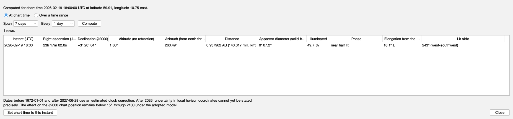

Packed 1854 × 433 px.

| shown, hovered or spoken |
|---|
| Mercury |
| Where Mercury is, computed from the bundled ephemeris for the chart time and place: its position among the fixed stars, its height and direction above the horizon, its distance and apparent size, how much of it is lit and which way the light falls, at that instant or over a range of instants. |
| Whether the table is for the chart time and place now |
| Computed for chart time 2026-02-19 18:00:00 UTC at latitude 59.91, longitude 10.75 east. |
| At chart time |
| One row, at the chart time |
| Show Mercury at the chart time |
| Shows a single row: Mercury at the chart time. |
| Over a time range |
| A row for every step from the chart time, over a span |
| Show Mercury over a range of instants |
| Shows a row for every step from the chart time over the span chosen, as many whole steps as the span holds; the first row is the chart time, read again whenever you compute. To range from another instant, set the chart time. |
| Span |
| 1 day |
| 7 days |
| 30 days |
| 90 days |
| 365 days |
| How far the rows reach from the chart time |
| Span of the range from the chart time |
| How far from the chart time the rows reach, in whole steps of the step beside it. |
| Every |
| 1 hour |
| 6 hours |
| The elapsed time between rows |
| Step between rows |
| The elapsed time between rows, on the UTC timeline, so a daily range does not drift across a change of civil clock. |
| Compute |
| Fill the table for the span and step above, from the chart time |
| Compute the range |
| Computes a row for every step of the span above, from the chart time now. |
| 1 rows. |
| Instant (UTC) |
| Right ascension (J2000) |
| Declination (J2000) |
| Altitude (no refraction) |
| Azimuth (from north through east) |
| Distance |
| Apparent diameter (solid body) |
| Illuminated |
| Phase |
| Elongation from the Sun |
| Lit side |
| 2026-02-19 18:00 · 23h 17m 02.0s · −3° 20′ 04″ · 1.80° · 260.49° · 0.937962 AU (140.317 mill. km) · 0′ 07.2″ · 49.7 % · near half lit · 18.1° E · 243° (west-southwest) |
| Mercury's computed quantities |
| Each row is one instant. The columns are the instant in UTC; right ascension and declination in the J2000 frame the chart is drawn in; altitude and azimuth without refraction; distance; the solid body's apparent diameter; the illuminated fraction; the phase; the elongation from the Sun with the side of the Sun Mercury is on; and the lit side, the direction the light falls from. |
| Dates before 1972-01-01 and after 2027-06-28 use an estimated clock correction. After 2026, uncertainty in local horizon coordinates cannot yet be stated precisely. The effect on the J2000 chart position remains below 15″ through 2100 under the adopted model. |
| Set chart time to this instant |
| Make the selected row's instant the chart time and redraw every body for it |
| Set the chart time to the selected row's instant |
| Sets the chart time to the instant of the selected row, as Place and Time would, so every enabled body is redrawn for it. This table is then for an earlier chart time until you compute again. |
| Close |
| Close the Mercury table |
| Closes the table. Nothing is changed or remembered; Place and Time keeps the place and instant. |

### A daily range through the 2026 inferior conjunction

A week of daily rows from the chart time, the first row the chart time itself. The disc is at its largest and least lit, and the side of the Sun changes from E to W - by right ascension, so before the conjunction a reader may be told of; the table names no conjunction. Mercury's apparition turns in days where Venus's takes weeks.

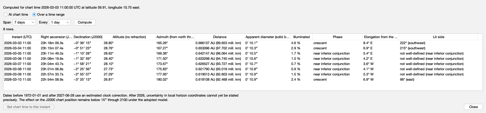

Packed 1854 × 433 px.

| shown, hovered or spoken |
|---|
| Mercury |
| Where Mercury is, computed from the bundled ephemeris for the chart time and place: its position among the fixed stars, its height and direction above the horizon, its distance and apparent size, how much of it is lit and which way the light falls, at that instant or over a range of instants. |
| Whether the table is for the chart time and place now |
| Computed for chart time 2026-03-03 11:00:00 UTC at latitude 59.91, longitude 10.75 east. |
| At chart time |
| One row, at the chart time |
| Show Mercury at the chart time |
| Shows a single row: Mercury at the chart time. |
| Over a time range |
| A row for every step from the chart time, over a span |
| Show Mercury over a range of instants |
| Shows a row for every step from the chart time over the span chosen, as many whole steps as the span holds; the first row is the chart time, read again whenever you compute. To range from another instant, set the chart time. |
| Span |
| 1 day |
| 7 days |
| 30 days |
| 90 days |
| 365 days |
| How far the rows reach from the chart time |
| Span of the range from the chart time |
| How far from the chart time the rows reach, in whole steps of the step beside it. |
| Every |
| 1 hour |
| 6 hours |
| The elapsed time between rows |
| Step between rows |
| The elapsed time between rows, on the UTC timeline, so a daily range does not drift across a change of civil clock. |
| Compute |
| Fill the table for the span and step above, from the chart time |
| Compute the range |
| Computes a row for every step of the span above, from the chart time now. |
| 8 rows. |
| Instant (UTC) |
| Right ascension (J2000) |
| Declination (J2000) |
| Altitude (no refraction) |
| Azimuth (from north through east) |
| Distance |
| Apparent diameter (solid body) |
| Illuminated |
| Phase |
| Elongation from the Sun |
| Lit side |
| 2026-03-03 11:00 · 23h 18m 09.3s · −0° 36′ 15″ · 28.80° · 165.26° · 0.666137 AU (99.653 mill. km) · 0′ 10.1″ · 4.6 % · crescent · 8.4° E · 222° (southwest) |
| 2026-03-04 11:00 · 23h 15m 07.4s · −0° 51′ 23″ · 28.76° · 167.27° · 0.653096 AU (97.702 mill. km) · 0′ 10.3″ · 2.9 % · crescent · 6.9° E · 215° (southwest) |
| 2026-03-05 11:00 · 23h 11m 49.2s · −1° 10′ 28″ · 28.62° · 169.36° · 0.642147 AU (96.064 mill. km) · 0′ 10.5″ · 1.7 % · near inferior conjunction · 5.4° E · not well-defined (near inferior conjunction) |
| 2026-03-06 11:00 · 23h 08m 19.6s · −1° 32′ 59″ · 28.40° · 171.50° · 0.633298 AU (94.740 mill. km) · 0′ 10.6″ · 1.0 % · near inferior conjunction · 4.2° E · not well-defined (near inferior conjunction) |
| 2026-03-07 11:00 · 23h 04m 43.7s · −1° 58′ 21″ · 28.10° · 173.67° · 0.626527 AU (93.727 mill. km) · 0′ 10.7″ · 0.7 % · near inferior conjunction · 3.6° W · not well-defined (near inferior conjunction) |
| 2026-03-08 11:00 · 23h 01m 06.8s · −2° 25′ 56″ · 27.73° · 175.83° · 0.621790 AU (93.018 mill. km) · 0′ 10.8″ · 0.9 % · near inferior conjunction · 4.1° W · not well-defined (near inferior conjunction) |
| 2026-03-09 11:00 · 22h 57m 33.7s · −2° 55′ 07″ · 27.29° · 177.95° · 0.619013 AU (92.603 mill. km) · 0′ 10.9″ · 1.5 % · near inferior conjunction · 5.3° W · not well-defined (near inferior conjunction) |
| 2026-03-10 11:00 · 22h 54m 08.9s · −3° 25′ 13″ · 26.81° · 180.02° · 0.618108 AU (92.468 mill. km) · 0′ 10.9″ · 2.4 % · crescent · 6.9° W · 96° (east) |
| Mercury's computed quantities |
| Each row is one instant. The columns are the instant in UTC; right ascension and declination in the J2000 frame the chart is drawn in; altitude and azimuth without refraction; distance; the solid body's apparent diameter; the illuminated fraction; the phase; the elongation from the Sun with the side of the Sun Mercury is on; and the lit side, the direction the light falls from. |
| Dates before 1972-01-01 and after 2027-06-28 use an estimated clock correction. After 2026, uncertainty in local horizon coordinates cannot yet be stated precisely. The effect on the J2000 chart position remains below 15″ through 2100 under the adopted model. |
| Set chart time to this instant [unavailable] |
| Make the selected row's instant the chart time and redraw every body for it [unavailable] |
| Set the chart time to the selected row's instant [unavailable] |
| Sets the chart time to the instant of the selected row, as Place and Time would, so every enabled body is redrawn for it. This table is then for an earlier chart time until you compute again. [unavailable] |
| Close |
| Close the Mercury table |
| Closes the table. Nothing is changed or remembered; Place and Time keeps the place and instant. |

### A range that leaves the interval

A week from the chart time ends after the last civil day Mercury is computed for. The table is empty and the status line says why, naming the interval; nothing is extrapolated.

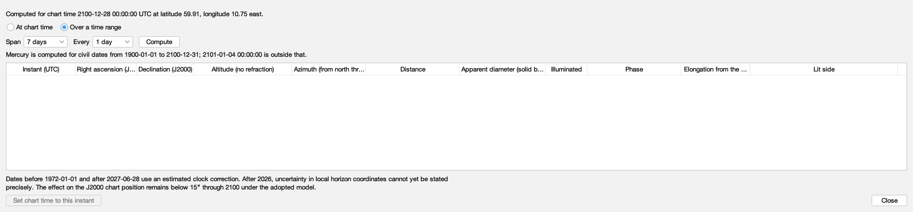

Packed 1854 × 433 px.

| shown, hovered or spoken |
|---|
| Mercury |
| Where Mercury is, computed from the bundled ephemeris for the chart time and place: its position among the fixed stars, its height and direction above the horizon, its distance and apparent size, how much of it is lit and which way the light falls, at that instant or over a range of instants. |
| Whether the table is for the chart time and place now |
| Computed for chart time 2100-12-28 00:00:00 UTC at latitude 59.91, longitude 10.75 east. |
| At chart time |
| One row, at the chart time |
| Show Mercury at the chart time |
| Shows a single row: Mercury at the chart time. |
| Over a time range |
| A row for every step from the chart time, over a span |
| Show Mercury over a range of instants |
| Shows a row for every step from the chart time over the span chosen, as many whole steps as the span holds; the first row is the chart time, read again whenever you compute. To range from another instant, set the chart time. |
| Span |
| 1 day |
| 7 days |
| 30 days |
| 90 days |
| 365 days |
| How far the rows reach from the chart time |
| Span of the range from the chart time |
| How far from the chart time the rows reach, in whole steps of the step beside it. |
| Every |
| 1 hour |
| 6 hours |
| The elapsed time between rows |
| Step between rows |
| The elapsed time between rows, on the UTC timeline, so a daily range does not drift across a change of civil clock. |
| Compute |
| Fill the table for the span and step above, from the chart time |
| Compute the range |
| Computes a row for every step of the span above, from the chart time now. |
| Mercury is computed for civil dates from 1900-01-01 to 2100-12-31; 2101-01-04 00:00:00 is outside that. |
| Instant (UTC) |
| Right ascension (J2000) |
| Declination (J2000) |
| Altitude (no refraction) |
| Azimuth (from north through east) |
| Distance |
| Apparent diameter (solid body) |
| Illuminated |
| Phase |
| Elongation from the Sun |
| Lit side |
| Mercury's computed quantities |
| Each row is one instant. The columns are the instant in UTC; right ascension and declination in the J2000 frame the chart is drawn in; altitude and azimuth without refraction; distance; the solid body's apparent diameter; the illuminated fraction; the phase; the elongation from the Sun with the side of the Sun Mercury is on; and the lit side, the direction the light falls from. |
| Dates before 1972-01-01 and after 2027-06-28 use an estimated clock correction. After 2026, uncertainty in local horizon coordinates cannot yet be stated precisely. The effect on the J2000 chart position remains below 15″ through 2100 under the adopted model. |
| Set chart time to this instant [unavailable] |
| Make the selected row's instant the chart time and redraw every body for it [unavailable] |
| Set the chart time to the selected row's instant [unavailable] |
| Sets the chart time to the instant of the selected row, as Place and Time would, so every enabled body is redrawn for it. This table is then for an earlier chart time until you compute again. [unavailable] |
| Close |
| Close the Mercury table |
| Closes the table. Nothing is changed or remembered; Place and Time keeps the place and instant. |

### Oslo during the 2019 transit

The NASA/GSFC catalogue's minute of greatest transit, while Mercury crossed the Sun's disc: the phase reads in front of the Sun, and the lit side is stated as not well-defined rather than as a false angle; from Oslo the Sun had just set.

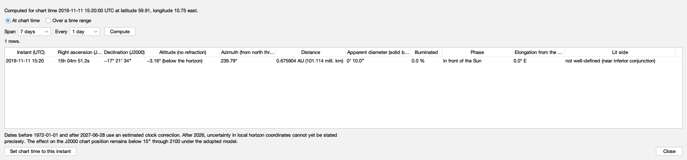

Packed 1854 × 433 px.

| shown, hovered or spoken |
|---|
| Mercury |
| Where Mercury is, computed from the bundled ephemeris for the chart time and place: its position among the fixed stars, its height and direction above the horizon, its distance and apparent size, how much of it is lit and which way the light falls, at that instant or over a range of instants. |
| Whether the table is for the chart time and place now |
| Computed for chart time 2019-11-11 15:20:00 UTC at latitude 59.91, longitude 10.75 east. |
| At chart time |
| One row, at the chart time |
| Show Mercury at the chart time |
| Shows a single row: Mercury at the chart time. |
| Over a time range |
| A row for every step from the chart time, over a span |
| Show Mercury over a range of instants |
| Shows a row for every step from the chart time over the span chosen, as many whole steps as the span holds; the first row is the chart time, read again whenever you compute. To range from another instant, set the chart time. |
| Span |
| 1 day |
| 7 days |
| 30 days |
| 90 days |
| 365 days |
| How far the rows reach from the chart time |
| Span of the range from the chart time |
| How far from the chart time the rows reach, in whole steps of the step beside it. |
| Every |
| 1 hour |
| 6 hours |
| The elapsed time between rows |
| Step between rows |
| The elapsed time between rows, on the UTC timeline, so a daily range does not drift across a change of civil clock. |
| Compute |
| Fill the table for the span and step above, from the chart time |
| Compute the range |
| Computes a row for every step of the span above, from the chart time now. |
| 1 rows. |
| Instant (UTC) |
| Right ascension (J2000) |
| Declination (J2000) |
| Altitude (no refraction) |
| Azimuth (from north through east) |
| Distance |
| Apparent diameter (solid body) |
| Illuminated |
| Phase |
| Elongation from the Sun |
| Lit side |
| 2019-11-11 15:20 · 15h 04m 51.2s · −17° 21′ 34″ · −3.16° (below the horizon) · 239.79° · 0.675904 AU (101.114 mill. km) · 0′ 10.0″ · 0.0 % · in front of the Sun · 0.0° E · not well-defined (near inferior conjunction) |
| Mercury's computed quantities |
| Each row is one instant. The columns are the instant in UTC; right ascension and declination in the J2000 frame the chart is drawn in; altitude and azimuth without refraction; distance; the solid body's apparent diameter; the illuminated fraction; the phase; the elongation from the Sun with the side of the Sun Mercury is on; and the lit side, the direction the light falls from. |
| Dates before 1972-01-01 and after 2027-06-28 use an estimated clock correction. After 2026, uncertainty in local horizon coordinates cannot yet be stated precisely. The effect on the J2000 chart position remains below 15″ through 2100 under the adopted model. |
| Set chart time to this instant |
| Make the selected row's instant the chart time and redraw every body for it |
| Set the chart time to the selected row's instant |
| Sets the chart time to the instant of the selected row, as Place and Time would, so every enabled body is redrawn for it. This table is then for an earlier chart time until you compute again. |
| Close |
| Close the Mercury table |
| Closes the table. Nothing is changed or remembered; Place and Time keeps the place and instant. |

### The chart moved on after computing

The chart time moved six hours on after this instant was computed (#612, ruling P1): the rows stay, dimmed, under the stale message, until Compute; the note states the chart time and place the rows are for.

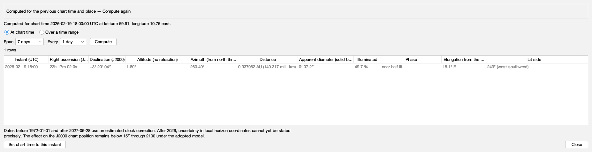

Packed 1854 × 479 px.

| shown, hovered or spoken |
|---|
| Mercury |
| Where Mercury is, computed from the bundled ephemeris for the chart time and place: its position among the fixed stars, its height and direction above the horizon, its distance and apparent size, how much of it is lit and which way the light falls, at that instant or over a range of instants. |
| Whether the table is for the chart time and place now |
| Computed for the previous chart time and place — Compute again |
| Computed for chart time 2026-02-19 18:00:00 UTC at latitude 59.91, longitude 10.75 east. |
| At chart time |
| One row, at the chart time |
| Show Mercury at the chart time |
| Shows a single row: Mercury at the chart time. |
| Over a time range |
| A row for every step from the chart time, over a span |
| Show Mercury over a range of instants |
| Shows a row for every step from the chart time over the span chosen, as many whole steps as the span holds; the first row is the chart time, read again whenever you compute. To range from another instant, set the chart time. |
| Span |
| 1 day |
| 7 days |
| 30 days |
| 90 days |
| 365 days |
| How far the rows reach from the chart time |
| Span of the range from the chart time |
| How far from the chart time the rows reach, in whole steps of the step beside it. |
| Every |
| 1 hour |
| 6 hours |
| The elapsed time between rows |
| Step between rows |
| The elapsed time between rows, on the UTC timeline, so a daily range does not drift across a change of civil clock. |
| Compute |
| Fill the table for the span and step above, from the chart time |
| Compute the range |
| Computes a row for every step of the span above, from the chart time now. |
| 1 rows. |
| Instant (UTC) |
| Right ascension (J2000) |
| Declination (J2000) |
| Altitude (no refraction) |
| Azimuth (from north through east) |
| Distance |
| Apparent diameter (solid body) |
| Illuminated |
| Phase |
| Elongation from the Sun |
| Lit side |
| 2026-02-19 18:00 · 23h 17m 02.0s · −3° 20′ 04″ · 1.80° · 260.49° · 0.937962 AU (140.317 mill. km) · 0′ 07.2″ · 49.7 % · near half lit · 18.1° E · 243° (west-southwest) |
| Mercury's computed quantities |
| Each row is one instant. The columns are the instant in UTC; right ascension and declination in the J2000 frame the chart is drawn in; altitude and azimuth without refraction; distance; the solid body's apparent diameter; the illuminated fraction; the phase; the elongation from the Sun with the side of the Sun Mercury is on; and the lit side, the direction the light falls from. |
| Dates before 1972-01-01 and after 2027-06-28 use an estimated clock correction. After 2026, uncertainty in local horizon coordinates cannot yet be stated precisely. The effect on the J2000 chart position remains below 15″ through 2100 under the adopted model. |
| Set chart time to this instant |
| Make the selected row's instant the chart time and redraw every body for it |
| Set the chart time to the selected row's instant |
| Sets the chart time to the instant of the selected row, as Place and Time would, so every enabled body is redrawn for it. This table is then for an earlier chart time until you compute again. |
| Close |
| Close the Mercury table |
| Closes the table. Nothing is changed or remembered; Place and Time keeps the place and instant. |

### The instant, in the dark appearance

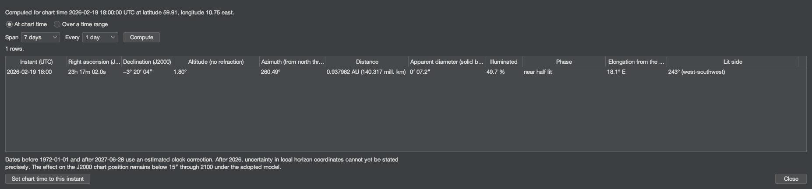

Packed 1854 × 433 px.

| shown, hovered or spoken |
|---|
| Mercury |
| Where Mercury is, computed from the bundled ephemeris for the chart time and place: its position among the fixed stars, its height and direction above the horizon, its distance and apparent size, how much of it is lit and which way the light falls, at that instant or over a range of instants. |
| Whether the table is for the chart time and place now |
| Computed for chart time 2026-02-19 18:00:00 UTC at latitude 59.91, longitude 10.75 east. |
| At chart time |
| One row, at the chart time |
| Show Mercury at the chart time |
| Shows a single row: Mercury at the chart time. |
| Over a time range |
| A row for every step from the chart time, over a span |
| Show Mercury over a range of instants |
| Shows a row for every step from the chart time over the span chosen, as many whole steps as the span holds; the first row is the chart time, read again whenever you compute. To range from another instant, set the chart time. |
| Span |
| 1 day |
| 7 days |
| 30 days |
| 90 days |
| 365 days |
| How far the rows reach from the chart time |
| Span of the range from the chart time |
| How far from the chart time the rows reach, in whole steps of the step beside it. |
| Every |
| 1 hour |
| 6 hours |
| The elapsed time between rows |
| Step between rows |
| The elapsed time between rows, on the UTC timeline, so a daily range does not drift across a change of civil clock. |
| Compute |
| Fill the table for the span and step above, from the chart time |
| Compute the range |
| Computes a row for every step of the span above, from the chart time now. |
| 1 rows. |
| Instant (UTC) |
| Right ascension (J2000) |
| Declination (J2000) |
| Altitude (no refraction) |
| Azimuth (from north through east) |
| Distance |
| Apparent diameter (solid body) |
| Illuminated |
| Phase |
| Elongation from the Sun |
| Lit side |
| 2026-02-19 18:00 · 23h 17m 02.0s · −3° 20′ 04″ · 1.80° · 260.49° · 0.937962 AU (140.317 mill. km) · 0′ 07.2″ · 49.7 % · near half lit · 18.1° E · 243° (west-southwest) |
| Mercury's computed quantities |
| Each row is one instant. The columns are the instant in UTC; right ascension and declination in the J2000 frame the chart is drawn in; altitude and azimuth without refraction; distance; the solid body's apparent diameter; the illuminated fraction; the phase; the elongation from the Sun with the side of the Sun Mercury is on; and the lit side, the direction the light falls from. |
| Dates before 1972-01-01 and after 2027-06-28 use an estimated clock correction. After 2026, uncertainty in local horizon coordinates cannot yet be stated precisely. The effect on the J2000 chart position remains below 15″ through 2100 under the adopted model. |
| Set chart time to this instant |
| Make the selected row's instant the chart time and redraw every body for it |
| Set the chart time to the selected row's instant |
| Sets the chart time to the instant of the selected row, as Place and Time would, so every enabled body is redrawn for it. This table is then for an earlier chart time until you compute again. |
| Close |
| Close the Mercury table |
| Closes the table. Nothing is changed or remembered; Place and Time keeps the place and instant. |

#### The headings, and what they explain

| heading | explanation |
|---|---|
| Instant (UTC) | The instant in UTC, to the minute. "est." marks an instant whose clock correction is estimated; † marks a range end that was not on the grid. |
| Right ascension (J2000) | Hours, minutes and seconds of time, in the ICRS/J2000 frame the chart is drawn in: where Mercury is among the fixed stars, as seen from the observing place, without aberration. |
| Declination (J2000) | Degrees, minutes and seconds of arc, in the same frame. |
| Altitude (no refraction) | Degrees above the mathematical horizon, without atmospheric refraction; below the horizon the number is kept and the status is added. |
| Azimuth (from north through east) | Degrees from north through east: 90° is east, 180° south, 270° west. |
| Distance | From the observer to Mercury's centre, in astronomical units and in millions of kilometres. |
| Apparent diameter (solid body) | How large Mercury's solid body looks, in minutes and seconds of arc, from its equatorial radius of 2440.53 km. Mercury's figure is triaxial, 2440.53 by 2440.53 by 2438.26 km; the equatorial radius is used, as JPL Horizons uses it, and the mean radius is not substituted. |
| Illuminated | How much of Mercury's disc is lit, as a percentage of the whole disc. |
| Phase | The phase as a reader sees it: in front of the Sun or behind the Sun when Mercury's disc meets the Sun's; otherwise near inferior conjunction, crescent, near half lit, gibbous or near full, by how much of the disc is lit - the same bands as Venus's. "Near" marks a band, not an exact instant. |
| Elongation from the Sun | Degrees between the Sun and Mercury in the observer's sky; E when Mercury is east of the Sun there in right ascension (the evening sky), W when west of it (the morning sky). It does not announce a conjunction. |
| Lit side | The position angle of the bright limb's midpoint, from celestial north through east, with the nearest of sixteen compass points; not well-defined near inferior conjunction and near full. |

## Norsk bokmål (`nb-NO`)

### One instant: Oslo at the 2026 greatest eastern elongation

The fresh state: a single row at the instant Place and Time holds - Espenak's hour of the greatest eastern elongation. Mercury is near half lit, east of the Sun in the evening sky, its lit side towards the Sun in the west-southwest.

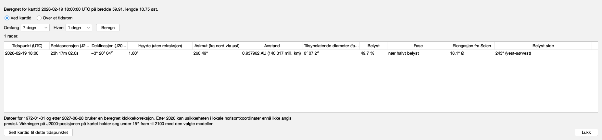

Packed 1854 × 433 px.

| shown, hovered or spoken |
|---|
| Merkur |
| Hvor Merkur er, beregnet fra den medfølgende efemeriden for karttiden og observasjonsstedet: posisjonen blant fiksstjernene, høyden og retningen over horisonten, avstanden og den tilsynelatende størrelsen, hvor mye av den som er belyst og hvilken vei lyset faller, ved det tidspunktet eller over et tidsrom. |
| Om tabellen gjelder karttiden og stedet nå |
| Beregnet for karttid 2026-02-19 18:00:00 UTC på bredde 59,91, lengde 10,75 øst. |
| Ved karttid |
| Én rad, ved karttiden |
| Vis Merkur ved karttiden |
| Viser én rad: Merkur ved karttiden. |
| Over et tidsrom |
| Én rad for hvert steg fra karttiden, over et omfang |
| Vis Merkur over et tidsrom |
| Viser én rad for hvert steg fra karttiden over omfanget valgt, så mange hele steg som omfanget rommer; første rad er karttiden, lest på nytt hver gang du beregner. Sett karttiden for å regne fra et annet tidspunkt. |
| Omfang |
| 1 døgn |
| 7 døgn |
| 30 døgn |
| 90 døgn |
| 365 døgn |
| Hvor langt radene rekker fra karttiden |
| Tidsrommets omfang fra karttiden |
| Hvor langt fra karttiden radene rekker, i hele steg av steget ved siden av. |
| Hvert |
| 1 time |
| 6 timer |
| Tiden som går mellom radene |
| Steg mellom radene |
| Tiden som går mellom radene, på UTC-tidslinjen, så et daglig tidsrom ikke forskyver seg ved skifte av sivil klokke. |
| Beregn |
| Fyll tabellen for omfanget og steget over, fra karttiden |
| Beregn tidsrommet |
| Beregner én rad for hvert steg i omfanget over, fra karttiden nå. |
| 1 rader. |
| Tidspunkt (UTC) |
| Rektascensjon (J2000) |
| Deklinasjon (J2000) |
| Høyde (uten refraksjon) |
| Asimut (fra nord via øst) |
| Avstand |
| Tilsynelatende diameter (fast kropp) |
| Belyst |
| Fase |
| Elongasjon fra Solen |
| Belyst side |
| 2026-02-19 18:00 · 23h 17m 02,0s · −3° 20′ 04″ · 1,80° · 260,49° · 0,937962 AU (140,317 mill. km) · 0′ 07,2″ · 49,7 % · nær halvt belyst · 18,1° Ø · 243° (vest-sørvest) |
| Merkurs beregnede størrelser |
| Hver rad er ett tidspunkt. Kolonnene er tidspunktet i UTC; rektascensjon og deklinasjon i J2000-rammen kartet tegnes i; høyde og asimut uten refraksjon; avstand; den faste kroppens tilsynelatende diameter; belyst andel; fase; elongasjon fra Solen med hvilken side av Solen Merkur står på; og belyst side, retningen lyset faller fra. |
| Datoer før 1972-01-01 og etter 2027-06-28 bruker en beregnet klokkekorreksjon. Etter 2026 kan usikkerheten i lokale horisontkoordinater ennå ikke angis presist. Virkningen på J2000-posisjonen på kartet holder seg under 15″ fram til 2100 med den valgte modellen. |
| Sett karttid til dette tidspunktet |
| Gjør den valgte radens tidspunkt til karttid og tegn hvert himmellegeme på nytt for det |
| Sett karttiden til den valgte radens tidspunkt |
| Setter karttiden til tidspunktet i den valgte raden, slik Sted og tid ville gjort, så hvert påslått himmellegeme tegnes på nytt for det. Denne tabellen gjelder så en tidligere karttid til du beregner på nytt. |
| Lukk |
| Lukk merkurtabellen |
| Lukker tabellen. Ingenting endres eller huskes; Sted og tid beholder stedet og tidspunktet. |

### A daily range through the 2026 inferior conjunction

A week of daily rows from the chart time, the first row the chart time itself. The disc is at its largest and least lit, and the side of the Sun changes from E to W - by right ascension, so before the conjunction a reader may be told of; the table names no conjunction. Mercury's apparition turns in days where Venus's takes weeks.

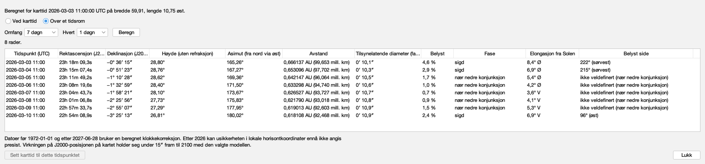

Packed 1854 × 433 px.

| shown, hovered or spoken |
|---|
| Merkur |
| Hvor Merkur er, beregnet fra den medfølgende efemeriden for karttiden og observasjonsstedet: posisjonen blant fiksstjernene, høyden og retningen over horisonten, avstanden og den tilsynelatende størrelsen, hvor mye av den som er belyst og hvilken vei lyset faller, ved det tidspunktet eller over et tidsrom. |
| Om tabellen gjelder karttiden og stedet nå |
| Beregnet for karttid 2026-03-03 11:00:00 UTC på bredde 59,91, lengde 10,75 øst. |
| Ved karttid |
| Én rad, ved karttiden |
| Vis Merkur ved karttiden |
| Viser én rad: Merkur ved karttiden. |
| Over et tidsrom |
| Én rad for hvert steg fra karttiden, over et omfang |
| Vis Merkur over et tidsrom |
| Viser én rad for hvert steg fra karttiden over omfanget valgt, så mange hele steg som omfanget rommer; første rad er karttiden, lest på nytt hver gang du beregner. Sett karttiden for å regne fra et annet tidspunkt. |
| Omfang |
| 1 døgn |
| 7 døgn |
| 30 døgn |
| 90 døgn |
| 365 døgn |
| Hvor langt radene rekker fra karttiden |
| Tidsrommets omfang fra karttiden |
| Hvor langt fra karttiden radene rekker, i hele steg av steget ved siden av. |
| Hvert |
| 1 time |
| 6 timer |
| Tiden som går mellom radene |
| Steg mellom radene |
| Tiden som går mellom radene, på UTC-tidslinjen, så et daglig tidsrom ikke forskyver seg ved skifte av sivil klokke. |
| Beregn |
| Fyll tabellen for omfanget og steget over, fra karttiden |
| Beregn tidsrommet |
| Beregner én rad for hvert steg i omfanget over, fra karttiden nå. |
| 8 rader. |
| Tidspunkt (UTC) |
| Rektascensjon (J2000) |
| Deklinasjon (J2000) |
| Høyde (uten refraksjon) |
| Asimut (fra nord via øst) |
| Avstand |
| Tilsynelatende diameter (fast kropp) |
| Belyst |
| Fase |
| Elongasjon fra Solen |
| Belyst side |
| 2026-03-03 11:00 · 23h 18m 09,3s · −0° 36′ 15″ · 28,80° · 165,26° · 0,666137 AU (99,653 mill. km) · 0′ 10,1″ · 4,6 % · sigd · 8,4° Ø · 222° (sørvest) |
| 2026-03-04 11:00 · 23h 15m 07,4s · −0° 51′ 23″ · 28,76° · 167,27° · 0,653096 AU (97,702 mill. km) · 0′ 10,3″ · 2,9 % · sigd · 6,9° Ø · 215° (sørvest) |
| 2026-03-05 11:00 · 23h 11m 49,2s · −1° 10′ 28″ · 28,62° · 169,36° · 0,642147 AU (96,064 mill. km) · 0′ 10,5″ · 1,7 % · nær nedre konjunksjon · 5,4° Ø · ikke veldefinert (nær nedre konjunksjon) |
| 2026-03-06 11:00 · 23h 08m 19,6s · −1° 32′ 59″ · 28,40° · 171,50° · 0,633298 AU (94,740 mill. km) · 0′ 10,6″ · 1,0 % · nær nedre konjunksjon · 4,2° Ø · ikke veldefinert (nær nedre konjunksjon) |
| 2026-03-07 11:00 · 23h 04m 43,7s · −1° 58′ 21″ · 28,10° · 173,67° · 0,626527 AU (93,727 mill. km) · 0′ 10,7″ · 0,7 % · nær nedre konjunksjon · 3,6° V · ikke veldefinert (nær nedre konjunksjon) |
| 2026-03-08 11:00 · 23h 01m 06,8s · −2° 25′ 56″ · 27,73° · 175,83° · 0,621790 AU (93,018 mill. km) · 0′ 10,8″ · 0,9 % · nær nedre konjunksjon · 4,1° V · ikke veldefinert (nær nedre konjunksjon) |
| 2026-03-09 11:00 · 22h 57m 33,7s · −2° 55′ 07″ · 27,29° · 177,95° · 0,619013 AU (92,603 mill. km) · 0′ 10,9″ · 1,5 % · nær nedre konjunksjon · 5,3° V · ikke veldefinert (nær nedre konjunksjon) |
| 2026-03-10 11:00 · 22h 54m 08,9s · −3° 25′ 13″ · 26,81° · 180,02° · 0,618108 AU (92,468 mill. km) · 0′ 10,9″ · 2,4 % · sigd · 6,9° V · 96° (øst) |
| Merkurs beregnede størrelser |
| Hver rad er ett tidspunkt. Kolonnene er tidspunktet i UTC; rektascensjon og deklinasjon i J2000-rammen kartet tegnes i; høyde og asimut uten refraksjon; avstand; den faste kroppens tilsynelatende diameter; belyst andel; fase; elongasjon fra Solen med hvilken side av Solen Merkur står på; og belyst side, retningen lyset faller fra. |
| Datoer før 1972-01-01 og etter 2027-06-28 bruker en beregnet klokkekorreksjon. Etter 2026 kan usikkerheten i lokale horisontkoordinater ennå ikke angis presist. Virkningen på J2000-posisjonen på kartet holder seg under 15″ fram til 2100 med den valgte modellen. |
| Sett karttid til dette tidspunktet [unavailable] |
| Gjør den valgte radens tidspunkt til karttid og tegn hvert himmellegeme på nytt for det [unavailable] |
| Sett karttiden til den valgte radens tidspunkt [unavailable] |
| Setter karttiden til tidspunktet i den valgte raden, slik Sted og tid ville gjort, så hvert påslått himmellegeme tegnes på nytt for det. Denne tabellen gjelder så en tidligere karttid til du beregner på nytt. [unavailable] |
| Lukk |
| Lukk merkurtabellen |
| Lukker tabellen. Ingenting endres eller huskes; Sted og tid beholder stedet og tidspunktet. |

### A range that leaves the interval

A week from the chart time ends after the last civil day Mercury is computed for. The table is empty and the status line says why, naming the interval; nothing is extrapolated.

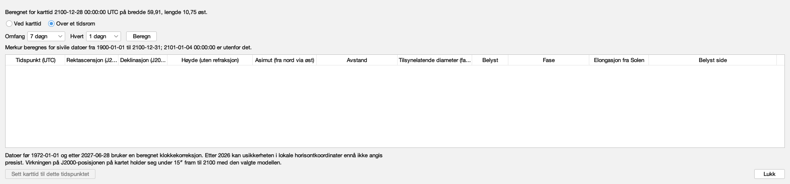

Packed 1854 × 433 px.

| shown, hovered or spoken |
|---|
| Merkur |
| Hvor Merkur er, beregnet fra den medfølgende efemeriden for karttiden og observasjonsstedet: posisjonen blant fiksstjernene, høyden og retningen over horisonten, avstanden og den tilsynelatende størrelsen, hvor mye av den som er belyst og hvilken vei lyset faller, ved det tidspunktet eller over et tidsrom. |
| Om tabellen gjelder karttiden og stedet nå |
| Beregnet for karttid 2100-12-28 00:00:00 UTC på bredde 59,91, lengde 10,75 øst. |
| Ved karttid |
| Én rad, ved karttiden |
| Vis Merkur ved karttiden |
| Viser én rad: Merkur ved karttiden. |
| Over et tidsrom |
| Én rad for hvert steg fra karttiden, over et omfang |
| Vis Merkur over et tidsrom |
| Viser én rad for hvert steg fra karttiden over omfanget valgt, så mange hele steg som omfanget rommer; første rad er karttiden, lest på nytt hver gang du beregner. Sett karttiden for å regne fra et annet tidspunkt. |
| Omfang |
| 1 døgn |
| 7 døgn |
| 30 døgn |
| 90 døgn |
| 365 døgn |
| Hvor langt radene rekker fra karttiden |
| Tidsrommets omfang fra karttiden |
| Hvor langt fra karttiden radene rekker, i hele steg av steget ved siden av. |
| Hvert |
| 1 time |
| 6 timer |
| Tiden som går mellom radene |
| Steg mellom radene |
| Tiden som går mellom radene, på UTC-tidslinjen, så et daglig tidsrom ikke forskyver seg ved skifte av sivil klokke. |
| Beregn |
| Fyll tabellen for omfanget og steget over, fra karttiden |
| Beregn tidsrommet |
| Beregner én rad for hvert steg i omfanget over, fra karttiden nå. |
| Merkur beregnes for sivile datoer fra 1900-01-01 til 2100-12-31; 2101-01-04 00:00:00 er utenfor det. |
| Tidspunkt (UTC) |
| Rektascensjon (J2000) |
| Deklinasjon (J2000) |
| Høyde (uten refraksjon) |
| Asimut (fra nord via øst) |
| Avstand |
| Tilsynelatende diameter (fast kropp) |
| Belyst |
| Fase |
| Elongasjon fra Solen |
| Belyst side |
| Merkurs beregnede størrelser |
| Hver rad er ett tidspunkt. Kolonnene er tidspunktet i UTC; rektascensjon og deklinasjon i J2000-rammen kartet tegnes i; høyde og asimut uten refraksjon; avstand; den faste kroppens tilsynelatende diameter; belyst andel; fase; elongasjon fra Solen med hvilken side av Solen Merkur står på; og belyst side, retningen lyset faller fra. |
| Datoer før 1972-01-01 og etter 2027-06-28 bruker en beregnet klokkekorreksjon. Etter 2026 kan usikkerheten i lokale horisontkoordinater ennå ikke angis presist. Virkningen på J2000-posisjonen på kartet holder seg under 15″ fram til 2100 med den valgte modellen. |
| Sett karttid til dette tidspunktet [unavailable] |
| Gjør den valgte radens tidspunkt til karttid og tegn hvert himmellegeme på nytt for det [unavailable] |
| Sett karttiden til den valgte radens tidspunkt [unavailable] |
| Setter karttiden til tidspunktet i den valgte raden, slik Sted og tid ville gjort, så hvert påslått himmellegeme tegnes på nytt for det. Denne tabellen gjelder så en tidligere karttid til du beregner på nytt. [unavailable] |
| Lukk |
| Lukk merkurtabellen |
| Lukker tabellen. Ingenting endres eller huskes; Sted og tid beholder stedet og tidspunktet. |

### Oslo during the 2019 transit

The NASA/GSFC catalogue's minute of greatest transit, while Mercury crossed the Sun's disc: the phase reads in front of the Sun, and the lit side is stated as not well-defined rather than as a false angle; from Oslo the Sun had just set.

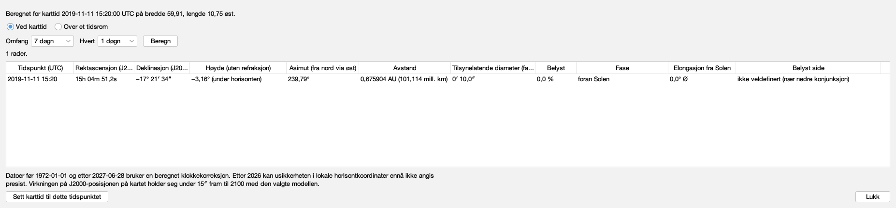

Packed 1854 × 433 px.

| shown, hovered or spoken |
|---|
| Merkur |
| Hvor Merkur er, beregnet fra den medfølgende efemeriden for karttiden og observasjonsstedet: posisjonen blant fiksstjernene, høyden og retningen over horisonten, avstanden og den tilsynelatende størrelsen, hvor mye av den som er belyst og hvilken vei lyset faller, ved det tidspunktet eller over et tidsrom. |
| Om tabellen gjelder karttiden og stedet nå |
| Beregnet for karttid 2019-11-11 15:20:00 UTC på bredde 59,91, lengde 10,75 øst. |
| Ved karttid |
| Én rad, ved karttiden |
| Vis Merkur ved karttiden |
| Viser én rad: Merkur ved karttiden. |
| Over et tidsrom |
| Én rad for hvert steg fra karttiden, over et omfang |
| Vis Merkur over et tidsrom |
| Viser én rad for hvert steg fra karttiden over omfanget valgt, så mange hele steg som omfanget rommer; første rad er karttiden, lest på nytt hver gang du beregner. Sett karttiden for å regne fra et annet tidspunkt. |
| Omfang |
| 1 døgn |
| 7 døgn |
| 30 døgn |
| 90 døgn |
| 365 døgn |
| Hvor langt radene rekker fra karttiden |
| Tidsrommets omfang fra karttiden |
| Hvor langt fra karttiden radene rekker, i hele steg av steget ved siden av. |
| Hvert |
| 1 time |
| 6 timer |
| Tiden som går mellom radene |
| Steg mellom radene |
| Tiden som går mellom radene, på UTC-tidslinjen, så et daglig tidsrom ikke forskyver seg ved skifte av sivil klokke. |
| Beregn |
| Fyll tabellen for omfanget og steget over, fra karttiden |
| Beregn tidsrommet |
| Beregner én rad for hvert steg i omfanget over, fra karttiden nå. |
| 1 rader. |
| Tidspunkt (UTC) |
| Rektascensjon (J2000) |
| Deklinasjon (J2000) |
| Høyde (uten refraksjon) |
| Asimut (fra nord via øst) |
| Avstand |
| Tilsynelatende diameter (fast kropp) |
| Belyst |
| Fase |
| Elongasjon fra Solen |
| Belyst side |
| 2019-11-11 15:20 · 15h 04m 51,2s · −17° 21′ 34″ · −3,16° (under horisonten) · 239,79° · 0,675904 AU (101,114 mill. km) · 0′ 10,0″ · 0,0 % · foran Solen · 0,0° Ø · ikke veldefinert (nær nedre konjunksjon) |
| Merkurs beregnede størrelser |
| Hver rad er ett tidspunkt. Kolonnene er tidspunktet i UTC; rektascensjon og deklinasjon i J2000-rammen kartet tegnes i; høyde og asimut uten refraksjon; avstand; den faste kroppens tilsynelatende diameter; belyst andel; fase; elongasjon fra Solen med hvilken side av Solen Merkur står på; og belyst side, retningen lyset faller fra. |
| Datoer før 1972-01-01 og etter 2027-06-28 bruker en beregnet klokkekorreksjon. Etter 2026 kan usikkerheten i lokale horisontkoordinater ennå ikke angis presist. Virkningen på J2000-posisjonen på kartet holder seg under 15″ fram til 2100 med den valgte modellen. |
| Sett karttid til dette tidspunktet |
| Gjør den valgte radens tidspunkt til karttid og tegn hvert himmellegeme på nytt for det |
| Sett karttiden til den valgte radens tidspunkt |
| Setter karttiden til tidspunktet i den valgte raden, slik Sted og tid ville gjort, så hvert påslått himmellegeme tegnes på nytt for det. Denne tabellen gjelder så en tidligere karttid til du beregner på nytt. |
| Lukk |
| Lukk merkurtabellen |
| Lukker tabellen. Ingenting endres eller huskes; Sted og tid beholder stedet og tidspunktet. |

### The chart moved on after computing

The chart time moved six hours on after this instant was computed (#612, ruling P1): the rows stay, dimmed, under the stale message, until Compute; the note states the chart time and place the rows are for.

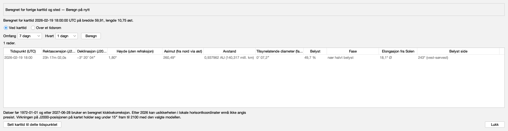

Packed 1854 × 479 px.

| shown, hovered or spoken |
|---|
| Merkur |
| Hvor Merkur er, beregnet fra den medfølgende efemeriden for karttiden og observasjonsstedet: posisjonen blant fiksstjernene, høyden og retningen over horisonten, avstanden og den tilsynelatende størrelsen, hvor mye av den som er belyst og hvilken vei lyset faller, ved det tidspunktet eller over et tidsrom. |
| Om tabellen gjelder karttiden og stedet nå |
| Beregnet for forrige karttid og sted — Beregn på nytt |
| Beregnet for karttid 2026-02-19 18:00:00 UTC på bredde 59,91, lengde 10,75 øst. |
| Ved karttid |
| Én rad, ved karttiden |
| Vis Merkur ved karttiden |
| Viser én rad: Merkur ved karttiden. |
| Over et tidsrom |
| Én rad for hvert steg fra karttiden, over et omfang |
| Vis Merkur over et tidsrom |
| Viser én rad for hvert steg fra karttiden over omfanget valgt, så mange hele steg som omfanget rommer; første rad er karttiden, lest på nytt hver gang du beregner. Sett karttiden for å regne fra et annet tidspunkt. |
| Omfang |
| 1 døgn |
| 7 døgn |
| 30 døgn |
| 90 døgn |
| 365 døgn |
| Hvor langt radene rekker fra karttiden |
| Tidsrommets omfang fra karttiden |
| Hvor langt fra karttiden radene rekker, i hele steg av steget ved siden av. |
| Hvert |
| 1 time |
| 6 timer |
| Tiden som går mellom radene |
| Steg mellom radene |
| Tiden som går mellom radene, på UTC-tidslinjen, så et daglig tidsrom ikke forskyver seg ved skifte av sivil klokke. |
| Beregn |
| Fyll tabellen for omfanget og steget over, fra karttiden |
| Beregn tidsrommet |
| Beregner én rad for hvert steg i omfanget over, fra karttiden nå. |
| 1 rader. |
| Tidspunkt (UTC) |
| Rektascensjon (J2000) |
| Deklinasjon (J2000) |
| Høyde (uten refraksjon) |
| Asimut (fra nord via øst) |
| Avstand |
| Tilsynelatende diameter (fast kropp) |
| Belyst |
| Fase |
| Elongasjon fra Solen |
| Belyst side |
| 2026-02-19 18:00 · 23h 17m 02,0s · −3° 20′ 04″ · 1,80° · 260,49° · 0,937962 AU (140,317 mill. km) · 0′ 07,2″ · 49,7 % · nær halvt belyst · 18,1° Ø · 243° (vest-sørvest) |
| Merkurs beregnede størrelser |
| Hver rad er ett tidspunkt. Kolonnene er tidspunktet i UTC; rektascensjon og deklinasjon i J2000-rammen kartet tegnes i; høyde og asimut uten refraksjon; avstand; den faste kroppens tilsynelatende diameter; belyst andel; fase; elongasjon fra Solen med hvilken side av Solen Merkur står på; og belyst side, retningen lyset faller fra. |
| Datoer før 1972-01-01 og etter 2027-06-28 bruker en beregnet klokkekorreksjon. Etter 2026 kan usikkerheten i lokale horisontkoordinater ennå ikke angis presist. Virkningen på J2000-posisjonen på kartet holder seg under 15″ fram til 2100 med den valgte modellen. |
| Sett karttid til dette tidspunktet |
| Gjør den valgte radens tidspunkt til karttid og tegn hvert himmellegeme på nytt for det |
| Sett karttiden til den valgte radens tidspunkt |
| Setter karttiden til tidspunktet i den valgte raden, slik Sted og tid ville gjort, så hvert påslått himmellegeme tegnes på nytt for det. Denne tabellen gjelder så en tidligere karttid til du beregner på nytt. |
| Lukk |
| Lukk merkurtabellen |
| Lukker tabellen. Ingenting endres eller huskes; Sted og tid beholder stedet og tidspunktet. |

### The instant, in the dark appearance

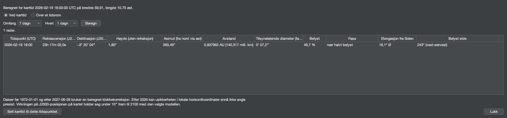

Packed 1854 × 433 px.

| shown, hovered or spoken |
|---|
| Merkur |
| Hvor Merkur er, beregnet fra den medfølgende efemeriden for karttiden og observasjonsstedet: posisjonen blant fiksstjernene, høyden og retningen over horisonten, avstanden og den tilsynelatende størrelsen, hvor mye av den som er belyst og hvilken vei lyset faller, ved det tidspunktet eller over et tidsrom. |
| Om tabellen gjelder karttiden og stedet nå |
| Beregnet for karttid 2026-02-19 18:00:00 UTC på bredde 59,91, lengde 10,75 øst. |
| Ved karttid |
| Én rad, ved karttiden |
| Vis Merkur ved karttiden |
| Viser én rad: Merkur ved karttiden. |
| Over et tidsrom |
| Én rad for hvert steg fra karttiden, over et omfang |
| Vis Merkur over et tidsrom |
| Viser én rad for hvert steg fra karttiden over omfanget valgt, så mange hele steg som omfanget rommer; første rad er karttiden, lest på nytt hver gang du beregner. Sett karttiden for å regne fra et annet tidspunkt. |
| Omfang |
| 1 døgn |
| 7 døgn |
| 30 døgn |
| 90 døgn |
| 365 døgn |
| Hvor langt radene rekker fra karttiden |
| Tidsrommets omfang fra karttiden |
| Hvor langt fra karttiden radene rekker, i hele steg av steget ved siden av. |
| Hvert |
| 1 time |
| 6 timer |
| Tiden som går mellom radene |
| Steg mellom radene |
| Tiden som går mellom radene, på UTC-tidslinjen, så et daglig tidsrom ikke forskyver seg ved skifte av sivil klokke. |
| Beregn |
| Fyll tabellen for omfanget og steget over, fra karttiden |
| Beregn tidsrommet |
| Beregner én rad for hvert steg i omfanget over, fra karttiden nå. |
| 1 rader. |
| Tidspunkt (UTC) |
| Rektascensjon (J2000) |
| Deklinasjon (J2000) |
| Høyde (uten refraksjon) |
| Asimut (fra nord via øst) |
| Avstand |
| Tilsynelatende diameter (fast kropp) |
| Belyst |
| Fase |
| Elongasjon fra Solen |
| Belyst side |
| 2026-02-19 18:00 · 23h 17m 02,0s · −3° 20′ 04″ · 1,80° · 260,49° · 0,937962 AU (140,317 mill. km) · 0′ 07,2″ · 49,7 % · nær halvt belyst · 18,1° Ø · 243° (vest-sørvest) |
| Merkurs beregnede størrelser |
| Hver rad er ett tidspunkt. Kolonnene er tidspunktet i UTC; rektascensjon og deklinasjon i J2000-rammen kartet tegnes i; høyde og asimut uten refraksjon; avstand; den faste kroppens tilsynelatende diameter; belyst andel; fase; elongasjon fra Solen med hvilken side av Solen Merkur står på; og belyst side, retningen lyset faller fra. |
| Datoer før 1972-01-01 og etter 2027-06-28 bruker en beregnet klokkekorreksjon. Etter 2026 kan usikkerheten i lokale horisontkoordinater ennå ikke angis presist. Virkningen på J2000-posisjonen på kartet holder seg under 15″ fram til 2100 med den valgte modellen. |
| Sett karttid til dette tidspunktet |
| Gjør den valgte radens tidspunkt til karttid og tegn hvert himmellegeme på nytt for det |
| Sett karttiden til den valgte radens tidspunkt |
| Setter karttiden til tidspunktet i den valgte raden, slik Sted og tid ville gjort, så hvert påslått himmellegeme tegnes på nytt for det. Denne tabellen gjelder så en tidligere karttid til du beregner på nytt. |
| Lukk |
| Lukk merkurtabellen |
| Lukker tabellen. Ingenting endres eller huskes; Sted og tid beholder stedet og tidspunktet. |

#### The headings, and what they explain

| heading | explanation |
|---|---|
| Tidspunkt (UTC) | Tidspunktet i UTC, til nærmeste minutt. «est.» merker et tidspunkt med beregnet klokkekorreksjon; † merker en slutt på tidsrommet som ikke lå på rutenettet. |
| Rektascensjon (J2000) | Timer, minutter og sekunder av tid, i ICRS/J2000-rammen kartet tegnes i: hvor Merkur står blant fiksstjernene, sett fra observasjonsstedet, uten aberrasjon. |
| Deklinasjon (J2000) | Grader, bueminutter og buesekunder, i samme ramme. |
| Høyde (uten refraksjon) | Grader over den matematiske horisonten, uten atmosfærisk refraksjon; under horisonten beholdes tallet og statusen legges til. |
| Asimut (fra nord via øst) | Grader fra nord via øst: 90° er øst, 180° sør, 270° vest. |
| Avstand | Fra observatøren til Merkurs sentrum, i astronomiske enheter og i millioner kilometer. |
| Tilsynelatende diameter (fast kropp) | Hvor stor Merkurs faste kropp ser ut, i bueminutter og buesekunder, ut fra ekvatorradien på 2440,53 km. Merkurs form er treakset, 2440,53 ganger 2440,53 ganger 2438,26 km; ekvatorradien brukes, slik JPL Horizons bruker den, og middelradien settes ikke inn i stedet. |
| Belyst | Hvor mye av Merkur-skiven som er belyst, i prosent av hele skiven. |
| Fase | Fasen slik leseren ser den: foran Solen eller bak Solen når Merkur-skiven møter Solens; ellers nær nedre konjunksjon, sigd, nær halvt belyst, mer enn halvt belyst eller nær full, etter hvor mye av skiven som er belyst - de samme båndene som for Venus. «Nær» merker et bånd, ikke et nøyaktig tidspunkt. |
| Elongasjon fra Solen | Grader mellom Solen og Merkur på observatørens himmel; Ø når Merkur står øst for Solen der i rektascensjon (kveldshimmelen), V når vest for den (morgenhimmelen). Den varsler ingen konjunksjon. |
| Belyst side | Posisjonsvinkelen til den lyse randens midtpunkt, fra himmelens nord via øst, med den nærmeste av seksten kompassretninger; ikke veldefinert nær nedre konjunksjon og nær full. |

