# Every word the Moon table says

Issue #408. Generated by `juranometria.tool.MoonTableSheetMain`
from compiled application classes and their classpath
resources, over the bundled Solar System pack. Packaged
acceptance separately verifies that the pack and the
interface language resources ship in the application image.

**Norsk bokmål — reviewed.** A person who reads the language has been through these surfaces and said these are the words an atlas should use. This is linguistic judgement, not corroboration against a source: unlike the constellation names next door, these are original translations written for this application and there is no citation to check them against. Recorded in `nb-NO.manifest`, and read from there rather than written here.

## The window, not a panel

Each capture is the production dialog built through
`SolarTableDialog.packedForStudy` over the Moon's columns,
which has no "English if omitted" overload. The title and
the window description are read from the `JDialog` itself;
every shown, hovered and spoken string is walked from the
content; the column headings' explanations, which a screen
reader hears and a hover shows, are listed from the model.

## What is translated here, and what is not

Every number is notation: right ascension, declination,
degrees, kilometres, the diameter, the percentage and the
instant are formatted in `Locale.ROOT` by `SunTableFormat`
and `MoonTableFormat` and are identical in both languages,
with the language's own decimal separator. The words are the
language's: the headings, the status line, the refusals, the
status below the horizon, the phase, the side of the Sun and
the compass point of the lit side. The shell's words are the
same keys the Sun table says (`solartable.*`); the Moon's own
are `moontable.*`.

## English (`en`)

### One instant, Oslo at midsummer

The fresh state: a single row at the instant Place and Time holds. A waxing crescent, 46 % lit, 85° east of the Sun, its lit side to the west-northwest.

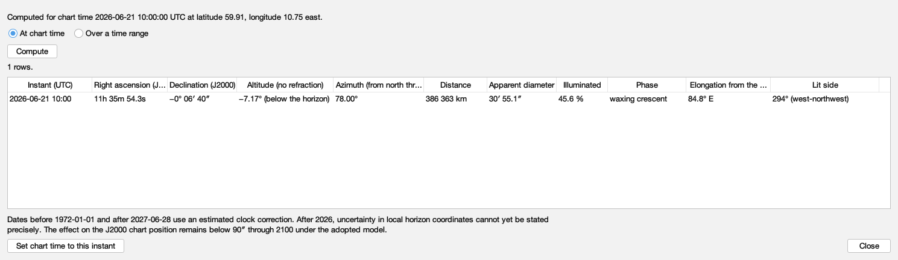

Packed 1489 × 433 px.

| shown, hovered or spoken |
|---|
| The Moon |
| Where the Moon is, computed from the bundled ephemeris for the chart time and place: its position among the fixed stars, its height and direction above the horizon, its distance and apparent size, how much of it is lit and which way the light falls, at that instant or over a range of instants. |
| Whether the table is for the chart time and place now |
| Computed for chart time 2026-06-21 10:00:00 UTC at latitude 59.91, longitude 10.75 east. |
| At chart time |
| One row, at the chart time |
| Show the Moon at the chart time |
| Shows a single row: the Moon at the chart time. |
| Over a time range |
| A row for every step from the chart time, over a span |
| Show the Moon over a range of instants |
| Shows a row for every step from the chart time over the span chosen, as many whole steps as the span holds; the first row is the chart time, read again whenever you compute. To range from another instant, set the chart time. |
| Span |
| 1 day |
| 7 days |
| 30 days |
| 90 days |
| 365 days |
| How far the rows reach from the chart time |
| Span of the range from the chart time |
| How far from the chart time the rows reach, in whole steps of the step beside it. |
| Every |
| 1 hour |
| 6 hours |
| The elapsed time between rows |
| Step between rows |
| The elapsed time between rows, on the UTC timeline, so a daily range does not drift across a change of civil clock. |
| Compute |
| Fill the table for the span and step above, from the chart time |
| Compute the range |
| Computes a row for every step of the span above, from the chart time now. |
| 1 rows. |
| Instant (UTC) |
| Right ascension (J2000) |
| Declination (J2000) |
| Altitude (no refraction) |
| Azimuth (from north through east) |
| Distance |
| Apparent diameter |
| Illuminated |
| Phase |
| Elongation from the Sun |
| Lit side |
| 2026-06-21 10:00 · 11h 35m 54.3s · −0° 06′ 40″ · −7.17° (below the horizon) · 78.00° · 386 363 km · 30′ 55.1″ · 45.6 % · waxing crescent · 84.8° E · 294° (west-northwest) |
| The Moon's computed quantities |
| Each row is one instant. The columns are the instant in UTC; right ascension and declination in the J2000 frame the chart is drawn in; altitude and azimuth without refraction; distance; apparent diameter; the illuminated fraction; the phase; the elongation from the Sun with the side of the Sun the Moon is on; and the lit side, the direction the light falls from. |
| Dates before 1972-01-01 and after 2027-06-28 use an estimated clock correction. After 2026, uncertainty in local horizon coordinates cannot yet be stated precisely. The effect on the J2000 chart position remains below 90″ through 2100 under the adopted model. |
| Set chart time to this instant |
| Make the selected row's instant the chart time and redraw every body for it |
| Set the chart time to the selected row's instant |
| Sets the chart time to the instant of the selected row, as Place and Time would, so every enabled body is redrawn for it. This table is then for an earlier chart time until you compute again. |
| Close |
| Close the Moon table |
| Closes the table. Nothing is changed or remembered; Place and Time keeps the place and instant. |

### A week of daily rows from the chart time

Daily rows from the chart time for a week, both ends: the first row is the chart time itself (#612, ruling P2). The status line counts them.

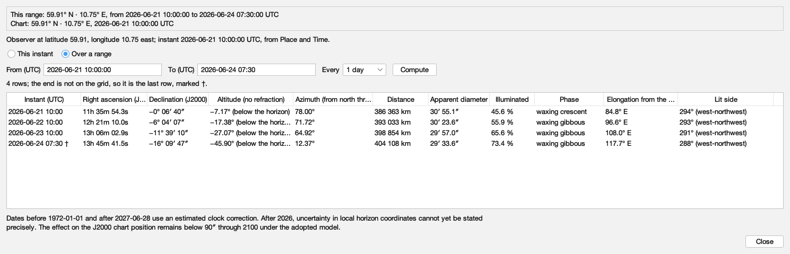

Packed 1489 × 433 px.

| shown, hovered or spoken |
|---|
| The Moon |
| Where the Moon is, computed from the bundled ephemeris for the chart time and place: its position among the fixed stars, its height and direction above the horizon, its distance and apparent size, how much of it is lit and which way the light falls, at that instant or over a range of instants. |
| Whether the table is for the chart time and place now |
| Computed for chart time 2026-06-21 10:00:00 UTC at latitude 59.91, longitude 10.75 east. |
| At chart time |
| One row, at the chart time |
| Show the Moon at the chart time |
| Shows a single row: the Moon at the chart time. |
| Over a time range |
| A row for every step from the chart time, over a span |
| Show the Moon over a range of instants |
| Shows a row for every step from the chart time over the span chosen, as many whole steps as the span holds; the first row is the chart time, read again whenever you compute. To range from another instant, set the chart time. |
| Span |
| 1 day |
| 7 days |
| 30 days |
| 90 days |
| 365 days |
| How far the rows reach from the chart time |
| Span of the range from the chart time |
| How far from the chart time the rows reach, in whole steps of the step beside it. |
| Every |
| 1 hour |
| 6 hours |
| The elapsed time between rows |
| Step between rows |
| The elapsed time between rows, on the UTC timeline, so a daily range does not drift across a change of civil clock. |
| Compute |
| Fill the table for the span and step above, from the chart time |
| Compute the range |
| Computes a row for every step of the span above, from the chart time now. |
| 8 rows. |
| Instant (UTC) |
| Right ascension (J2000) |
| Declination (J2000) |
| Altitude (no refraction) |
| Azimuth (from north through east) |
| Distance |
| Apparent diameter |
| Illuminated |
| Phase |
| Elongation from the Sun |
| Lit side |
| 2026-06-21 10:00 · 11h 35m 54.3s · −0° 06′ 40″ · −7.17° (below the horizon) · 78.00° · 386 363 km · 30′ 55.1″ · 45.6 % · waxing crescent · 84.8° E · 294° (west-northwest) |
| 2026-06-22 10:00 · 12h 21m 10.0s · −6° 04′ 07″ · −17.38° (below the horizon) · 71.72° · 393 033 km · 30′ 23.6″ · 55.9 % · waxing gibbous · 96.6° E · 293° (west-northwest) |
| 2026-06-23 10:00 · 13h 06m 02.9s · −11° 39′ 10″ · −27.07° (below the horizon) · 64.92° · 398 854 km · 29′ 57.0″ · 65.6 % · waxing gibbous · 108.0° E · 291° (west-northwest) |
| 2026-06-24 10:00 · 13h 51m 34.1s · −16° 41′ 49″ · −36.12° (below the horizon) · 57.02° · 403 640 km · 29′ 35.7″ · 74.5 % · waxing gibbous · 119.2° E · 288° (west-northwest) |
| 2026-06-25 10:00 · 14h 38m 31.1s · −21° 02′ 25″ · −44.31° (below the horizon) · 47.26° · 407 302 km · 29′ 19.7″ · 82.3 % · waxing gibbous · 130.1° E · 283° (west-northwest) |
| 2026-06-26 10:00 · 15h 27m 23.1s · −24° 31′ 09″ · −51.24° (below the horizon) · 34.65° · 409 830 km · 29′ 08.8″ · 88.8 % · waxing gibbous · 140.8° E · 277° (west) |
| 2026-06-27 10:00 · 16h 18m 14.5s · −26° 58′ 23″ · −56.23° (below the horizon) · 18.31° · 411 268 km · 29′ 02.7″ · 94.0 % · waxing gibbous · 151.5° E · 269° (west) |
| 2026-06-28 10:00 · 17h 10m 40.4s · −28° 15′ 49″ · −58.38° (below the horizon) · 358.61° · 411 686 km · 29′ 01.0″ · 97.6 % · waxing gibbous · 162.0° E · 258° (west-southwest) |
| The Moon's computed quantities |
| Each row is one instant. The columns are the instant in UTC; right ascension and declination in the J2000 frame the chart is drawn in; altitude and azimuth without refraction; distance; apparent diameter; the illuminated fraction; the phase; the elongation from the Sun with the side of the Sun the Moon is on; and the lit side, the direction the light falls from. |
| Dates before 1972-01-01 and after 2027-06-28 use an estimated clock correction. After 2026, uncertainty in local horizon coordinates cannot yet be stated precisely. The effect on the J2000 chart position remains below 90″ through 2100 under the adopted model. |
| Set chart time to this instant [unavailable] |
| Make the selected row's instant the chart time and redraw every body for it [unavailable] |
| Set the chart time to the selected row's instant [unavailable] |
| Sets the chart time to the instant of the selected row, as Place and Time would, so every enabled body is redrawn for it. This table is then for an earlier chart time until you compute again. [unavailable] |
| Close |
| Close the Moon table |
| Closes the table. Nothing is changed or remembered; Place and Time keeps the place and instant. |

### A range that asks for too many rows

A year of hourly rows asks for more than the 1 000 shown. The table is empty and the status line says why; nothing is cut short silently.

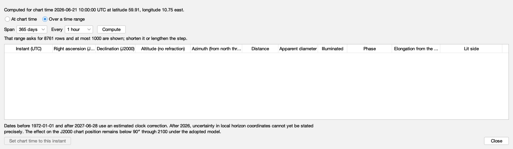

Packed 1489 × 433 px.

| shown, hovered or spoken |
|---|
| The Moon |
| Where the Moon is, computed from the bundled ephemeris for the chart time and place: its position among the fixed stars, its height and direction above the horizon, its distance and apparent size, how much of it is lit and which way the light falls, at that instant or over a range of instants. |
| Whether the table is for the chart time and place now |
| Computed for chart time 2026-06-21 10:00:00 UTC at latitude 59.91, longitude 10.75 east. |
| At chart time |
| One row, at the chart time |
| Show the Moon at the chart time |
| Shows a single row: the Moon at the chart time. |
| Over a time range |
| A row for every step from the chart time, over a span |
| Show the Moon over a range of instants |
| Shows a row for every step from the chart time over the span chosen, as many whole steps as the span holds; the first row is the chart time, read again whenever you compute. To range from another instant, set the chart time. |
| Span |
| 1 day |
| 7 days |
| 30 days |
| 90 days |
| 365 days |
| How far the rows reach from the chart time |
| Span of the range from the chart time |
| How far from the chart time the rows reach, in whole steps of the step beside it. |
| Every |
| 1 hour |
| 6 hours |
| The elapsed time between rows |
| Step between rows |
| The elapsed time between rows, on the UTC timeline, so a daily range does not drift across a change of civil clock. |
| Compute |
| Fill the table for the span and step above, from the chart time |
| Compute the range |
| Computes a row for every step of the span above, from the chart time now. |
| That range asks for 8761 rows and at most 1000 are shown; shorten it or lengthen the step. |
| Instant (UTC) |
| Right ascension (J2000) |
| Declination (J2000) |
| Altitude (no refraction) |
| Azimuth (from north through east) |
| Distance |
| Apparent diameter |
| Illuminated |
| Phase |
| Elongation from the Sun |
| Lit side |
| The Moon's computed quantities |
| Each row is one instant. The columns are the instant in UTC; right ascension and declination in the J2000 frame the chart is drawn in; altitude and azimuth without refraction; distance; apparent diameter; the illuminated fraction; the phase; the elongation from the Sun with the side of the Sun the Moon is on; and the lit side, the direction the light falls from. |
| Dates before 1972-01-01 and after 2027-06-28 use an estimated clock correction. After 2026, uncertainty in local horizon coordinates cannot yet be stated precisely. The effect on the J2000 chart position remains below 90″ through 2100 under the adopted model. |
| Set chart time to this instant [unavailable] |
| Make the selected row's instant the chart time and redraw every body for it [unavailable] |
| Set the chart time to the selected row's instant [unavailable] |
| Sets the chart time to the instant of the selected row, as Place and Time would, so every enabled body is redrawn for it. This table is then for an earlier chart time until you compute again. [unavailable] |
| Close |
| Close the Moon table |
| Closes the table. Nothing is changed or remembered; Place and Time keeps the place and instant. |

### Cape Town at the June full Moon

A southern observer at Espenak's full-Moon instant: the Moon 74° high, 99.9 % lit, near full, and the lit side stated as not well-defined rather than as a false angle.

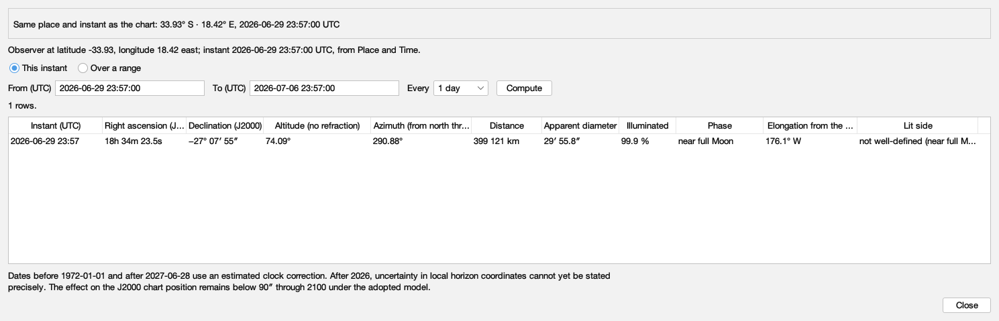

Packed 1489 × 433 px.

| shown, hovered or spoken |
|---|
| The Moon |
| Where the Moon is, computed from the bundled ephemeris for the chart time and place: its position among the fixed stars, its height and direction above the horizon, its distance and apparent size, how much of it is lit and which way the light falls, at that instant or over a range of instants. |
| Whether the table is for the chart time and place now |
| Computed for chart time 2026-06-29 23:57:00 UTC at latitude -33.93, longitude 18.42 east. |
| At chart time |
| One row, at the chart time |
| Show the Moon at the chart time |
| Shows a single row: the Moon at the chart time. |
| Over a time range |
| A row for every step from the chart time, over a span |
| Show the Moon over a range of instants |
| Shows a row for every step from the chart time over the span chosen, as many whole steps as the span holds; the first row is the chart time, read again whenever you compute. To range from another instant, set the chart time. |
| Span |
| 1 day |
| 7 days |
| 30 days |
| 90 days |
| 365 days |
| How far the rows reach from the chart time |
| Span of the range from the chart time |
| How far from the chart time the rows reach, in whole steps of the step beside it. |
| Every |
| 1 hour |
| 6 hours |
| The elapsed time between rows |
| Step between rows |
| The elapsed time between rows, on the UTC timeline, so a daily range does not drift across a change of civil clock. |
| Compute |
| Fill the table for the span and step above, from the chart time |
| Compute the range |
| Computes a row for every step of the span above, from the chart time now. |
| 1 rows. |
| Instant (UTC) |
| Right ascension (J2000) |
| Declination (J2000) |
| Altitude (no refraction) |
| Azimuth (from north through east) |
| Distance |
| Apparent diameter |
| Illuminated |
| Phase |
| Elongation from the Sun |
| Lit side |
| 2026-06-29 23:57 · 18h 34m 23.5s · −27° 07′ 55″ · 74.09° · 290.88° · 399 121 km · 29′ 55.8″ · 99.9 % · near full Moon · 176.1° W · not well-defined (near full Moon) |
| The Moon's computed quantities |
| Each row is one instant. The columns are the instant in UTC; right ascension and declination in the J2000 frame the chart is drawn in; altitude and azimuth without refraction; distance; apparent diameter; the illuminated fraction; the phase; the elongation from the Sun with the side of the Sun the Moon is on; and the lit side, the direction the light falls from. |
| Dates before 1972-01-01 and after 2027-06-28 use an estimated clock correction. After 2026, uncertainty in local horizon coordinates cannot yet be stated precisely. The effect on the J2000 chart position remains below 90″ through 2100 under the adopted model. |
| Set chart time to this instant |
| Make the selected row's instant the chart time and redraw every body for it |
| Set the chart time to the selected row's instant |
| Sets the chart time to the instant of the selected row, as Place and Time would, so every enabled body is redrawn for it. This table is then for an earlier chart time until you compute again. |
| Close |
| Close the Moon table |
| Closes the table. Nothing is changed or remembered; Place and Time keeps the place and instant. |

### The chart moved on after computing

The chart time moved six hours on after this instant was computed (#612, ruling P1): the rows stay, dimmed, under the stale message, until Compute; the note states the chart time and place the rows are for.

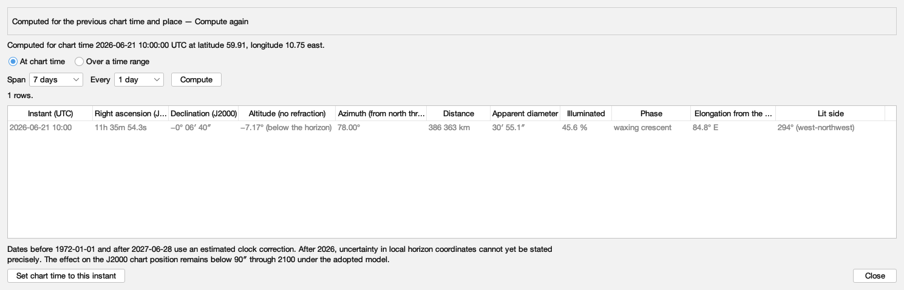

Packed 1489 × 479 px.

| shown, hovered or spoken |
|---|
| The Moon |
| Where the Moon is, computed from the bundled ephemeris for the chart time and place: its position among the fixed stars, its height and direction above the horizon, its distance and apparent size, how much of it is lit and which way the light falls, at that instant or over a range of instants. |
| Whether the table is for the chart time and place now |
| Computed for the previous chart time and place — Compute again |
| Computed for chart time 2026-06-21 10:00:00 UTC at latitude 59.91, longitude 10.75 east. |
| At chart time |
| One row, at the chart time |
| Show the Moon at the chart time |
| Shows a single row: the Moon at the chart time. |
| Over a time range |
| A row for every step from the chart time, over a span |
| Show the Moon over a range of instants |
| Shows a row for every step from the chart time over the span chosen, as many whole steps as the span holds; the first row is the chart time, read again whenever you compute. To range from another instant, set the chart time. |
| Span |
| 1 day |
| 7 days |
| 30 days |
| 90 days |
| 365 days |
| How far the rows reach from the chart time |
| Span of the range from the chart time |
| How far from the chart time the rows reach, in whole steps of the step beside it. |
| Every |
| 1 hour |
| 6 hours |
| The elapsed time between rows |
| Step between rows |
| The elapsed time between rows, on the UTC timeline, so a daily range does not drift across a change of civil clock. |
| Compute |
| Fill the table for the span and step above, from the chart time |
| Compute the range |
| Computes a row for every step of the span above, from the chart time now. |
| 1 rows. |
| Instant (UTC) |
| Right ascension (J2000) |
| Declination (J2000) |
| Altitude (no refraction) |
| Azimuth (from north through east) |
| Distance |
| Apparent diameter |
| Illuminated |
| Phase |
| Elongation from the Sun |
| Lit side |
| 2026-06-21 10:00 · 11h 35m 54.3s · −0° 06′ 40″ · −7.17° (below the horizon) · 78.00° · 386 363 km · 30′ 55.1″ · 45.6 % · waxing crescent · 84.8° E · 294° (west-northwest) |
| The Moon's computed quantities |
| Each row is one instant. The columns are the instant in UTC; right ascension and declination in the J2000 frame the chart is drawn in; altitude and azimuth without refraction; distance; apparent diameter; the illuminated fraction; the phase; the elongation from the Sun with the side of the Sun the Moon is on; and the lit side, the direction the light falls from. |
| Dates before 1972-01-01 and after 2027-06-28 use an estimated clock correction. After 2026, uncertainty in local horizon coordinates cannot yet be stated precisely. The effect on the J2000 chart position remains below 90″ through 2100 under the adopted model. |
| Set chart time to this instant |
| Make the selected row's instant the chart time and redraw every body for it |
| Set the chart time to the selected row's instant |
| Sets the chart time to the instant of the selected row, as Place and Time would, so every enabled body is redrawn for it. This table is then for an earlier chart time until you compute again. |
| Close |
| Close the Moon table |
| Closes the table. Nothing is changed or remembered; Place and Time keeps the place and instant. |

### The instant, in the dark appearance

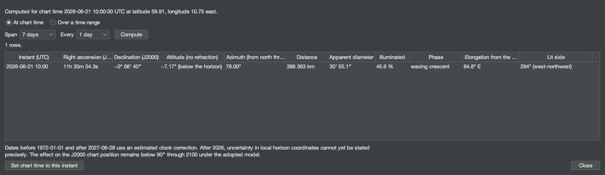

Packed 1489 × 433 px.

| shown, hovered or spoken |
|---|
| The Moon |
| Where the Moon is, computed from the bundled ephemeris for the chart time and place: its position among the fixed stars, its height and direction above the horizon, its distance and apparent size, how much of it is lit and which way the light falls, at that instant or over a range of instants. |
| Whether the table is for the chart time and place now |
| Computed for chart time 2026-06-21 10:00:00 UTC at latitude 59.91, longitude 10.75 east. |
| At chart time |
| One row, at the chart time |
| Show the Moon at the chart time |
| Shows a single row: the Moon at the chart time. |
| Over a time range |
| A row for every step from the chart time, over a span |
| Show the Moon over a range of instants |
| Shows a row for every step from the chart time over the span chosen, as many whole steps as the span holds; the first row is the chart time, read again whenever you compute. To range from another instant, set the chart time. |
| Span |
| 1 day |
| 7 days |
| 30 days |
| 90 days |
| 365 days |
| How far the rows reach from the chart time |
| Span of the range from the chart time |
| How far from the chart time the rows reach, in whole steps of the step beside it. |
| Every |
| 1 hour |
| 6 hours |
| The elapsed time between rows |
| Step between rows |
| The elapsed time between rows, on the UTC timeline, so a daily range does not drift across a change of civil clock. |
| Compute |
| Fill the table for the span and step above, from the chart time |
| Compute the range |
| Computes a row for every step of the span above, from the chart time now. |
| 1 rows. |
| Instant (UTC) |
| Right ascension (J2000) |
| Declination (J2000) |
| Altitude (no refraction) |
| Azimuth (from north through east) |
| Distance |
| Apparent diameter |
| Illuminated |
| Phase |
| Elongation from the Sun |
| Lit side |
| 2026-06-21 10:00 · 11h 35m 54.3s · −0° 06′ 40″ · −7.17° (below the horizon) · 78.00° · 386 363 km · 30′ 55.1″ · 45.6 % · waxing crescent · 84.8° E · 294° (west-northwest) |
| The Moon's computed quantities |
| Each row is one instant. The columns are the instant in UTC; right ascension and declination in the J2000 frame the chart is drawn in; altitude and azimuth without refraction; distance; apparent diameter; the illuminated fraction; the phase; the elongation from the Sun with the side of the Sun the Moon is on; and the lit side, the direction the light falls from. |
| Dates before 1972-01-01 and after 2027-06-28 use an estimated clock correction. After 2026, uncertainty in local horizon coordinates cannot yet be stated precisely. The effect on the J2000 chart position remains below 90″ through 2100 under the adopted model. |
| Set chart time to this instant |
| Make the selected row's instant the chart time and redraw every body for it |
| Set the chart time to the selected row's instant |
| Sets the chart time to the instant of the selected row, as Place and Time would, so every enabled body is redrawn for it. This table is then for an earlier chart time until you compute again. |
| Close |
| Close the Moon table |
| Closes the table. Nothing is changed or remembered; Place and Time keeps the place and instant. |

#### The headings, and what they explain

| heading | explanation |
|---|---|
| Instant (UTC) | The instant in UTC, to the minute. "est." marks an instant whose clock correction is estimated; † marks a range end that was not on the grid. |
| Right ascension (J2000) | Hours, minutes and seconds of time, in the ICRS/J2000 frame the chart is drawn in: where the Moon is among the fixed stars, as seen from the observing place, without aberration. |
| Declination (J2000) | Degrees, minutes and seconds of arc, in the same frame. |
| Altitude (no refraction) | Degrees above the mathematical horizon, without atmospheric refraction; below the horizon the number is kept and the status is added. |
| Azimuth (from north through east) | Degrees from north through east: 90° is east, 180° south, 270° west. |
| Distance | From the observer to the Moon's centre, in kilometres. |
| Apparent diameter | How large the Moon's disc looks, in minutes and seconds of arc. |
| Illuminated | How much of the Moon's disc is lit, as a percentage of the whole disc. |
| Phase | The phase as a reader sees it: near new Moon, waxing crescent, near first quarter, waxing gibbous, near full Moon, waning gibbous, near last quarter or waning crescent. Waxing and waning follow the Moon's path around the Earth and are the same for every observer; "near" marks a band around the event, not its exact instant. |
| Elongation from the Sun | Degrees between the Sun and the Moon in the observer's sky; E when the Moon is east of the Sun there (the evening sky), W when west of it (the morning sky). |
| Lit side | The position angle of the bright limb's midpoint, from celestial north through east, with the nearest of sixteen compass points; not well-defined near new and full Moon. |

## Norsk bokmål (`nb-NO`)

### One instant, Oslo at midsummer

The fresh state: a single row at the instant Place and Time holds. A waxing crescent, 46 % lit, 85° east of the Sun, its lit side to the west-northwest.

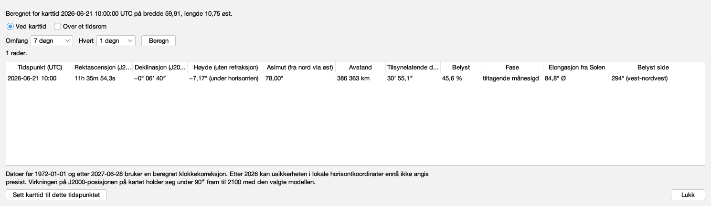

Packed 1489 × 433 px.

| shown, hovered or spoken |
|---|
| Månen |
| Hvor Månen er, beregnet fra den medfølgende efemeriden for karttiden og observasjonsstedet: posisjonen blant fiksstjernene, høyden og retningen over horisonten, avstanden og den tilsynelatende størrelsen, hvor mye av den som er belyst og hvilken vei lyset faller, ved det tidspunktet eller over et tidsrom. |
| Om tabellen gjelder karttiden og stedet nå |
| Beregnet for karttid 2026-06-21 10:00:00 UTC på bredde 59,91, lengde 10,75 øst. |
| Ved karttid |
| Én rad, ved karttiden |
| Vis Månen ved karttiden |
| Viser én rad: Månen ved karttiden. |
| Over et tidsrom |
| Én rad for hvert steg fra karttiden, over et omfang |
| Vis Månen over et tidsrom |
| Viser én rad for hvert steg fra karttiden over omfanget valgt, så mange hele steg som omfanget rommer; første rad er karttiden, lest på nytt hver gang du beregner. Sett karttiden for å regne fra et annet tidspunkt. |
| Omfang |
| 1 døgn |
| 7 døgn |
| 30 døgn |
| 90 døgn |
| 365 døgn |
| Hvor langt radene rekker fra karttiden |
| Tidsrommets omfang fra karttiden |
| Hvor langt fra karttiden radene rekker, i hele steg av steget ved siden av. |
| Hvert |
| 1 time |
| 6 timer |
| Tiden som går mellom radene |
| Steg mellom radene |
| Tiden som går mellom radene, på UTC-tidslinjen, så et daglig tidsrom ikke forskyver seg ved skifte av sivil klokke. |
| Beregn |
| Fyll tabellen for omfanget og steget over, fra karttiden |
| Beregn tidsrommet |
| Beregner én rad for hvert steg i omfanget over, fra karttiden nå. |
| 1 rader. |
| Tidspunkt (UTC) |
| Rektascensjon (J2000) |
| Deklinasjon (J2000) |
| Høyde (uten refraksjon) |
| Asimut (fra nord via øst) |
| Avstand |
| Tilsynelatende diameter |
| Belyst |
| Fase |
| Elongasjon fra Solen |
| Belyst side |
| 2026-06-21 10:00 · 11h 35m 54,3s · −0° 06′ 40″ · −7,17° (under horisonten) · 78,00° · 386 363 km · 30′ 55,1″ · 45,6 % · tiltagende månesigd · 84,8° Ø · 294° (vest-nordvest) |
| Månens beregnede størrelser |
| Hver rad er ett tidspunkt. Kolonnene er tidspunktet i UTC; rektascensjon og deklinasjon i J2000-rammen kartet tegnes i; høyde og asimut uten refraksjon; avstand; tilsynelatende diameter; belyst andel; fase; elongasjon fra Solen med hvilken side av Solen Månen står på; og belyst side, retningen lyset faller fra. |
| Datoer før 1972-01-01 og etter 2027-06-28 bruker en beregnet klokkekorreksjon. Etter 2026 kan usikkerheten i lokale horisontkoordinater ennå ikke angis presist. Virkningen på J2000-posisjonen på kartet holder seg under 90″ fram til 2100 med den valgte modellen. |
| Sett karttid til dette tidspunktet |
| Gjør den valgte radens tidspunkt til karttid og tegn hvert himmellegeme på nytt for det |
| Sett karttiden til den valgte radens tidspunkt |
| Setter karttiden til tidspunktet i den valgte raden, slik Sted og tid ville gjort, så hvert påslått himmellegeme tegnes på nytt for det. Denne tabellen gjelder så en tidligere karttid til du beregner på nytt. |
| Lukk |
| Lukk månetabellen |
| Lukker tabellen. Ingenting endres eller huskes; Sted og tid beholder stedet og tidspunktet. |

### A week of daily rows from the chart time

Daily rows from the chart time for a week, both ends: the first row is the chart time itself (#612, ruling P2). The status line counts them.

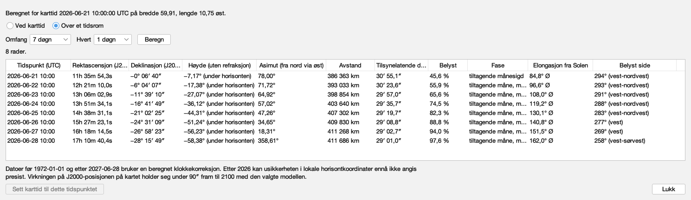

Packed 1489 × 433 px.

| shown, hovered or spoken |
|---|
| Månen |
| Hvor Månen er, beregnet fra den medfølgende efemeriden for karttiden og observasjonsstedet: posisjonen blant fiksstjernene, høyden og retningen over horisonten, avstanden og den tilsynelatende størrelsen, hvor mye av den som er belyst og hvilken vei lyset faller, ved det tidspunktet eller over et tidsrom. |
| Om tabellen gjelder karttiden og stedet nå |
| Beregnet for karttid 2026-06-21 10:00:00 UTC på bredde 59,91, lengde 10,75 øst. |
| Ved karttid |
| Én rad, ved karttiden |
| Vis Månen ved karttiden |
| Viser én rad: Månen ved karttiden. |
| Over et tidsrom |
| Én rad for hvert steg fra karttiden, over et omfang |
| Vis Månen over et tidsrom |
| Viser én rad for hvert steg fra karttiden over omfanget valgt, så mange hele steg som omfanget rommer; første rad er karttiden, lest på nytt hver gang du beregner. Sett karttiden for å regne fra et annet tidspunkt. |
| Omfang |
| 1 døgn |
| 7 døgn |
| 30 døgn |
| 90 døgn |
| 365 døgn |
| Hvor langt radene rekker fra karttiden |
| Tidsrommets omfang fra karttiden |
| Hvor langt fra karttiden radene rekker, i hele steg av steget ved siden av. |
| Hvert |
| 1 time |
| 6 timer |
| Tiden som går mellom radene |
| Steg mellom radene |
| Tiden som går mellom radene, på UTC-tidslinjen, så et daglig tidsrom ikke forskyver seg ved skifte av sivil klokke. |
| Beregn |
| Fyll tabellen for omfanget og steget over, fra karttiden |
| Beregn tidsrommet |
| Beregner én rad for hvert steg i omfanget over, fra karttiden nå. |
| 8 rader. |
| Tidspunkt (UTC) |
| Rektascensjon (J2000) |
| Deklinasjon (J2000) |
| Høyde (uten refraksjon) |
| Asimut (fra nord via øst) |
| Avstand |
| Tilsynelatende diameter |
| Belyst |
| Fase |
| Elongasjon fra Solen |
| Belyst side |
| 2026-06-21 10:00 · 11h 35m 54,3s · −0° 06′ 40″ · −7,17° (under horisonten) · 78,00° · 386 363 km · 30′ 55,1″ · 45,6 % · tiltagende månesigd · 84,8° Ø · 294° (vest-nordvest) |
| 2026-06-22 10:00 · 12h 21m 10,0s · −6° 04′ 07″ · −17,38° (under horisonten) · 71,72° · 393 033 km · 30′ 23,6″ · 55,9 % · tiltagende måne, mer enn halv · 96,6° Ø · 293° (vest-nordvest) |
| 2026-06-23 10:00 · 13h 06m 02,9s · −11° 39′ 10″ · −27,07° (under horisonten) · 64,92° · 398 854 km · 29′ 57,0″ · 65,6 % · tiltagende måne, mer enn halv · 108,0° Ø · 291° (vest-nordvest) |
| 2026-06-24 10:00 · 13h 51m 34,1s · −16° 41′ 49″ · −36,12° (under horisonten) · 57,02° · 403 640 km · 29′ 35,7″ · 74,5 % · tiltagende måne, mer enn halv · 119,2° Ø · 288° (vest-nordvest) |
| 2026-06-25 10:00 · 14h 38m 31,1s · −21° 02′ 25″ · −44,31° (under horisonten) · 47,26° · 407 302 km · 29′ 19,7″ · 82,3 % · tiltagende måne, mer enn halv · 130,1° Ø · 283° (vest-nordvest) |
| 2026-06-26 10:00 · 15h 27m 23,1s · −24° 31′ 09″ · −51,24° (under horisonten) · 34,65° · 409 830 km · 29′ 08,8″ · 88,8 % · tiltagende måne, mer enn halv · 140,8° Ø · 277° (vest) |
| 2026-06-27 10:00 · 16h 18m 14,5s · −26° 58′ 23″ · −56,23° (under horisonten) · 18,31° · 411 268 km · 29′ 02,7″ · 94,0 % · tiltagende måne, mer enn halv · 151,5° Ø · 269° (vest) |
| 2026-06-28 10:00 · 17h 10m 40,4s · −28° 15′ 49″ · −58,38° (under horisonten) · 358,61° · 411 686 km · 29′ 01,0″ · 97,6 % · tiltagende måne, mer enn halv · 162,0° Ø · 258° (vest-sørvest) |
| Månens beregnede størrelser |
| Hver rad er ett tidspunkt. Kolonnene er tidspunktet i UTC; rektascensjon og deklinasjon i J2000-rammen kartet tegnes i; høyde og asimut uten refraksjon; avstand; tilsynelatende diameter; belyst andel; fase; elongasjon fra Solen med hvilken side av Solen Månen står på; og belyst side, retningen lyset faller fra. |
| Datoer før 1972-01-01 og etter 2027-06-28 bruker en beregnet klokkekorreksjon. Etter 2026 kan usikkerheten i lokale horisontkoordinater ennå ikke angis presist. Virkningen på J2000-posisjonen på kartet holder seg under 90″ fram til 2100 med den valgte modellen. |
| Sett karttid til dette tidspunktet [unavailable] |
| Gjør den valgte radens tidspunkt til karttid og tegn hvert himmellegeme på nytt for det [unavailable] |
| Sett karttiden til den valgte radens tidspunkt [unavailable] |
| Setter karttiden til tidspunktet i den valgte raden, slik Sted og tid ville gjort, så hvert påslått himmellegeme tegnes på nytt for det. Denne tabellen gjelder så en tidligere karttid til du beregner på nytt. [unavailable] |
| Lukk |
| Lukk månetabellen |
| Lukker tabellen. Ingenting endres eller huskes; Sted og tid beholder stedet og tidspunktet. |

### A range that asks for too many rows

A year of hourly rows asks for more than the 1 000 shown. The table is empty and the status line says why; nothing is cut short silently.

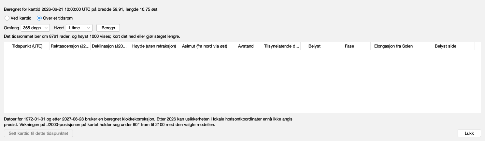

Packed 1489 × 433 px.

| shown, hovered or spoken |
|---|
| Månen |
| Hvor Månen er, beregnet fra den medfølgende efemeriden for karttiden og observasjonsstedet: posisjonen blant fiksstjernene, høyden og retningen over horisonten, avstanden og den tilsynelatende størrelsen, hvor mye av den som er belyst og hvilken vei lyset faller, ved det tidspunktet eller over et tidsrom. |
| Om tabellen gjelder karttiden og stedet nå |
| Beregnet for karttid 2026-06-21 10:00:00 UTC på bredde 59,91, lengde 10,75 øst. |
| Ved karttid |
| Én rad, ved karttiden |
| Vis Månen ved karttiden |
| Viser én rad: Månen ved karttiden. |
| Over et tidsrom |
| Én rad for hvert steg fra karttiden, over et omfang |
| Vis Månen over et tidsrom |
| Viser én rad for hvert steg fra karttiden over omfanget valgt, så mange hele steg som omfanget rommer; første rad er karttiden, lest på nytt hver gang du beregner. Sett karttiden for å regne fra et annet tidspunkt. |
| Omfang |
| 1 døgn |
| 7 døgn |
| 30 døgn |
| 90 døgn |
| 365 døgn |
| Hvor langt radene rekker fra karttiden |
| Tidsrommets omfang fra karttiden |
| Hvor langt fra karttiden radene rekker, i hele steg av steget ved siden av. |
| Hvert |
| 1 time |
| 6 timer |
| Tiden som går mellom radene |
| Steg mellom radene |
| Tiden som går mellom radene, på UTC-tidslinjen, så et daglig tidsrom ikke forskyver seg ved skifte av sivil klokke. |
| Beregn |
| Fyll tabellen for omfanget og steget over, fra karttiden |
| Beregn tidsrommet |
| Beregner én rad for hvert steg i omfanget over, fra karttiden nå. |
| Det tidsrommet ber om 8761 rader, og høyst 1000 vises; kort det ned eller gjør steget lengre. |
| Tidspunkt (UTC) |
| Rektascensjon (J2000) |
| Deklinasjon (J2000) |
| Høyde (uten refraksjon) |
| Asimut (fra nord via øst) |
| Avstand |
| Tilsynelatende diameter |
| Belyst |
| Fase |
| Elongasjon fra Solen |
| Belyst side |
| Månens beregnede størrelser |
| Hver rad er ett tidspunkt. Kolonnene er tidspunktet i UTC; rektascensjon og deklinasjon i J2000-rammen kartet tegnes i; høyde og asimut uten refraksjon; avstand; tilsynelatende diameter; belyst andel; fase; elongasjon fra Solen med hvilken side av Solen Månen står på; og belyst side, retningen lyset faller fra. |
| Datoer før 1972-01-01 og etter 2027-06-28 bruker en beregnet klokkekorreksjon. Etter 2026 kan usikkerheten i lokale horisontkoordinater ennå ikke angis presist. Virkningen på J2000-posisjonen på kartet holder seg under 90″ fram til 2100 med den valgte modellen. |
| Sett karttid til dette tidspunktet [unavailable] |
| Gjør den valgte radens tidspunkt til karttid og tegn hvert himmellegeme på nytt for det [unavailable] |
| Sett karttiden til den valgte radens tidspunkt [unavailable] |
| Setter karttiden til tidspunktet i den valgte raden, slik Sted og tid ville gjort, så hvert påslått himmellegeme tegnes på nytt for det. Denne tabellen gjelder så en tidligere karttid til du beregner på nytt. [unavailable] |
| Lukk |
| Lukk månetabellen |
| Lukker tabellen. Ingenting endres eller huskes; Sted og tid beholder stedet og tidspunktet. |

### Cape Town at the June full Moon

A southern observer at Espenak's full-Moon instant: the Moon 74° high, 99.9 % lit, near full, and the lit side stated as not well-defined rather than as a false angle.

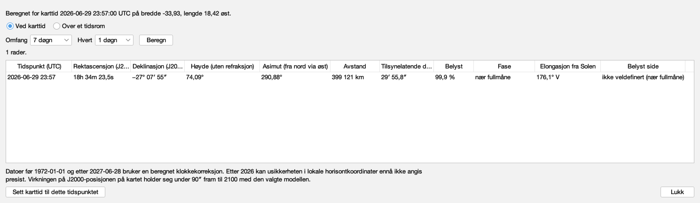

Packed 1489 × 433 px.

| shown, hovered or spoken |
|---|
| Månen |
| Hvor Månen er, beregnet fra den medfølgende efemeriden for karttiden og observasjonsstedet: posisjonen blant fiksstjernene, høyden og retningen over horisonten, avstanden og den tilsynelatende størrelsen, hvor mye av den som er belyst og hvilken vei lyset faller, ved det tidspunktet eller over et tidsrom. |
| Om tabellen gjelder karttiden og stedet nå |
| Beregnet for karttid 2026-06-29 23:57:00 UTC på bredde -33,93, lengde 18,42 øst. |
| Ved karttid |
| Én rad, ved karttiden |
| Vis Månen ved karttiden |
| Viser én rad: Månen ved karttiden. |
| Over et tidsrom |
| Én rad for hvert steg fra karttiden, over et omfang |
| Vis Månen over et tidsrom |
| Viser én rad for hvert steg fra karttiden over omfanget valgt, så mange hele steg som omfanget rommer; første rad er karttiden, lest på nytt hver gang du beregner. Sett karttiden for å regne fra et annet tidspunkt. |
| Omfang |
| 1 døgn |
| 7 døgn |
| 30 døgn |
| 90 døgn |
| 365 døgn |
| Hvor langt radene rekker fra karttiden |
| Tidsrommets omfang fra karttiden |
| Hvor langt fra karttiden radene rekker, i hele steg av steget ved siden av. |
| Hvert |
| 1 time |
| 6 timer |
| Tiden som går mellom radene |
| Steg mellom radene |
| Tiden som går mellom radene, på UTC-tidslinjen, så et daglig tidsrom ikke forskyver seg ved skifte av sivil klokke. |
| Beregn |
| Fyll tabellen for omfanget og steget over, fra karttiden |
| Beregn tidsrommet |
| Beregner én rad for hvert steg i omfanget over, fra karttiden nå. |
| 1 rader. |
| Tidspunkt (UTC) |
| Rektascensjon (J2000) |
| Deklinasjon (J2000) |
| Høyde (uten refraksjon) |
| Asimut (fra nord via øst) |
| Avstand |
| Tilsynelatende diameter |
| Belyst |
| Fase |
| Elongasjon fra Solen |
| Belyst side |
| 2026-06-29 23:57 · 18h 34m 23,5s · −27° 07′ 55″ · 74,09° · 290,88° · 399 121 km · 29′ 55,8″ · 99,9 % · nær fullmåne · 176,1° V · ikke veldefinert (nær fullmåne) |
| Månens beregnede størrelser |
| Hver rad er ett tidspunkt. Kolonnene er tidspunktet i UTC; rektascensjon og deklinasjon i J2000-rammen kartet tegnes i; høyde og asimut uten refraksjon; avstand; tilsynelatende diameter; belyst andel; fase; elongasjon fra Solen med hvilken side av Solen Månen står på; og belyst side, retningen lyset faller fra. |
| Datoer før 1972-01-01 og etter 2027-06-28 bruker en beregnet klokkekorreksjon. Etter 2026 kan usikkerheten i lokale horisontkoordinater ennå ikke angis presist. Virkningen på J2000-posisjonen på kartet holder seg under 90″ fram til 2100 med den valgte modellen. |
| Sett karttid til dette tidspunktet |
| Gjør den valgte radens tidspunkt til karttid og tegn hvert himmellegeme på nytt for det |
| Sett karttiden til den valgte radens tidspunkt |
| Setter karttiden til tidspunktet i den valgte raden, slik Sted og tid ville gjort, så hvert påslått himmellegeme tegnes på nytt for det. Denne tabellen gjelder så en tidligere karttid til du beregner på nytt. |
| Lukk |
| Lukk månetabellen |
| Lukker tabellen. Ingenting endres eller huskes; Sted og tid beholder stedet og tidspunktet. |

### The chart moved on after computing

The chart time moved six hours on after this instant was computed (#612, ruling P1): the rows stay, dimmed, under the stale message, until Compute; the note states the chart time and place the rows are for.

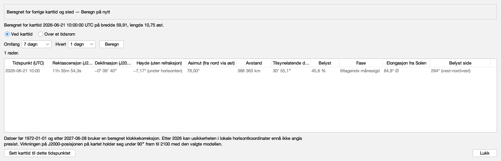

Packed 1489 × 479 px.

| shown, hovered or spoken |
|---|
| Månen |
| Hvor Månen er, beregnet fra den medfølgende efemeriden for karttiden og observasjonsstedet: posisjonen blant fiksstjernene, høyden og retningen over horisonten, avstanden og den tilsynelatende størrelsen, hvor mye av den som er belyst og hvilken vei lyset faller, ved det tidspunktet eller over et tidsrom. |
| Om tabellen gjelder karttiden og stedet nå |
| Beregnet for forrige karttid og sted — Beregn på nytt |
| Beregnet for karttid 2026-06-21 10:00:00 UTC på bredde 59,91, lengde 10,75 øst. |
| Ved karttid |
| Én rad, ved karttiden |
| Vis Månen ved karttiden |
| Viser én rad: Månen ved karttiden. |
| Over et tidsrom |
| Én rad for hvert steg fra karttiden, over et omfang |
| Vis Månen over et tidsrom |
| Viser én rad for hvert steg fra karttiden over omfanget valgt, så mange hele steg som omfanget rommer; første rad er karttiden, lest på nytt hver gang du beregner. Sett karttiden for å regne fra et annet tidspunkt. |
| Omfang |
| 1 døgn |
| 7 døgn |
| 30 døgn |
| 90 døgn |
| 365 døgn |
| Hvor langt radene rekker fra karttiden |
| Tidsrommets omfang fra karttiden |
| Hvor langt fra karttiden radene rekker, i hele steg av steget ved siden av. |
| Hvert |
| 1 time |
| 6 timer |
| Tiden som går mellom radene |
| Steg mellom radene |
| Tiden som går mellom radene, på UTC-tidslinjen, så et daglig tidsrom ikke forskyver seg ved skifte av sivil klokke. |
| Beregn |
| Fyll tabellen for omfanget og steget over, fra karttiden |
| Beregn tidsrommet |
| Beregner én rad for hvert steg i omfanget over, fra karttiden nå. |
| 1 rader. |
| Tidspunkt (UTC) |
| Rektascensjon (J2000) |
| Deklinasjon (J2000) |
| Høyde (uten refraksjon) |
| Asimut (fra nord via øst) |
| Avstand |
| Tilsynelatende diameter |
| Belyst |
| Fase |
| Elongasjon fra Solen |
| Belyst side |
| 2026-06-21 10:00 · 11h 35m 54,3s · −0° 06′ 40″ · −7,17° (under horisonten) · 78,00° · 386 363 km · 30′ 55,1″ · 45,6 % · tiltagende månesigd · 84,8° Ø · 294° (vest-nordvest) |
| Månens beregnede størrelser |
| Hver rad er ett tidspunkt. Kolonnene er tidspunktet i UTC; rektascensjon og deklinasjon i J2000-rammen kartet tegnes i; høyde og asimut uten refraksjon; avstand; tilsynelatende diameter; belyst andel; fase; elongasjon fra Solen med hvilken side av Solen Månen står på; og belyst side, retningen lyset faller fra. |
| Datoer før 1972-01-01 og etter 2027-06-28 bruker en beregnet klokkekorreksjon. Etter 2026 kan usikkerheten i lokale horisontkoordinater ennå ikke angis presist. Virkningen på J2000-posisjonen på kartet holder seg under 90″ fram til 2100 med den valgte modellen. |
| Sett karttid til dette tidspunktet |
| Gjør den valgte radens tidspunkt til karttid og tegn hvert himmellegeme på nytt for det |
| Sett karttiden til den valgte radens tidspunkt |
| Setter karttiden til tidspunktet i den valgte raden, slik Sted og tid ville gjort, så hvert påslått himmellegeme tegnes på nytt for det. Denne tabellen gjelder så en tidligere karttid til du beregner på nytt. |
| Lukk |
| Lukk månetabellen |
| Lukker tabellen. Ingenting endres eller huskes; Sted og tid beholder stedet og tidspunktet. |

### The instant, in the dark appearance

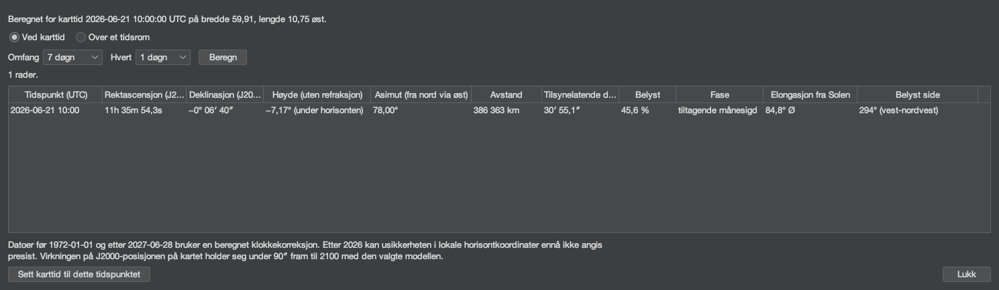

Packed 1489 × 433 px.

| shown, hovered or spoken |
|---|
| Månen |
| Hvor Månen er, beregnet fra den medfølgende efemeriden for karttiden og observasjonsstedet: posisjonen blant fiksstjernene, høyden og retningen over horisonten, avstanden og den tilsynelatende størrelsen, hvor mye av den som er belyst og hvilken vei lyset faller, ved det tidspunktet eller over et tidsrom. |
| Om tabellen gjelder karttiden og stedet nå |
| Beregnet for karttid 2026-06-21 10:00:00 UTC på bredde 59,91, lengde 10,75 øst. |
| Ved karttid |
| Én rad, ved karttiden |
| Vis Månen ved karttiden |
| Viser én rad: Månen ved karttiden. |
| Over et tidsrom |
| Én rad for hvert steg fra karttiden, over et omfang |
| Vis Månen over et tidsrom |
| Viser én rad for hvert steg fra karttiden over omfanget valgt, så mange hele steg som omfanget rommer; første rad er karttiden, lest på nytt hver gang du beregner. Sett karttiden for å regne fra et annet tidspunkt. |
| Omfang |
| 1 døgn |
| 7 døgn |
| 30 døgn |
| 90 døgn |
| 365 døgn |
| Hvor langt radene rekker fra karttiden |
| Tidsrommets omfang fra karttiden |
| Hvor langt fra karttiden radene rekker, i hele steg av steget ved siden av. |
| Hvert |
| 1 time |
| 6 timer |
| Tiden som går mellom radene |
| Steg mellom radene |
| Tiden som går mellom radene, på UTC-tidslinjen, så et daglig tidsrom ikke forskyver seg ved skifte av sivil klokke. |
| Beregn |
| Fyll tabellen for omfanget og steget over, fra karttiden |
| Beregn tidsrommet |
| Beregner én rad for hvert steg i omfanget over, fra karttiden nå. |
| 1 rader. |
| Tidspunkt (UTC) |
| Rektascensjon (J2000) |
| Deklinasjon (J2000) |
| Høyde (uten refraksjon) |
| Asimut (fra nord via øst) |
| Avstand |
| Tilsynelatende diameter |
| Belyst |
| Fase |
| Elongasjon fra Solen |
| Belyst side |
| 2026-06-21 10:00 · 11h 35m 54,3s · −0° 06′ 40″ · −7,17° (under horisonten) · 78,00° · 386 363 km · 30′ 55,1″ · 45,6 % · tiltagende månesigd · 84,8° Ø · 294° (vest-nordvest) |
| Månens beregnede størrelser |
| Hver rad er ett tidspunkt. Kolonnene er tidspunktet i UTC; rektascensjon og deklinasjon i J2000-rammen kartet tegnes i; høyde og asimut uten refraksjon; avstand; tilsynelatende diameter; belyst andel; fase; elongasjon fra Solen med hvilken side av Solen Månen står på; og belyst side, retningen lyset faller fra. |
| Datoer før 1972-01-01 og etter 2027-06-28 bruker en beregnet klokkekorreksjon. Etter 2026 kan usikkerheten i lokale horisontkoordinater ennå ikke angis presist. Virkningen på J2000-posisjonen på kartet holder seg under 90″ fram til 2100 med den valgte modellen. |
| Sett karttid til dette tidspunktet |
| Gjør den valgte radens tidspunkt til karttid og tegn hvert himmellegeme på nytt for det |
| Sett karttiden til den valgte radens tidspunkt |
| Setter karttiden til tidspunktet i den valgte raden, slik Sted og tid ville gjort, så hvert påslått himmellegeme tegnes på nytt for det. Denne tabellen gjelder så en tidligere karttid til du beregner på nytt. |
| Lukk |
| Lukk månetabellen |
| Lukker tabellen. Ingenting endres eller huskes; Sted og tid beholder stedet og tidspunktet. |

#### The headings, and what they explain

| heading | explanation |
|---|---|
| Tidspunkt (UTC) | Tidspunktet i UTC, til nærmeste minutt. «est.» merker et tidspunkt med beregnet klokkekorreksjon; † merker en slutt på tidsrommet som ikke lå på rutenettet. |
| Rektascensjon (J2000) | Timer, minutter og sekunder av tid, i ICRS/J2000-rammen kartet tegnes i: hvor Månen står blant fiksstjernene, sett fra observasjonsstedet, uten aberrasjon. |
| Deklinasjon (J2000) | Grader, bueminutter og buesekunder, i samme ramme. |
| Høyde (uten refraksjon) | Grader over den matematiske horisonten, uten atmosfærisk refraksjon; under horisonten beholdes tallet og statusen legges til. |
| Asimut (fra nord via øst) | Grader fra nord via øst: 90° er øst, 180° sør, 270° vest. |
| Avstand | Fra observatøren til Månens sentrum, i kilometer. |
| Tilsynelatende diameter | Hvor stor måneskiven ser ut, i bueminutter og buesekunder. |
| Belyst | Hvor mye av måneskiven som er belyst, i prosent av hele skiven. |
| Fase | Fasen slik leseren ser den: nær nymåne, tiltagende månesigd, nær første kvarter, tiltagende måne (mer enn halv), nær fullmåne, avtagende måne (mer enn halv), nær siste kvarter eller avtagende månesigd. Tiltagende og avtagende følger Månens bane rundt Jorden og er like for alle observatører; «nær» merker et bånd rundt hendelsen, ikke det nøyaktige tidspunktet. |
| Elongasjon fra Solen | Grader mellom Solen og Månen på observatørens himmel; Ø når Månen står øst for Solen der (kveldshimmelen), V når vest for den (morgenhimmelen). |
| Belyst side | Posisjonsvinkelen til den lyse randens midtpunkt, fra himmelens nord via øst, med den nærmeste av seksten kompassretninger; ikke veldefinert nær ny- og fullmåne. |

