# Every word the Sun table says

Issue #400. Generated by `juranometria.tool.SunTableSheetMain`
from compiled application classes and their classpath
resources, over the bundled Solar System pack. Packaged
acceptance separately verifies that the pack and the
interface language resources ship in the application image.

**Norsk bokmål — reviewed.** A person who reads the language has been through these surfaces and said these are the words an atlas should use. This is linguistic judgement, not corroboration against a source: unlike the constellation names next door, these are original translations written for this application and there is no citation to check them against. Recorded in `nb-NO.manifest`, and read from there rather than written here.

## The window, not a panel

Each capture is the production dialog built through
`SolarTableDialog.packedForStudy`, which has no "English if
omitted" overload. The title and the window description are
read from the `JDialog` itself; every shown, hovered and
spoken string is walked from the content; the column
headings' explanations, which a screen reader hears and a
hover shows, are listed from the model.

## What is translated here, and what is not

Every number is notation: right ascension, declination,
degrees, distance, diameter and the instant are formatted
in `Locale.ROOT` by `SunTableFormat` and are identical in
both languages, because a value must parse if a reader
carries it into Place and Time. The words are the
language's: the headings, the status line, the refusals,
and the status below the horizon. Access letters are
language too, and no two controls share one.

## English (`en`)

### One instant, Oslo at midsummer

The fresh state: a single row at the instant Place and Time holds. The Sun stands 51° high to the south-east.

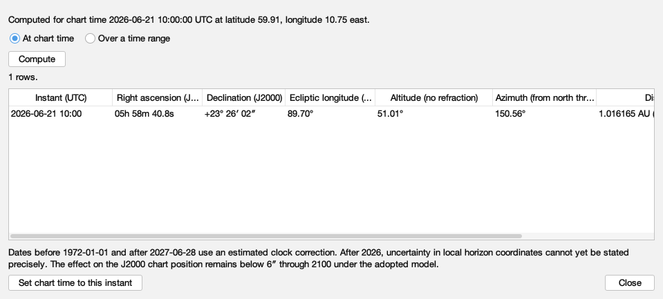

Packed 959 × 433 px.

| shown, hovered or spoken |
|---|
| The Sun |
| Where the Sun is, computed from the bundled ephemeris for the chart time and place: its position among the fixed stars, its height and direction above the mathematical horizon, its distance and how large it looks. One row for that instant, or a row for every step of a range. Nothing is drawn on the chart. |
| Whether the table is for the chart time and place now |
| Computed for chart time 2026-06-21 10:00:00 UTC at latitude 59.91, longitude 10.75 east. |
| At chart time |
| One row, at the chart time |
| Show the Sun at the chart time |
| Shows a single row: the Sun at the chart time. |
| Over a time range |
| A row for every step from the chart time, over a span |
| Show the Sun over a range of instants |
| Shows a row for every step from the chart time over the span chosen, as many whole steps as the span holds; the first row is the chart time, read again whenever you compute. To range from another instant, set the chart time. |
| Span |
| 1 day |
| 7 days |
| 30 days |
| 90 days |
| 365 days |
| How far the rows reach from the chart time |
| Span of the range from the chart time |
| How far from the chart time the rows reach, in whole steps of the step beside it. |
| Every |
| 1 hour |
| 6 hours |
| The elapsed time between rows |
| Step between rows |
| The elapsed time between rows, on the UTC timeline, so a daily range does not drift across a change of civil clock. |
| Compute |
| Fill the table for the span and step above, from the chart time |
| Compute the range |
| Computes a row for every step of the span above, from the chart time now. |
| 1 rows. |
| Instant (UTC) |
| Right ascension (J2000) |
| Declination (J2000) |
| Ecliptic longitude (J2000) |
| Altitude (no refraction) |
| Azimuth (from north through east) |
| Distance |
| Apparent diameter |
| 2026-06-21 10:00 · 05h 58m 40.8s · +23° 26′ 02″ · 89.70° · 51.01° · 150.56° · 1.016165 AU (152.016 mill. km) · 31′ 27.9″ |
| The Sun's computed quantities |
| Each row is one instant. The columns are the instant in UTC; right ascension and declination in the J2000 frame the chart is drawn in; ecliptic longitude on the J2000 ecliptic; altitude above the mathematical horizon and azimuth from north through east, without refraction; distance from the observer; and the apparent diameter of the disc. |
| Dates before 1972-01-01 and after 2027-06-28 use an estimated clock correction. After 2026, uncertainty in local horizon coordinates cannot yet be stated precisely. The effect on the J2000 chart position remains below 6″ through 2100 under the adopted model. |
| Set chart time to this instant |
| Make the selected row's instant the chart time and redraw every body for it |
| Set the chart time to the selected row's instant |
| Sets the chart time to the instant of the selected row, as Place and Time would, so every enabled body is redrawn for it. This table is then for an earlier chart time until you compute again. |
| Close |
| Close the Sun table |
| Closes the table. Nothing is changed or remembered; Place and Time keeps the place and instant. |

### A week of daily rows from the chart time

Daily rows from the chart time for a week, both ends: the first row is the chart time itself (#612, ruling P2). The status line counts them.

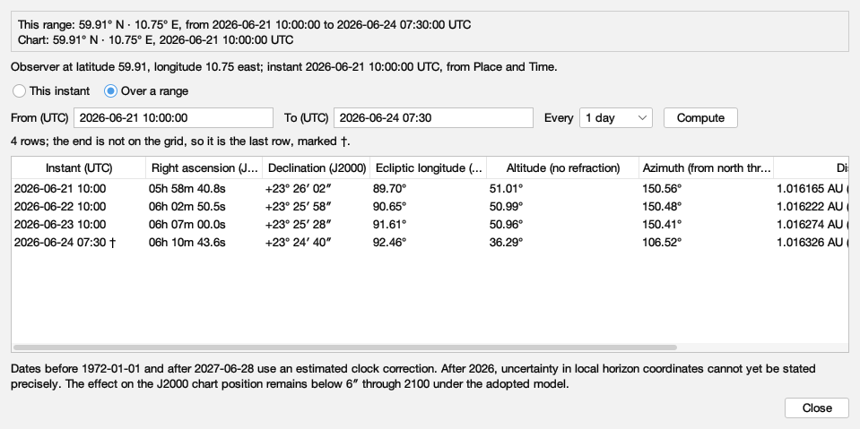

Packed 959 × 433 px.

| shown, hovered or spoken |
|---|
| The Sun |
| Where the Sun is, computed from the bundled ephemeris for the chart time and place: its position among the fixed stars, its height and direction above the mathematical horizon, its distance and how large it looks. One row for that instant, or a row for every step of a range. Nothing is drawn on the chart. |
| Whether the table is for the chart time and place now |
| Computed for chart time 2026-06-21 10:00:00 UTC at latitude 59.91, longitude 10.75 east. |
| At chart time |
| One row, at the chart time |
| Show the Sun at the chart time |
| Shows a single row: the Sun at the chart time. |
| Over a time range |
| A row for every step from the chart time, over a span |
| Show the Sun over a range of instants |
| Shows a row for every step from the chart time over the span chosen, as many whole steps as the span holds; the first row is the chart time, read again whenever you compute. To range from another instant, set the chart time. |
| Span |
| 1 day |
| 7 days |
| 30 days |
| 90 days |
| 365 days |
| How far the rows reach from the chart time |
| Span of the range from the chart time |
| How far from the chart time the rows reach, in whole steps of the step beside it. |
| Every |
| 1 hour |
| 6 hours |
| The elapsed time between rows |
| Step between rows |
| The elapsed time between rows, on the UTC timeline, so a daily range does not drift across a change of civil clock. |
| Compute |
| Fill the table for the span and step above, from the chart time |
| Compute the range |
| Computes a row for every step of the span above, from the chart time now. |
| 8 rows. |
| Instant (UTC) |
| Right ascension (J2000) |
| Declination (J2000) |
| Ecliptic longitude (J2000) |
| Altitude (no refraction) |
| Azimuth (from north through east) |
| Distance |
| Apparent diameter |
| 2026-06-21 10:00 · 05h 58m 40.8s · +23° 26′ 02″ · 89.70° · 51.01° · 150.56° · 1.016165 AU (152.016 mill. km) · 31′ 27.9″ |
| 2026-06-22 10:00 · 06h 02m 50.5s · +23° 25′ 58″ · 90.65° · 50.99° · 150.48° · 1.016222 AU (152.025 mill. km) · 31′ 27.8″ |
| 2026-06-23 10:00 · 06h 07m 00.0s · +23° 25′ 28″ · 91.61° · 50.96° · 150.41° · 1.016274 AU (152.032 mill. km) · 31′ 27.7″ |
| 2026-06-24 10:00 · 06h 11m 09.5s · +23° 24′ 34″ · 92.56° · 50.93° · 150.35° · 1.016323 AU (152.040 mill. km) · 31′ 27.7″ |
| 2026-06-25 10:00 · 06h 15m 18.8s · +23° 23′ 15″ · 93.51° · 50.90° · 150.28° · 1.016367 AU (152.046 mill. km) · 31′ 27.6″ |
| 2026-06-26 10:00 · 06h 19m 28.0s · +23° 21′ 32″ · 94.47° · 50.85° · 150.22° · 1.016407 AU (152.052 mill. km) · 31′ 27.5″ |
| 2026-06-27 10:00 · 06h 23m 37.1s · +23° 19′ 24″ · 95.42° · 50.80° · 150.16° · 1.016444 AU (152.058 mill. km) · 31′ 27.4″ |
| 2026-06-28 10:00 · 06h 27m 46.0s · +23° 16′ 51″ · 96.37° · 50.75° · 150.11° · 1.016477 AU (152.063 mill. km) · 31′ 27.4″ |
| The Sun's computed quantities |
| Each row is one instant. The columns are the instant in UTC; right ascension and declination in the J2000 frame the chart is drawn in; ecliptic longitude on the J2000 ecliptic; altitude above the mathematical horizon and azimuth from north through east, without refraction; distance from the observer; and the apparent diameter of the disc. |
| Dates before 1972-01-01 and after 2027-06-28 use an estimated clock correction. After 2026, uncertainty in local horizon coordinates cannot yet be stated precisely. The effect on the J2000 chart position remains below 6″ through 2100 under the adopted model. |
| Set chart time to this instant [unavailable] |
| Make the selected row's instant the chart time and redraw every body for it [unavailable] |
| Set the chart time to the selected row's instant [unavailable] |
| Sets the chart time to the instant of the selected row, as Place and Time would, so every enabled body is redrawn for it. This table is then for an earlier chart time until you compute again. [unavailable] |
| Close |
| Close the Sun table |
| Closes the table. Nothing is changed or remembered; Place and Time keeps the place and instant. |

### A range that asks for too many rows

A year of hourly rows asks for more than the 1 000 shown. The table is empty and the status line says why; nothing is cut short silently.

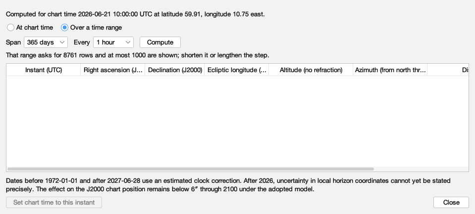

Packed 959 × 433 px.

| shown, hovered or spoken |
|---|
| The Sun |
| Where the Sun is, computed from the bundled ephemeris for the chart time and place: its position among the fixed stars, its height and direction above the mathematical horizon, its distance and how large it looks. One row for that instant, or a row for every step of a range. Nothing is drawn on the chart. |
| Whether the table is for the chart time and place now |
| Computed for chart time 2026-06-21 10:00:00 UTC at latitude 59.91, longitude 10.75 east. |
| At chart time |
| One row, at the chart time |
| Show the Sun at the chart time |
| Shows a single row: the Sun at the chart time. |
| Over a time range |
| A row for every step from the chart time, over a span |
| Show the Sun over a range of instants |
| Shows a row for every step from the chart time over the span chosen, as many whole steps as the span holds; the first row is the chart time, read again whenever you compute. To range from another instant, set the chart time. |
| Span |
| 1 day |
| 7 days |
| 30 days |
| 90 days |
| 365 days |
| How far the rows reach from the chart time |
| Span of the range from the chart time |
| How far from the chart time the rows reach, in whole steps of the step beside it. |
| Every |
| 1 hour |
| 6 hours |
| The elapsed time between rows |
| Step between rows |
| The elapsed time between rows, on the UTC timeline, so a daily range does not drift across a change of civil clock. |
| Compute |
| Fill the table for the span and step above, from the chart time |
| Compute the range |
| Computes a row for every step of the span above, from the chart time now. |
| That range asks for 8761 rows and at most 1000 are shown; shorten it or lengthen the step. |
| Instant (UTC) |
| Right ascension (J2000) |
| Declination (J2000) |
| Ecliptic longitude (J2000) |
| Altitude (no refraction) |
| Azimuth (from north through east) |
| Distance |
| Apparent diameter |
| The Sun's computed quantities |
| Each row is one instant. The columns are the instant in UTC; right ascension and declination in the J2000 frame the chart is drawn in; ecliptic longitude on the J2000 ecliptic; altitude above the mathematical horizon and azimuth from north through east, without refraction; distance from the observer; and the apparent diameter of the disc. |
| Dates before 1972-01-01 and after 2027-06-28 use an estimated clock correction. After 2026, uncertainty in local horizon coordinates cannot yet be stated precisely. The effect on the J2000 chart position remains below 6″ through 2100 under the adopted model. |
| Set chart time to this instant [unavailable] |
| Make the selected row's instant the chart time and redraw every body for it [unavailable] |
| Set the chart time to the selected row's instant [unavailable] |
| Sets the chart time to the instant of the selected row, as Place and Time would, so every enabled body is redrawn for it. This table is then for an earlier chart time until you compute again. [unavailable] |
| Close |
| Close the Sun table |
| Closes the table. Nothing is changed or remembered; Place and Time keeps the place and instant. |

### Quito at the December solstice

An equatorial observer at the IMCCE's solstice instant: the Sun is up, 32° high; the instant is shown to the minute, rounded.

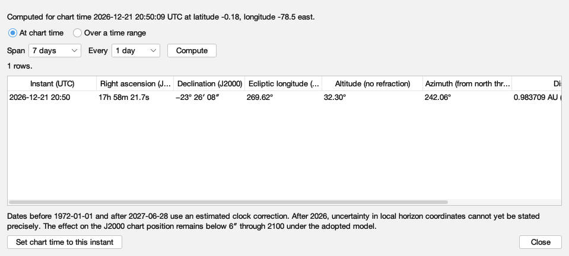

Packed 959 × 433 px.

| shown, hovered or spoken |
|---|
| The Sun |
| Where the Sun is, computed from the bundled ephemeris for the chart time and place: its position among the fixed stars, its height and direction above the mathematical horizon, its distance and how large it looks. One row for that instant, or a row for every step of a range. Nothing is drawn on the chart. |
| Whether the table is for the chart time and place now |
| Computed for chart time 2026-12-21 20:50:09 UTC at latitude -0.18, longitude -78.5 east. |
| At chart time |
| One row, at the chart time |
| Show the Sun at the chart time |
| Shows a single row: the Sun at the chart time. |
| Over a time range |
| A row for every step from the chart time, over a span |
| Show the Sun over a range of instants |
| Shows a row for every step from the chart time over the span chosen, as many whole steps as the span holds; the first row is the chart time, read again whenever you compute. To range from another instant, set the chart time. |
| Span |
| 1 day |
| 7 days |
| 30 days |
| 90 days |
| 365 days |
| How far the rows reach from the chart time |
| Span of the range from the chart time |
| How far from the chart time the rows reach, in whole steps of the step beside it. |
| Every |
| 1 hour |
| 6 hours |
| The elapsed time between rows |
| Step between rows |
| The elapsed time between rows, on the UTC timeline, so a daily range does not drift across a change of civil clock. |
| Compute |
| Fill the table for the span and step above, from the chart time |
| Compute the range |
| Computes a row for every step of the span above, from the chart time now. |
| 1 rows. |
| Instant (UTC) |
| Right ascension (J2000) |
| Declination (J2000) |
| Ecliptic longitude (J2000) |
| Altitude (no refraction) |
| Azimuth (from north through east) |
| Distance |
| Apparent diameter |
| 2026-12-21 20:50 · 17h 58m 21.7s · −23° 26′ 08″ · 269.62° · 32.30° · 242.06° · 0.983709 AU (147.161 mill. km) · 32′ 30.2″ |
| The Sun's computed quantities |
| Each row is one instant. The columns are the instant in UTC; right ascension and declination in the J2000 frame the chart is drawn in; ecliptic longitude on the J2000 ecliptic; altitude above the mathematical horizon and azimuth from north through east, without refraction; distance from the observer; and the apparent diameter of the disc. |
| Dates before 1972-01-01 and after 2027-06-28 use an estimated clock correction. After 2026, uncertainty in local horizon coordinates cannot yet be stated precisely. The effect on the J2000 chart position remains below 6″ through 2100 under the adopted model. |
| Set chart time to this instant |
| Make the selected row's instant the chart time and redraw every body for it |
| Set the chart time to the selected row's instant |
| Sets the chart time to the instant of the selected row, as Place and Time would, so every enabled body is redrawn for it. This table is then for an earlier chart time until you compute again. |
| Close |
| Close the Sun table |
| Closes the table. Nothing is changed or remembered; Place and Time keeps the place and instant. |

### The chart moved on after computing

The chart time moved six hours on after this instant was computed (#612, ruling P1): the rows stay, dimmed, under the stale message, until Compute; the note states the chart time and place the rows are for.

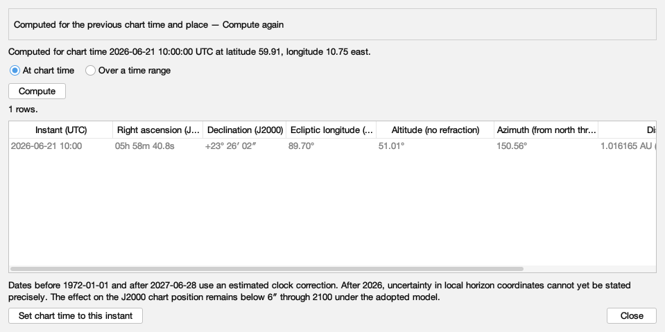

Packed 959 × 479 px.

| shown, hovered or spoken |
|---|
| The Sun |
| Where the Sun is, computed from the bundled ephemeris for the chart time and place: its position among the fixed stars, its height and direction above the mathematical horizon, its distance and how large it looks. One row for that instant, or a row for every step of a range. Nothing is drawn on the chart. |
| Whether the table is for the chart time and place now |
| Computed for the previous chart time and place — Compute again |
| Computed for chart time 2026-06-21 10:00:00 UTC at latitude 59.91, longitude 10.75 east. |
| At chart time |
| One row, at the chart time |
| Show the Sun at the chart time |
| Shows a single row: the Sun at the chart time. |
| Over a time range |
| A row for every step from the chart time, over a span |
| Show the Sun over a range of instants |
| Shows a row for every step from the chart time over the span chosen, as many whole steps as the span holds; the first row is the chart time, read again whenever you compute. To range from another instant, set the chart time. |
| Span |
| 1 day |
| 7 days |
| 30 days |
| 90 days |
| 365 days |
| How far the rows reach from the chart time |
| Span of the range from the chart time |
| How far from the chart time the rows reach, in whole steps of the step beside it. |
| Every |
| 1 hour |
| 6 hours |
| The elapsed time between rows |
| Step between rows |
| The elapsed time between rows, on the UTC timeline, so a daily range does not drift across a change of civil clock. |
| Compute |
| Fill the table for the span and step above, from the chart time |
| Compute the range |
| Computes a row for every step of the span above, from the chart time now. |
| 1 rows. |
| Instant (UTC) |
| Right ascension (J2000) |
| Declination (J2000) |
| Ecliptic longitude (J2000) |
| Altitude (no refraction) |
| Azimuth (from north through east) |
| Distance |
| Apparent diameter |
| 2026-06-21 10:00 · 05h 58m 40.8s · +23° 26′ 02″ · 89.70° · 51.01° · 150.56° · 1.016165 AU (152.016 mill. km) · 31′ 27.9″ |
| The Sun's computed quantities |
| Each row is one instant. The columns are the instant in UTC; right ascension and declination in the J2000 frame the chart is drawn in; ecliptic longitude on the J2000 ecliptic; altitude above the mathematical horizon and azimuth from north through east, without refraction; distance from the observer; and the apparent diameter of the disc. |
| Dates before 1972-01-01 and after 2027-06-28 use an estimated clock correction. After 2026, uncertainty in local horizon coordinates cannot yet be stated precisely. The effect on the J2000 chart position remains below 6″ through 2100 under the adopted model. |
| Set chart time to this instant |
| Make the selected row's instant the chart time and redraw every body for it |
| Set the chart time to the selected row's instant |
| Sets the chart time to the instant of the selected row, as Place and Time would, so every enabled body is redrawn for it. This table is then for an earlier chart time until you compute again. |
| Close |
| Close the Sun table |
| Closes the table. Nothing is changed or remembered; Place and Time keeps the place and instant. |

### The instant, in the dark appearance

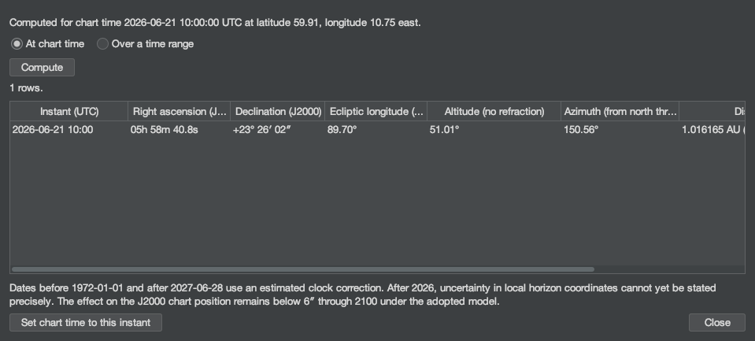

Packed 959 × 433 px.

| shown, hovered or spoken |
|---|
| The Sun |
| Where the Sun is, computed from the bundled ephemeris for the chart time and place: its position among the fixed stars, its height and direction above the mathematical horizon, its distance and how large it looks. One row for that instant, or a row for every step of a range. Nothing is drawn on the chart. |
| Whether the table is for the chart time and place now |
| Computed for chart time 2026-06-21 10:00:00 UTC at latitude 59.91, longitude 10.75 east. |
| At chart time |
| One row, at the chart time |
| Show the Sun at the chart time |
| Shows a single row: the Sun at the chart time. |
| Over a time range |
| A row for every step from the chart time, over a span |
| Show the Sun over a range of instants |
| Shows a row for every step from the chart time over the span chosen, as many whole steps as the span holds; the first row is the chart time, read again whenever you compute. To range from another instant, set the chart time. |
| Span |
| 1 day |
| 7 days |
| 30 days |
| 90 days |
| 365 days |
| How far the rows reach from the chart time |
| Span of the range from the chart time |
| How far from the chart time the rows reach, in whole steps of the step beside it. |
| Every |
| 1 hour |
| 6 hours |
| The elapsed time between rows |
| Step between rows |
| The elapsed time between rows, on the UTC timeline, so a daily range does not drift across a change of civil clock. |
| Compute |
| Fill the table for the span and step above, from the chart time |
| Compute the range |
| Computes a row for every step of the span above, from the chart time now. |
| 1 rows. |
| Instant (UTC) |
| Right ascension (J2000) |
| Declination (J2000) |
| Ecliptic longitude (J2000) |
| Altitude (no refraction) |
| Azimuth (from north through east) |
| Distance |
| Apparent diameter |
| 2026-06-21 10:00 · 05h 58m 40.8s · +23° 26′ 02″ · 89.70° · 51.01° · 150.56° · 1.016165 AU (152.016 mill. km) · 31′ 27.9″ |
| The Sun's computed quantities |
| Each row is one instant. The columns are the instant in UTC; right ascension and declination in the J2000 frame the chart is drawn in; ecliptic longitude on the J2000 ecliptic; altitude above the mathematical horizon and azimuth from north through east, without refraction; distance from the observer; and the apparent diameter of the disc. |
| Dates before 1972-01-01 and after 2027-06-28 use an estimated clock correction. After 2026, uncertainty in local horizon coordinates cannot yet be stated precisely. The effect on the J2000 chart position remains below 6″ through 2100 under the adopted model. |
| Set chart time to this instant |
| Make the selected row's instant the chart time and redraw every body for it |
| Set the chart time to the selected row's instant |
| Sets the chart time to the instant of the selected row, as Place and Time would, so every enabled body is redrawn for it. This table is then for an earlier chart time until you compute again. |
| Close |
| Close the Sun table |
| Closes the table. Nothing is changed or remembered; Place and Time keeps the place and instant. |

#### The headings, and what they explain

| heading | explanation |
|---|---|
| Instant (UTC) | The instant in UTC, to the minute. "est." marks an instant whose clock correction is estimated; † marks a range end that was not on the grid. |
| Right ascension (J2000) | Hours, minutes and seconds of time, in the ICRS/J2000 frame the chart is drawn in: where the Sun is among the fixed stars, as seen from the observing place, without aberration. |
| Declination (J2000) | Degrees, minutes and seconds of arc, in the same frame. |
| Ecliptic longitude (J2000) | Degrees along the J2000 ecliptic, measured from the fixed J2000 equinox. The equinoxes and solstices of a later year fall near, not exactly at, 0°, 90°, 180° and 270°, because the equinox itself moves. |
| Altitude (no refraction) | Degrees above the mathematical horizon, without atmospheric refraction; below the horizon the number is kept and the status is added. |
| Azimuth (from north through east) | Degrees from north through east: 90° is east, 180° south, 270° west. |
| Distance | From the observer to the Sun's centre, in astronomical units and in millions of kilometres. |
| Apparent diameter | How large the Sun's disc looks, in minutes and seconds of arc. |

## Norsk bokmål (`nb-NO`)

### One instant, Oslo at midsummer

The fresh state: a single row at the instant Place and Time holds. The Sun stands 51° high to the south-east.

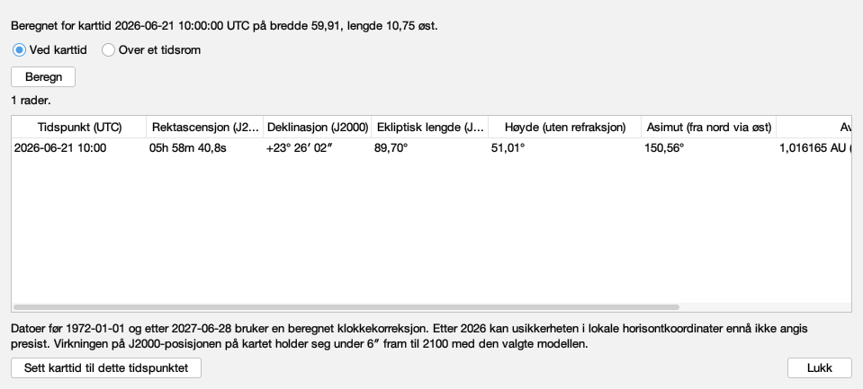

Packed 959 × 433 px.

| shown, hovered or spoken |
|---|
| Solen |
| Hvor Solen er, beregnet fra den medfølgende efemeriden for karttiden og observasjonsstedet: posisjonen blant fiksstjernene, høyden og retningen over den matematiske horisonten, avstanden og hvor stor den ser ut. Én rad for det tidspunktet, eller én rad for hvert steg i et tidsrom. Ingenting tegnes på kartet. |
| Om tabellen gjelder karttiden og stedet nå |
| Beregnet for karttid 2026-06-21 10:00:00 UTC på bredde 59,91, lengde 10,75 øst. |
| Ved karttid |
| Én rad, ved karttiden |
| Vis Solen ved karttiden |
| Viser én rad: Solen ved karttiden. |
| Over et tidsrom |
| Én rad for hvert steg fra karttiden, over et omfang |
| Vis Solen over et tidsrom |
| Viser én rad for hvert steg fra karttiden over omfanget valgt, så mange hele steg som omfanget rommer; første rad er karttiden, lest på nytt hver gang du beregner. Sett karttiden for å regne fra et annet tidspunkt. |
| Omfang |
| 1 døgn |
| 7 døgn |
| 30 døgn |
| 90 døgn |
| 365 døgn |
| Hvor langt radene rekker fra karttiden |
| Tidsrommets omfang fra karttiden |
| Hvor langt fra karttiden radene rekker, i hele steg av steget ved siden av. |
| Hvert |
| 1 time |
| 6 timer |
| Tiden som går mellom radene |
| Steg mellom radene |
| Tiden som går mellom radene, på UTC-tidslinjen, så et daglig tidsrom ikke forskyver seg ved skifte av sivil klokke. |
| Beregn |
| Fyll tabellen for omfanget og steget over, fra karttiden |
| Beregn tidsrommet |
| Beregner én rad for hvert steg i omfanget over, fra karttiden nå. |
| 1 rader. |
| Tidspunkt (UTC) |
| Rektascensjon (J2000) |
| Deklinasjon (J2000) |
| Ekliptisk lengde (J2000) |
| Høyde (uten refraksjon) |
| Asimut (fra nord via øst) |
| Avstand |
| Tilsynelatende diameter |
| 2026-06-21 10:00 · 05h 58m 40,8s · +23° 26′ 02″ · 89,70° · 51,01° · 150,56° · 1,016165 AU (152,016 mill. km) · 31′ 27,9″ |
| Solens beregnede størrelser |
| Hver rad er ett tidspunkt. Kolonnene er tidspunktet i UTC; rektascensjon og deklinasjon i J2000-rammen kartet tegnes i; ekliptisk lengde på J2000-ekliptikken; høyde over den matematiske horisonten og asimut fra nord via øst, uten refraksjon; avstand fra observatøren; og skivens tilsynelatende diameter. |
| Datoer før 1972-01-01 og etter 2027-06-28 bruker en beregnet klokkekorreksjon. Etter 2026 kan usikkerheten i lokale horisontkoordinater ennå ikke angis presist. Virkningen på J2000-posisjonen på kartet holder seg under 6″ fram til 2100 med den valgte modellen. |
| Sett karttid til dette tidspunktet |
| Gjør den valgte radens tidspunkt til karttid og tegn hvert himmellegeme på nytt for det |
| Sett karttiden til den valgte radens tidspunkt |
| Setter karttiden til tidspunktet i den valgte raden, slik Sted og tid ville gjort, så hvert påslått himmellegeme tegnes på nytt for det. Denne tabellen gjelder så en tidligere karttid til du beregner på nytt. |
| Lukk |
| Lukk soltabellen |
| Lukker tabellen. Ingenting endres eller huskes; Sted og tid beholder stedet og tidspunktet. |

### A week of daily rows from the chart time

Daily rows from the chart time for a week, both ends: the first row is the chart time itself (#612, ruling P2). The status line counts them.

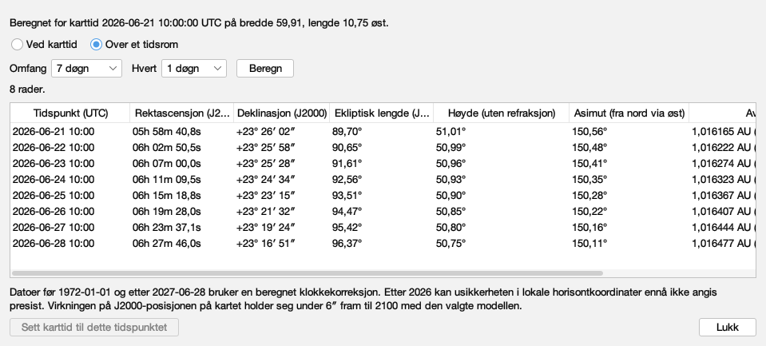

Packed 959 × 433 px.

| shown, hovered or spoken |
|---|
| Solen |
| Hvor Solen er, beregnet fra den medfølgende efemeriden for karttiden og observasjonsstedet: posisjonen blant fiksstjernene, høyden og retningen over den matematiske horisonten, avstanden og hvor stor den ser ut. Én rad for det tidspunktet, eller én rad for hvert steg i et tidsrom. Ingenting tegnes på kartet. |
| Om tabellen gjelder karttiden og stedet nå |
| Beregnet for karttid 2026-06-21 10:00:00 UTC på bredde 59,91, lengde 10,75 øst. |
| Ved karttid |
| Én rad, ved karttiden |
| Vis Solen ved karttiden |
| Viser én rad: Solen ved karttiden. |
| Over et tidsrom |
| Én rad for hvert steg fra karttiden, over et omfang |
| Vis Solen over et tidsrom |
| Viser én rad for hvert steg fra karttiden over omfanget valgt, så mange hele steg som omfanget rommer; første rad er karttiden, lest på nytt hver gang du beregner. Sett karttiden for å regne fra et annet tidspunkt. |
| Omfang |
| 1 døgn |
| 7 døgn |
| 30 døgn |
| 90 døgn |
| 365 døgn |
| Hvor langt radene rekker fra karttiden |
| Tidsrommets omfang fra karttiden |
| Hvor langt fra karttiden radene rekker, i hele steg av steget ved siden av. |
| Hvert |
| 1 time |
| 6 timer |
| Tiden som går mellom radene |
| Steg mellom radene |
| Tiden som går mellom radene, på UTC-tidslinjen, så et daglig tidsrom ikke forskyver seg ved skifte av sivil klokke. |
| Beregn |
| Fyll tabellen for omfanget og steget over, fra karttiden |
| Beregn tidsrommet |
| Beregner én rad for hvert steg i omfanget over, fra karttiden nå. |
| 8 rader. |
| Tidspunkt (UTC) |
| Rektascensjon (J2000) |
| Deklinasjon (J2000) |
| Ekliptisk lengde (J2000) |
| Høyde (uten refraksjon) |
| Asimut (fra nord via øst) |
| Avstand |
| Tilsynelatende diameter |
| 2026-06-21 10:00 · 05h 58m 40,8s · +23° 26′ 02″ · 89,70° · 51,01° · 150,56° · 1,016165 AU (152,016 mill. km) · 31′ 27,9″ |
| 2026-06-22 10:00 · 06h 02m 50,5s · +23° 25′ 58″ · 90,65° · 50,99° · 150,48° · 1,016222 AU (152,025 mill. km) · 31′ 27,8″ |
| 2026-06-23 10:00 · 06h 07m 00,0s · +23° 25′ 28″ · 91,61° · 50,96° · 150,41° · 1,016274 AU (152,032 mill. km) · 31′ 27,7″ |
| 2026-06-24 10:00 · 06h 11m 09,5s · +23° 24′ 34″ · 92,56° · 50,93° · 150,35° · 1,016323 AU (152,040 mill. km) · 31′ 27,7″ |
| 2026-06-25 10:00 · 06h 15m 18,8s · +23° 23′ 15″ · 93,51° · 50,90° · 150,28° · 1,016367 AU (152,046 mill. km) · 31′ 27,6″ |
| 2026-06-26 10:00 · 06h 19m 28,0s · +23° 21′ 32″ · 94,47° · 50,85° · 150,22° · 1,016407 AU (152,052 mill. km) · 31′ 27,5″ |
| 2026-06-27 10:00 · 06h 23m 37,1s · +23° 19′ 24″ · 95,42° · 50,80° · 150,16° · 1,016444 AU (152,058 mill. km) · 31′ 27,4″ |
| 2026-06-28 10:00 · 06h 27m 46,0s · +23° 16′ 51″ · 96,37° · 50,75° · 150,11° · 1,016477 AU (152,063 mill. km) · 31′ 27,4″ |
| Solens beregnede størrelser |
| Hver rad er ett tidspunkt. Kolonnene er tidspunktet i UTC; rektascensjon og deklinasjon i J2000-rammen kartet tegnes i; ekliptisk lengde på J2000-ekliptikken; høyde over den matematiske horisonten og asimut fra nord via øst, uten refraksjon; avstand fra observatøren; og skivens tilsynelatende diameter. |
| Datoer før 1972-01-01 og etter 2027-06-28 bruker en beregnet klokkekorreksjon. Etter 2026 kan usikkerheten i lokale horisontkoordinater ennå ikke angis presist. Virkningen på J2000-posisjonen på kartet holder seg under 6″ fram til 2100 med den valgte modellen. |
| Sett karttid til dette tidspunktet [unavailable] |
| Gjør den valgte radens tidspunkt til karttid og tegn hvert himmellegeme på nytt for det [unavailable] |
| Sett karttiden til den valgte radens tidspunkt [unavailable] |
| Setter karttiden til tidspunktet i den valgte raden, slik Sted og tid ville gjort, så hvert påslått himmellegeme tegnes på nytt for det. Denne tabellen gjelder så en tidligere karttid til du beregner på nytt. [unavailable] |
| Lukk |
| Lukk soltabellen |
| Lukker tabellen. Ingenting endres eller huskes; Sted og tid beholder stedet og tidspunktet. |

### A range that asks for too many rows

A year of hourly rows asks for more than the 1 000 shown. The table is empty and the status line says why; nothing is cut short silently.

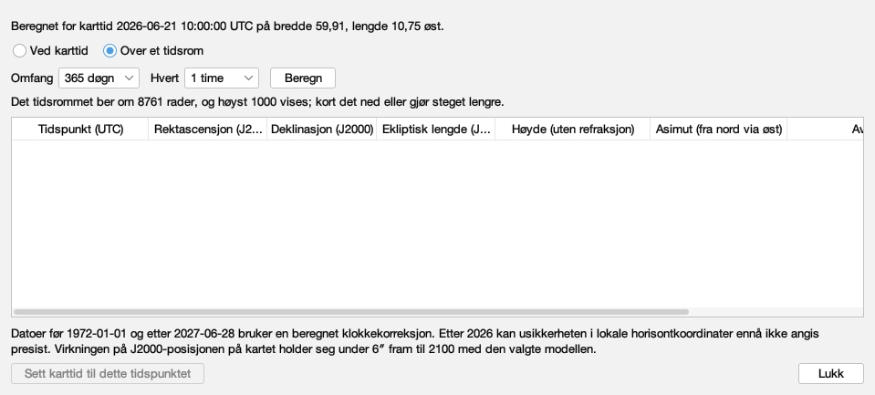

Packed 959 × 433 px.

| shown, hovered or spoken |
|---|
| Solen |
| Hvor Solen er, beregnet fra den medfølgende efemeriden for karttiden og observasjonsstedet: posisjonen blant fiksstjernene, høyden og retningen over den matematiske horisonten, avstanden og hvor stor den ser ut. Én rad for det tidspunktet, eller én rad for hvert steg i et tidsrom. Ingenting tegnes på kartet. |
| Om tabellen gjelder karttiden og stedet nå |
| Beregnet for karttid 2026-06-21 10:00:00 UTC på bredde 59,91, lengde 10,75 øst. |
| Ved karttid |
| Én rad, ved karttiden |
| Vis Solen ved karttiden |
| Viser én rad: Solen ved karttiden. |
| Over et tidsrom |
| Én rad for hvert steg fra karttiden, over et omfang |
| Vis Solen over et tidsrom |
| Viser én rad for hvert steg fra karttiden over omfanget valgt, så mange hele steg som omfanget rommer; første rad er karttiden, lest på nytt hver gang du beregner. Sett karttiden for å regne fra et annet tidspunkt. |
| Omfang |
| 1 døgn |
| 7 døgn |
| 30 døgn |
| 90 døgn |
| 365 døgn |
| Hvor langt radene rekker fra karttiden |
| Tidsrommets omfang fra karttiden |
| Hvor langt fra karttiden radene rekker, i hele steg av steget ved siden av. |
| Hvert |
| 1 time |
| 6 timer |
| Tiden som går mellom radene |
| Steg mellom radene |
| Tiden som går mellom radene, på UTC-tidslinjen, så et daglig tidsrom ikke forskyver seg ved skifte av sivil klokke. |
| Beregn |
| Fyll tabellen for omfanget og steget over, fra karttiden |
| Beregn tidsrommet |
| Beregner én rad for hvert steg i omfanget over, fra karttiden nå. |
| Det tidsrommet ber om 8761 rader, og høyst 1000 vises; kort det ned eller gjør steget lengre. |
| Tidspunkt (UTC) |
| Rektascensjon (J2000) |
| Deklinasjon (J2000) |
| Ekliptisk lengde (J2000) |
| Høyde (uten refraksjon) |
| Asimut (fra nord via øst) |
| Avstand |
| Tilsynelatende diameter |
| Solens beregnede størrelser |
| Hver rad er ett tidspunkt. Kolonnene er tidspunktet i UTC; rektascensjon og deklinasjon i J2000-rammen kartet tegnes i; ekliptisk lengde på J2000-ekliptikken; høyde over den matematiske horisonten og asimut fra nord via øst, uten refraksjon; avstand fra observatøren; og skivens tilsynelatende diameter. |
| Datoer før 1972-01-01 og etter 2027-06-28 bruker en beregnet klokkekorreksjon. Etter 2026 kan usikkerheten i lokale horisontkoordinater ennå ikke angis presist. Virkningen på J2000-posisjonen på kartet holder seg under 6″ fram til 2100 med den valgte modellen. |
| Sett karttid til dette tidspunktet [unavailable] |
| Gjør den valgte radens tidspunkt til karttid og tegn hvert himmellegeme på nytt for det [unavailable] |
| Sett karttiden til den valgte radens tidspunkt [unavailable] |
| Setter karttiden til tidspunktet i den valgte raden, slik Sted og tid ville gjort, så hvert påslått himmellegeme tegnes på nytt for det. Denne tabellen gjelder så en tidligere karttid til du beregner på nytt. [unavailable] |
| Lukk |
| Lukk soltabellen |
| Lukker tabellen. Ingenting endres eller huskes; Sted og tid beholder stedet og tidspunktet. |

### Quito at the December solstice

An equatorial observer at the IMCCE's solstice instant: the Sun is up, 32° high; the instant is shown to the minute, rounded.

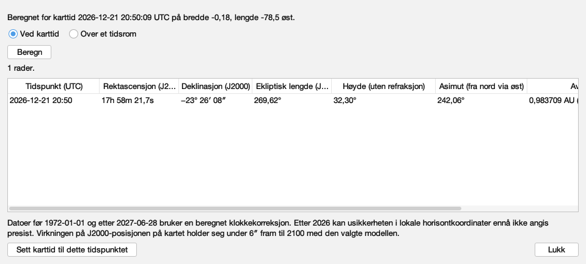

Packed 959 × 433 px.

| shown, hovered or spoken |
|---|
| Solen |
| Hvor Solen er, beregnet fra den medfølgende efemeriden for karttiden og observasjonsstedet: posisjonen blant fiksstjernene, høyden og retningen over den matematiske horisonten, avstanden og hvor stor den ser ut. Én rad for det tidspunktet, eller én rad for hvert steg i et tidsrom. Ingenting tegnes på kartet. |
| Om tabellen gjelder karttiden og stedet nå |
| Beregnet for karttid 2026-12-21 20:50:09 UTC på bredde -0,18, lengde -78,5 øst. |
| Ved karttid |
| Én rad, ved karttiden |
| Vis Solen ved karttiden |
| Viser én rad: Solen ved karttiden. |
| Over et tidsrom |
| Én rad for hvert steg fra karttiden, over et omfang |
| Vis Solen over et tidsrom |
| Viser én rad for hvert steg fra karttiden over omfanget valgt, så mange hele steg som omfanget rommer; første rad er karttiden, lest på nytt hver gang du beregner. Sett karttiden for å regne fra et annet tidspunkt. |
| Omfang |
| 1 døgn |
| 7 døgn |
| 30 døgn |
| 90 døgn |
| 365 døgn |
| Hvor langt radene rekker fra karttiden |
| Tidsrommets omfang fra karttiden |
| Hvor langt fra karttiden radene rekker, i hele steg av steget ved siden av. |
| Hvert |
| 1 time |
| 6 timer |
| Tiden som går mellom radene |
| Steg mellom radene |
| Tiden som går mellom radene, på UTC-tidslinjen, så et daglig tidsrom ikke forskyver seg ved skifte av sivil klokke. |
| Beregn |
| Fyll tabellen for omfanget og steget over, fra karttiden |
| Beregn tidsrommet |
| Beregner én rad for hvert steg i omfanget over, fra karttiden nå. |
| 1 rader. |
| Tidspunkt (UTC) |
| Rektascensjon (J2000) |
| Deklinasjon (J2000) |
| Ekliptisk lengde (J2000) |
| Høyde (uten refraksjon) |
| Asimut (fra nord via øst) |
| Avstand |
| Tilsynelatende diameter |
| 2026-12-21 20:50 · 17h 58m 21,7s · −23° 26′ 08″ · 269,62° · 32,30° · 242,06° · 0,983709 AU (147,161 mill. km) · 32′ 30,2″ |
| Solens beregnede størrelser |
| Hver rad er ett tidspunkt. Kolonnene er tidspunktet i UTC; rektascensjon og deklinasjon i J2000-rammen kartet tegnes i; ekliptisk lengde på J2000-ekliptikken; høyde over den matematiske horisonten og asimut fra nord via øst, uten refraksjon; avstand fra observatøren; og skivens tilsynelatende diameter. |
| Datoer før 1972-01-01 og etter 2027-06-28 bruker en beregnet klokkekorreksjon. Etter 2026 kan usikkerheten i lokale horisontkoordinater ennå ikke angis presist. Virkningen på J2000-posisjonen på kartet holder seg under 6″ fram til 2100 med den valgte modellen. |
| Sett karttid til dette tidspunktet |
| Gjør den valgte radens tidspunkt til karttid og tegn hvert himmellegeme på nytt for det |
| Sett karttiden til den valgte radens tidspunkt |
| Setter karttiden til tidspunktet i den valgte raden, slik Sted og tid ville gjort, så hvert påslått himmellegeme tegnes på nytt for det. Denne tabellen gjelder så en tidligere karttid til du beregner på nytt. |
| Lukk |
| Lukk soltabellen |
| Lukker tabellen. Ingenting endres eller huskes; Sted og tid beholder stedet og tidspunktet. |

### The chart moved on after computing

The chart time moved six hours on after this instant was computed (#612, ruling P1): the rows stay, dimmed, under the stale message, until Compute; the note states the chart time and place the rows are for.

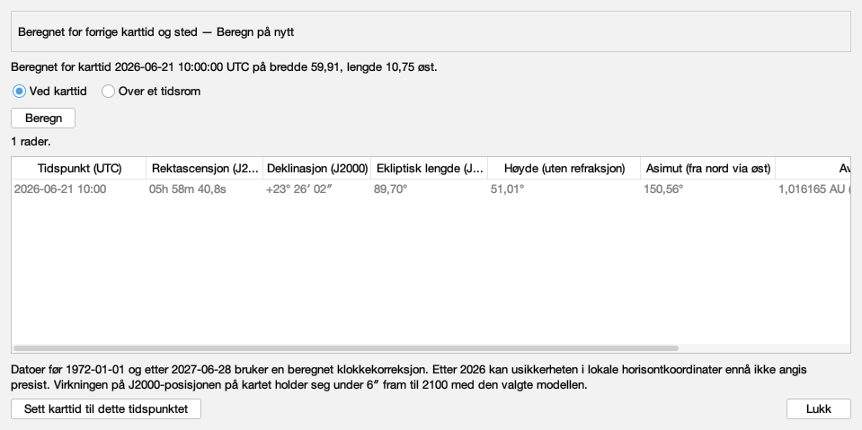

Packed 959 × 479 px.

| shown, hovered or spoken |
|---|
| Solen |
| Hvor Solen er, beregnet fra den medfølgende efemeriden for karttiden og observasjonsstedet: posisjonen blant fiksstjernene, høyden og retningen over den matematiske horisonten, avstanden og hvor stor den ser ut. Én rad for det tidspunktet, eller én rad for hvert steg i et tidsrom. Ingenting tegnes på kartet. |
| Om tabellen gjelder karttiden og stedet nå |
| Beregnet for forrige karttid og sted — Beregn på nytt |
| Beregnet for karttid 2026-06-21 10:00:00 UTC på bredde 59,91, lengde 10,75 øst. |
| Ved karttid |
| Én rad, ved karttiden |
| Vis Solen ved karttiden |
| Viser én rad: Solen ved karttiden. |
| Over et tidsrom |
| Én rad for hvert steg fra karttiden, over et omfang |
| Vis Solen over et tidsrom |
| Viser én rad for hvert steg fra karttiden over omfanget valgt, så mange hele steg som omfanget rommer; første rad er karttiden, lest på nytt hver gang du beregner. Sett karttiden for å regne fra et annet tidspunkt. |
| Omfang |
| 1 døgn |
| 7 døgn |
| 30 døgn |
| 90 døgn |
| 365 døgn |
| Hvor langt radene rekker fra karttiden |
| Tidsrommets omfang fra karttiden |
| Hvor langt fra karttiden radene rekker, i hele steg av steget ved siden av. |
| Hvert |
| 1 time |
| 6 timer |
| Tiden som går mellom radene |
| Steg mellom radene |
| Tiden som går mellom radene, på UTC-tidslinjen, så et daglig tidsrom ikke forskyver seg ved skifte av sivil klokke. |
| Beregn |
| Fyll tabellen for omfanget og steget over, fra karttiden |
| Beregn tidsrommet |
| Beregner én rad for hvert steg i omfanget over, fra karttiden nå. |
| 1 rader. |
| Tidspunkt (UTC) |
| Rektascensjon (J2000) |
| Deklinasjon (J2000) |
| Ekliptisk lengde (J2000) |
| Høyde (uten refraksjon) |
| Asimut (fra nord via øst) |
| Avstand |
| Tilsynelatende diameter |
| 2026-06-21 10:00 · 05h 58m 40,8s · +23° 26′ 02″ · 89,70° · 51,01° · 150,56° · 1,016165 AU (152,016 mill. km) · 31′ 27,9″ |
| Solens beregnede størrelser |
| Hver rad er ett tidspunkt. Kolonnene er tidspunktet i UTC; rektascensjon og deklinasjon i J2000-rammen kartet tegnes i; ekliptisk lengde på J2000-ekliptikken; høyde over den matematiske horisonten og asimut fra nord via øst, uten refraksjon; avstand fra observatøren; og skivens tilsynelatende diameter. |
| Datoer før 1972-01-01 og etter 2027-06-28 bruker en beregnet klokkekorreksjon. Etter 2026 kan usikkerheten i lokale horisontkoordinater ennå ikke angis presist. Virkningen på J2000-posisjonen på kartet holder seg under 6″ fram til 2100 med den valgte modellen. |
| Sett karttid til dette tidspunktet |
| Gjør den valgte radens tidspunkt til karttid og tegn hvert himmellegeme på nytt for det |
| Sett karttiden til den valgte radens tidspunkt |
| Setter karttiden til tidspunktet i den valgte raden, slik Sted og tid ville gjort, så hvert påslått himmellegeme tegnes på nytt for det. Denne tabellen gjelder så en tidligere karttid til du beregner på nytt. |
| Lukk |
| Lukk soltabellen |
| Lukker tabellen. Ingenting endres eller huskes; Sted og tid beholder stedet og tidspunktet. |

### The instant, in the dark appearance

Packed 959 × 433 px.

| shown, hovered or spoken |
|---|
| Solen |
| Hvor Solen er, beregnet fra den medfølgende efemeriden for karttiden og observasjonsstedet: posisjonen blant fiksstjernene, høyden og retningen over den matematiske horisonten, avstanden og hvor stor den ser ut. Én rad for det tidspunktet, eller én rad for hvert steg i et tidsrom. Ingenting tegnes på kartet. |
| Om tabellen gjelder karttiden og stedet nå |
| Beregnet for karttid 2026-06-21 10:00:00 UTC på bredde 59,91, lengde 10,75 øst. |
| Ved karttid |
| Én rad, ved karttiden |
| Vis Solen ved karttiden |
| Viser én rad: Solen ved karttiden. |
| Over et tidsrom |
| Én rad for hvert steg fra karttiden, over et omfang |
| Vis Solen over et tidsrom |
| Viser én rad for hvert steg fra karttiden over omfanget valgt, så mange hele steg som omfanget rommer; første rad er karttiden, lest på nytt hver gang du beregner. Sett karttiden for å regne fra et annet tidspunkt. |
| Omfang |
| 1 døgn |
| 7 døgn |
| 30 døgn |
| 90 døgn |
| 365 døgn |
| Hvor langt radene rekker fra karttiden |
| Tidsrommets omfang fra karttiden |
| Hvor langt fra karttiden radene rekker, i hele steg av steget ved siden av. |
| Hvert |
| 1 time |
| 6 timer |
| Tiden som går mellom radene |
| Steg mellom radene |
| Tiden som går mellom radene, på UTC-tidslinjen, så et daglig tidsrom ikke forskyver seg ved skifte av sivil klokke. |
| Beregn |
| Fyll tabellen for omfanget og steget over, fra karttiden |
| Beregn tidsrommet |
| Beregner én rad for hvert steg i omfanget over, fra karttiden nå. |
| 1 rader. |
| Tidspunkt (UTC) |
| Rektascensjon (J2000) |
| Deklinasjon (J2000) |
| Ekliptisk lengde (J2000) |
| Høyde (uten refraksjon) |
| Asimut (fra nord via øst) |
| Avstand |
| Tilsynelatende diameter |
| 2026-06-21 10:00 · 05h 58m 40,8s · +23° 26′ 02″ · 89,70° · 51,01° · 150,56° · 1,016165 AU (152,016 mill. km) · 31′ 27,9″ |
| Solens beregnede størrelser |
| Hver rad er ett tidspunkt. Kolonnene er tidspunktet i UTC; rektascensjon og deklinasjon i J2000-rammen kartet tegnes i; ekliptisk lengde på J2000-ekliptikken; høyde over den matematiske horisonten og asimut fra nord via øst, uten refraksjon; avstand fra observatøren; og skivens tilsynelatende diameter. |
| Datoer før 1972-01-01 og etter 2027-06-28 bruker en beregnet klokkekorreksjon. Etter 2026 kan usikkerheten i lokale horisontkoordinater ennå ikke angis presist. Virkningen på J2000-posisjonen på kartet holder seg under 6″ fram til 2100 med den valgte modellen. |
| Sett karttid til dette tidspunktet |
| Gjør den valgte radens tidspunkt til karttid og tegn hvert himmellegeme på nytt for det |
| Sett karttiden til den valgte radens tidspunkt |
| Setter karttiden til tidspunktet i den valgte raden, slik Sted og tid ville gjort, så hvert påslått himmellegeme tegnes på nytt for det. Denne tabellen gjelder så en tidligere karttid til du beregner på nytt. |
| Lukk |
| Lukk soltabellen |
| Lukker tabellen. Ingenting endres eller huskes; Sted og tid beholder stedet og tidspunktet. |

#### The headings, and what they explain

| heading | explanation |
|---|---|
| Tidspunkt (UTC) | Tidspunktet i UTC, til nærmeste minutt. «est.» merker et tidspunkt med beregnet klokkekorreksjon; † merker en slutt på tidsrommet som ikke lå på rutenettet. |
| Rektascensjon (J2000) | Timer, minutter og sekunder av tid, i ICRS/J2000-rammen kartet tegnes i: hvor Solen står blant fiksstjernene, sett fra observasjonsstedet, uten aberrasjon. |
| Deklinasjon (J2000) | Grader, bueminutter og buesekunder, i samme ramme. |
| Ekliptisk lengde (J2000) | Grader langs J2000-ekliptikken, målt fra det faste J2000-vårjevndøgnspunktet. Jevndøgn og solverv i et senere år faller nær, ikke nøyaktig på, 0°, 90°, 180° og 270°, fordi jevndøgnspunktet selv flytter seg. |
| Høyde (uten refraksjon) | Grader over den matematiske horisonten, uten atmosfærisk refraksjon; under horisonten beholdes tallet og statusen legges til. |
| Asimut (fra nord via øst) | Grader fra nord via øst: 90° er øst, 180° sør, 270° vest. |
| Avstand | Fra observatøren til Solens sentrum, i astronomiske enheter og i millioner kilometer. |
| Tilsynelatende diameter | Hvor stor solskiven ser ut, i bueminutter og buesekunder. |

