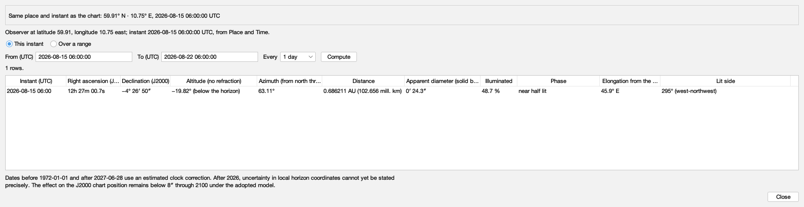
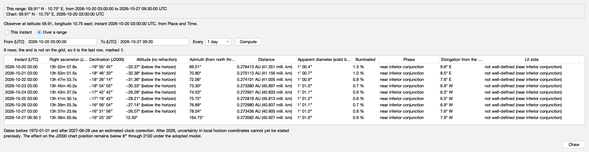
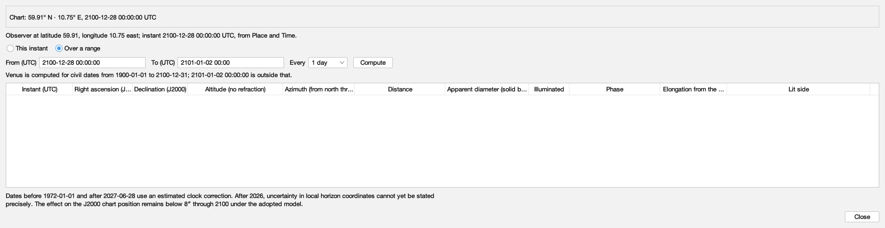
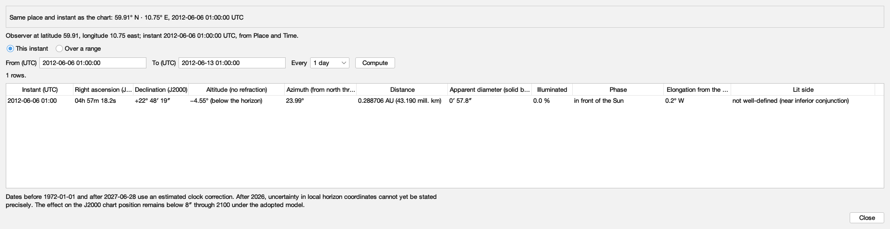
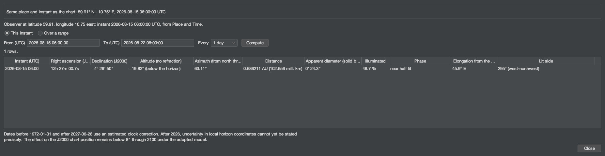
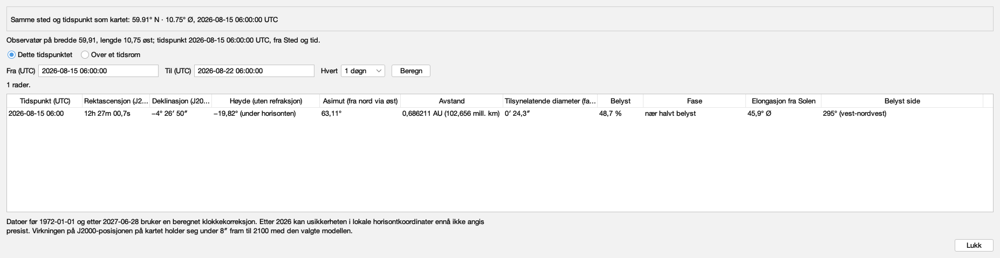
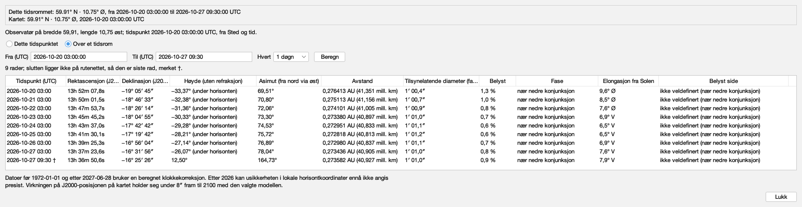
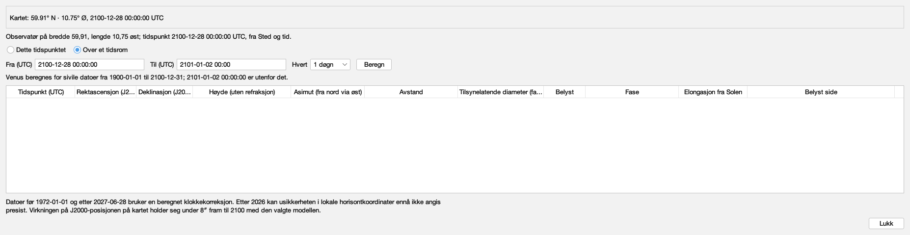
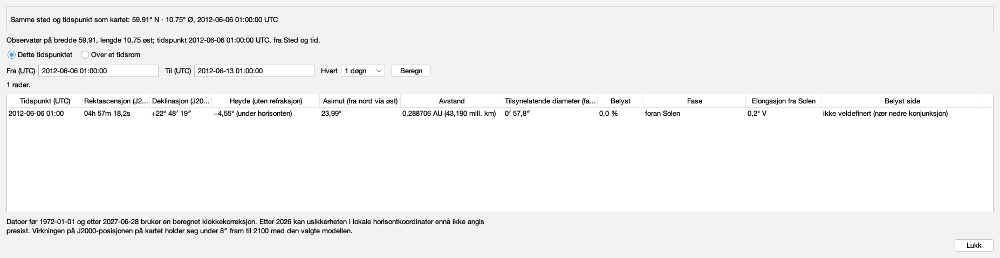
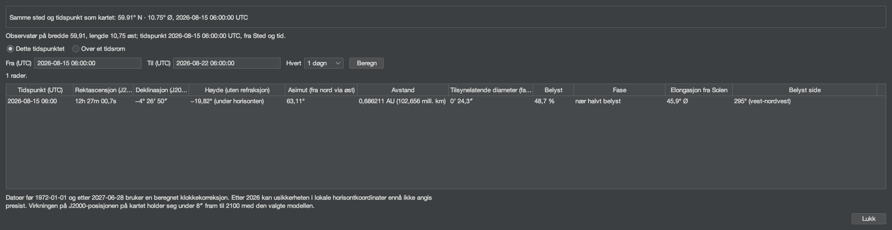

# Every word the Venus table says

Issue #502. Generated by `juranometria.tool.VenusTableSheetMain`
from compiled application classes and their classpath
resources, over the bundled Solar System and planets packs.
Packaged acceptance separately verifies that the packs and the
interface language resources ship in the application image.

**Norsk bokmål — reviewed.** A person who reads the language has been through these surfaces and said these are the words an atlas should use. This is linguistic judgement, not corroboration against a source: unlike the constellation names next door, these are original translations written for this application and there is no citation to check them against. Recorded in `nb-NO.manifest`, and read from there rather than written here.

## The window, not a panel

Each capture is the production dialog built through
`SolarTableDialog.packedForStudy` over Venus's columns,
which has no "English if omitted" overload. The title and
the window description are read from the `JDialog` itself;
every shown, hovered and spoken string is walked from the
content; the column headings' explanations, which a screen
reader hears and a hover shows, are listed from the model.

## What is translated here, and what is not

Every number is notation: right ascension, declination,
degrees, astronomical units and million kilometres, the
solid body's diameter, the percentage and the instant are
formatted in `Locale.ROOT` by `SunTableFormat` and
`MoonTableFormat` and are identical in both languages,
with the language's own decimal separator. The words are the
language's: the headings, the status line, the refusals, the
status below the horizon, the phase, the side of the Sun and
the compass point of the lit side. The shell's words are the
same keys the Sun and Moon tables say (`solartable.*`, the
compass points and the side letters among them); Venus's own
are `venustable.*`, the phase words ruled on #500.

## English (`en`)

### One instant: Oslo at the 2026 greatest eastern elongation

The fresh state: a single row at the instant Place and Time holds - Espenak's hour of the greatest eastern elongation. Venus is near half lit, east of the Sun in the evening sky, its lit side towards the Sun in the west.

Packed 1854 × 479 px.

| shown, hovered or spoken |
|---|
| Venus |
| Where Venus is, computed from the bundled ephemeris for the observing place and instant set in Place and Time: its position among the fixed stars, its height and direction above the horizon, its distance and apparent size, how much of it is lit and which way the light falls, at that instant or over a range of instants. |
| Agreement with the chart |
| Same place and instant as the chart: 59.91° N · 10.75° E, 2026-08-15 06:00:00 UTC |
| Update from Place and Time |
| Read the place and instant from Place and Time again |
| Read the observer and instant from Place and Time again |
| Reads the observing place and instant from Place and Time again and recomputes. The table also does this when it opens and whenever it comes to the front. |
| Observer at latitude 59.91, longitude 10.75 east; instant 2026-08-15 06:00:00 UTC, from Place and Time. |
| This instant |
| One row, at the instant set in Place and Time |
| Show Venus at the instant set in Place and Time |
| Shows a single row: Venus at the observing instant set in Place and Time. |
| Over a range |
| A row for every step from a start to an end |
| Show Venus over a range of instants |
| Shows a row for every step from the start to the end, both included; an end that is not on the grid is added as the last row and marked. |
| From (UTC) |
| yyyy-mm-dd hh:mm or hh:mm:ss, in UTC |
| The first instant of the range, in UTC. Starts at the instant set in Place and Time. |
| To (UTC) |
| The last instant of the range, in UTC, included; if it is not on the grid it is added as the last row and marked. |
| Every |
| 1 hour |
| 6 hours |
| 1 day |
| 7 days |
| 30 days |
| The elapsed time between rows |
| Step between rows |
| The elapsed time between rows, on the UTC timeline, so a daily range does not drift across a change of civil clock. |
| Compute |
| Fill the table for the range above |
| Compute the range |
| Computes a row for every step of the range above. |
| 1 rows. |
| Instant (UTC) |
| Right ascension (J2000) |
| Declination (J2000) |
| Altitude (no refraction) |
| Azimuth (from north through east) |
| Distance |
| Apparent diameter (solid body) |
| Illuminated |
| Phase |
| Elongation from the Sun |
| Lit side |
| 2026-08-15 06:00 · 12h 27m 00.7s · −4° 26′ 50″ · −19.82° (below the horizon) · 63.11° · 0.686211 AU (102.656 mill. km) · 0′ 24.3″ · 48.7 % · near half lit · 45.9° E · 295° (west-northwest) |
| Venus's computed quantities |
| Each row is one instant. The columns are the instant in UTC; right ascension and declination in the J2000 frame the chart is drawn in; altitude and azimuth without refraction; distance; the solid body's apparent diameter; the illuminated fraction; the phase; the elongation from the Sun with the side of the Sun Venus is on; and the lit side, the direction the light falls from. |
| Dates before 1972-01-01 and after 2027-06-28 use an estimated clock correction. After 2026, uncertainty in local horizon coordinates cannot yet be stated precisely. The effect on the J2000 chart position remains below 8″ through 2100 under the adopted model. |
| Close |
| Close the Venus table |
| Closes the table. Nothing is changed or remembered; Place and Time keeps the place and instant. |

### A daily range through the 2026 inferior conjunction

Daily rows from the instant, and an end that is not on the grid, added last and marked †. The disc is at its largest and least lit, and the side of the Sun changes from E to W - by right ascension, so before the conjunction a reader may be told of; the table names no conjunction.

Packed 1854 × 479 px.

| shown, hovered or spoken |
|---|
| Venus |
| Where Venus is, computed from the bundled ephemeris for the observing place and instant set in Place and Time: its position among the fixed stars, its height and direction above the horizon, its distance and apparent size, how much of it is lit and which way the light falls, at that instant or over a range of instants. |
| Agreement with the chart |
| This range: 59.91° N · 10.75° E, from 2026-10-20 03:00:00 to 2026-10-27 09:30:00 UTCChart: 59.91° N · 10.75° E, 2026-10-20 03:00:00 UTC |
| This range: 59.91° N · 10.75° E, from 2026-10-20 03:00:00 to 2026-10-27 09:30:00 UTC Chart: 59.91° N · 10.75° E, 2026-10-20 03:00:00 UTC |
| Update from Place and Time |
| Read the place and instant from Place and Time again |
| Read the observer and instant from Place and Time again |
| Reads the observing place and instant from Place and Time again and recomputes. The table also does this when it opens and whenever it comes to the front. |
| Observer at latitude 59.91, longitude 10.75 east; instant 2026-10-20 03:00:00 UTC, from Place and Time. |
| This instant |
| One row, at the instant set in Place and Time |
| Show Venus at the instant set in Place and Time |
| Shows a single row: Venus at the observing instant set in Place and Time. |
| Over a range |
| A row for every step from a start to an end |
| Show Venus over a range of instants |
| Shows a row for every step from the start to the end, both included; an end that is not on the grid is added as the last row and marked. |
| From (UTC) |
| yyyy-mm-dd hh:mm or hh:mm:ss, in UTC |
| The first instant of the range, in UTC. Starts at the instant set in Place and Time. |
| To (UTC) |
| The last instant of the range, in UTC, included; if it is not on the grid it is added as the last row and marked. |
| Every |
| 1 hour |
| 6 hours |
| 1 day |
| 7 days |
| 30 days |
| The elapsed time between rows |
| Step between rows |
| The elapsed time between rows, on the UTC timeline, so a daily range does not drift across a change of civil clock. |
| Compute |
| Fill the table for the range above |
| Compute the range |
| Computes a row for every step of the range above. |
| 9 rows; the end is not on the grid, so it is the last row, marked †. |
| Instant (UTC) |
| Right ascension (J2000) |
| Declination (J2000) |
| Altitude (no refraction) |
| Azimuth (from north through east) |
| Distance |
| Apparent diameter (solid body) |
| Illuminated |
| Phase |
| Elongation from the Sun |
| Lit side |
| 2026-10-20 03:00 · 13h 52m 07.8s · −19° 05′ 45″ · −33.37° (below the horizon) · 69.51° · 0.276413 AU (41.351 mill. km) · 1′ 00.4″ · 1.3 % · near inferior conjunction · 9.6° E · not well-defined (near inferior conjunction) |
| 2026-10-21 03:00 · 13h 50m 01.5s · −18° 46′ 33″ · −32.38° (below the horizon) · 70.80° · 0.275113 AU (41.156 mill. km) · 1′ 00.7″ · 1.0 % · near inferior conjunction · 8.5° E · not well-defined (near inferior conjunction) |
| 2026-10-22 03:00 · 13h 47m 53.7s · −18° 26′ 14″ · −31.36° (below the horizon) · 72.06° · 0.274101 AU (41.005 mill. km) · 1′ 00.9″ · 0.8 % · near inferior conjunction · 7.6° E · not well-defined (near inferior conjunction) |
| 2026-10-23 03:00 · 13h 45m 45.2s · −18° 04′ 55″ · −30.33° (below the horizon) · 73.30° · 0.273380 AU (40.897 mill. km) · 1′ 01.0″ · 0.7 % · near inferior conjunction · 6.9° W · not well-defined (near inferior conjunction) |
| 2026-10-24 03:00 · 13h 43m 37.0s · −17° 42′ 42″ · −29.28° (below the horizon) · 74.53° · 0.272951 AU (40.833 mill. km) · 1′ 01.1″ · 0.6 % · near inferior conjunction · 6.5° W · not well-defined (near inferior conjunction) |
| 2026-10-25 03:00 · 13h 41m 30.1s · −17° 19′ 42″ · −28.21° (below the horizon) · 75.72° · 0.272818 AU (40.813 mill. km) · 1′ 01.2″ · 0.6 % · near inferior conjunction · 6.5° W · not well-defined (near inferior conjunction) |
| 2026-10-26 03:00 · 13h 39m 25.3s · −16° 56′ 04″ · −27.14° (below the horizon) · 76.89° · 0.272980 AU (40.837 mill. km) · 1′ 01.1″ · 0.7 % · near inferior conjunction · 6.9° W · not well-defined (near inferior conjunction) |
| 2026-10-27 03:00 · 13h 37m 23.6s · −16° 31′ 56″ · −26.07° (below the horizon) · 78.04° · 0.273436 AU (40.905 mill. km) · 1′ 01.0″ · 0.8 % · near inferior conjunction · 7.6° W · not well-defined (near inferior conjunction) |
| 2026-10-27 09:30 † · 13h 36m 50.6s · −16° 25′ 26″ · 12.50° · 164.73° · 0.273582 AU (40.927 mill. km) · 1′ 01.0″ · 0.9 % · near inferior conjunction · 7.9° W · not well-defined (near inferior conjunction) |
| Venus's computed quantities |
| Each row is one instant. The columns are the instant in UTC; right ascension and declination in the J2000 frame the chart is drawn in; altitude and azimuth without refraction; distance; the solid body's apparent diameter; the illuminated fraction; the phase; the elongation from the Sun with the side of the Sun Venus is on; and the lit side, the direction the light falls from. |
| Dates before 1972-01-01 and after 2027-06-28 use an estimated clock correction. After 2026, uncertainty in local horizon coordinates cannot yet be stated precisely. The effect on the J2000 chart position remains below 8″ through 2100 under the adopted model. |
| Close |
| Close the Venus table |
| Closes the table. Nothing is changed or remembered; Place and Time keeps the place and instant. |

### A range that leaves the interval

The end is after the last civil day Venus is computed for. The table is empty and the status line says why, naming the interval; nothing is extrapolated.

Packed 1854 × 479 px.

| shown, hovered or spoken |
|---|
| Venus |
| Where Venus is, computed from the bundled ephemeris for the observing place and instant set in Place and Time: its position among the fixed stars, its height and direction above the horizon, its distance and apparent size, how much of it is lit and which way the light falls, at that instant or over a range of instants. |
| Agreement with the chart |
| Chart: 59.91° N · 10.75° E, 2100-12-28 00:00:00 UTC |
| Update from Place and Time |
| Read the place and instant from Place and Time again |
| Read the observer and instant from Place and Time again |
| Reads the observing place and instant from Place and Time again and recomputes. The table also does this when it opens and whenever it comes to the front. |
| Observer at latitude 59.91, longitude 10.75 east; instant 2100-12-28 00:00:00 UTC, from Place and Time. |
| This instant |
| One row, at the instant set in Place and Time |
| Show Venus at the instant set in Place and Time |
| Shows a single row: Venus at the observing instant set in Place and Time. |
| Over a range |
| A row for every step from a start to an end |
| Show Venus over a range of instants |
| Shows a row for every step from the start to the end, both included; an end that is not on the grid is added as the last row and marked. |
| From (UTC) |
| yyyy-mm-dd hh:mm or hh:mm:ss, in UTC |
| The first instant of the range, in UTC. Starts at the instant set in Place and Time. |
| To (UTC) |
| The last instant of the range, in UTC, included; if it is not on the grid it is added as the last row and marked. |
| Every |
| 1 hour |
| 6 hours |
| 1 day |
| 7 days |
| 30 days |
| The elapsed time between rows |
| Step between rows |
| The elapsed time between rows, on the UTC timeline, so a daily range does not drift across a change of civil clock. |
| Compute |
| Fill the table for the range above |
| Compute the range |
| Computes a row for every step of the range above. |
| Venus is computed for civil dates from 1900-01-01 to 2100-12-31; 2101-01-02 00:00:00 is outside that. |
| Instant (UTC) |
| Right ascension (J2000) |
| Declination (J2000) |
| Altitude (no refraction) |
| Azimuth (from north through east) |
| Distance |
| Apparent diameter (solid body) |
| Illuminated |
| Phase |
| Elongation from the Sun |
| Lit side |
| Venus's computed quantities |
| Each row is one instant. The columns are the instant in UTC; right ascension and declination in the J2000 frame the chart is drawn in; altitude and azimuth without refraction; distance; the solid body's apparent diameter; the illuminated fraction; the phase; the elongation from the Sun with the side of the Sun Venus is on; and the lit side, the direction the light falls from. |
| Dates before 1972-01-01 and after 2027-06-28 use an estimated clock correction. After 2026, uncertainty in local horizon coordinates cannot yet be stated precisely. The effect on the J2000 chart position remains below 8″ through 2100 under the adopted model. |
| Close |
| Close the Venus table |
| Closes the table. Nothing is changed or remembered; Place and Time keeps the place and instant. |

### Oslo during the 2012 transit

Espenak's hour of the 2012 inferior conjunction, while Venus crossed the Sun's disc: the phase reads in front of the Sun, and the lit side is stated as not well-defined rather than as a false angle.

Packed 1854 × 479 px.

| shown, hovered or spoken |
|---|
| Venus |
| Where Venus is, computed from the bundled ephemeris for the observing place and instant set in Place and Time: its position among the fixed stars, its height and direction above the horizon, its distance and apparent size, how much of it is lit and which way the light falls, at that instant or over a range of instants. |
| Agreement with the chart |
| Same place and instant as the chart: 59.91° N · 10.75° E, 2012-06-06 01:00:00 UTC |
| Update from Place and Time |
| Read the place and instant from Place and Time again |
| Read the observer and instant from Place and Time again |
| Reads the observing place and instant from Place and Time again and recomputes. The table also does this when it opens and whenever it comes to the front. |
| Observer at latitude 59.91, longitude 10.75 east; instant 2012-06-06 01:00:00 UTC, from Place and Time. |
| This instant |
| One row, at the instant set in Place and Time |
| Show Venus at the instant set in Place and Time |
| Shows a single row: Venus at the observing instant set in Place and Time. |
| Over a range |
| A row for every step from a start to an end |
| Show Venus over a range of instants |
| Shows a row for every step from the start to the end, both included; an end that is not on the grid is added as the last row and marked. |
| From (UTC) |
| yyyy-mm-dd hh:mm or hh:mm:ss, in UTC |
| The first instant of the range, in UTC. Starts at the instant set in Place and Time. |
| To (UTC) |
| The last instant of the range, in UTC, included; if it is not on the grid it is added as the last row and marked. |
| Every |
| 1 hour |
| 6 hours |
| 1 day |
| 7 days |
| 30 days |
| The elapsed time between rows |
| Step between rows |
| The elapsed time between rows, on the UTC timeline, so a daily range does not drift across a change of civil clock. |
| Compute |
| Fill the table for the range above |
| Compute the range |
| Computes a row for every step of the range above. |
| 1 rows. |
| Instant (UTC) |
| Right ascension (J2000) |
| Declination (J2000) |
| Altitude (no refraction) |
| Azimuth (from north through east) |
| Distance |
| Apparent diameter (solid body) |
| Illuminated |
| Phase |
| Elongation from the Sun |
| Lit side |
| 2012-06-06 01:00 · 04h 57m 18.2s · +22° 48′ 19″ · −4.55° (below the horizon) · 23.99° · 0.288706 AU (43.190 mill. km) · 0′ 57.8″ · 0.0 % · in front of the Sun · 0.2° W · not well-defined (near inferior conjunction) |
| Venus's computed quantities |
| Each row is one instant. The columns are the instant in UTC; right ascension and declination in the J2000 frame the chart is drawn in; altitude and azimuth without refraction; distance; the solid body's apparent diameter; the illuminated fraction; the phase; the elongation from the Sun with the side of the Sun Venus is on; and the lit side, the direction the light falls from. |
| Dates before 1972-01-01 and after 2027-06-28 use an estimated clock correction. After 2026, uncertainty in local horizon coordinates cannot yet be stated precisely. The effect on the J2000 chart position remains below 8″ through 2100 under the adopted model. |
| Close |
| Close the Venus table |
| Closes the table. Nothing is changed or remembered; Place and Time keeps the place and instant. |

### The instant, in the dark appearance

Packed 1854 × 479 px.

| shown, hovered or spoken |
|---|
| Venus |
| Where Venus is, computed from the bundled ephemeris for the observing place and instant set in Place and Time: its position among the fixed stars, its height and direction above the horizon, its distance and apparent size, how much of it is lit and which way the light falls, at that instant or over a range of instants. |
| Agreement with the chart |
| Same place and instant as the chart: 59.91° N · 10.75° E, 2026-08-15 06:00:00 UTC |
| Update from Place and Time |
| Read the place and instant from Place and Time again |
| Read the observer and instant from Place and Time again |
| Reads the observing place and instant from Place and Time again and recomputes. The table also does this when it opens and whenever it comes to the front. |
| Observer at latitude 59.91, longitude 10.75 east; instant 2026-08-15 06:00:00 UTC, from Place and Time. |
| This instant |
| One row, at the instant set in Place and Time |
| Show Venus at the instant set in Place and Time |
| Shows a single row: Venus at the observing instant set in Place and Time. |
| Over a range |
| A row for every step from a start to an end |
| Show Venus over a range of instants |
| Shows a row for every step from the start to the end, both included; an end that is not on the grid is added as the last row and marked. |
| From (UTC) |
| yyyy-mm-dd hh:mm or hh:mm:ss, in UTC |
| The first instant of the range, in UTC. Starts at the instant set in Place and Time. |
| To (UTC) |
| The last instant of the range, in UTC, included; if it is not on the grid it is added as the last row and marked. |
| Every |
| 1 hour |
| 6 hours |
| 1 day |
| 7 days |
| 30 days |
| The elapsed time between rows |
| Step between rows |
| The elapsed time between rows, on the UTC timeline, so a daily range does not drift across a change of civil clock. |
| Compute |
| Fill the table for the range above |
| Compute the range |
| Computes a row for every step of the range above. |
| 1 rows. |
| Instant (UTC) |
| Right ascension (J2000) |
| Declination (J2000) |
| Altitude (no refraction) |
| Azimuth (from north through east) |
| Distance |
| Apparent diameter (solid body) |
| Illuminated |
| Phase |
| Elongation from the Sun |
| Lit side |
| 2026-08-15 06:00 · 12h 27m 00.7s · −4° 26′ 50″ · −19.82° (below the horizon) · 63.11° · 0.686211 AU (102.656 mill. km) · 0′ 24.3″ · 48.7 % · near half lit · 45.9° E · 295° (west-northwest) |
| Venus's computed quantities |
| Each row is one instant. The columns are the instant in UTC; right ascension and declination in the J2000 frame the chart is drawn in; altitude and azimuth without refraction; distance; the solid body's apparent diameter; the illuminated fraction; the phase; the elongation from the Sun with the side of the Sun Venus is on; and the lit side, the direction the light falls from. |
| Dates before 1972-01-01 and after 2027-06-28 use an estimated clock correction. After 2026, uncertainty in local horizon coordinates cannot yet be stated precisely. The effect on the J2000 chart position remains below 8″ through 2100 under the adopted model. |
| Close |
| Close the Venus table |
| Closes the table. Nothing is changed or remembered; Place and Time keeps the place and instant. |

#### The headings, and what they explain

| heading | explanation |
|---|---|
| Instant (UTC) | The instant in UTC, to the minute. "est." marks an instant whose clock correction is estimated; † marks a range end that was not on the grid. |
| Right ascension (J2000) | Hours, minutes and seconds of time, in the ICRS/J2000 frame the chart is drawn in: where Venus is among the fixed stars, as seen from the observing place, without aberration. |
| Declination (J2000) | Degrees, minutes and seconds of arc, in the same frame. |
| Altitude (no refraction) | Degrees above the mathematical horizon, without atmospheric refraction; below the horizon the number is kept and the status is added. |
| Azimuth (from north through east) | Degrees from north through east: 90° is east, 180° south, 270° west. |
| Distance | From the observer to Venus's centre, in astronomical units and in millions of kilometres. |
| Apparent diameter (solid body) | How large Venus's solid body looks, in minutes and seconds of arc, from its 6051.8 km radius. The visible cloud deck is about 1.22 % larger, depending on the wavelength - at most 0.77″ larger between 1900 and 2100. It is stated here, not drawn. |
| Illuminated | How much of Venus's disc is lit, as a percentage of the whole disc. |
| Phase | The phase as a reader sees it: in front of the Sun or behind the Sun when Venus's disc meets the Sun's; otherwise near inferior conjunction, crescent, near half lit, gibbous or near full, by how much of the disc is lit. "Near" marks a band, not an exact instant. |
| Elongation from the Sun | Degrees between the Sun and Venus in the observer's sky; E when Venus is east of the Sun there in right ascension (the evening sky), W when west of it (the morning sky). It does not announce a conjunction. |
| Lit side | The position angle of the bright limb's midpoint, from celestial north through east, with the nearest of sixteen compass points; not well-defined near inferior conjunction and near full. |

## Norsk bokmål (`nb-NO`)

### One instant: Oslo at the 2026 greatest eastern elongation

The fresh state: a single row at the instant Place and Time holds - Espenak's hour of the greatest eastern elongation. Venus is near half lit, east of the Sun in the evening sky, its lit side towards the Sun in the west.

Packed 1854 × 479 px.

| shown, hovered or spoken |
|---|
| Venus |
| Hvor Venus er, beregnet fra den medfølgende efemeriden for observasjonsstedet og tidspunktet satt i Sted og tid: posisjonen blant fiksstjernene, høyden og retningen over horisonten, avstanden og den tilsynelatende størrelsen, hvor mye av den som er belyst og hvilken vei lyset faller, ved det tidspunktet eller over et tidsrom. |
| Samsvar med kartet |
| Samme sted og tidspunkt som kartet: 59.91° N · 10.75° Ø, 2026-08-15 06:00:00 UTC |
| Oppdater fra Sted og tid |
| Les sted og tidspunkt fra Sted og tid på nytt |
| Les observatør og tidspunkt fra Sted og tid på nytt |
| Leser observasjonsstedet og tidspunktet fra Sted og tid på nytt og beregner om igjen. Tabellen gjør også dette når den åpnes og hver gang den kommer fremst. |
| Observatør på bredde 59,91, lengde 10,75 øst; tidspunkt 2026-08-15 06:00:00 UTC, fra Sted og tid. |
| Dette tidspunktet |
| Én rad, ved tidspunktet satt i Sted og tid |
| Vis Venus ved tidspunktet satt i Sted og tid |
| Viser én rad: Venus ved observasjonstidspunktet satt i Sted og tid. |
| Over et tidsrom |
| Én rad for hvert steg fra en start til en slutt |
| Vis Venus over et tidsrom |
| Viser én rad for hvert steg fra starten til slutten, begge medregnet; en slutt som ikke ligger på rutenettet, legges til som siste rad og merkes. |
| Fra (UTC) |
| åååå-mm-dd tt:mm eller tt:mm:ss, i UTC |
| Første tidspunkt i tidsrommet, i UTC. Starter ved tidspunktet satt i Sted og tid. |
| Til (UTC) |
| Siste tidspunkt i tidsrommet, i UTC, medregnet; ligger det ikke på rutenettet, legges det til som siste rad og merkes. |
| Hvert |
| 1 time |
| 6 timer |
| 1 døgn |
| 7 døgn |
| 30 døgn |
| Tiden som går mellom radene |
| Steg mellom radene |
| Tiden som går mellom radene, på UTC-tidslinjen, så et daglig tidsrom ikke forskyver seg ved skifte av sivil klokke. |
| Beregn |
| Fyll tabellen for tidsrommet over |
| Beregn tidsrommet |
| Beregner én rad for hvert steg i tidsrommet over. |
| 1 rader. |
| Tidspunkt (UTC) |
| Rektascensjon (J2000) |
| Deklinasjon (J2000) |
| Høyde (uten refraksjon) |
| Asimut (fra nord via øst) |
| Avstand |
| Tilsynelatende diameter (fast kropp) |
| Belyst |
| Fase |
| Elongasjon fra Solen |
| Belyst side |
| 2026-08-15 06:00 · 12h 27m 00,7s · −4° 26′ 50″ · −19,82° (under horisonten) · 63,11° · 0,686211 AU (102,656 mill. km) · 0′ 24,3″ · 48,7 % · nær halvt belyst · 45,9° Ø · 295° (vest-nordvest) |
| Venus' beregnede størrelser |
| Hver rad er ett tidspunkt. Kolonnene er tidspunktet i UTC; rektascensjon og deklinasjon i J2000-rammen kartet tegnes i; høyde og asimut uten refraksjon; avstand; den faste kroppens tilsynelatende diameter; belyst andel; fase; elongasjon fra Solen med hvilken side av Solen Venus står på; og belyst side, retningen lyset faller fra. |
| Datoer før 1972-01-01 og etter 2027-06-28 bruker en beregnet klokkekorreksjon. Etter 2026 kan usikkerheten i lokale horisontkoordinater ennå ikke angis presist. Virkningen på J2000-posisjonen på kartet holder seg under 8″ fram til 2100 med den valgte modellen. |
| Lukk |
| Lukk venustabellen |
| Lukker tabellen. Ingenting endres eller huskes; Sted og tid beholder stedet og tidspunktet. |

### A daily range through the 2026 inferior conjunction

Daily rows from the instant, and an end that is not on the grid, added last and marked †. The disc is at its largest and least lit, and the side of the Sun changes from E to W - by right ascension, so before the conjunction a reader may be told of; the table names no conjunction.

Packed 1854 × 479 px.

| shown, hovered or spoken |
|---|
| Venus |
| Hvor Venus er, beregnet fra den medfølgende efemeriden for observasjonsstedet og tidspunktet satt i Sted og tid: posisjonen blant fiksstjernene, høyden og retningen over horisonten, avstanden og den tilsynelatende størrelsen, hvor mye av den som er belyst og hvilken vei lyset faller, ved det tidspunktet eller over et tidsrom. |
| Samsvar med kartet |
| Dette tidsrommet: 59.91° N · 10.75° Ø, fra 2026-10-20 03:00:00 til 2026-10-27 09:30:00 UTCKartet: 59.91° N · 10.75° Ø, 2026-10-20 03:00:00 UTC |
| Dette tidsrommet: 59.91° N · 10.75° Ø, fra 2026-10-20 03:00:00 til 2026-10-27 09:30:00 UTC Kartet: 59.91° N · 10.75° Ø, 2026-10-20 03:00:00 UTC |
| Oppdater fra Sted og tid |
| Les sted og tidspunkt fra Sted og tid på nytt |
| Les observatør og tidspunkt fra Sted og tid på nytt |
| Leser observasjonsstedet og tidspunktet fra Sted og tid på nytt og beregner om igjen. Tabellen gjør også dette når den åpnes og hver gang den kommer fremst. |
| Observatør på bredde 59,91, lengde 10,75 øst; tidspunkt 2026-10-20 03:00:00 UTC, fra Sted og tid. |
| Dette tidspunktet |
| Én rad, ved tidspunktet satt i Sted og tid |
| Vis Venus ved tidspunktet satt i Sted og tid |
| Viser én rad: Venus ved observasjonstidspunktet satt i Sted og tid. |
| Over et tidsrom |
| Én rad for hvert steg fra en start til en slutt |
| Vis Venus over et tidsrom |
| Viser én rad for hvert steg fra starten til slutten, begge medregnet; en slutt som ikke ligger på rutenettet, legges til som siste rad og merkes. |
| Fra (UTC) |
| åååå-mm-dd tt:mm eller tt:mm:ss, i UTC |
| Første tidspunkt i tidsrommet, i UTC. Starter ved tidspunktet satt i Sted og tid. |
| Til (UTC) |
| Siste tidspunkt i tidsrommet, i UTC, medregnet; ligger det ikke på rutenettet, legges det til som siste rad og merkes. |
| Hvert |
| 1 time |
| 6 timer |
| 1 døgn |
| 7 døgn |
| 30 døgn |
| Tiden som går mellom radene |
| Steg mellom radene |
| Tiden som går mellom radene, på UTC-tidslinjen, så et daglig tidsrom ikke forskyver seg ved skifte av sivil klokke. |
| Beregn |
| Fyll tabellen for tidsrommet over |
| Beregn tidsrommet |
| Beregner én rad for hvert steg i tidsrommet over. |
| 9 rader; slutten ligger ikke på rutenettet, så den er siste rad, merket †. |
| Tidspunkt (UTC) |
| Rektascensjon (J2000) |
| Deklinasjon (J2000) |
| Høyde (uten refraksjon) |
| Asimut (fra nord via øst) |
| Avstand |
| Tilsynelatende diameter (fast kropp) |
| Belyst |
| Fase |
| Elongasjon fra Solen |
| Belyst side |
| 2026-10-20 03:00 · 13h 52m 07,8s · −19° 05′ 45″ · −33,37° (under horisonten) · 69,51° · 0,276413 AU (41,351 mill. km) · 1′ 00,4″ · 1,3 % · nær nedre konjunksjon · 9,6° Ø · ikke veldefinert (nær nedre konjunksjon) |
| 2026-10-21 03:00 · 13h 50m 01,5s · −18° 46′ 33″ · −32,38° (under horisonten) · 70,80° · 0,275113 AU (41,156 mill. km) · 1′ 00,7″ · 1,0 % · nær nedre konjunksjon · 8,5° Ø · ikke veldefinert (nær nedre konjunksjon) |
| 2026-10-22 03:00 · 13h 47m 53,7s · −18° 26′ 14″ · −31,36° (under horisonten) · 72,06° · 0,274101 AU (41,005 mill. km) · 1′ 00,9″ · 0,8 % · nær nedre konjunksjon · 7,6° Ø · ikke veldefinert (nær nedre konjunksjon) |
| 2026-10-23 03:00 · 13h 45m 45,2s · −18° 04′ 55″ · −30,33° (under horisonten) · 73,30° · 0,273380 AU (40,897 mill. km) · 1′ 01,0″ · 0,7 % · nær nedre konjunksjon · 6,9° V · ikke veldefinert (nær nedre konjunksjon) |
| 2026-10-24 03:00 · 13h 43m 37,0s · −17° 42′ 42″ · −29,28° (under horisonten) · 74,53° · 0,272951 AU (40,833 mill. km) · 1′ 01,1″ · 0,6 % · nær nedre konjunksjon · 6,5° V · ikke veldefinert (nær nedre konjunksjon) |
| 2026-10-25 03:00 · 13h 41m 30,1s · −17° 19′ 42″ · −28,21° (under horisonten) · 75,72° · 0,272818 AU (40,813 mill. km) · 1′ 01,2″ · 0,6 % · nær nedre konjunksjon · 6,5° V · ikke veldefinert (nær nedre konjunksjon) |
| 2026-10-26 03:00 · 13h 39m 25,3s · −16° 56′ 04″ · −27,14° (under horisonten) · 76,89° · 0,272980 AU (40,837 mill. km) · 1′ 01,1″ · 0,7 % · nær nedre konjunksjon · 6,9° V · ikke veldefinert (nær nedre konjunksjon) |
| 2026-10-27 03:00 · 13h 37m 23,6s · −16° 31′ 56″ · −26,07° (under horisonten) · 78,04° · 0,273436 AU (40,905 mill. km) · 1′ 01,0″ · 0,8 % · nær nedre konjunksjon · 7,6° V · ikke veldefinert (nær nedre konjunksjon) |
| 2026-10-27 09:30 † · 13h 36m 50,6s · −16° 25′ 26″ · 12,50° · 164,73° · 0,273582 AU (40,927 mill. km) · 1′ 01,0″ · 0,9 % · nær nedre konjunksjon · 7,9° V · ikke veldefinert (nær nedre konjunksjon) |
| Venus' beregnede størrelser |
| Hver rad er ett tidspunkt. Kolonnene er tidspunktet i UTC; rektascensjon og deklinasjon i J2000-rammen kartet tegnes i; høyde og asimut uten refraksjon; avstand; den faste kroppens tilsynelatende diameter; belyst andel; fase; elongasjon fra Solen med hvilken side av Solen Venus står på; og belyst side, retningen lyset faller fra. |
| Datoer før 1972-01-01 og etter 2027-06-28 bruker en beregnet klokkekorreksjon. Etter 2026 kan usikkerheten i lokale horisontkoordinater ennå ikke angis presist. Virkningen på J2000-posisjonen på kartet holder seg under 8″ fram til 2100 med den valgte modellen. |
| Lukk |
| Lukk venustabellen |
| Lukker tabellen. Ingenting endres eller huskes; Sted og tid beholder stedet og tidspunktet. |

### A range that leaves the interval

The end is after the last civil day Venus is computed for. The table is empty and the status line says why, naming the interval; nothing is extrapolated.

Packed 1854 × 479 px.

| shown, hovered or spoken |
|---|
| Venus |
| Hvor Venus er, beregnet fra den medfølgende efemeriden for observasjonsstedet og tidspunktet satt i Sted og tid: posisjonen blant fiksstjernene, høyden og retningen over horisonten, avstanden og den tilsynelatende størrelsen, hvor mye av den som er belyst og hvilken vei lyset faller, ved det tidspunktet eller over et tidsrom. |
| Samsvar med kartet |
| Kartet: 59.91° N · 10.75° Ø, 2100-12-28 00:00:00 UTC |
| Oppdater fra Sted og tid |
| Les sted og tidspunkt fra Sted og tid på nytt |
| Les observatør og tidspunkt fra Sted og tid på nytt |
| Leser observasjonsstedet og tidspunktet fra Sted og tid på nytt og beregner om igjen. Tabellen gjør også dette når den åpnes og hver gang den kommer fremst. |
| Observatør på bredde 59,91, lengde 10,75 øst; tidspunkt 2100-12-28 00:00:00 UTC, fra Sted og tid. |
| Dette tidspunktet |
| Én rad, ved tidspunktet satt i Sted og tid |
| Vis Venus ved tidspunktet satt i Sted og tid |
| Viser én rad: Venus ved observasjonstidspunktet satt i Sted og tid. |
| Over et tidsrom |
| Én rad for hvert steg fra en start til en slutt |
| Vis Venus over et tidsrom |
| Viser én rad for hvert steg fra starten til slutten, begge medregnet; en slutt som ikke ligger på rutenettet, legges til som siste rad og merkes. |
| Fra (UTC) |
| åååå-mm-dd tt:mm eller tt:mm:ss, i UTC |
| Første tidspunkt i tidsrommet, i UTC. Starter ved tidspunktet satt i Sted og tid. |
| Til (UTC) |
| Siste tidspunkt i tidsrommet, i UTC, medregnet; ligger det ikke på rutenettet, legges det til som siste rad og merkes. |
| Hvert |
| 1 time |
| 6 timer |
| 1 døgn |
| 7 døgn |
| 30 døgn |
| Tiden som går mellom radene |
| Steg mellom radene |
| Tiden som går mellom radene, på UTC-tidslinjen, så et daglig tidsrom ikke forskyver seg ved skifte av sivil klokke. |
| Beregn |
| Fyll tabellen for tidsrommet over |
| Beregn tidsrommet |
| Beregner én rad for hvert steg i tidsrommet over. |
| Venus beregnes for sivile datoer fra 1900-01-01 til 2100-12-31; 2101-01-02 00:00:00 er utenfor det. |
| Tidspunkt (UTC) |
| Rektascensjon (J2000) |
| Deklinasjon (J2000) |
| Høyde (uten refraksjon) |
| Asimut (fra nord via øst) |
| Avstand |
| Tilsynelatende diameter (fast kropp) |
| Belyst |
| Fase |
| Elongasjon fra Solen |
| Belyst side |
| Venus' beregnede størrelser |
| Hver rad er ett tidspunkt. Kolonnene er tidspunktet i UTC; rektascensjon og deklinasjon i J2000-rammen kartet tegnes i; høyde og asimut uten refraksjon; avstand; den faste kroppens tilsynelatende diameter; belyst andel; fase; elongasjon fra Solen med hvilken side av Solen Venus står på; og belyst side, retningen lyset faller fra. |
| Datoer før 1972-01-01 og etter 2027-06-28 bruker en beregnet klokkekorreksjon. Etter 2026 kan usikkerheten i lokale horisontkoordinater ennå ikke angis presist. Virkningen på J2000-posisjonen på kartet holder seg under 8″ fram til 2100 med den valgte modellen. |
| Lukk |
| Lukk venustabellen |
| Lukker tabellen. Ingenting endres eller huskes; Sted og tid beholder stedet og tidspunktet. |

### Oslo during the 2012 transit

Espenak's hour of the 2012 inferior conjunction, while Venus crossed the Sun's disc: the phase reads in front of the Sun, and the lit side is stated as not well-defined rather than as a false angle.

Packed 1854 × 479 px.

| shown, hovered or spoken |
|---|
| Venus |
| Hvor Venus er, beregnet fra den medfølgende efemeriden for observasjonsstedet og tidspunktet satt i Sted og tid: posisjonen blant fiksstjernene, høyden og retningen over horisonten, avstanden og den tilsynelatende størrelsen, hvor mye av den som er belyst og hvilken vei lyset faller, ved det tidspunktet eller over et tidsrom. |
| Samsvar med kartet |
| Samme sted og tidspunkt som kartet: 59.91° N · 10.75° Ø, 2012-06-06 01:00:00 UTC |
| Oppdater fra Sted og tid |
| Les sted og tidspunkt fra Sted og tid på nytt |
| Les observatør og tidspunkt fra Sted og tid på nytt |
| Leser observasjonsstedet og tidspunktet fra Sted og tid på nytt og beregner om igjen. Tabellen gjør også dette når den åpnes og hver gang den kommer fremst. |
| Observatør på bredde 59,91, lengde 10,75 øst; tidspunkt 2012-06-06 01:00:00 UTC, fra Sted og tid. |
| Dette tidspunktet |
| Én rad, ved tidspunktet satt i Sted og tid |
| Vis Venus ved tidspunktet satt i Sted og tid |
| Viser én rad: Venus ved observasjonstidspunktet satt i Sted og tid. |
| Over et tidsrom |
| Én rad for hvert steg fra en start til en slutt |
| Vis Venus over et tidsrom |
| Viser én rad for hvert steg fra starten til slutten, begge medregnet; en slutt som ikke ligger på rutenettet, legges til som siste rad og merkes. |
| Fra (UTC) |
| åååå-mm-dd tt:mm eller tt:mm:ss, i UTC |
| Første tidspunkt i tidsrommet, i UTC. Starter ved tidspunktet satt i Sted og tid. |
| Til (UTC) |
| Siste tidspunkt i tidsrommet, i UTC, medregnet; ligger det ikke på rutenettet, legges det til som siste rad og merkes. |
| Hvert |
| 1 time |
| 6 timer |
| 1 døgn |
| 7 døgn |
| 30 døgn |
| Tiden som går mellom radene |
| Steg mellom radene |
| Tiden som går mellom radene, på UTC-tidslinjen, så et daglig tidsrom ikke forskyver seg ved skifte av sivil klokke. |
| Beregn |
| Fyll tabellen for tidsrommet over |
| Beregn tidsrommet |
| Beregner én rad for hvert steg i tidsrommet over. |
| 1 rader. |
| Tidspunkt (UTC) |
| Rektascensjon (J2000) |
| Deklinasjon (J2000) |
| Høyde (uten refraksjon) |
| Asimut (fra nord via øst) |
| Avstand |
| Tilsynelatende diameter (fast kropp) |
| Belyst |
| Fase |
| Elongasjon fra Solen |
| Belyst side |
| 2012-06-06 01:00 · 04h 57m 18,2s · +22° 48′ 19″ · −4,55° (under horisonten) · 23,99° · 0,288706 AU (43,190 mill. km) · 0′ 57,8″ · 0,0 % · foran Solen · 0,2° V · ikke veldefinert (nær nedre konjunksjon) |
| Venus' beregnede størrelser |
| Hver rad er ett tidspunkt. Kolonnene er tidspunktet i UTC; rektascensjon og deklinasjon i J2000-rammen kartet tegnes i; høyde og asimut uten refraksjon; avstand; den faste kroppens tilsynelatende diameter; belyst andel; fase; elongasjon fra Solen med hvilken side av Solen Venus står på; og belyst side, retningen lyset faller fra. |
| Datoer før 1972-01-01 og etter 2027-06-28 bruker en beregnet klokkekorreksjon. Etter 2026 kan usikkerheten i lokale horisontkoordinater ennå ikke angis presist. Virkningen på J2000-posisjonen på kartet holder seg under 8″ fram til 2100 med den valgte modellen. |
| Lukk |
| Lukk venustabellen |
| Lukker tabellen. Ingenting endres eller huskes; Sted og tid beholder stedet og tidspunktet. |

### The instant, in the dark appearance

Packed 1854 × 479 px.

| shown, hovered or spoken |
|---|
| Venus |
| Hvor Venus er, beregnet fra den medfølgende efemeriden for observasjonsstedet og tidspunktet satt i Sted og tid: posisjonen blant fiksstjernene, høyden og retningen over horisonten, avstanden og den tilsynelatende størrelsen, hvor mye av den som er belyst og hvilken vei lyset faller, ved det tidspunktet eller over et tidsrom. |
| Samsvar med kartet |
| Samme sted og tidspunkt som kartet: 59.91° N · 10.75° Ø, 2026-08-15 06:00:00 UTC |
| Oppdater fra Sted og tid |
| Les sted og tidspunkt fra Sted og tid på nytt |
| Les observatør og tidspunkt fra Sted og tid på nytt |
| Leser observasjonsstedet og tidspunktet fra Sted og tid på nytt og beregner om igjen. Tabellen gjør også dette når den åpnes og hver gang den kommer fremst. |
| Observatør på bredde 59,91, lengde 10,75 øst; tidspunkt 2026-08-15 06:00:00 UTC, fra Sted og tid. |
| Dette tidspunktet |
| Én rad, ved tidspunktet satt i Sted og tid |
| Vis Venus ved tidspunktet satt i Sted og tid |
| Viser én rad: Venus ved observasjonstidspunktet satt i Sted og tid. |
| Over et tidsrom |
| Én rad for hvert steg fra en start til en slutt |
| Vis Venus over et tidsrom |
| Viser én rad for hvert steg fra starten til slutten, begge medregnet; en slutt som ikke ligger på rutenettet, legges til som siste rad og merkes. |
| Fra (UTC) |
| åååå-mm-dd tt:mm eller tt:mm:ss, i UTC |
| Første tidspunkt i tidsrommet, i UTC. Starter ved tidspunktet satt i Sted og tid. |
| Til (UTC) |
| Siste tidspunkt i tidsrommet, i UTC, medregnet; ligger det ikke på rutenettet, legges det til som siste rad og merkes. |
| Hvert |
| 1 time |
| 6 timer |
| 1 døgn |
| 7 døgn |
| 30 døgn |
| Tiden som går mellom radene |
| Steg mellom radene |
| Tiden som går mellom radene, på UTC-tidslinjen, så et daglig tidsrom ikke forskyver seg ved skifte av sivil klokke. |
| Beregn |
| Fyll tabellen for tidsrommet over |
| Beregn tidsrommet |
| Beregner én rad for hvert steg i tidsrommet over. |
| 1 rader. |
| Tidspunkt (UTC) |
| Rektascensjon (J2000) |
| Deklinasjon (J2000) |
| Høyde (uten refraksjon) |
| Asimut (fra nord via øst) |
| Avstand |
| Tilsynelatende diameter (fast kropp) |
| Belyst |
| Fase |
| Elongasjon fra Solen |
| Belyst side |
| 2026-08-15 06:00 · 12h 27m 00,7s · −4° 26′ 50″ · −19,82° (under horisonten) · 63,11° · 0,686211 AU (102,656 mill. km) · 0′ 24,3″ · 48,7 % · nær halvt belyst · 45,9° Ø · 295° (vest-nordvest) |
| Venus' beregnede størrelser |
| Hver rad er ett tidspunkt. Kolonnene er tidspunktet i UTC; rektascensjon og deklinasjon i J2000-rammen kartet tegnes i; høyde og asimut uten refraksjon; avstand; den faste kroppens tilsynelatende diameter; belyst andel; fase; elongasjon fra Solen med hvilken side av Solen Venus står på; og belyst side, retningen lyset faller fra. |
| Datoer før 1972-01-01 og etter 2027-06-28 bruker en beregnet klokkekorreksjon. Etter 2026 kan usikkerheten i lokale horisontkoordinater ennå ikke angis presist. Virkningen på J2000-posisjonen på kartet holder seg under 8″ fram til 2100 med den valgte modellen. |
| Lukk |
| Lukk venustabellen |
| Lukker tabellen. Ingenting endres eller huskes; Sted og tid beholder stedet og tidspunktet. |

#### The headings, and what they explain

| heading | explanation |
|---|---|
| Tidspunkt (UTC) | Tidspunktet i UTC, til nærmeste minutt. «est.» merker et tidspunkt med beregnet klokkekorreksjon; † merker en slutt på tidsrommet som ikke lå på rutenettet. |
| Rektascensjon (J2000) | Timer, minutter og sekunder av tid, i ICRS/J2000-rammen kartet tegnes i: hvor Venus står blant fiksstjernene, sett fra observasjonsstedet, uten aberrasjon. |
| Deklinasjon (J2000) | Grader, bueminutter og buesekunder, i samme ramme. |
| Høyde (uten refraksjon) | Grader over den matematiske horisonten, uten atmosfærisk refraksjon; under horisonten beholdes tallet og statusen legges til. |
| Asimut (fra nord via øst) | Grader fra nord via øst: 90° er øst, 180° sør, 270° vest. |
| Avstand | Fra observatøren til Venus' sentrum, i astronomiske enheter og i millioner kilometer. |
| Tilsynelatende diameter (fast kropp) | Hvor stor Venus' faste kropp ser ut, i bueminutter og buesekunder, ut fra radien på 6051,8 km. Det synlige skydekket er omtrent 1,22 % større, avhengig av bølgelengden - høyst 0,77″ større mellom 1900 og 2100. Det oppgis her, men tegnes ikke. |
| Belyst | Hvor mye av Venus-skiven som er belyst, i prosent av hele skiven. |
| Fase | Fasen slik leseren ser den: foran Solen eller bak Solen når Venus-skiven møter Solens; ellers nær nedre konjunksjon, sigd, nær halvt belyst, mer enn halvt belyst eller nær full, etter hvor mye av skiven som er belyst. «Nær» merker et bånd, ikke et nøyaktig tidspunkt. |
| Elongasjon fra Solen | Grader mellom Solen og Venus på observatørens himmel; Ø når Venus står øst for Solen der i rektascensjon (kveldshimmelen), V når vest for den (morgenhimmelen). Den varsler ingen konjunksjon. |
| Belyst side | Posisjonsvinkelen til den lyse randens midtpunkt, fra himmelens nord via øst, med den nærmeste av seksten kompassretninger; ikke veldefinert nær nedre konjunksjon og nær full. |

