# Mars, Phobos and Deimos on the page: measurements and mock-ups

Issue #605. What a cartography rule would mean on the atlas's own pages, measured through the production projections and the accepted Mars service (#602) under the contract ruled on #601 and handed over by #604, with candidate marks drawn by this study over pages the production composition painted, as the Venus (#512) and Saturn (#578) studies did. Nothing here is production rendering; every image is a mock-up and says so in its corner. The closer fields are painted through viewports, as #539 painted them; the ladder still refuses them. Regenerate with `make mars-cartography-study`.

## A. True scale on every page

Over 1900-2100 (10488 weekly geocentric instants from the service): Mars's equatorial diameter is 3.50-25.10″, its polar diameter at the tilt at most 24.97″ (the two differ by at most 0.138″); it is never less than 83.86 % lit (on 2005-07-11), and the dark part of its disc - the diameter times (1 − k) - is at most 1.99″. Over the moons' years (2609 weekly instants from 2000 to the exclusive end; the opposition windows' finer samples reach further, 35.02″ and 86.77″ in 2003) Phobos stands 0.29-32.34″ from Mars's centre (the most on 2003-08-16) and Deimos 0.43-77.25″ (on 2003-09-20); the largest moon disc is Phobos's 0.096″. The atlas's smallest star mark is 1.4 px across.

Pixels on the 900 × 700 page at its centre (each field's own projection) - the ladder's fields, then the two closer fields below it; millimetres on the A4 sheet's chart area (272 mm wide).

| field | Mars px (min-max) | flattening px (max) | dark part px (max) | Phobos from Mars px (max) | Deimos from Mars px (max) | Mars on A4 mm (max) |
|---:|---|---:|---:|---:|---:|---:|
| 180° | 0.01-0.04 | 0.000 | 0.00 | 0.05 | 0.12 | 0.011 |
| 120° | 0.01-0.05 | 0.000 | 0.00 | 0.06 | 0.15 | 0.016 |
| 90° | 0.01-0.07 | 0.000 | 0.01 | 0.09 | 0.20 | 0.021 |
| 60° | 0.01-0.10 | 0.001 | 0.01 | 0.13 | 0.31 | 0.032 |
| 42° | 0.02-0.14 | 0.001 | 0.01 | 0.18 | 0.44 | 0.045 |
| 36° | 0.02-0.17 | 0.001 | 0.01 | 0.22 | 0.52 | 0.053 |
| 24° | 0.04-0.26 | 0.001 | 0.02 | 0.33 | 0.79 | 0.079 |
| 18° | 0.05-0.35 | 0.002 | 0.03 | 0.45 | 1.06 | 0.105 |
| 12° | 0.07-0.52 | 0.003 | 0.04 | 0.67 | 1.60 | 0.158 |
| 8° | 0.11-0.78 | 0.004 | 0.06 | 1.01 | 2.41 | 0.237 |
| 6° | 0.15-1.04 | 0.006 | 0.08 | 1.35 | 3.22 | 0.316 |
| 4° | 0.22-1.57 | 0.009 | 0.12 | 2.02 | 4.83 | 0.473 |
| 3° | 0.29-2.09 | 0.012 | 0.17 | 2.69 | 6.44 | 0.631 |
| 2° | 0.44-3.14 | 0.017 | 0.25 | 4.04 | 9.65 | 0.947 |
| 1° | 0.87-6.27 | 0.035 | 0.50 | 8.09 | 19.31 | 1.894 |
| 0.5° (closer) | 1.75-12.55 | 0.069 | 0.99 | 16.17 | 38.62 | 3.787 |
| 0.25° (closer) | 3.50-25.10 | 0.138 | 1.99 | 32.34 | 77.25 | 7.574 |

## B. Where things become resolvable or separable

**Mars against the 6 px minimum mark (rule M).** The page scale at its centre is 0.2500 px per arcsecond at 1° and scales with 1/field. Mars's largest disc reaches 6 px at 1.05°, its smallest at 0.15°: on the ordinary ladder the true disc exceeds the mark only at 1°, and only near the closest oppositions.

**The phase.** The dark part reaches one pixel only at 0.50° and narrower, and the flattening never reaches a pixel on any field offered (0.138 px at 0.25°). Mars's phase is real but slight: on a 6 px mark at k = 0.8386 the dark part is 0.97 px.

**Each moon decided on its own (Jupiter's rule 4).** Over the 2609 weekly geocentric configurations of the moons' years, on each field: behind Mars, omitted; at the chart's normal minimum field (1°) every moon not behind is drawn (Jupiter's floor); otherwise a moon in front is drawn only on a drawn disc of at least 12 px, a moon whose 3 px symbol comes within 3 px of Mars's drawn edge is not drawn (at Mars), and a second moon within 6 px of one already drawn is not drawn (collides); priority in front, clear, shadowed, then Phobos before Deimos. Mars's drawn disc is the larger of its true disc and the 6 px mark.

The first five columns are the geometry alone, without Jupiter's floor: whether a moon's symbol would stand clear of Mars's drawn mark and of the other moon. The last two are what Jupiter's floor rule draws, on the fields it covers (the normal minimum and narrower), where every moon not behind Mars is drawn whatever it overlaps.

| field | Phobos clear of the mark | Deimos clear of the mark | both clear and apart | Phobos in front, resolvable | collides | Phobos drawn by the floor | Deimos drawn by the floor |
|---:|---:|---:|---:|---:|---:|---:|---:|
| 180° | 0.0 % | 0.0 % | 0.0 % | 0.0 % | 0.0 % | - | - |
| 120° | 0.0 % | 0.0 % | 0.0 % | 0.0 % | 0.0 % | - | - |
| 90° | 0.0 % | 0.0 % | 0.0 % | 0.0 % | 0.0 % | - | - |
| 60° | 0.0 % | 0.0 % | 0.0 % | 0.0 % | 0.0 % | - | - |
| 42° | 0.0 % | 0.0 % | 0.0 % | 0.0 % | 0.0 % | - | - |
| 36° | 0.0 % | 0.0 % | 0.0 % | 0.0 % | 0.0 % | - | - |
| 24° | 0.0 % | 0.0 % | 0.0 % | 0.0 % | 0.0 % | - | - |
| 18° | 0.0 % | 0.0 % | 0.0 % | 0.0 % | 0.0 % | - | - |
| 12° | 0.0 % | 0.0 % | 0.0 % | 0.0 % | 0.0 % | - | - |
| 8° | 0.0 % | 0.0 % | 0.0 % | 0.0 % | 0.0 % | - | - |
| 6° | 0.0 % | 0.0 % | 0.0 % | 0.0 % | 0.0 % | - | - |
| 4° | 0.0 % | 0.0 % | 0.0 % | 0.0 % | 0.0 % | - | - |
| 3° | 0.0 % | 0.0 % | 0.0 % | 0.0 % | 0.0 % | - | - |
| 2° | 0.0 % | 1.6 % | 0.0 % | 0.0 % | 0.0 % | - | - |
| 1° | 0.3 % | 13.2 % | 0.3 % | 0.0 % | 0.0 % | 94.1 % | 99.0 % |
| 0.5° | 7.1 % | 38.1 % | 5.9 % | 0.0 % | 0.3 % | 94.1 % | 99.0 % |
| 0.25° | 22.1 % | 79.7 % | 20.8 % | 0.8 % | 0.7 % | 94.1 % | 99.0 % |

Percentages are of all weekly configurations; a moon behind Mars is counted in none of the columns shown.

## C. The frame: each body at its own J2000 place

The chart is drawn in J2000. As for Jupiter and Saturn (#482, #578), each moon is proposed at its own astrometric J2000 place, never at Mars's place plus the table's apparent-of-date offsets: over the moons' years the two differ by at most 0.284″ (0.28 px at 0.25°), the precession and aberration the table's offsets carry. Mars's pole and tilt are not drawn: no surface is shown, and the flattening is under a pixel on every field.

## D. Mock-ups on the atlas's own pages

Each page is painted by the production renderer over the bundled catalogue. Over it this study draws, from the service's J2000 places: **Mars by rule M** - the larger of its true equatorial disc and a 6 px mark, phased by the page's own lit region, Venus's and Mercury's way, in the page's ink with no colour; **each moon** as a 3 px symbol at its own J2000 place, decided on its own (section B): filled when clear, filled over a ground ring when in front, an outline when in Mars's shadow, not drawn when behind; **labels** through the production `LabelPlacement`, each refused alone. Below the horizon the marks take the subdued tone. Where the system is a few pixels across an inset magnifies it - a **study magnification, not a field the atlas offers** - drawing Mars's true disc rather than the mark, so the moons stand where they truly are.

### The 2003 opposition (Espenak's hour, 2003-08-28 16:00 UTC), from the Earth's centre, 8° field

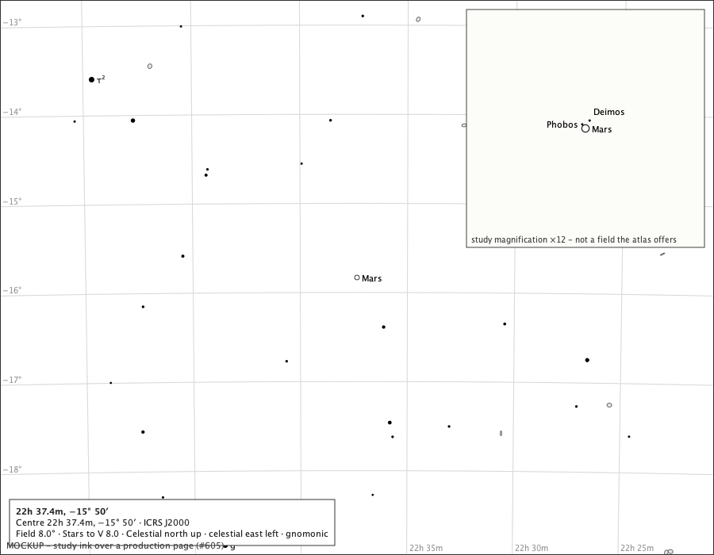

The century's closest named opposition: Mars at its largest, the moons at their widest. Drawn on the page: Mars by rule M, true disc 0.78 px, drawn 6.00 px, k = 0.998; Phobos at mars, not drawn; Deimos at mars, not drawn; Where its labels went on this machine is in `platform.md`.

### The 2003 opposition (Espenak's hour, 2003-08-28 16:00 UTC), from the Earth's centre, 3° field

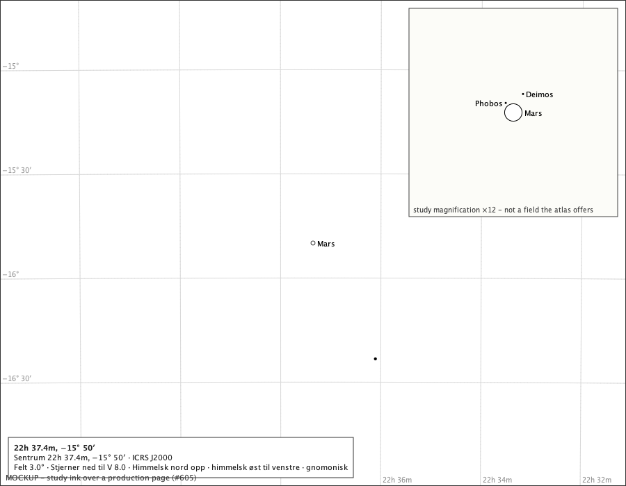

The century's closest named opposition: Mars at its largest, the moons at their widest. Drawn on the page: Mars by rule M, true disc 2.09 px, drawn 6.00 px, k = 0.998; Phobos at mars, not drawn; Deimos at mars, not drawn; Where its labels went on this machine is in `platform.md`.

### The 2003 opposition (Espenak's hour, 2003-08-28 16:00 UTC), from the Earth's centre, 1° field

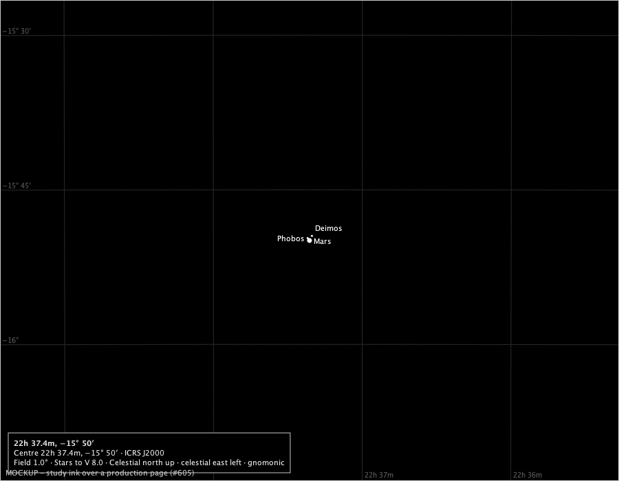

The century's closest named opposition: Mars at its largest, the moons at their widest. Drawn on the page: Mars by rule M, true disc 6.28 px, drawn 6.28 px, k = 0.998; Phobos at (447, 347) clear; Deimos at (453, 343) clear; Where its labels went on this machine is in `platform.md`.

### The 2003 opposition (Espenak's hour, 2003-08-28 16:00 UTC), from the Earth's centre, 0.5° field

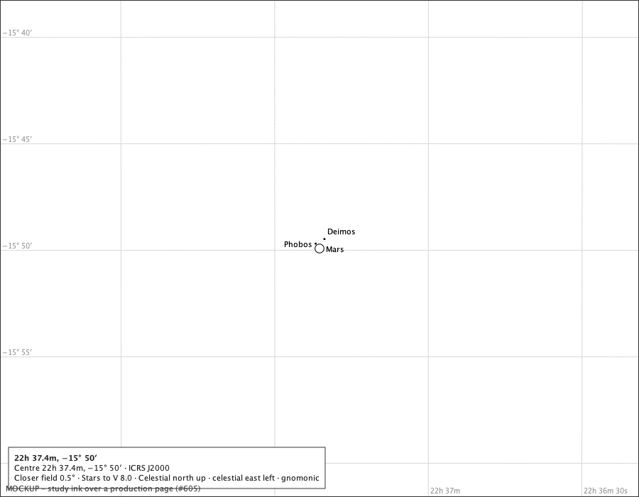

The century's closest named opposition: Mars at its largest, the moons at their widest. Drawn on the page: Mars by rule M, true disc 12.56 px, drawn 12.56 px, k = 0.998; Phobos at (445, 343) clear; Deimos at (457, 337) clear; Where its labels went on this machine is in `platform.md`.

### The 2003 opposition (Espenak's hour, 2003-08-28 16:00 UTC), from the Earth's centre, 0.25° field

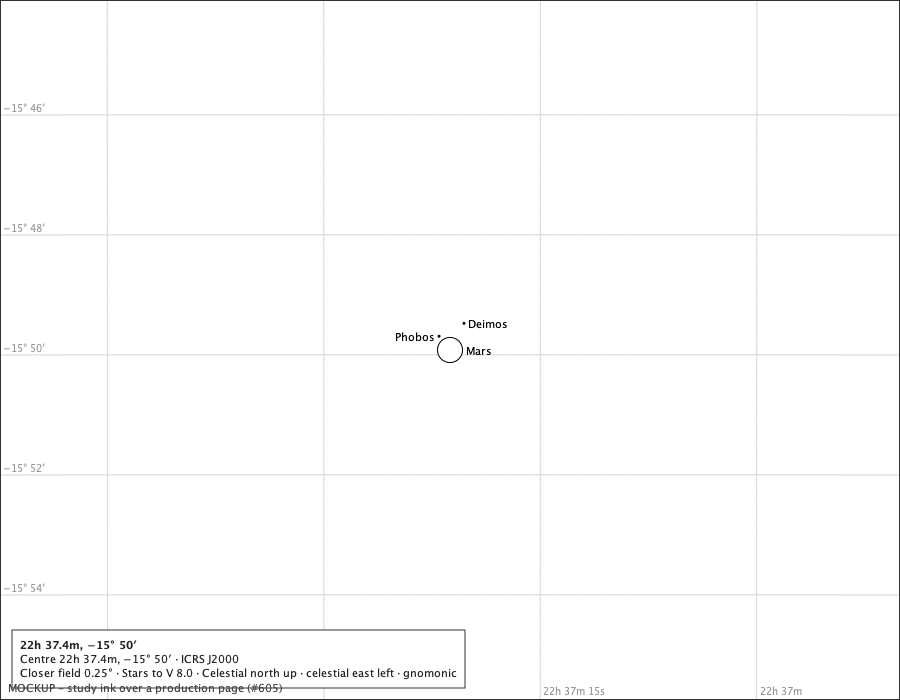

The century's closest named opposition: Mars at its largest, the moons at their widest. Drawn on the page: Mars by rule M, true disc 25.12 px, drawn 25.12 px, k = 0.998; Phobos at (439, 336) clear; Deimos at (464, 323) clear; Where its labels went on this machine is in `platform.md`.

### The 2027 aphelic opposition (2027-02-19 15:00 UTC), from the Earth's centre, 1° field

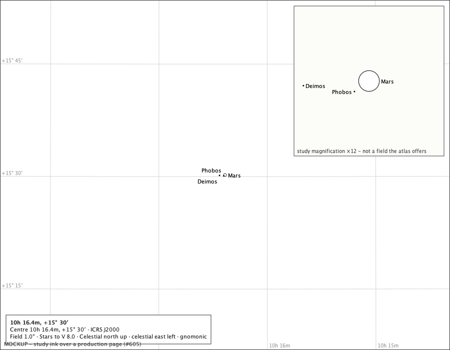

Mars about half its 2003 size; the moons closer to it. Drawn on the page: Mars by rule M, true disc 3.45 px, drawn 6.00 px, k = 0.999; Phobos at (448, 352) clear; Deimos at (439, 351) clear; Where its labels went on this machine is in `platform.md`.

### The 2027 aphelic opposition (2027-02-19 15:00 UTC), from the Earth's centre, 0.25° field

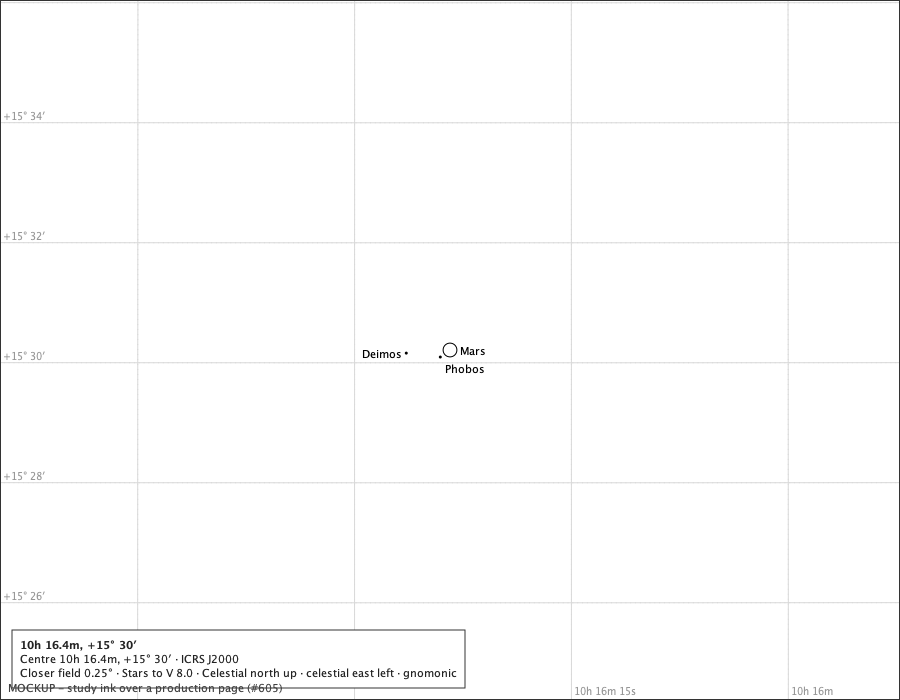

Mars about half its 2003 size; the moons closer to it. Drawn on the page: Mars by rule M, true disc 13.81 px, drawn 13.81 px, k = 0.999; Phobos at (440, 357) clear; Deimos at (406, 353) clear; Where its labels went on this machine is in `platform.md`.

### Mars at its greatest phase angle (2005-07-11), Oslo, 0.25° field

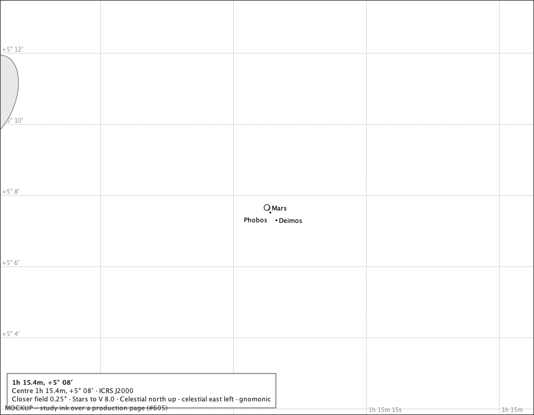

The slimmest Mars of the century: the dark part on the side away from the Sun. Drawn on the page: Mars by rule M, true disc 9.89 px, drawn 9.89 px, k = 0.839; Phobos at (456, 359) clear; Deimos at (466, 372) clear; Where its labels went on this machine is in `platform.md`.

### Mars at its greatest phase angle (2005-07-11), Oslo, 1° field

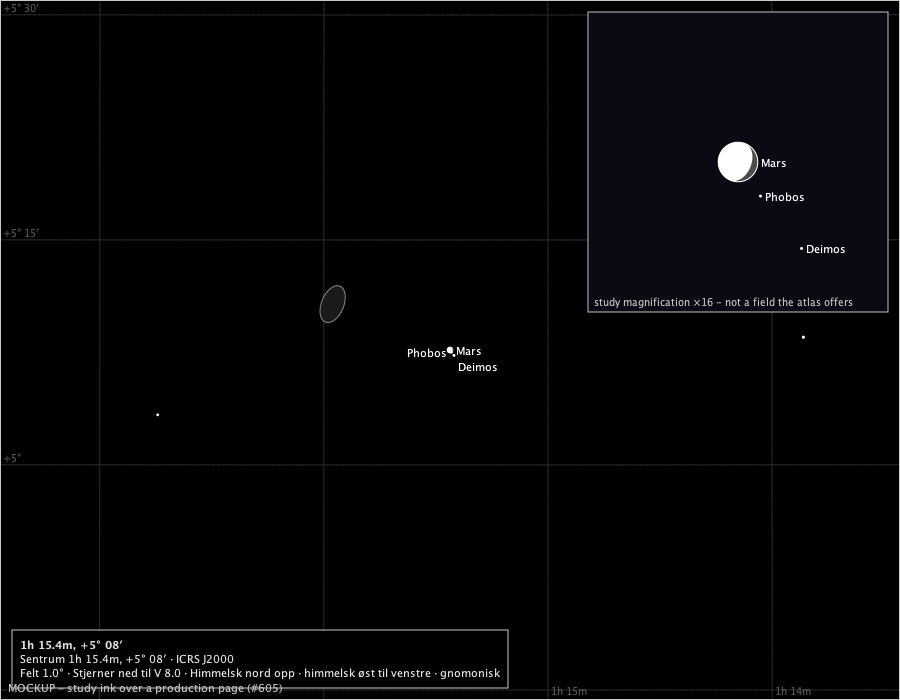

On the 6 px mark the phase is a fraction of a pixel; the inset shows it. Drawn on the page: Mars by rule M, true disc 2.47 px, drawn 6.00 px, k = 0.839; Phobos at (451, 352) clear; Deimos at (454, 355) clear; Where its labels went on this machine is in `platform.md`.

### The 2026 conjunction (Espenak's hour, 2026-01-09 10:00 UTC), Oslo, 3° field, with the Sun

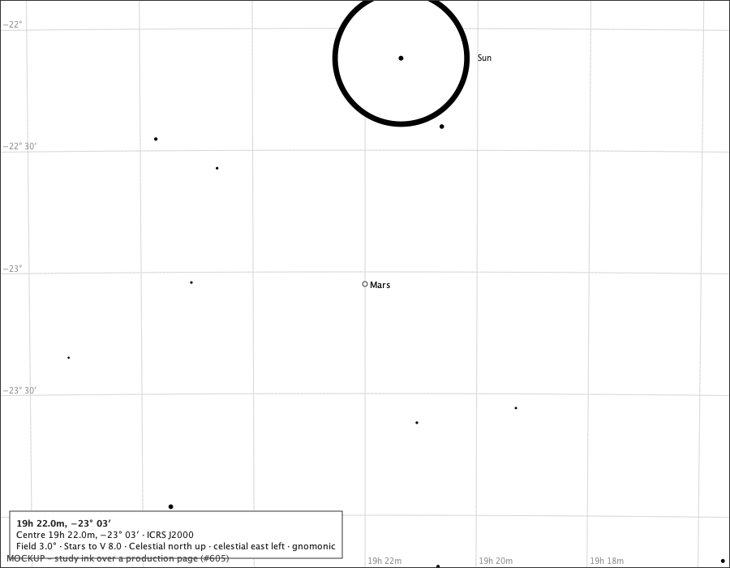

At the published hour Mars is 0.94° from the Sun's centre - the conjunction is in ecliptic longitude - so the mark stands beside the production Sun, not behind it; only inside the Sun's disc would the Sun cover it. Drawn on the page: Mars by rule M, true disc 0.32 px, drawn 6.00 px, k = 1.000; Phobos at mars, not drawn; Deimos at mars, not drawn; Where its labels went on this machine is in `platform.md`.

### Phobos behind Mars in its shadow (Horizons U, 2005-02-27), Oslo, 0.25° field

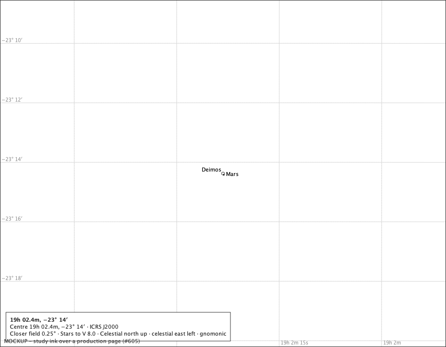

A moon behind Mars is not drawn; its state is spoken, never drawn. Drawn on the page: Mars by rule M, true disc 5.08 px, drawn 6.00 px, k = 0.922; Phobos behind, not drawn; Deimos at (452, 353) clear; Where its labels went on this machine is in `platform.md`.

### Phobos in Mars's shadow (Horizons u, 2005-03-06), Oslo, 0.25° field

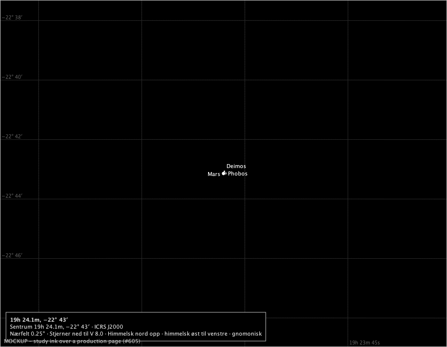

Eclipsed: the symbol as an outline. Drawn on the page: Mars by rule M, true disc 5.23 px, drawn 6.00 px, k = 0.916; Phobos at (455, 350) shadowed; Deimos at (452, 346) clear; Where its labels went on this machine is in `platform.md`.

### Phobos in front of Mars (Horizons t, 2005-08-07), Oslo, 0.25° field

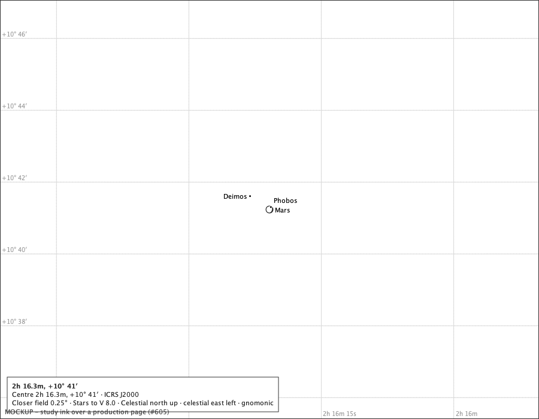

In transit, on a disc too small to show it: the symbol over a ground ring, or unresolved by rule. Drawn on the page: Mars by rule M, true disc 11.77 px, drawn 11.77 px, k = 0.845; Phobos at (452, 346) in front; Deimos at (418, 328) clear; Where its labels went on this machine is in `platform.md`.

### Deimos at its greatest separation of the 2003 opposition (2003-08-28 08:00 UTC), from the Earth's centre, 0.25° field

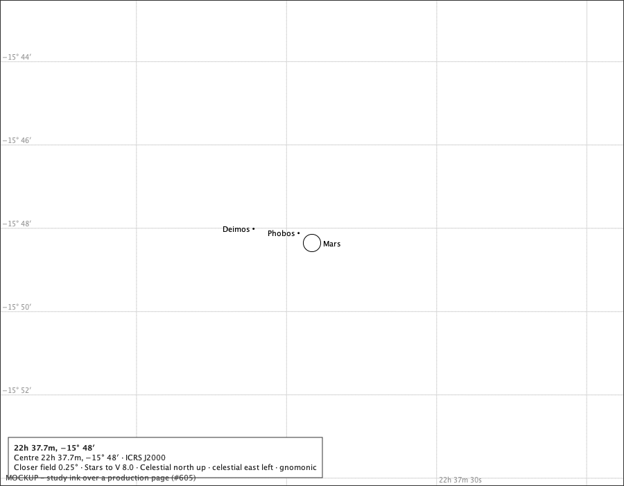

The widest the system ever stands on a page. Drawn on the page: Mars by rule M, true disc 25.12 px, drawn 25.12 px, k = 0.998; Phobos at (431, 336) clear; Deimos at (366, 330) clear; Where its labels went on this machine is in `platform.md`.

### Mars 2.5° S of the Pleiades (Espenak, 2100-03-01 16:09 UTC), Oslo, 8° field

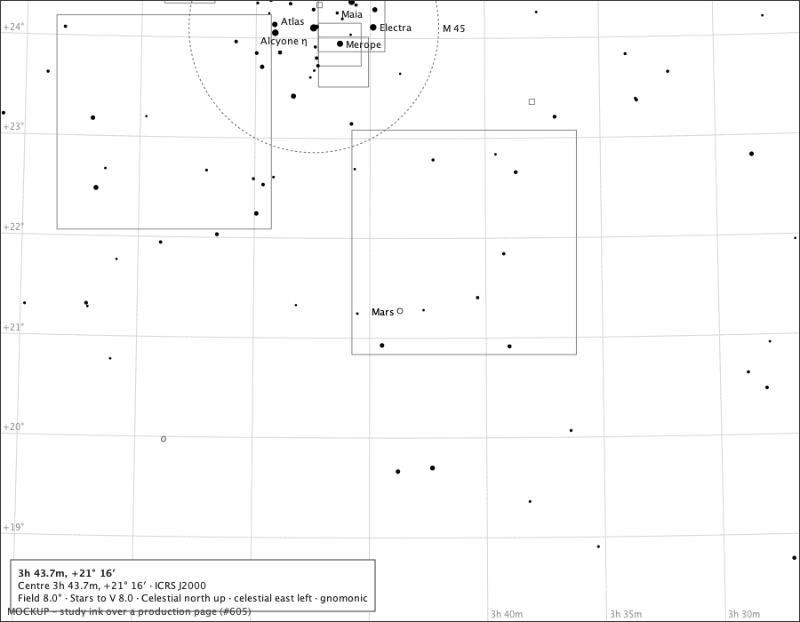

A crowded catalogue field, after the moons' years: Mars alone, as the table shows it. Drawn on the page: Mars by rule M, true disc 0.20 px, drawn 6.00 px, k = 0.895; the moons not computed at this instant (2000-2049 only); Where its labels went on this machine is in `platform.md`.

### Mars below the horizon (2026-10-25 21:00 UTC), Oslo, 8° field, the horizon drawn

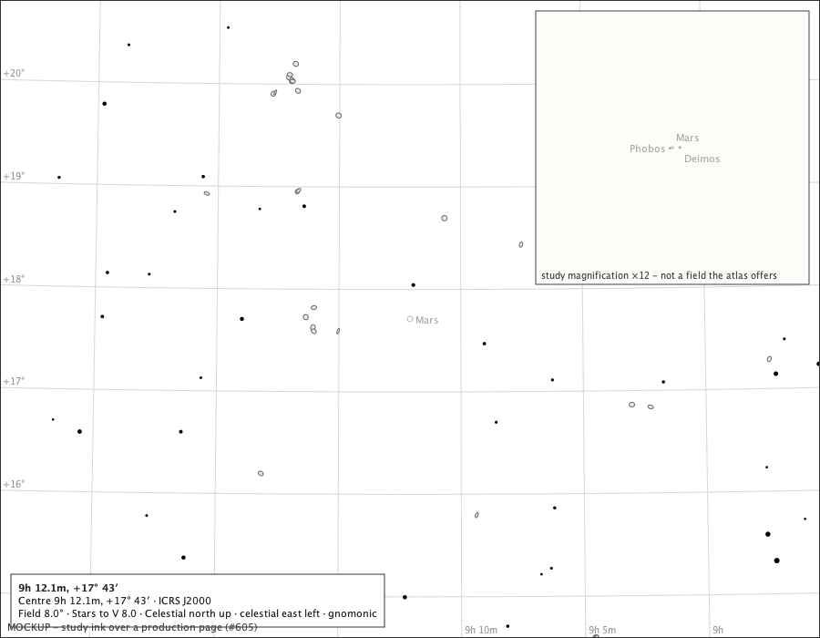

Below the drawn horizon the marks and labels take the subdued tone (#615). Drawn on the page: Mars by rule M, true disc 0.20 px, drawn 6.00 px, k = 0.896, below the horizon; Phobos at mars, not drawn; Deimos at mars, not drawn; Where its labels went on this machine is in `platform.md`.

### The 2003 opposition on the A4 sheet's chart area at 150 dpi (1754 × 1090 px), 1° field

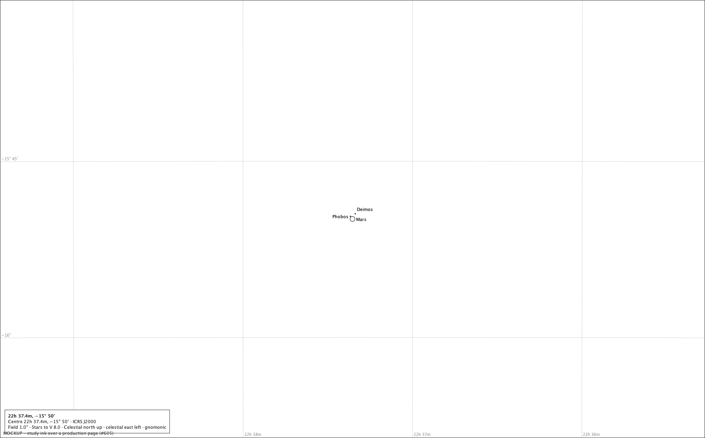

On paper the system reads at 1° without magnification. Drawn on the page: Mars by rule M, true disc 12.24 px, drawn 12.24 px, k = 0.998; Phobos at (872, 538) clear; Deimos at (884, 532) clear; Where its labels went on this machine is in `platform.md`.

## E. What the measurements support

1. **Rule M, phased.** Mars's true disc is under the 6 px mark on every ladder field but 1° (where it exceeds it only near the closest oppositions): the mark, phased by the page's lit region, stands for Mars, as Venus's and Mercury's do; the true disc takes over wherever it is larger.
2. **No colour.** The phase is real but slight (the dark part at most 1.99″, 0.50 px at 1°); nothing in the contract measures a colour, so the mark is drawn in the page's ink, as every other body.
3. **Moons decided on their own**, Jupiter's 3 px symbols and rules (section B). By the geometry alone Phobos stands clear of Mars's drawn mark almost only on the closer fields (in 0.3 % of weeks at 1°), and Deimos from 2°. Jupiter's floor would draw both at 1° and narrower even where they overlap the mark, so whether that floor applies to Mars is a question in its own right.
4. **Jupiter's vocabulary A**, with Mars's name; no shadow on Mars, no ring of any kind.
5. **Selection and Centre on chart** for Mars as for the other planets; whether a moon is selectable is the owner's.
6. **The closer fields** are where the moons separate (section B); eligibility is the owner's.
7. **Below the horizon, black sky, Norwegian and paper** as every body's (#615, #526).
8. **The split:** Mars (the planet, phased by rule M) first, then the moons.

