# Mars on the chart

Issue #606, part 1. The production composition - `ChartComponent` over the bundled catalogue, with the Solar System module attached and Mars switched on - under the rulings on #605: rule M phased (R-1), the larger of the true equatorial disc and a 6 px mark, the lit region turned through the page's north and east at Mars; no colour (R-2); the planet selectable and pointed at as an occurrence (R-5); eligible for the closer fields (R-6); on screen and on paper as the other bodies (R-7). Part 2 draws Phobos and Deimos (R-3, R-4): each a 3 px symbol at its own J2000 place, drawn only where it stands clear of Mars's drawn mark and of the other moon, on every field - no floor; in front only over a drawn disc of at least 12 px; in the shadow a hollow ring; behind, or too close to tell apart, not drawn but spoken; not selectable (R-5). The instants are Espenak's rows in `docs/studies/mars-system/mars-events.txt` and hours the service itself finds; positions and phases are the service's for Oslo at sea level. Regenerate with `make mars-on-the-chart-study`.

## The 2003 closest opposition, 2003-08-28T16:00:00Z, Oslo

The service: 25.1″ across, 99.8 % lit, phase near full, χ 157.1° (not well defined), 173.4° from the Sun.

### 8°, the page's words in Norwegian (the page's field 8°)

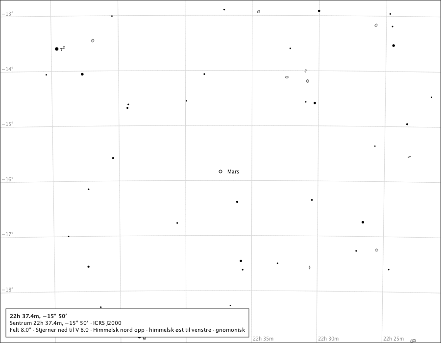

The true disc is under a pixel at 8°: the 6 px mark stands in, and the page calls it a symbol. Drawn: Mars at (450.0, 350.0), symbol 6.0 px, name placed; Spoken: Mars (et kartografisk symbol, ikke Mars' tilsynelatende diameter). Phobos, for nær til å skjelnes i dette feltet, ikke tegnet. Deimos, for nær til å skjelnes i dette feltet, ikke tegnet.

### 3° on the black sky (the page's field 3°)

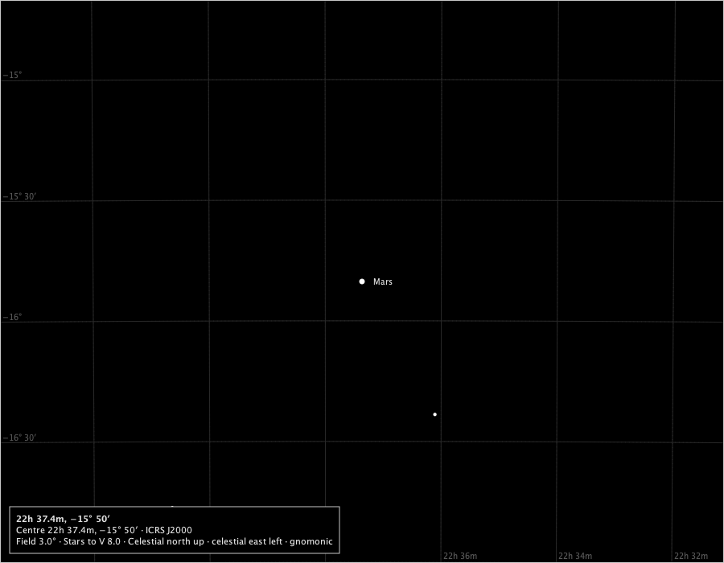

The mark in the black sky's star ink; no colour (R-2). Drawn: Mars at (450.0, 350.0), symbol 6.0 px, name placed; Spoken: Mars (a cartographic symbol, not Mars's apparent diameter). Phobos, too close to tell apart at this field, not drawn. Deimos, too close to tell apart at this field, not drawn.

### The minimum field, 1° (the page's field 1°)

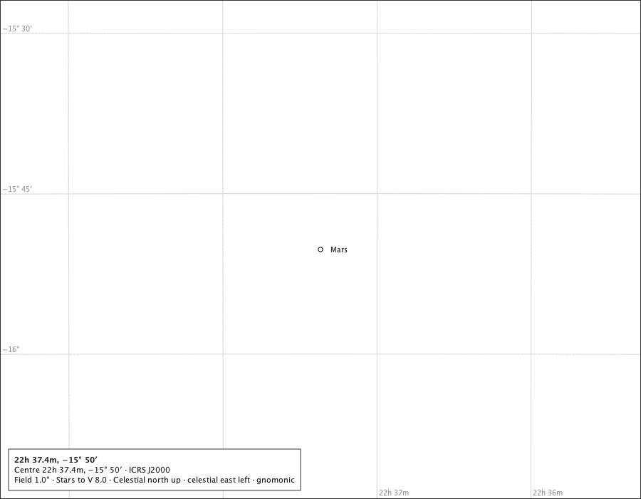

25″ is a little over 6 px at 1°: the true disc, near full, and no longer a symbol. Drawn: Mars at (450.0, 350.0), disc 6.3 px, name placed; Spoken: Mars. Phobos, too close to tell apart at this field, not drawn. Deimos, too close to tell apart at this field, not drawn.

### The 0.5° closer field, in Norwegian (the page's field 0.5°)

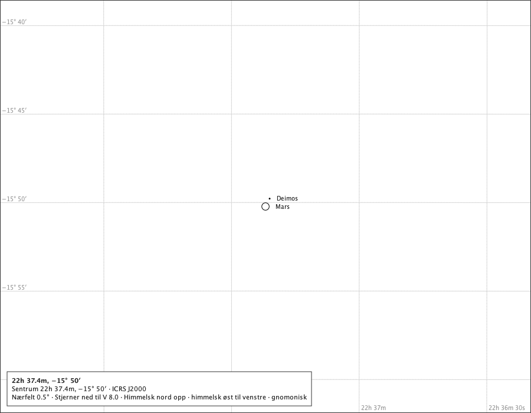

Reached by zooming in from 1°, as the application offers it with Mars on the page (R-6). Drawn: Mars at (450.0, 350.0), disc 12.6 px, name placed; Deimos at (457.0, 336.7), symbol 3.0 px, name placed; Spoken: Mars. Deimos (et kartografisk symbol, ikke Deimos' tilsynelatende diameter). Phobos, for nær til å skjelnes i dette feltet, ikke tegnet.

### The 0.25° closer field on the black sky (the page's field 0.25°)

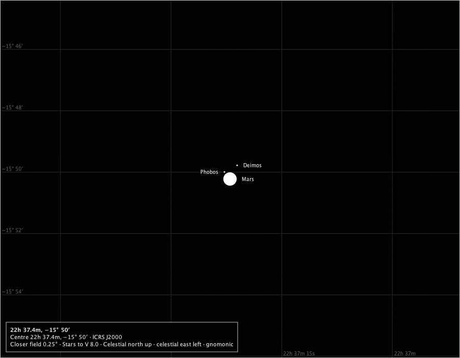

The true disc some 25 px across. Drawn: Mars at (450.0, 350.0), disc 25.1 px, name placed; Deimos at (464.0, 323.4), symbol 3.0 px, name placed; Phobos at (439.1, 336.3), symbol 3.0 px, name placed; Spoken: Mars. Deimos (a cartographic symbol, not Deimos's apparent diameter). Phobos (a cartographic symbol, not Phobos's apparent diameter).

## The conjunctions, Oslo, with the Sun

### The 2026 conjunction, 2026-01-09T10:00:00Z

The service: 3.9″ across, 100.0 % lit, phase near full, χ 350.8° (not well defined), 0.9° from the Sun.

### At 3° (the page's field 3°)

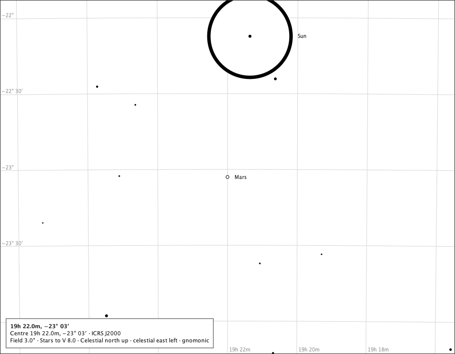

Mars passes north of the Sun's disc at this conjunction: the mark beside the Sun, beneath the stars, near full. Drawn: Mars at (450.0, 350.0), symbol 6.0 px, name placed; Sun at (494.4, 71.7), disc 162.6 px, name placed; Spoken: Mars (a cartographic symbol, not Mars's apparent diameter). Sun. Phobos, too close to tell apart at this field, not drawn. Deimos, too close to tell apart at this field, not drawn.

### Behind the Sun, 1912-11-05T03:00:00Z

The hour of 1912 the service puts Mars geocentrically deepest behind the Sun's disc (no almanac row is quoted for it). The service: 3.7″ across, 100.0 % lit, phase behind sun, χ 193.2° (not well defined), 0.1° from the Sun.

### At 1° (the page's field 1°)

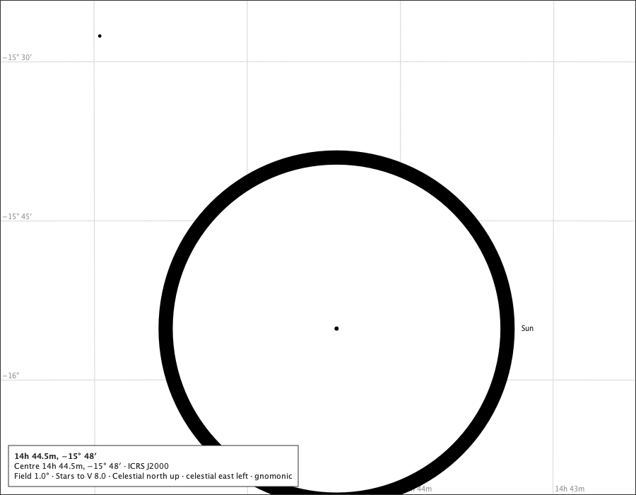

The mark laid beneath the stars and covered by the Sun's ground-filled disc; the page says *behind the Sun*. Drawn: Mars at (450.0, 350.0), symbol 6.0 px, state mars.behind, name refused; Sun at (476.3, 464.7), disc 483.9 px, name placed; Spoken: Mars, behind the Sun (a cartographic symbol, not Mars's apparent diameter). Sun.

### At 1°, in Norwegian on the black sky (the page's field 1°)

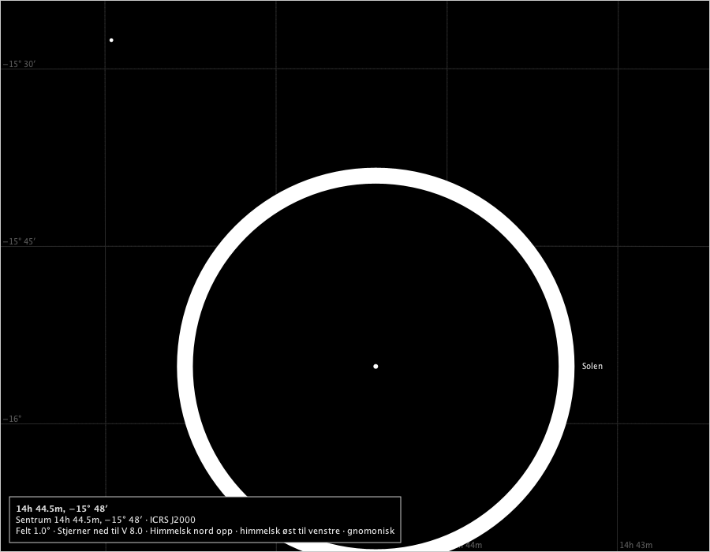

The same, spoken in Norwegian. Drawn: Mars at (450.0, 350.0), symbol 6.0 px, state mars.behind, name refused; Solen at (476.3, 464.7), disc 483.9 px, name placed; Spoken: Mars, bak Solen (et kartografisk symbol, ikke Mars' tilsynelatende diameter). Solen.

## The widest dark side of the 2018 apparition, 2018-10-06T00:00:00Z

The day of 2018 on which the service finds Mars's defect of illumination widest on the sky, geocentrically, 1.8″; drawn for Oslo. The service: 15.1″ across, 87.9 % lit, phase gibbous, χ 253.0° (well defined), 115.3° from the Sun.

### The 0.25° closer field (the page's field 0.25°)

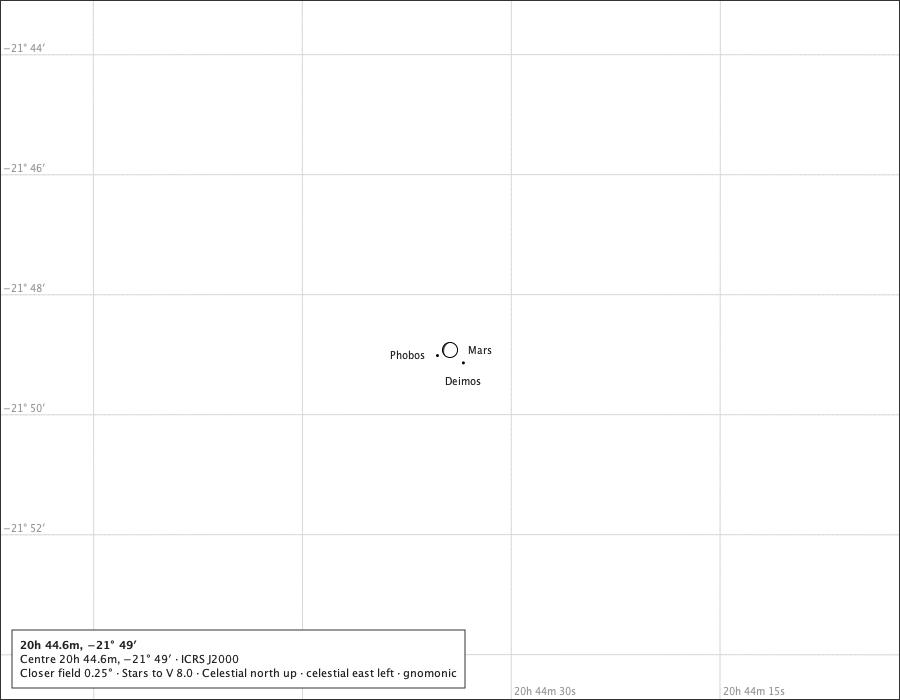

The dark side a narrow band on the limb away from the Sun. Drawn: Mars at (450.0, 350.0), disc 15.1 px, name placed; Deimos at (463.4, 362.9), symbol 3.0 px, name placed; Phobos at (437.5, 355.6), symbol 3.0 px, name placed; Spoken: Mars. Deimos (a cartographic symbol, not Deimos's apparent diameter). Phobos (a cartographic symbol, not Phobos's apparent diameter).

Measured inside the outline: 132 of 140 pixels lit, **94 %** against k = 87.9 %; the lit side faces **252°** (read from the dark side's pixels through the page's north and east), 1° from the service's χ = 253.0°. The outline's ring is left out of the count and takes the dark side's outermost pixels with it, so the share reads a few points high; what is held is that the disc is drawn short of full and the dark side lies opposite χ, within 45°.

## Phobos and Deimos

Each case is the first ten-minute step the service finds, for Oslo, in the window named. The 2003 pages above are drawn with the moons as the page decides them; on the ordinary ladder they stand on Mars's mark and are spoken, not drawn.

### Deimos near its greatest elongation, 2018-07-27T13:00:00Z (the page's field 0.25°)

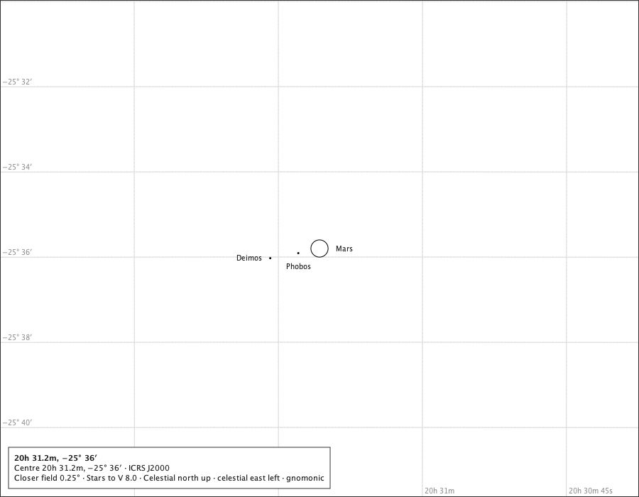

Mars 24.3″ across. The service: Phobos 30.6″ from Mars's centre, clear, sunlit; Deimos 70.7″ from Mars's centre, clear, sunlit. At 0.25° Deimos stands clear: a filled dot, named. Drawn: Mars at (450.0, 350.0), disc 24.3 px, name placed; Deimos at (380.6, 363.6), symbol 3.0 px, name placed; Phobos at (420.1, 356.5), symbol 3.0 px, name placed; Spoken: Mars. Deimos (a cartographic symbol, not Deimos's apparent diameter). Phobos (a cartographic symbol, not Phobos's apparent diameter).

### The same at 1°, in Norwegian, 2018-07-27T13:00:00Z (the page's field 1°)

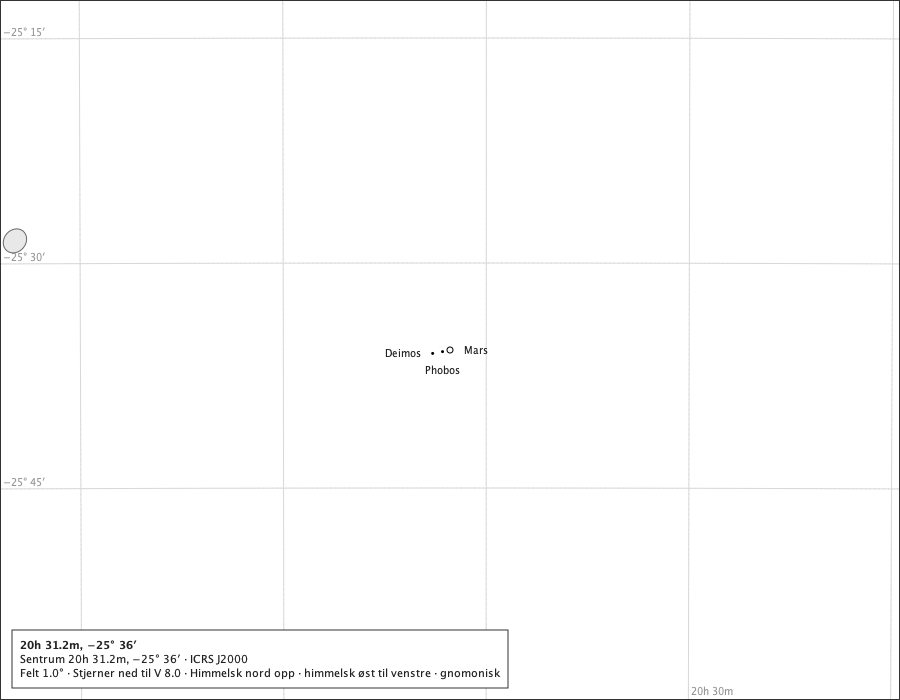

Mars 24.3″ across. The service: Phobos 30.6″ from Mars's centre, clear, sunlit; Deimos 70.7″ from Mars's centre, clear, sunlit. At 1° the page decides each moon on its own. Drawn: Mars at (450.0, 350.0), disc 6.1 px, name placed; Deimos at (432.7, 353.4), symbol 3.0 px, name placed; Phobos at (442.5, 351.6), symbol 3.0 px, name placed; Spoken: Mars. Deimos (et kartografisk symbol, ikke Deimos' tilsynelatende diameter). Phobos (et kartografisk symbol, ikke Phobos' tilsynelatende diameter).

### The same at 8°, 2018-07-27T13:00:00Z (the page's field 8°)

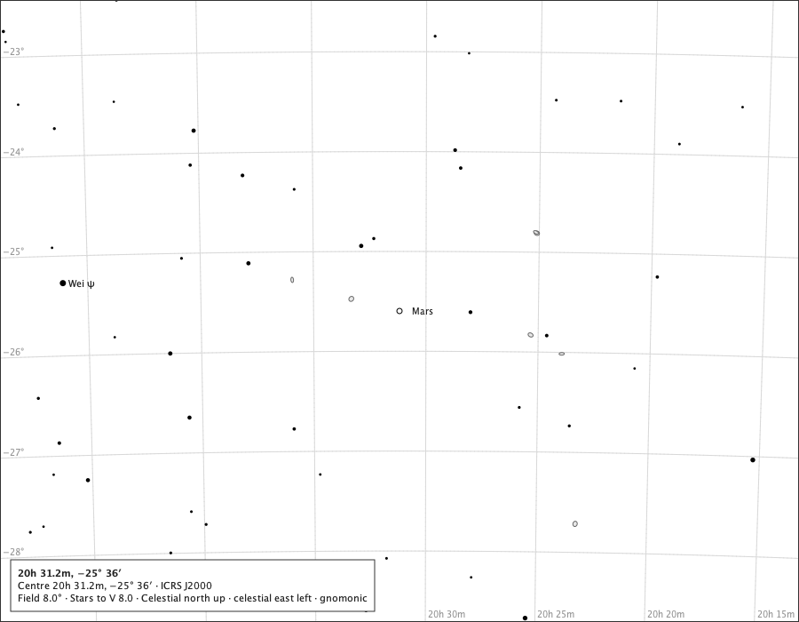

Mars 24.3″ across. The service: Phobos 30.6″ from Mars's centre, clear, sunlit; Deimos 70.7″ from Mars's centre, clear, sunlit. At 8° both stand on Mars's mark: neither is drawn, and the page says so (no floor, R-3). Drawn: Mars at (450.0, 350.0), symbol 6.0 px, name placed; Spoken: Mars (a cartographic symbol, not Mars's apparent diameter). Phobos, too close to tell apart at this field, not drawn. Deimos, too close to tell apart at this field, not drawn.

### Phobos in front of Mars, 2001-06-30T15:00:00Z (the page's field 0.25°)

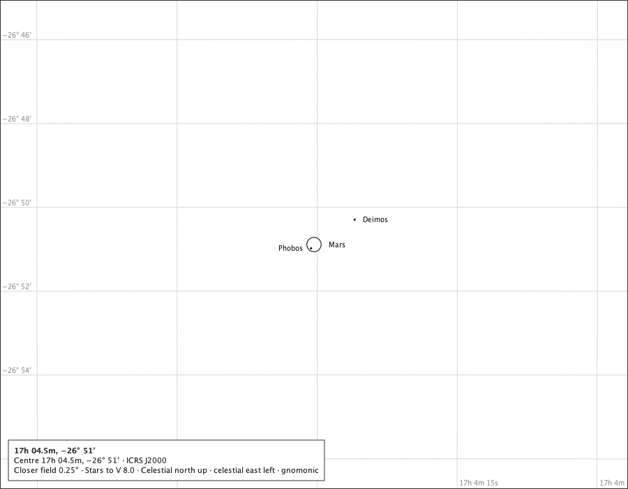

Mars 20.5″ across. The service: Phobos 6.9″ from Mars's centre, in front, sunlit; Deimos 68.3″ from Mars's centre, clear, sunlit. Over a drawn disc of at least 12 px: the dot ringed in the page's ground, painted with the disc. Drawn: Mars at (450.0, 350.0), disc 20.5 px, name placed; Deimos at (508.2, 314.4), symbol 3.0 px, name placed; Phobos at (445.8, 355.4), symbol 3.0 px, state mars.inFront, name placed; Spoken: Mars. Deimos (a cartographic symbol, not Deimos's apparent diameter). Phobos, in front of Mars (a cartographic symbol, not Phobos's apparent diameter).

### The same on the black sky, 2001-06-30T15:00:00Z (the page's field 0.25°)

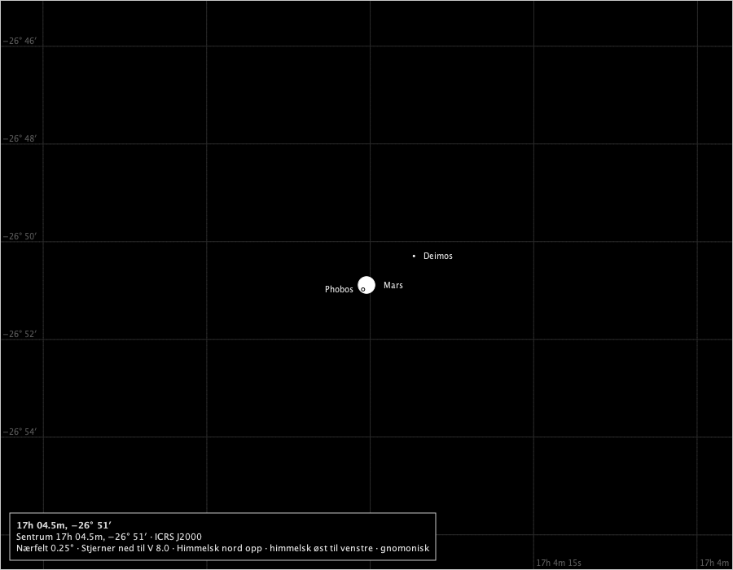

Mars 20.5″ across. The service: Phobos 6.9″ from Mars's centre, in front, sunlit; Deimos 68.3″ from Mars's centre, clear, sunlit. In Norwegian. Drawn: Mars at (450.0, 350.0), disc 20.5 px, name placed; Deimos at (508.2, 314.4), symbol 3.0 px, name placed; Phobos at (445.8, 355.4), symbol 3.0 px, state mars.inFront, name placed; Spoken: Mars. Deimos (et kartografisk symbol, ikke Deimos' tilsynelatende diameter). Phobos, foran Mars (et kartografisk symbol, ikke Phobos' tilsynelatende diameter).

### Phobos behind Mars, 2018-07-27T11:20:00Z (the page's field 0.25°)

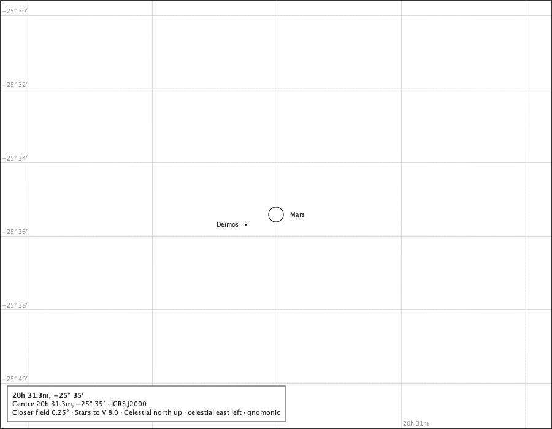

Mars 24.3″ across. The service: Phobos 9.5″ from Mars's centre, behind, in shadow; Deimos 52.1″ from Mars's centre, clear, sunlit. Behind Mars: not drawn, and spoken. Drawn: Mars at (450.0, 350.0), disc 24.3 px, name placed; Deimos at (400.5, 366.5), symbol 3.0 px, name placed; Spoken: Mars. Deimos (a cartographic symbol, not Deimos's apparent diameter). Phobos, behind Mars, not drawn.

### Phobos in Mars's shadow, beside the disc, 2018-05-01T01:10:00Z (the page's field 0.25°)

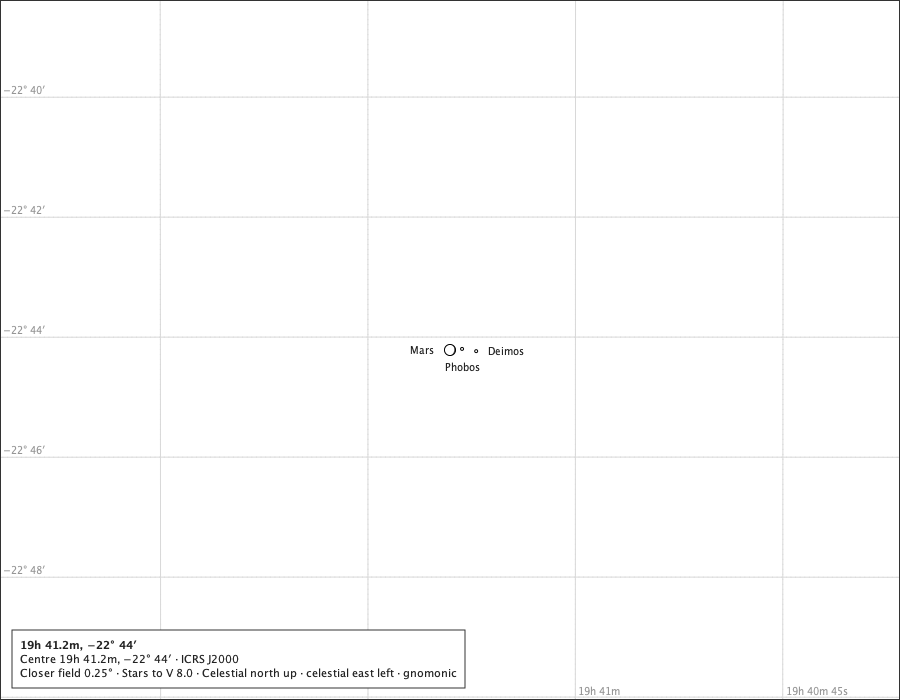

Mars 11.1″ across. The service: Phobos 12.1″ from Mars's centre, clear, in shadow; Deimos 26.2″ from Mars's centre, clear, in shadow. A hollow ring, with its state. Drawn: Mars at (450.0, 350.0), disc 11.1 px, name placed; Deimos at (476.2, 351.2), symbol 3.0 px, state mars.shadowed, name placed; Phobos at (462.1, 348.9), symbol 3.0 px, state mars.shadowed, name placed; Spoken: Mars. Deimos, in Mars's shadow (a cartographic symbol, not Deimos's apparent diameter). Phobos, in Mars's shadow (a cartographic symbol, not Phobos's apparent diameter).

### After the moons' years, 2051-03-01T00:00:00Z (the page's field 0.25°)

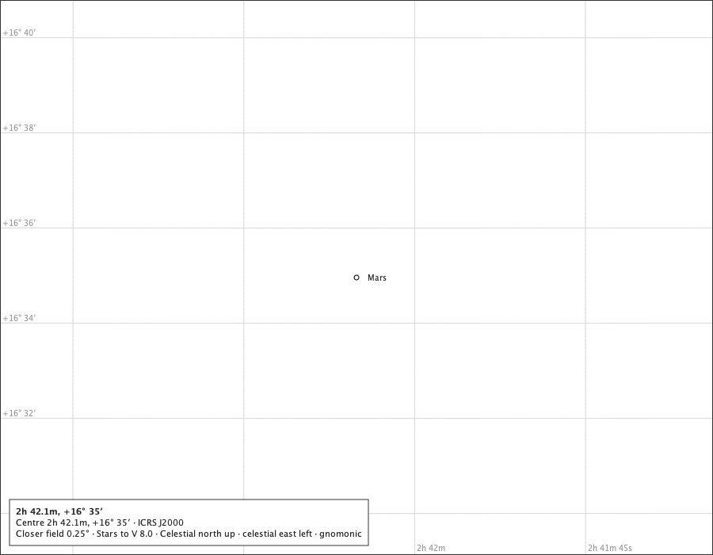

Mars 5.5″ across. No moons computed. Mars alone, as the table shows it; nothing is said of moons with no numbers. Drawn: Mars at (450.0, 350.0), symbol 6.0 px, name placed; Spoken: Mars (a cartographic symbol, not Mars's apparent diameter).

## Outside the years

At 1899-12-31T12:00:00Z - before the planets pack's first day, 1900-01-01 - the module draws nothing for Mars: 0 bodies drawn, and the page says nothing of it.

