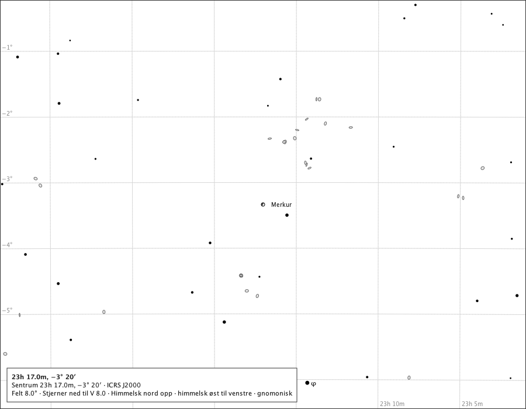
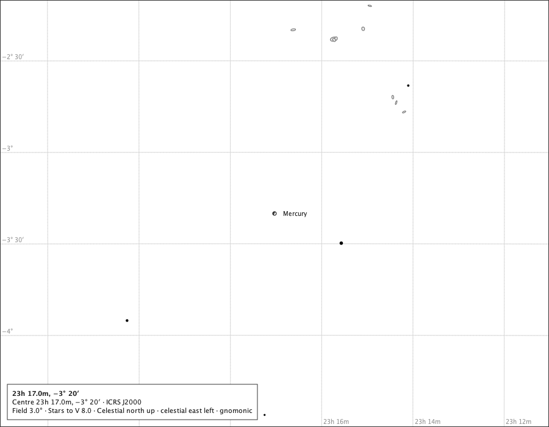
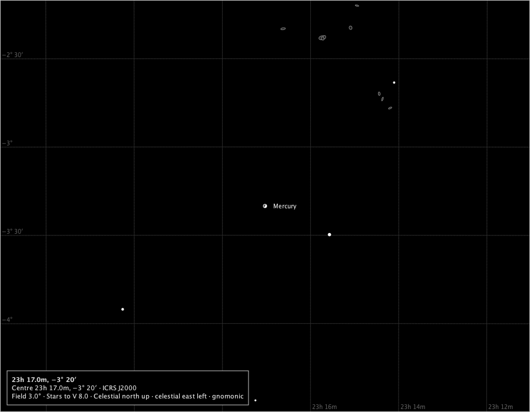
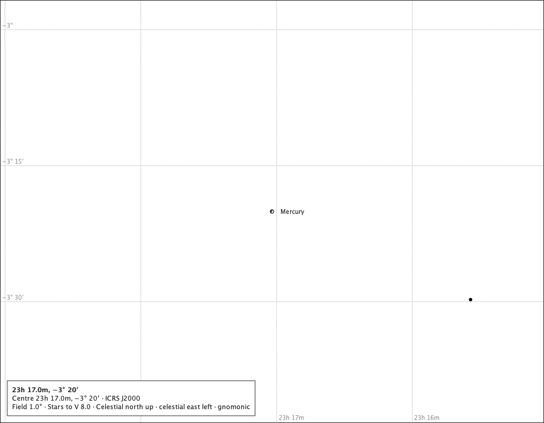
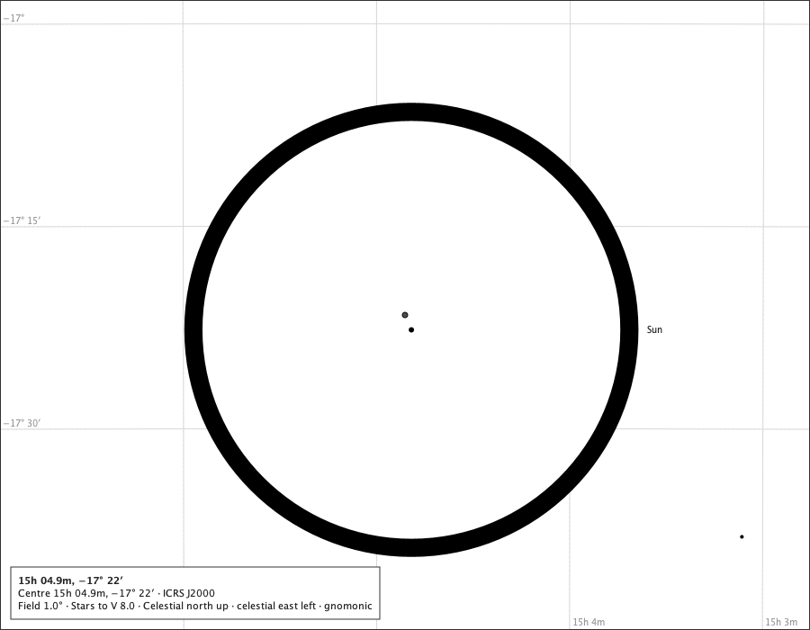
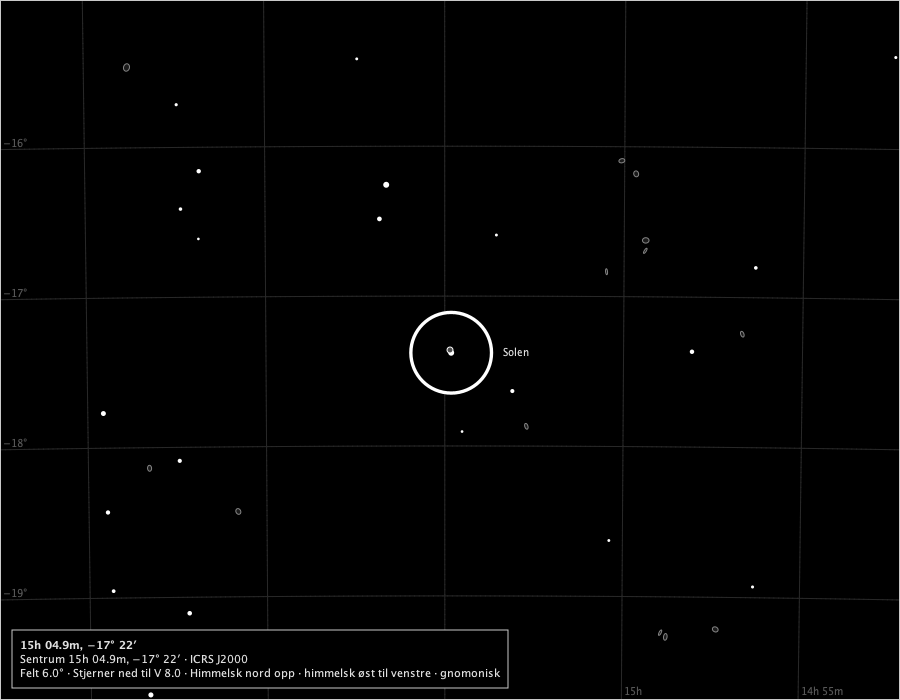
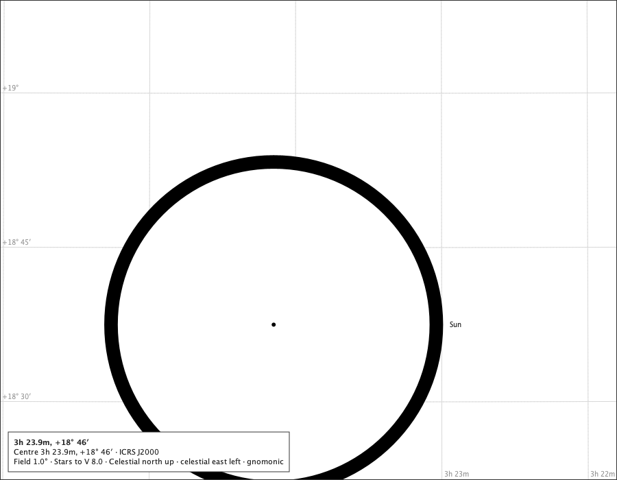
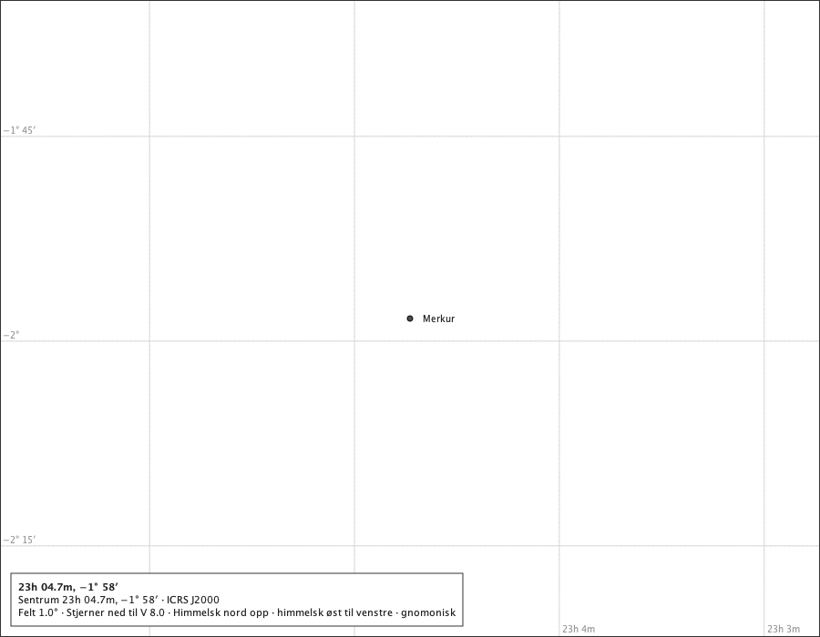
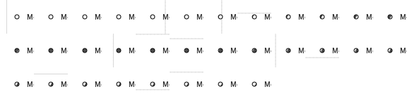

# Mercury on the chart

Sprint 50, issue #542. The production composition - `ChartComponent` over the bundled catalogue, with the Solar System module attached and Mercury switched on - under the rulings on #539: rule M as for Venus, the larger of the true solid-body disc and a 6 px mark, phased by the page's own lit region (χ of date turned through the page's north and east at Mercury); on the ordinary ladder the true disc is always under the mark, so Mercury is always a cartographic symbol beneath the stars, spoken as one; no sliver invented near conjunction; transits and occultations by painting order; the geometric state spoken when Mercury meets the Sun's disc. Its phase becomes visible on screen only below 1° (#481, #543-#544); this page is the ordinary ladder. The instants are the cited rows in `docs/studies/mercury/mercury-events.txt`; positions and phases are the service's for Oslo at sea level. Regenerate with `make mercury-on-the-chart-study`.

## The 2026 greatest eastern elongation, Oslo

### Største østlige elongasjon, 8°, the page's words in Norwegian

The table: 49.7 % lit, nær halvt belyst, χ 243.3° (WSW (243°)). The true disc is a fifth of a pixel at 8°: the 6 px mark stands in, phased, and the page calls it a symbol. Drawn: Merkur at (450.0, 350.0), symbol 6.0 px, name placed; Spoken: Merkur (et kartografisk symbol, ikke Merkurs tilsynelatende diameter).

### The elongation at 3°

The true disc is under a pixel at 3°: the mark still stands in. Drawn: Mercury at (450.0, 350.0), symbol 6.0 px, name placed; Spoken: Mercury (a cartographic symbol, not Mercury's apparent diameter).

### The elongation at 3° on the black sky

The lit side in the black sky's star ink, the dark side a little above the sky's ground. Drawn: Mercury at (450.0, 350.0), symbol 6.0 px, name placed; Spoken: Mercury (a cartographic symbol, not Mercury's apparent diameter).

### The elongation at the minimum field, 1°

The table: 49.7 % lit, near half lit, χ 243.3° (WSW (243°)). About 1.8 px at 1°: still the mark - Mercury's phase is in the mark's lit region, never in a size the disc does not have. Drawn: Mercury at (450.0, 350.0), symbol 6.0 px, name placed; Spoken: Mercury (a cartographic symbol, not Mercury's apparent diameter).

## The conjunctions, Oslo, with the Sun

### The 2019 transit, 2019-11-11T15:20:00Z

In front of the Sun: the mark painted over the Sun's disc in the bodies layer, its dark side reading on the Sun's ground beside the capped centre dot (#541), and the page says so beside the name. Drawn: Sun at (457.1, 366.5), disc 484.4 px, name placed; Mercury at (450.0, 350.0), symbol 6.0 px, state mercury.inFront, name refused; Spoken: Mercury, in front of the Sun (a cartographic symbol, not Mercury's apparent diameter).

### The 2019 transit at 6°, in Norwegian

The mark over the Sun's disc; its name refused inside the Sun's ink, as Venus's is (C4). Drawn: Solen at (451.2, 352.7), disc 80.7 px, name placed; Merkur at (450.0, 350.0), symbol 6.0 px, state mercury.inFront, name refused; Spoken: Merkur, foran Solen (et kartografisk symbol, ikke Merkurs tilsynelatende diameter).

### Behind the Sun, 2026-05-14T14:00:00Z

Behind the Sun: the mark laid beneath the stars and covered by the Sun's ground-filled disc; the page says *behind the Sun*. Drawn: Mercury at (450.0, 350.0), symbol 6.0 px, state mercury.behind, name refused; Sun at (399.2, 473.5), disc 474.6 px, name placed; Spoken: Mercury, behind the Sun (a cartographic symbol, not Mercury's apparent diameter). Sun.

### The 2026 inferior conjunction, 2026-03-07T11:00:00Z

The table: 0.7 % lit, nær nedre konjunksjon, χ 157.2° (not well-defined). 3.6° from the Sun: the mark dark with its limb, the lit sliver under a pixel, as the geometry gives. Drawn: Merkur at (450.0, 350.0), symbol 6.0 px, name placed; Spoken: Merkur (et kartografisk symbol, ikke Merkurs tilsynelatende diameter).

## The 2026 apparitions as a row of phases

From the 2026 superior conjunction, 2026-01-21T16:00:00Z, every 3 days through the inferior conjunction and 50 days beyond, Oslo: each mark or disc cut from its own 1° page drawn by the production component (left to right, 12 to a row). Beside the Mercury table's own cells, what the rendered pixels show - every pixel inside the mark classed as lit, dark side or the limb's own ink, which is left out: the share drawn lit, and the direction the lit side faces read back through the page's north and east at Mercury. A mark of 6 px holds some two dozen pixels, so the share is coarse; what is held is that a disc the table calls crescent is drawn less than half lit and a gibbous one more where the table's k is at least five points from a half, and that the drawn lit side faces within 45° of the table's χ wherever the table says χ is well defined.

| step | instant (UTC) | table: lit | table: phase | table: χ | drawn | drawn: lit | drawn: facing | agrees |
|---:|---|---:|---|---:|---|---:|---|---|
| 0 | 2026-01-21 16:00 | 99.8 % | near full | 346.9° | symbol 6.0 px | 100 % | - | - |
| 1 | 2026-01-24 16:00 | 99.6 % | near full | 301.0° | symbol 6.0 px | 100 % | - | - |
| 2 | 2026-01-27 16:00 | 99.0 % | near full | 280.0° | symbol 6.0 px | 100 % | - | - |
| 3 | 2026-01-30 16:00 | 97.8 % | gibbous | 269.2° | symbol 6.0 px | 100 % | - | - |
| 4 | 2026-02-02 16:00 | 95.8 % | gibbous | 262.4° | symbol 6.0 px | 100 % | - | - |
| 5 | 2026-02-05 16:00 | 92.5 % | gibbous | 257.4° | symbol 6.0 px | 100 % | - | - |
| 6 | 2026-02-08 16:00 | 87.6 % | gibbous | 253.6° | symbol 6.0 px | 100 % | - | - |
| 7 | 2026-02-11 16:00 | 80.5 % | gibbous | 250.3° | symbol 6.0 px | 94 % | 225° | yes |
| 8 | 2026-02-14 16:00 | 71.0 % | gibbous | 247.6° | symbol 6.0 px | 75 % | 270° | yes |
| 9 | 2026-02-17 16:00 | 59.1 % | gibbous | 245.1° | symbol 6.0 px | 63 % | 254° | yes |
| 10 | 2026-02-20 16:00 | 45.5 % | crescent | 242.6° | symbol 6.0 px | 44 % | 242° | yes |
| 11 | 2026-02-23 16:00 | 31.5 % | crescent | 239.7° | symbol 6.0 px | 25 % | 239° | yes |
| 12 | 2026-02-26 16:00 | 18.8 % | crescent | 235.8° | symbol 6.0 px | 6 % | 225° | yes |
| 13 | 2026-03-01 16:00 | 8.8 % | crescent | 229.3° | symbol 6.0 px | 0 % | - | - |
| 14 | 2026-03-04 16:00 | 2.6 % | crescent | 213.2° | symbol 6.0 px | 0 % | - | - |
| 15 | 2026-03-07 16:00 | 0.7 % | near inferior conjunction | 150.6° | symbol 6.0 px | 0 % | - | - |
| 16 | 2026-03-10 16:00 | 2.6 % | crescent | 94.5° | symbol 6.0 px | 0 % | - | - |
| 17 | 2026-03-13 16:00 | 7.3 % | crescent | 80.4° | symbol 6.0 px | 0 % | - | - |
| 18 | 2026-03-16 16:00 | 13.6 % | crescent | 74.7° | symbol 6.0 px | 0 % | - | - |
| 19 | 2026-03-19 16:00 | 20.5 % | crescent | 71.5° | symbol 6.0 px | 6 % | 45° | yes |
| 20 | 2026-03-22 16:00 | 27.2 % | crescent | 69.3° | symbol 6.0 px | 13 % | 56° | yes |
| 21 | 2026-03-25 16:00 | 33.6 % | crescent | 67.6° | symbol 6.0 px | 25 % | 59° | yes |
| 22 | 2026-03-28 16:00 | 39.4 % | crescent | 66.2° | symbol 6.0 px | 38 % | 74° | yes |
| 23 | 2026-03-31 16:00 | 44.7 % | crescent | 65.0° | symbol 6.0 px | 38 % | 74° | yes |
| 24 | 2026-04-03 16:00 | 49.6 % | near half lit | 63.9° | symbol 6.0 px | 50 % | 67° | yes |
| 25 | 2026-04-06 16:00 | 54.1 % | gibbous | 63.0° | symbol 6.0 px | 56 % | 62° | yes |
| 26 | 2026-04-09 16:00 | 58.3 % | gibbous | 62.1° | symbol 6.0 px | 63 % | 74° | yes |
| 27 | 2026-04-12 16:00 | 62.3 % | gibbous | 61.5° | symbol 6.0 px | 69 % | 77° | yes |
| 28 | 2026-04-15 16:00 | 66.1 % | gibbous | 61.0° | symbol 6.0 px | 69 % | 77° | yes |
| 29 | 2026-04-18 16:00 | 70.0 % | gibbous | 60.6° | symbol 6.0 px | 81 % | 45° | yes |
| 30 | 2026-04-21 16:00 | 73.9 % | gibbous | 60.5° | symbol 6.0 px | 88 % | 56° | yes |
| 31 | 2026-04-24 16:00 | 77.9 % | gibbous | 60.5° | symbol 6.0 px | 94 % | 45° | yes |

**19 of the 19 steps where the table states χ agree**: the drawn half is the table's and the lit side faces within 45° of χ.

