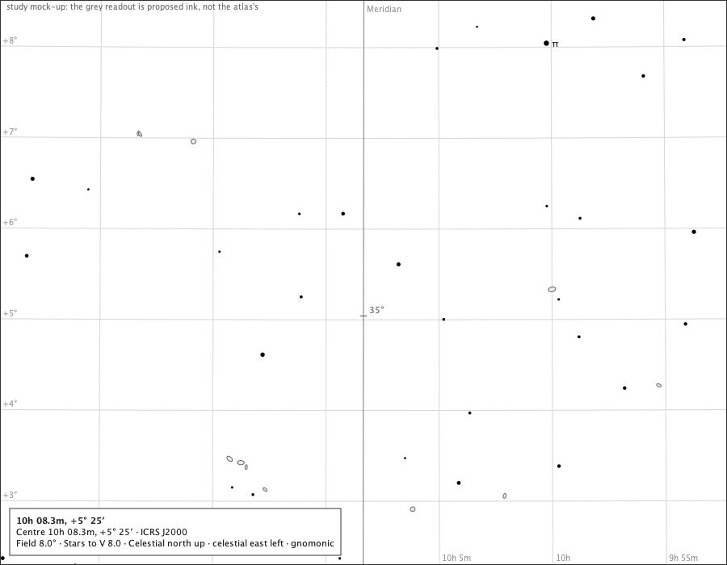
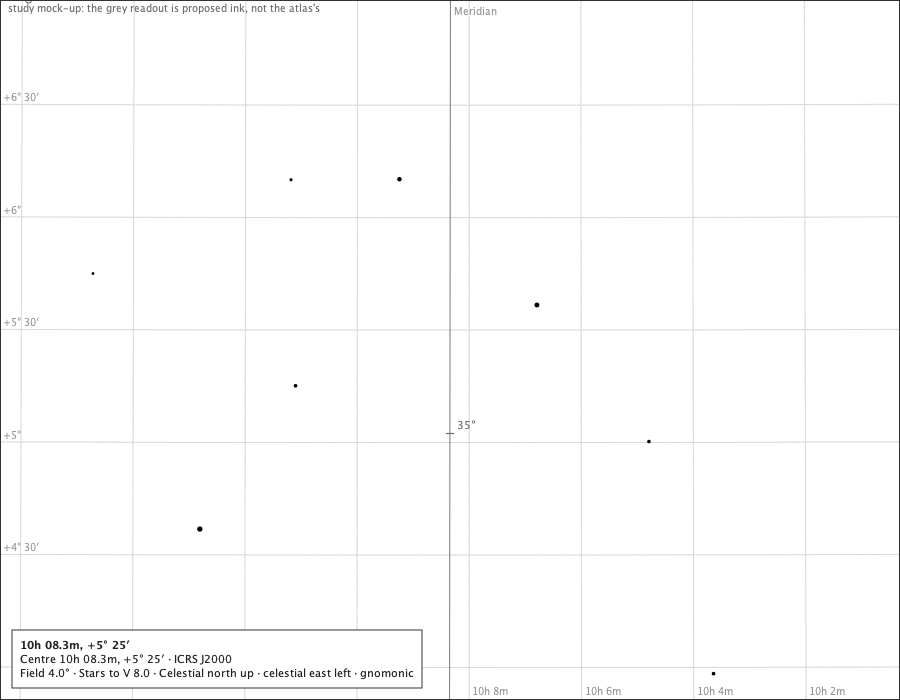
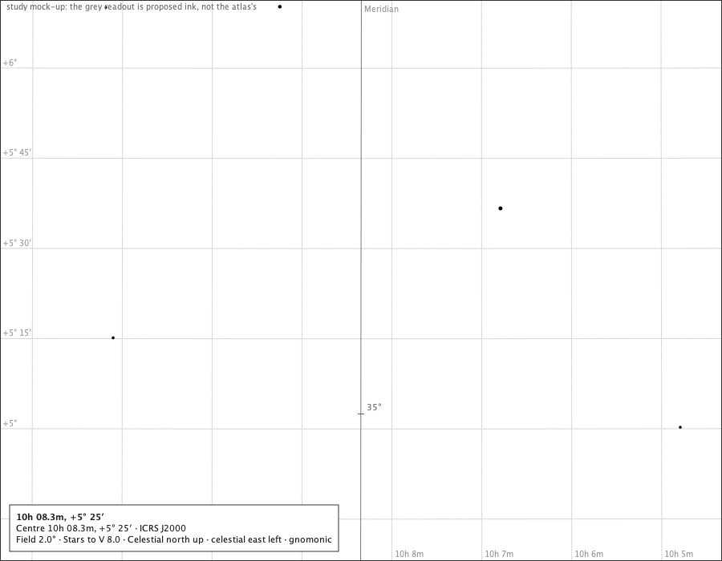
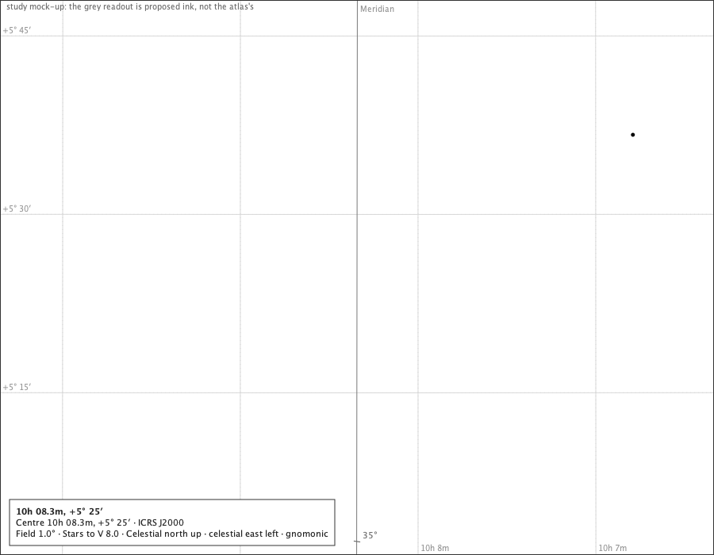
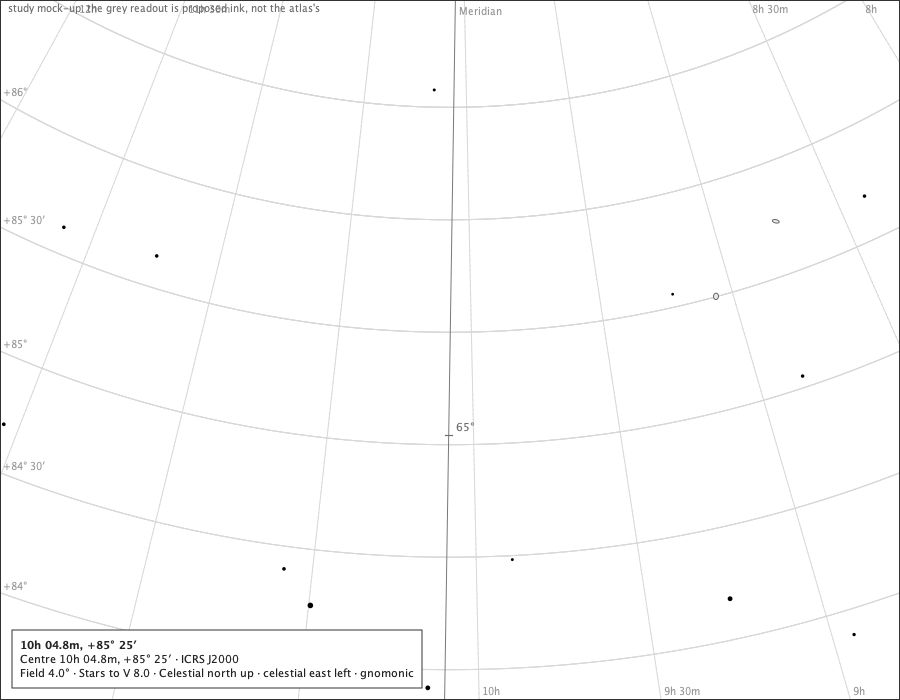
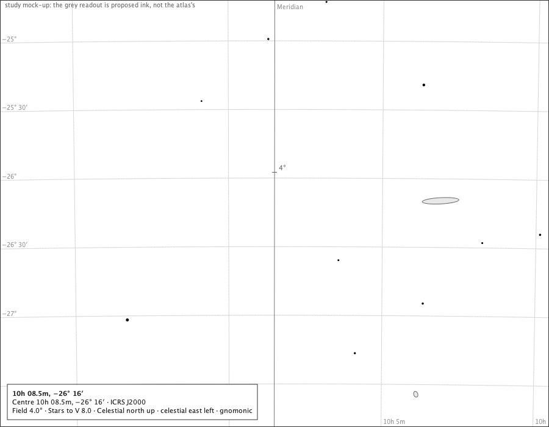
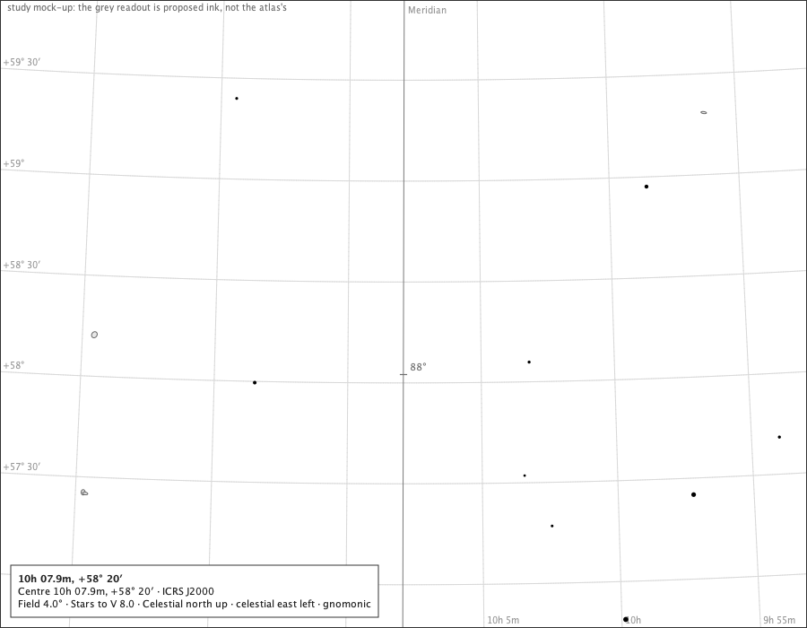
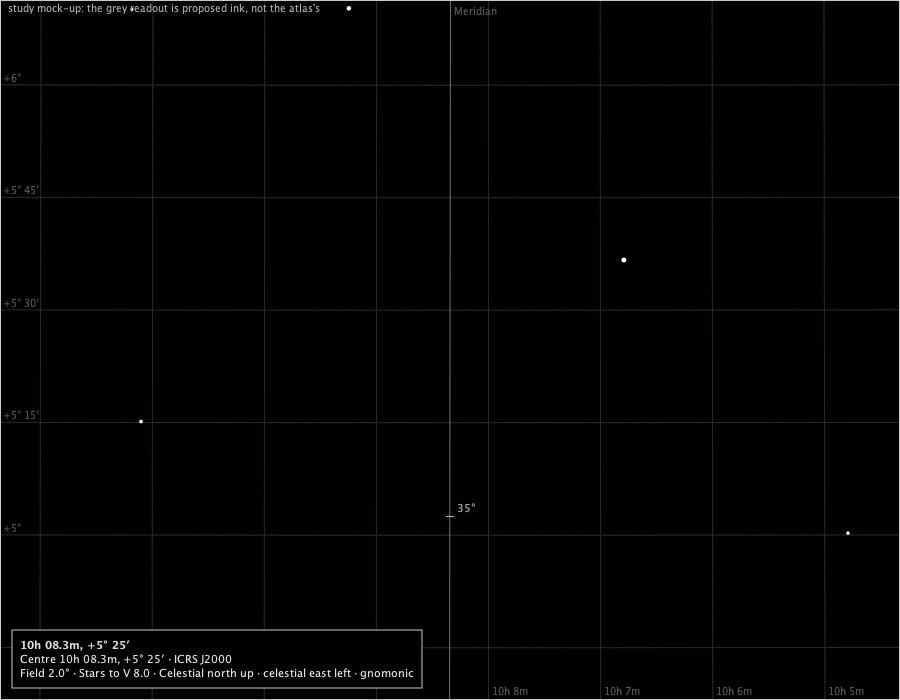
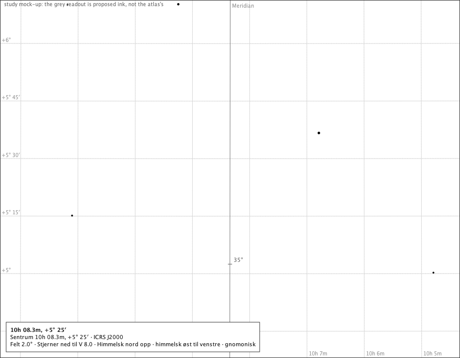

# One altitude readout on the meridian at narrow fields (#563)

Generated by `make meridian-readout-study` (`juranometria.tool.MeridianReadoutStudyMain`). The observer is the stated case of `docs/decisions/place-and-time.md`: Oslo, 59.913 N 10.752 E, 2026-03-20 21:33 UTC. Each page is the production composition - the component with the meridian module attached through the host, the meridian, the mathematical horizon and the ruled 10° ticks on - and the candidate readout is **drawn by this study over it**, in a grey the page never uses, with the figure the page's own words would give. The geometry below is read through the page's own projection: which ruled ticks lie on the page, which altitudes of the meridian the page shows, and where each candidate would stand.

Two candidates (`MeridianReadout`), each stating its altitude with `PageText.altitudeTick`:

- **A, the nearest point:** the visible point of the meridian nearest the page centre, stating its own altitude rounded to the degree (or the half degree).
- **C, the whole degree:** the whole degree of altitude on the visible line nearest the page centre - an exact tick outside the 10° sequence, drawn as a shorter stroke.

## Pages

| page | field | ruled ticks on page | visible altitudes | A: nearest point | C: whole degree | drawn |
|---|---|---|---|---|---|---|
|  south-35-8 (south half at 35.37°, between the 30° and 40° ticks) | 8° | 0 | 32.30°–38.45° | 35.35° at (450.0, 352.2) | 35° at (449.9, 391.6) | C at (449.9, 391.6), figure 35° |
|  south-35-4 (south half at 35.37°, between the 30° and 40° ticks) | 4° | 0 | 33.85°–36.90° | 35.35° at (450.0, 354.5) | 35° at (449.9, 433.2) | C at (449.9, 433.2), figure 35° |
|  south-35-2 (south half at 35.37°, between the 30° and 40° ticks) | 2° | 0 | 34.60°–36.10° | 35.35° at (450.0, 359.0) | 35° at (449.8, 516.5) | C at (449.8, 516.5), figure 35° |
|  south-35-1 (south half at 35.37°, between the 30° and 40° ticks) | 1° | 0 | 35.00°–35.75° | 35.35° at (450.0, 368.0) | 35° at (449.6, 683.0) | C at (449.6, 683.0), figure 35° |
|  north-65-4 (north half at 64.62°, between the 60° and 70° ticks) | 4° | 0 | 63.10°–66.15° | 64.60° at (450.1, 345.5) | 65° at (448.7, 435.5) | C at (448.7, 435.5), figure 65° |
|  south-4-4 (south half at 3.7°, just above the horizon) | 4° | 0 | 2.15°–5.25° | 3.70° at (450.0, 350.0) | 4° at (450.1, 282.5) | C at (450.1, 282.5), figure 4° |
|  south-88-4 (south half at 88.3°, just below the zenith) | 4° | 0 | 86.75°–89.85° | 88.30° at (450.0, 350.0) | 88° at (449.8, 417.5) | C at (449.8, 417.5), figure 88° |
|  south-35-2-dark (black sky) | 2° | 0 | 34.60°–36.10° | 35.35° at (450.0, 359.0) | 35° at (449.8, 516.5) | C at (449.8, 516.5), figure 35° |
|  south-35-2-nb (Norwegian) | 2° | 0 | 34.60°–36.10° | 35.35° at (450.0, 359.0) | 35° at (449.8, 516.5) | C at (449.8, 516.5), figure 35° |

## The geographic pole

At latitude 90° the sky refuses a point on the meridian (IllegalArgumentException): the module draws no ticks there, and a readout has nothing to stand on. The rule inherits the refusal.

## Panning along the line, 4° field, south half

Eight steps of a quarter degree of altitude. What each candidate would state, and how its figure moves: A glides with the centre and its rounded figure changes at each half-degree or degree boundary; C stands at an exact degree and steps to the next whole degree when that comes nearer the centre.

| centre altitude | A: exact | A to the degree | A to the half degree | C: whole degree | C on page |
|---|---|---|---|---|---|
| 35.12° | 35.10° | 35° | 35° | 35° | (450.0, 377.0) |
| 35.37° | 35.35° | 35° | 35.5° | 35° | (449.9, 433.2) |
| 35.62° | 35.60° | 36° | 35.5° | 36° | (450.1, 264.5) |
| 35.87° | 35.85° | 36° | 36° | 36° | (450.0, 320.8) |
| 36.12° | 36.10° | 36° | 36° | 36° | (450.0, 377.0) |
| 36.37° | 36.35° | 36° | 36.5° | 36° | (449.9, 433.2) |
| 36.62° | 36.60° | 37° | 36.5° | 37° | (450.1, 264.5) |
| 36.87° | 36.85° | 37° | 37° | 37° | (450.0, 320.8) |
| 37.12° | 37.10° | 37° | 37° | 37° | (450.0, 377.0) |

## Zooming in on the same point, south half at 35.37°

| field | page height in degrees (approx.) | ruled ticks on page | readout offered | C: whole degree |
|---|---|---|---|---|
| 24° | 18.7° | 2 | no: a ruled tick is on the page | — |
| 12° | 9.3° | 1 | no: a ruled tick is on the page | — |
| 8° | 6.2° | 0 | yes | 35° |
| 6° | 4.7° | 0 | yes | 35° |
| 4° | 3.1° | 0 | yes | 35° |
| 3° | 2.3° | 0 | yes | 35° |
| 2° | 1.6° | 0 | yes | 35° |
| 1° | 0.8° | 0 | yes | 35° |

## What the measurements support

1. **When.** The readout is offered only while the meridian is drawn with its altitude ticks on, a positive-altitude part of it is on the page, and no ruled tick is. The zoom table says at which fields a page centred between two ticks shows neither: the page is 700/900 of its field tall, so the gap first opens below about 13° of field.
2. **Where.** Candidate C stands at an exact whole degree; candidate A at the centre's own point with a rounded figure. Both stand on the visible line, nearest the page centre.
3. **Stability.** Panning moves A continuously and changes its figure at every boundary; C holds its degree and steps once per degree of pan.
4. **Words.** The figure is `PageText.altitudeTick`, the page's own, in both languages; a half-degree figure would write one decimal, as the ticks' contract already allows.
5. **Edges.** Nothing below the horizon; nothing at 90°; refused at the geographic pole.
6. **Ink.** A stroke across the line as the ruled ticks', shorter, and the figure placed by the production placement and refused alone - here only mocked up.
