# The meridian's graduation on production pages (#515)

Generated by `make meridian-ticks-study` (`juranometria.tool.MeridianTicksStudyMain`). The observer is the stated case of `docs/decisions/place-and-time.md`: Oslo, 59.913 N 10.752 E, 2026-03-20 21:33 UTC. Each page is the production composition - the component with the meridian module attached through the host - and every figure below is read from its pixels. The proposal is `MeridianModule.Ticks.PROPOSED`: a tick every 10° of altitude on both halves, the figure beside each. Ninety is the zenith and never a tick; zero is the horizon and never one. Which ticks lie on a page is the sky's and the projection's, the same on every machine, and is stated here; whether a stroke shows through the page's own text and where a figure found room depend on the fonts in front of the rasteriser, and are this machine's record in `platform.md`.

| page | field | half | ticks on page |
|---|---|---|---|
| 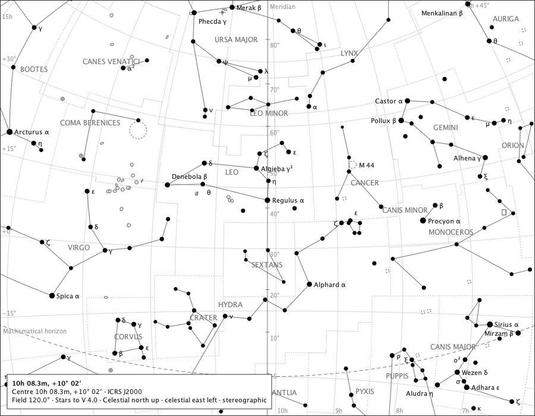 south-120 | 120° | south half | 8 |
|  south-60 | 60° | south half | 5 |
| 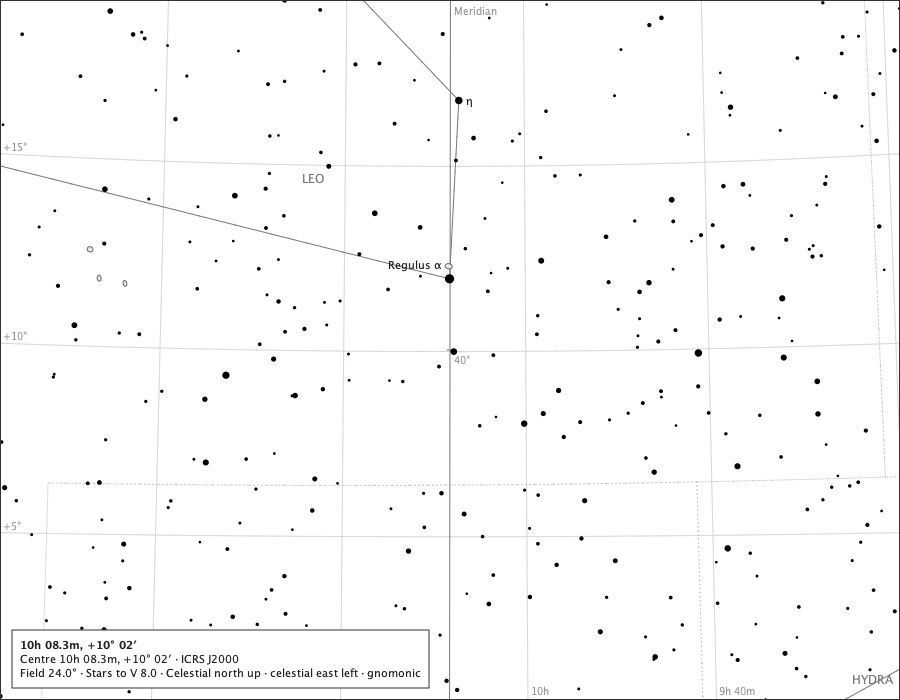 south-24 | 24° | south half | 1 |
| 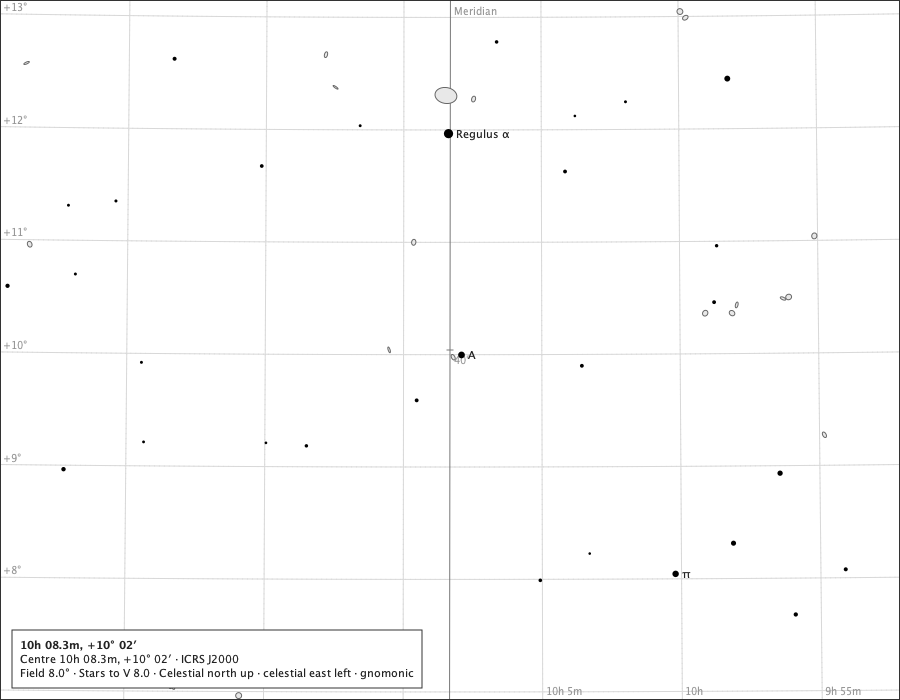 south-8 | 8° | south half | 1 |
| 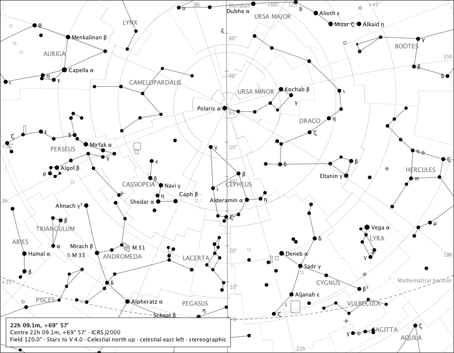 north-120 | 120° | north half | 8 |
| 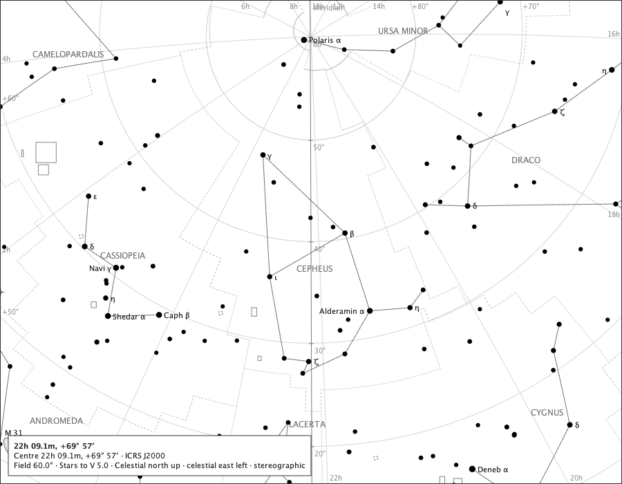 north-60 | 60° | north half | 5 |
| 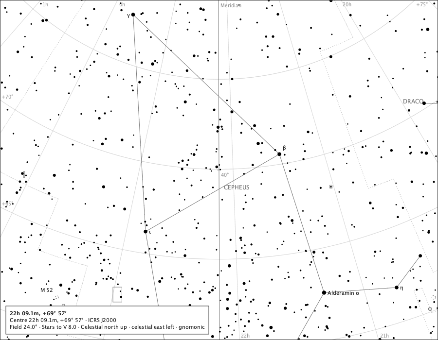 north-24 | 24° | north half | 1 |
| 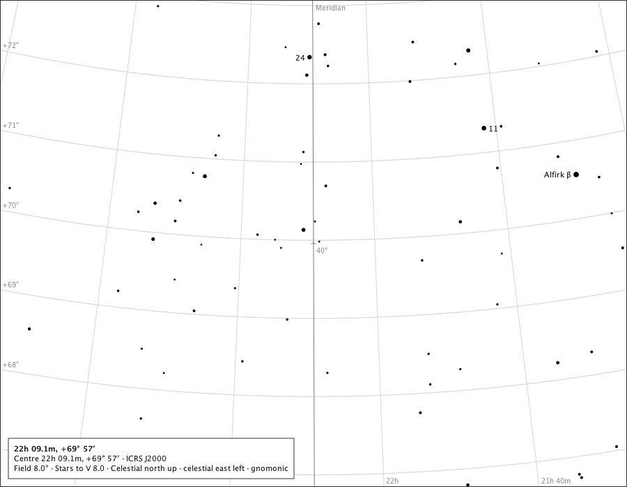 north-8 | 8° | north half | 1 |
| 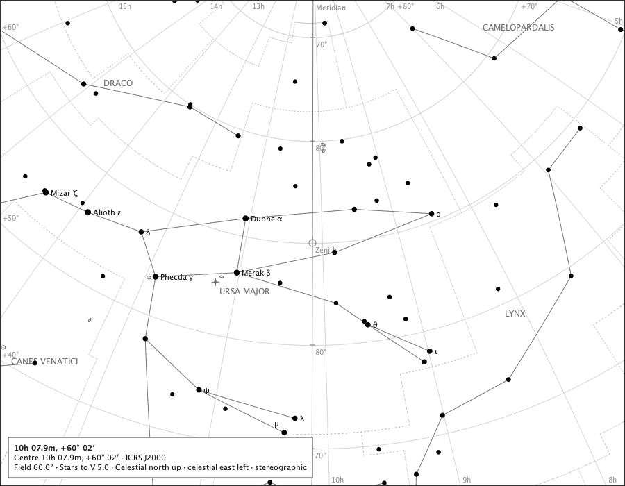 zenith-60 | 60° | both halves, zenith centred | 4 |
| 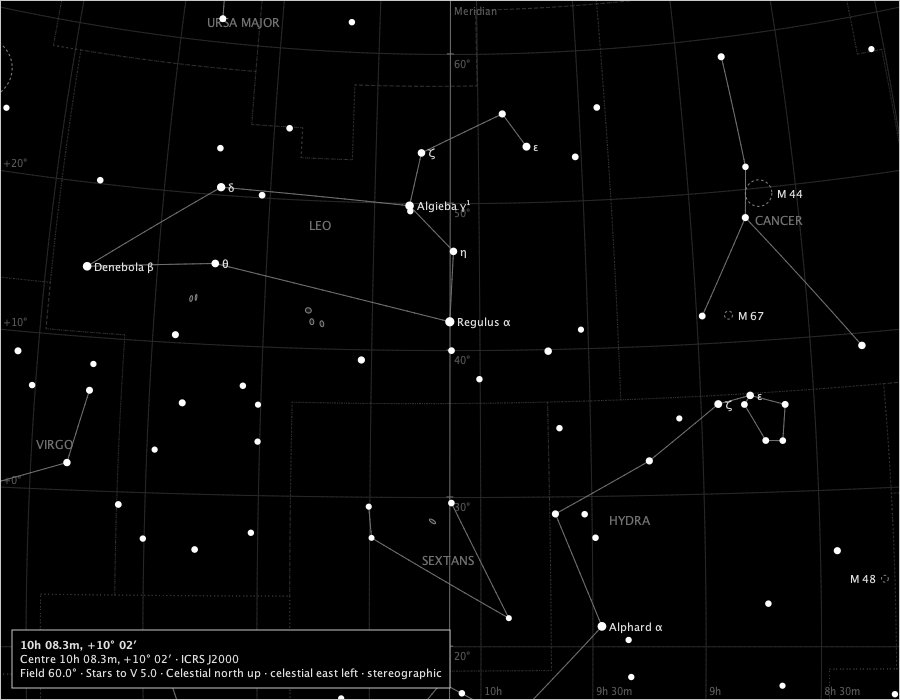 south-60-dark | 60° | south half, black sky | 5 |
| 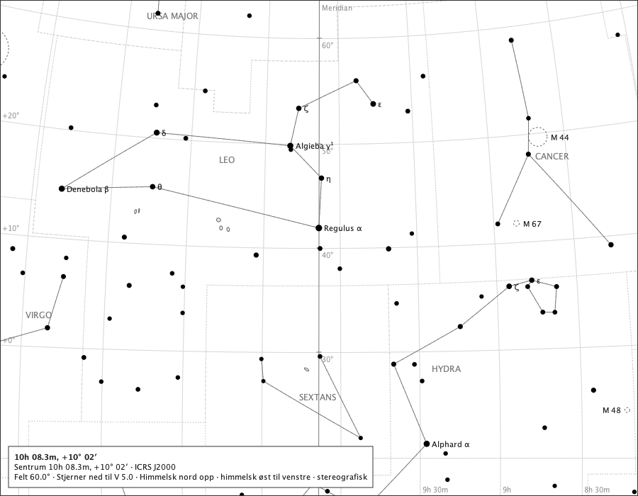 south-60-nb | 60° | south half, Norwegian | 5 |

## Density, for the ruling

The same south-half page at 60°, three graduations. The proposal is the first.

| page | step | figure every | ticks on page |
|---|---|---|---|
|  density-10-10 | 10° | 10° | 5 |
|  density-10-30 | 10° | 30° | 5 |
| 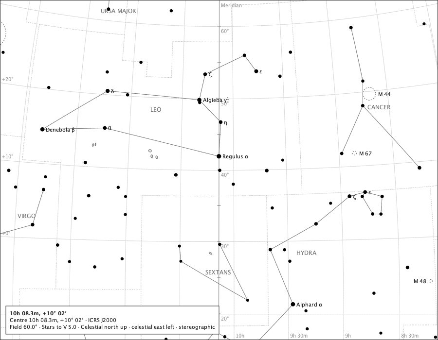 density-5-10 | 5° | 10° | 9 |

## The Solar System bodies are invariant

- centred on the sun at 120° (`bodies-sun-120.png`): 3 bodies drawn - Venus; Sun; Moon; placements identical with the ticks on and off; pixels differ only where the graduation drew, 0 inside a body's disc.
- centred on the moon at 120° (`bodies-moon-120.png`): 3 bodies drawn - Venus; Sun; Moon; placements identical with the ticks on and off; pixels differ only where the graduation drew, 0 inside a body's disc.
- centred on the venus at 120° (`bodies-venus-120.png`): 3 bodies drawn - Venus; Sun; Moon; placements identical with the ticks on and off; pixels differ only where the graduation drew, 0 inside a body's disc.

## Questions for the ruling

1. **The step.** Every 10° (the proposal), or every 5° - the 5° graduation is drawn above, and at 60° its strokes still read as strokes.
2. **The figures.** Beside every tick (the proposal), or every third - the 10°/30° page above shows the sparser lettering.
3. **Behaviour.** The ticks ride the meridian: hidden with it, no shortcut of their own (as the zenith), off at every session start as every observer line is (`PlaceAndTimeSession`); the view report names the choice as `altitude-ticks`. Nothing selects a tick; its figure takes a clean box or is refused, and the sky's own text never moves.
