# Neptune, Triton and Nereid on the page: measurements and mock-ups

Issue #658. What a cartography rule would mean on the atlas's own pages, measured through the production projections and the accepted Neptune service (#655) under the contract ruled on #654 and handed over by #657, with candidate marks drawn by this study over pages the production composition painted, as the Mars (#605) and Uranus (#637) studies did. Nothing here is production rendering; every image is a mock-up and says so in its corner. The closer fields are painted through viewports, as #539 painted them; the ladder still refuses them. Regenerate with `make neptune-cartography-study`.

## A. True scale on every page

Over 1900-2100 (10488 weekly geocentric instants from the service): Neptune's equatorial diameter is 2.18-2.37″ (the most on 2041-10-28), its polar diameter at the tilt never more than 0.040″ smaller; it is never less than 99.9710 % lit (on 2035-07-16), and the dark part of its disc - the diameter times (1 − k) - is at most 0.0007″. The planetocentric tilt reaches 28.38° (on 2004-05-03) and comes within 0.00° of the equator (on 2045-10-09). Over the moons' years (5270 weekly instants, 2000-2100) the moons stand from Neptune's centre: Triton 0.35-16.96″ (the least on 2048-02-15, the most on 2045-11-04), Nereid 2.07-457.63″ (the least on 2008-03-22, the most on 2018-08-25); the largest moon disc is 0.129″. The atlas's smallest star mark is 1.4 px across.

Pixels on the 900 × 700 page at its centre (each field's own projection) - the ladder's fields, then the two closer fields below it; millimetres on the A4 sheet's chart area (272 mm wide).

| field | Neptune px (min-max) | flattening px (max) | dark part px (max) | Triton from Neptune px (min-max) | Nereid from Neptune px (min-max) | Neptune on A4 mm (max) |
|---:|---|---:|---:|---:|---:|---:|
| 180° | 0.00-0.00 | 0.000 | 0.000 | 0.00-0.03 | 0.00-0.70 | 0.001 |
| 120° | 0.00-0.00 | 0.000 | 0.000 | 0.00-0.03 | 0.00-0.86 | 0.001 |
| 90° | 0.01-0.01 | 0.000 | 0.000 | 0.00-0.04 | 0.01-1.21 | 0.002 |
| 60° | 0.01-0.01 | 0.000 | 0.000 | 0.00-0.07 | 0.01-1.86 | 0.003 |
| 42° | 0.01-0.01 | 0.000 | 0.000 | 0.00-0.10 | 0.01-2.60 | 0.004 |
| 36° | 0.01-0.02 | 0.000 | 0.000 | 0.00-0.11 | 0.01-3.07 | 0.005 |
| 24° | 0.02-0.02 | 0.000 | 0.000 | 0.00-0.17 | 0.02-4.70 | 0.007 |
| 18° | 0.03-0.03 | 0.001 | 0.000 | 0.00-0.23 | 0.03-6.30 | 0.010 |
| 12° | 0.05-0.05 | 0.001 | 0.000 | 0.01-0.35 | 0.04-9.50 | 0.015 |
| 8° | 0.07-0.07 | 0.001 | 0.000 | 0.01-0.53 | 0.06-14.28 | 0.022 |
| 6° | 0.09-0.10 | 0.002 | 0.000 | 0.01-0.71 | 0.09-19.05 | 0.030 |
| 4° | 0.14-0.15 | 0.003 | 0.000 | 0.02-1.06 | 0.13-28.59 | 0.045 |
| 3° | 0.18-0.20 | 0.003 | 0.000 | 0.03-1.41 | 0.17-38.13 | 0.060 |
| 2° | 0.27-0.30 | 0.005 | 0.000 | 0.04-2.12 | 0.26-57.20 | 0.089 |
| 1° | 0.55-0.59 | 0.010 | 0.000 | 0.09-4.24 | 0.52-114.40 | 0.179 |
| 0.5° (closer) | 1.09-1.18 | 0.020 | 0.000 | 0.17-8.48 | 1.03-228.81 | 0.358 |
| 0.25° (closer) | 2.18-2.37 | 0.040 | 0.001 | 0.35-16.96 | 2.07-457.62 | 0.715 |

## B. Where things become resolvable or separable

**Neptune against the 6 px minimum mark (rule M).** The page scale at its centre is 0.2500 px per arcsecond at 1° and scales with 1/field. Neptune's largest disc would reach 6 px only at 0.099°, its smallest at 0.091° - narrower than every field offered, the closer ones included: **on every page the mark stands for Neptune.**

**The phase and the figure.** The dark part is at most 0.0007 px at 0.25°; on a 6 px mark at k = 0.99971 it is 0.002 px. The flattening is at most 0.040 px at 0.25°. Neither is ever visible: a phased or an oblate mark would draw nothing a reader could see.

**Each moon decided on its own (Mars's R-3, Uranus's R-5).** Over the 5270 weekly geocentric configurations of the moons' years, on each field: behind Neptune, omitted; a moon in front is drawn only on a drawn disc of at least 12 px; a moon whose 3 px symbol comes within 3 px of Neptune's drawn edge is not drawn (at Neptune); and a moon within 6 px of one already drawn is not drawn (collides); priority in front, clear, shadowed, then outward from Neptune. Neptune's drawn disc is the larger of its true disc and the 6 px mark.

The moons' columns and *both* are the geometry alone, Mars's rule: whether a moon's symbol would stand clear of Neptune's drawn mark and of the moon already drawn. The last column is what Jupiter's floor rule draws, on the fields it covers (the normal minimum and narrower), where every moon not behind Neptune is drawn whatever it overlaps: the share of moon places drawn.

| field | Triton clear | Nereid clear | some moon drawn | both drawn | collides | moon places drawn by the floor |
|---:|---:|---:|---:|---:|---:|---:|
| 180° | 0.0 % | 0.0 % | 0.0 % | 0.0 % | 0.0 % | - |
| 120° | 0.0 % | 0.0 % | 0.0 % | 0.0 % | 0.0 % | - |
| 90° | 0.0 % | 0.0 % | 0.0 % | 0.0 % | 0.0 % | - |
| 60° | 0.0 % | 0.0 % | 0.0 % | 0.0 % | 0.0 % | - |
| 42° | 0.0 % | 0.0 % | 0.0 % | 0.0 % | 0.0 % | - |
| 36° | 0.0 % | 0.0 % | 0.0 % | 0.0 % | 0.0 % | - |
| 24° | 0.0 % | 0.0 % | 0.0 % | 0.0 % | 0.0 % | - |
| 18° | 0.0 % | 0.0 % | 0.0 % | 0.0 % | 0.0 % | - |
| 12° | 0.0 % | 18.3 % | 18.3 % | 0.0 % | 0.0 % | - |
| 8° | 0.0 % | 44.8 % | 44.8 % | 0.0 % | 0.0 % | - |
| 6° | 0.0 % | 58.0 % | 58.0 % | 0.0 % | 0.0 % | - |
| 4° | 0.0 % | 71.3 % | 71.3 % | 0.0 % | 0.0 % | - |
| 3° | 0.0 % | 78.4 % | 78.4 % | 0.0 % | 0.0 % | - |
| 2° | 0.0 % | 86.9 % | 86.9 % | 0.0 % | 0.0 % | - |
| 1° | 0.0 % | 95.6 % | 95.6 % | 0.0 % | 0.0 % | 99.9 % |
| 0.5° | 32.8 % | 98.3 % | 99.0 % | 32.1 % | 0.1 % | 99.9 % |
| 0.25° | 91.3 % | 99.3 % | 100.0 % | 90.6 % | 0.1 % | 99.9 % |

A moon's column and *some*/*both* are shares of the weekly configurations; *collides* is a share of all moon places; a moon behind Neptune is drawn in none.

## B2. The moons' brightness against each page's stars

Over the moons' years Horizons gives the moons' apparent magnitudes (the committed `magnitudes-30d-*-geocentric.txt`): Triton 13.43-13.63, Nereid 18.67-18.88. No magnitude is shown for any body (the contract has no authority for one), but a mark on a star chart reads as a star among stars. Each field's page, centred on Neptune at the 2026 opposition, arrives with its field's own limiting magnitude (`ChartViewState.defaultMagnitudeFor`); the reader's control can make it fainter only to V 8, the atlas's faintest step:

| field | the page's limiting magnitude | faintest star drawn | Triton, magnitudes fainter than the faintest star | Nereid, magnitudes fainter than the faintest star |
|---:|---:|---:|---:|---:|
| 180° | 5.0 | 5.00 | 8.4 | 13.7 |
| 120° | 4.0 | 4.00 | 9.4 | 14.7 |
| 90° | 4.0 | 4.00 | 9.4 | 14.7 |
| 60° | 5.0 | 5.00 | 8.4 | 13.7 |
| 42° | 8.0 | 8.00 | 5.4 | 10.7 |
| 36° | 8.0 | 8.00 | 5.4 | 10.7 |
| 24° | 8.0 | 8.00 | 5.4 | 10.7 |
| 18° | 8.0 | 8.00 | 5.4 | 10.7 |
| 12° | 8.0 | 8.00 | 5.4 | 10.7 |
| 8° | 8.0 | 8.00 | 5.4 | 10.7 |
| 6° | 8.0 | 8.00 | 5.4 | 10.7 |
| 4° | 8.0 | 8.00 | 5.4 | 10.7 |
| 3° | 8.0 | 8.00 | 5.4 | 10.7 |
| 2° | 8.0 | 7.98 | 5.4 | 10.7 |
| 1° | 8.0 | 7.98 | 5.4 | 10.7 |
| 0.5° | 8.0 | 7.98 | 5.4 | 10.7 |
| 0.25° | 8.0 | 7.98 | 5.4 | 10.7 |

A positive number: the moon at its brightest is that many magnitudes fainter than the faintest star the page draws. The closer fields reuse the normal minimum field's stars.

## C. The rings

None is drawn or measured here. The contract ruled no ring rows, no ring ink and no ring authority (#654, N-8): the atlas holds no Neptune ring radius to draw at its true size, and none is enlarged without an explicit cartographic ruling.

## D. The frame: each body at its own J2000 place

The chart is drawn in J2000. As for Jupiter, Saturn, Mars and Uranus, each moon is proposed at its own astrometric J2000 place, never at Neptune's place plus the table's apparent-of-date offsets: over the moons' years the two differ by at most 2.317″ (2.32 px at 0.25°).

## E. Mock-ups on the atlas's own pages

Each page is painted by the production renderer over the bundled catalogue. Over it this study draws, from the service's J2000 places: **Neptune by rule M** - the larger of its true equatorial disc and a 6 px mark, unphased and in the page's ink with no colour; **each moon** as a 3 px symbol at its own J2000 place, decided on its own by Mars's rule (section B): filled when clear, filled over a ground ring when in front, an outline when in Neptune's shadow, not drawn when behind; **labels** through the production `LabelPlacement`, each refused alone. Below the horizon the marks take the subdued tone. Where the system is a few pixels across an inset magnifies it - a **study magnification, not a field the atlas offers** - drawing Neptune's true disc rather than the mark, so the moons stand where they truly are.

### The 2026 opposition (Espenak's hour, 2026-09-26 00:00 UTC), from the Earth's centre, 12° field

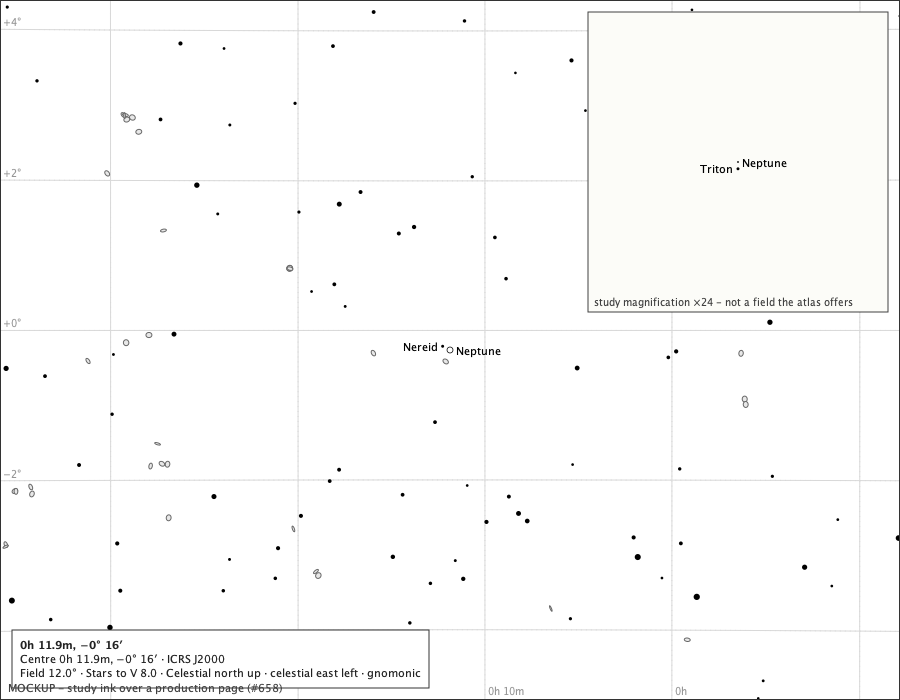

This year's opposition: Triton and Nereid by Mars's rule, the field narrowing. Drawn on the page: Neptune by rule M, true disc 0.05 px, drawn 6.00 px, unphased; Triton at neptune, not drawn; Nereid at (443, 346) clear; Where its labels went on this machine is in `platform.md`.

### The 2026 opposition (Espenak's hour, 2026-09-26 00:00 UTC), from the Earth's centre, 8° field

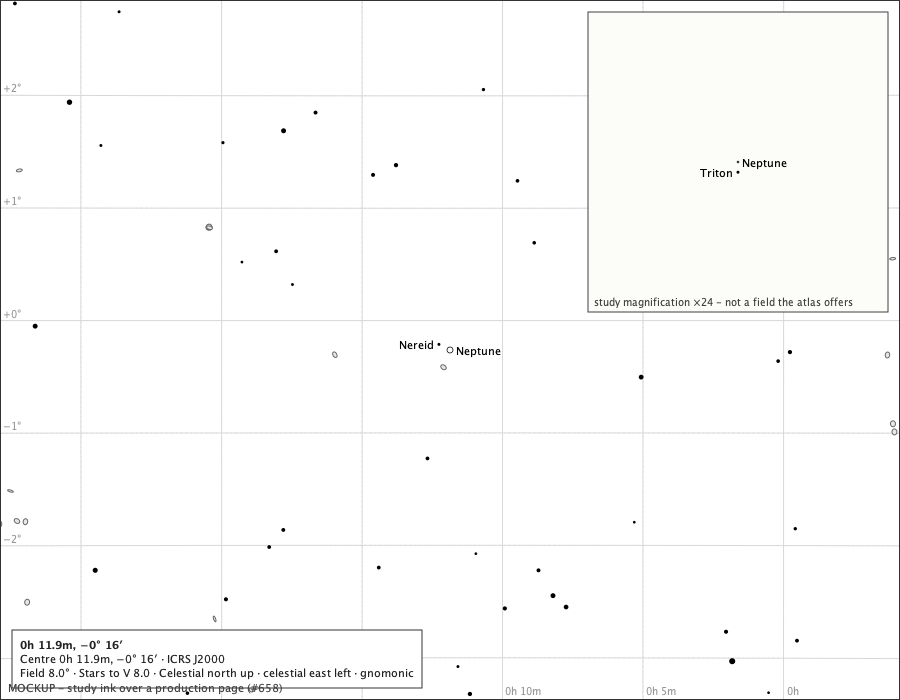

This year's opposition: Triton and Nereid by Mars's rule, the field narrowing. Drawn on the page: Neptune by rule M, true disc 0.07 px, drawn 6.00 px, unphased; Triton at neptune, not drawn; Nereid at (439, 344) clear; Where its labels went on this machine is in `platform.md`.

### The 2026 opposition (Espenak's hour, 2026-09-26 00:00 UTC), from the Earth's centre, 2° field

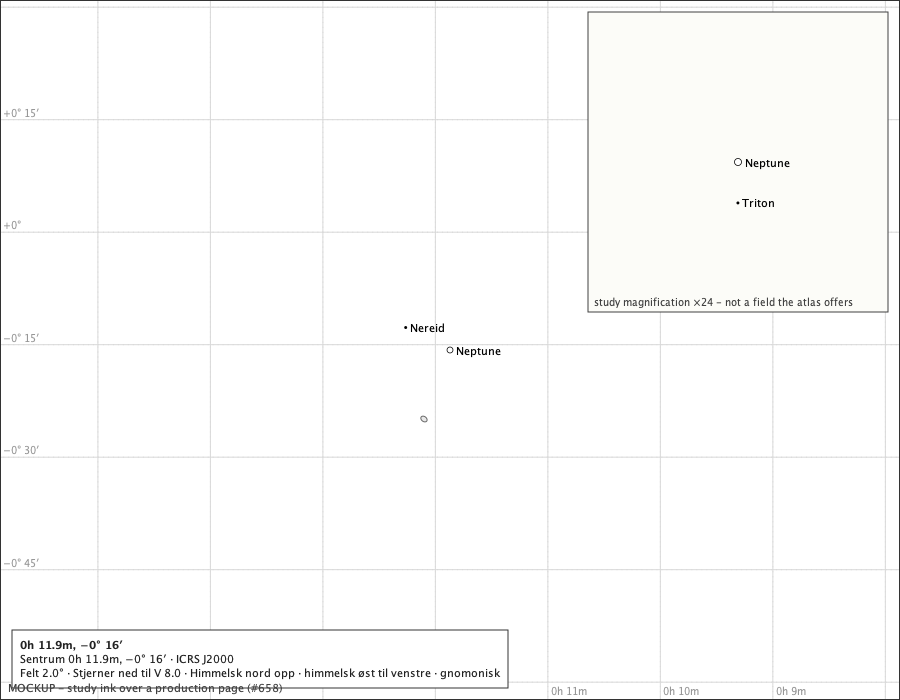

This year's opposition: Triton and Nereid by Mars's rule, the field narrowing. Drawn on the page: Neptune by rule M, true disc 0.30 px, drawn 6.00 px, unphased; Triton at neptune, not drawn; Nereid at (406, 328) clear; Where its labels went on this machine is in `platform.md`.

### The 2026 opposition (Espenak's hour, 2026-09-26 00:00 UTC), from the Earth's centre, 1° field

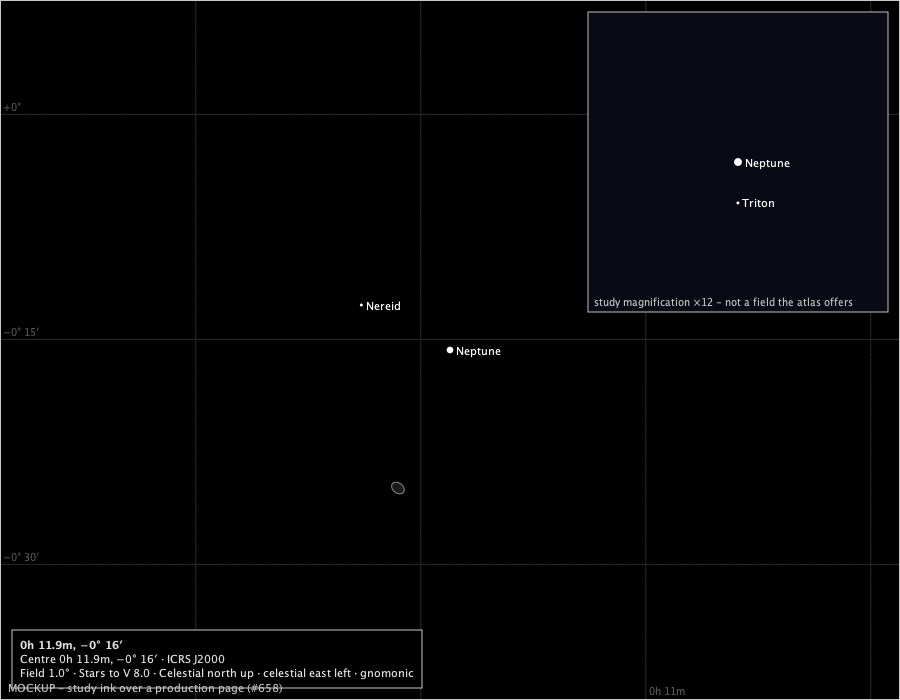

This year's opposition: Triton and Nereid by Mars's rule, the field narrowing. Drawn on the page: Neptune by rule M, true disc 0.59 px, drawn 6.00 px, unphased; Triton at neptune, not drawn; Nereid at (361, 305) clear; Where its labels went on this machine is in `platform.md`.

### The 2026 opposition (Espenak's hour, 2026-09-26 00:00 UTC), from the Earth's centre, 0.5° field

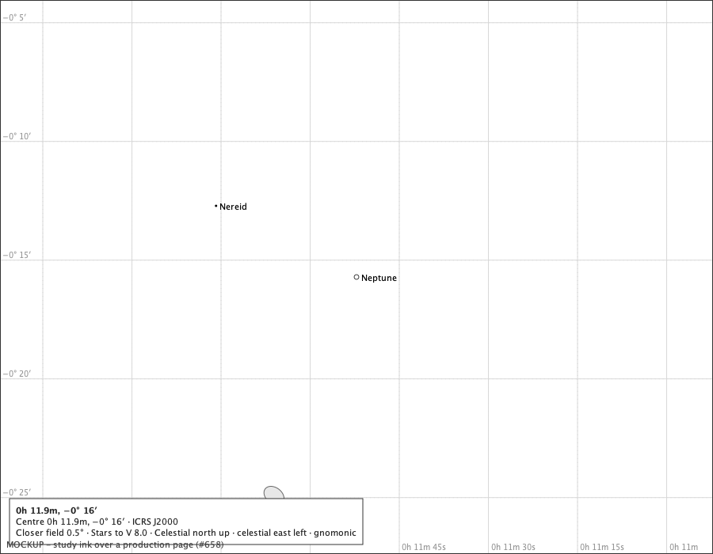

This year's opposition: Triton and Nereid by Mars's rule, the field narrowing. Drawn on the page: Neptune by rule M, true disc 1.18 px, drawn 6.00 px, unphased; Triton at neptune, not drawn; Nereid at (273, 260) clear; Where its labels went on this machine is in `platform.md`.

### The 2026 opposition (Espenak's hour, 2026-09-26 00:00 UTC), from the Earth's centre, 0.25° field

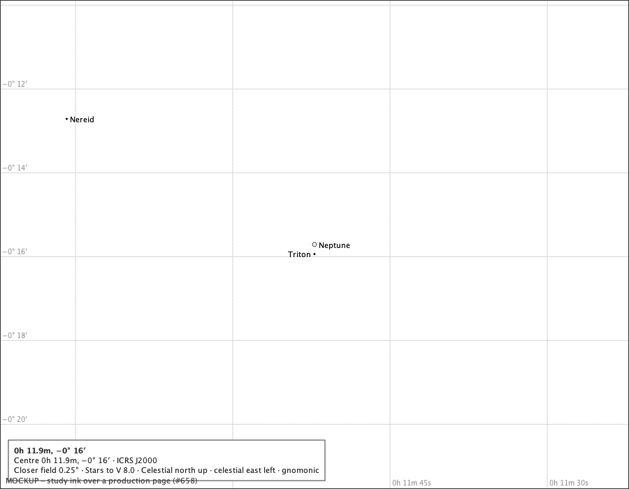

This year's opposition: Triton and Nereid by Mars's rule, the field narrowing. Drawn on the page: Neptune by rule M, true disc 2.36 px, drawn 6.00 px, unphased; Triton at (450, 364) clear; Nereid at (95, 170) clear; Where its labels went on this machine is in `platform.md`.

### Neptune at its largest (2041-10-28), from the Earth's centre, 0.25° field

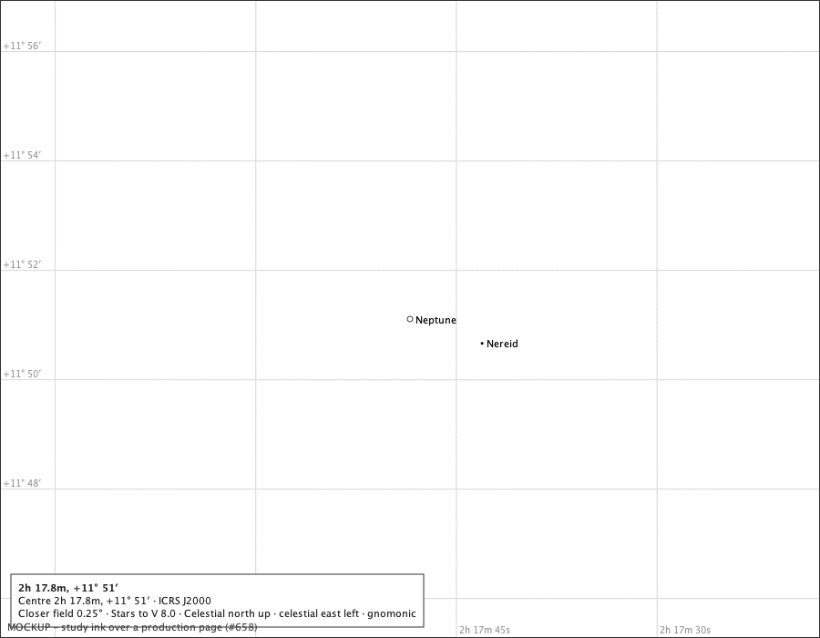

The century's largest disc, still inside the 6 px mark. Drawn on the page: Neptune by rule M, true disc 2.37 px, drawn 6.00 px, unphased; Triton at neptune, not drawn; Nereid at (529, 377) clear; Where its labels went on this machine is in `platform.md`.

### Triton at its widest (2045-11-04), from the Earth's centre, 1° field

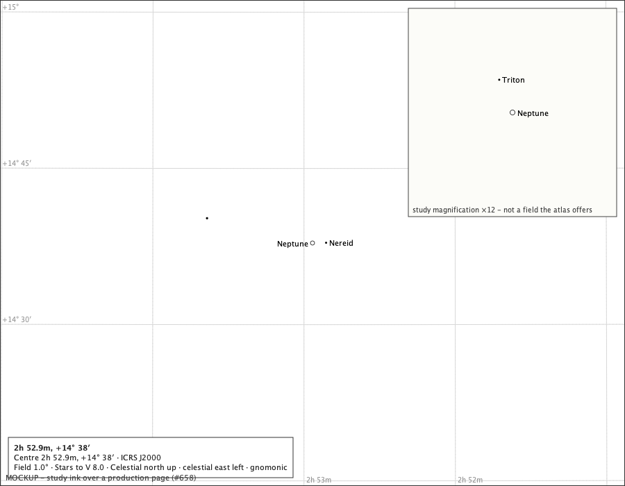

Triton's greatest separation on the ladder's narrowest field. Drawn on the page: Neptune by rule M, true disc 0.59 px, drawn 6.00 px, unphased; Triton at neptune, not drawn; Nereid at (470, 350) clear; Where its labels went on this machine is in `platform.md`.

### Triton at its widest (2045-11-04), from the Earth's centre, 0.25° field

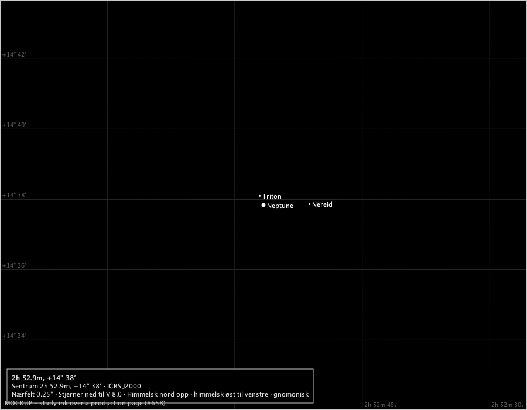

The widest Triton ever stands on a page. Drawn on the page: Neptune by rule M, true disc 2.37 px, drawn 6.00 px, unphased; Triton at (444, 334) clear; Nereid at (528, 349) clear; Where its labels went on this machine is in `platform.md`.

### Nereid at its widest (2018-08-25), from the Earth's centre, 12° field

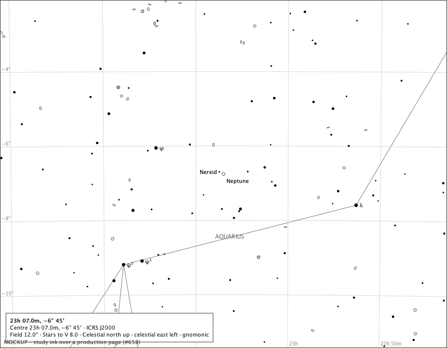

Nereid clear of Neptune even on a wide field, among stars far brighter than it (section B2). Drawn on the page: Neptune by rule M, true disc 0.05 px, drawn 6.00 px, unphased; Triton at neptune, not drawn; Nereid at (442, 346) clear; Where its labels went on this machine is in `platform.md`.

### Nereid at its widest (2018-08-25), from the Earth's centre, 1° field

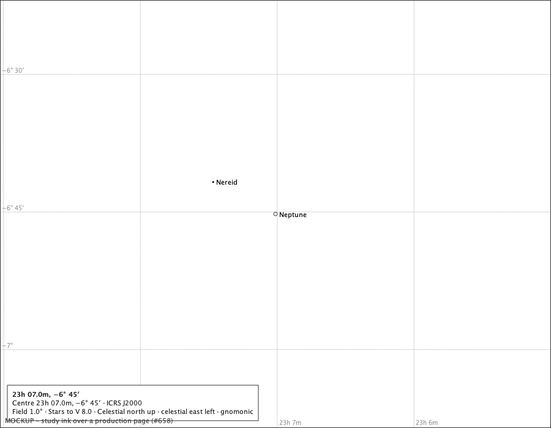

At 1° Nereid stands far from Neptune's mark, a moon among the field's stars. Drawn on the page: Neptune by rule M, true disc 0.59 px, drawn 6.00 px, unphased; Triton at neptune, not drawn; Nereid at (348, 298) clear; Where its labels went on this machine is in `platform.md`.

### Nereid at its nearest (2008-03-22), from the Earth's centre, 0.25° field

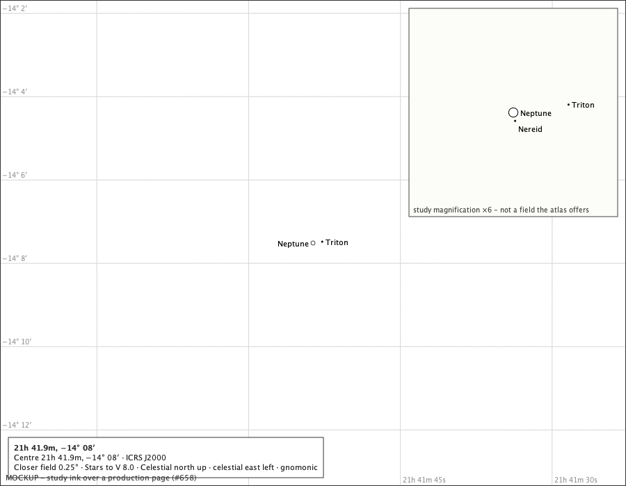

At its least separation Nereid stands on Neptune's mark even at 0.25°; the inset shows where. Drawn on the page: Neptune by rule M, true disc 2.22 px, drawn 6.00 px, unphased; Triton at (463, 348) clear; Nereid at neptune, not drawn; Where its labels went on this machine is in `platform.md`.

### The 2026 conjunction (Espenak's hour, 2026-03-22 10:00 UTC), Oslo, 3° field, with the Sun

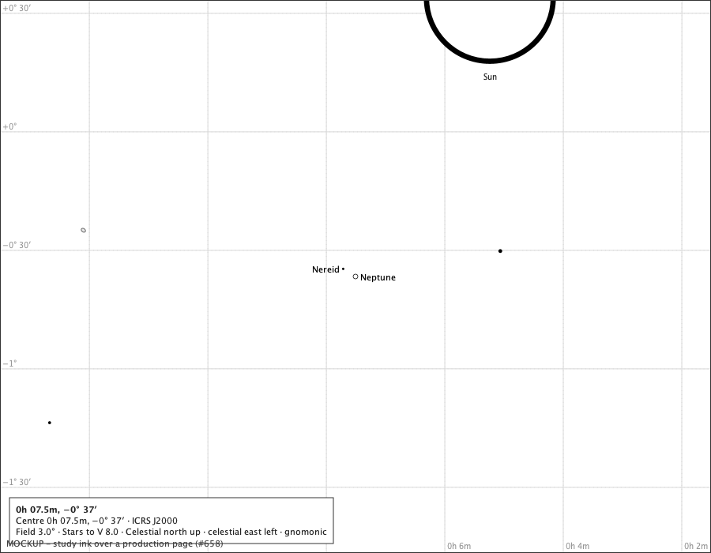

At the published hour Neptune is 1.31° from the Sun's centre - the conjunction is in ecliptic longitude - so the mark stands beside the production Sun, not behind it; only inside the Sun's disc would the Sun cover it. Drawn on the page: Neptune by rule M, true disc 0.18 px, drawn 6.00 px, unphased; Triton at neptune, not drawn; Nereid at (434, 340) clear; Where its labels went on this machine is in `platform.md`.

### Triton in front of Neptune (Horizons t, 2043-09-07), Oslo, 0.25° field

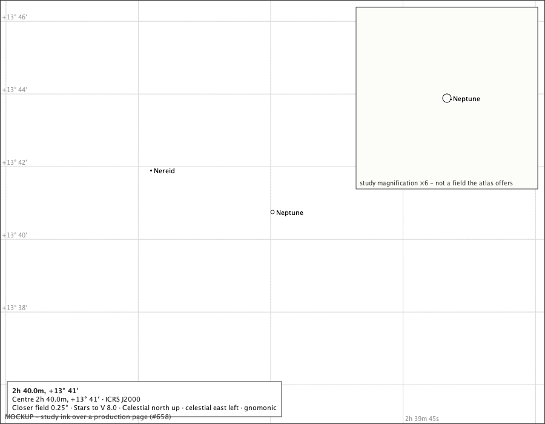

In transit, on a disc far too small to show it: unresolved by rule on the page; the inset shows the symbol over its ground ring on the true disc. Drawn on the page: Neptune by rule M, true disc 2.33 px, drawn 6.00 px, unphased; Triton in front unresolved, not drawn; Nereid at (250, 282) clear; Where its labels went on this machine is in `platform.md`.

### Triton behind Neptune in its shadow (Horizons U, 2044-09-26), Oslo, 0.25° field

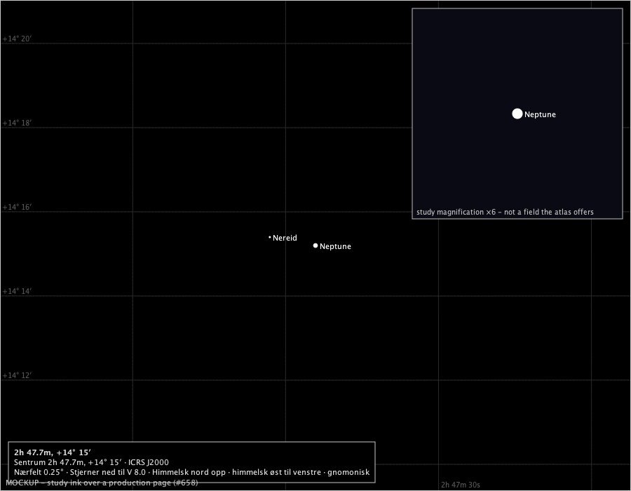

A moon behind Neptune is not drawn, on the page or in the inset; its state is spoken, never drawn. Drawn on the page: Neptune by rule M, true disc 2.35 px, drawn 6.00 px, unphased; Triton behind, not drawn; Nereid at (385, 338) clear; Where its labels went on this machine is in `platform.md`.

### Neptune before the moons' years (1999-12-31 23:00 UTC), from the Earth's centre, 1° field

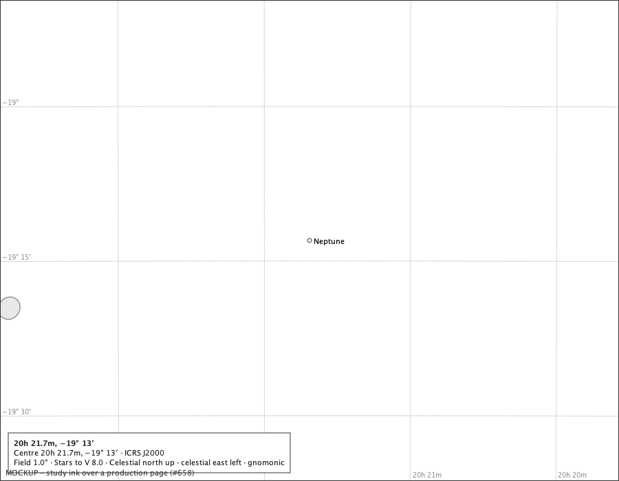

Neptune alone, as the table shows it. Drawn on the page: Neptune by rule M, true disc 0.55 px, drawn 6.00 px, unphased; the moons not computed at this instant (2000-2100 only); Where its labels went on this machine is in `platform.md`.

### Neptune below the horizon (2026-10-29 12:00 UTC), Oslo, 8° field, the horizon drawn

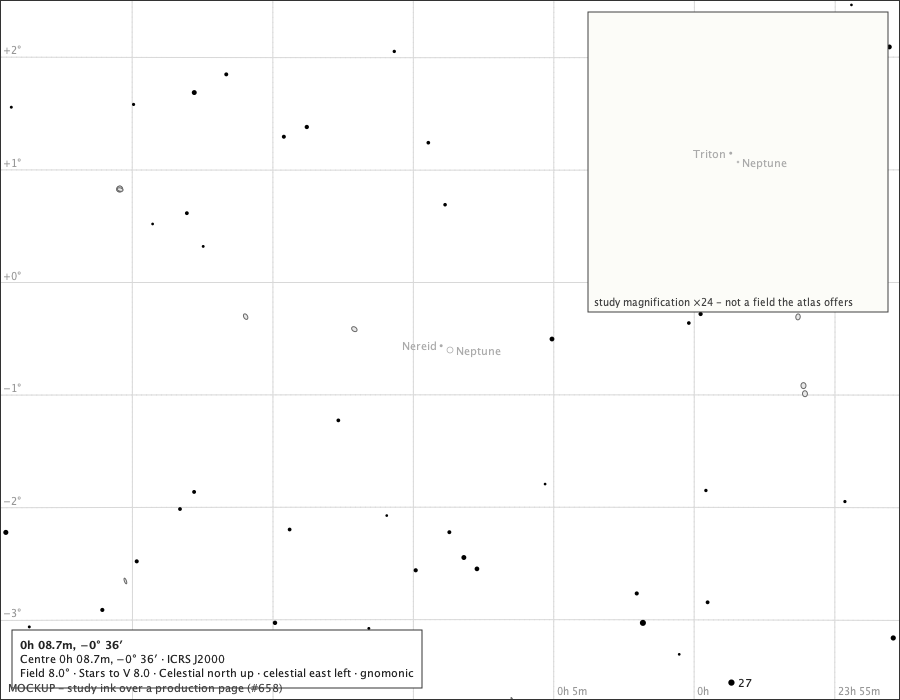

Below the drawn horizon the marks and labels take the subdued tone (#615). Drawn on the page: Neptune by rule M, true disc 0.07 px, drawn 6.00 px, unphased, below the horizon; Triton at neptune, not drawn; Nereid at (441, 346) clear; Where its labels went on this machine is in `platform.md`.

### The 2026 opposition on the A4 sheet's chart area at 150 dpi (1754 × 1090 px), 1° field

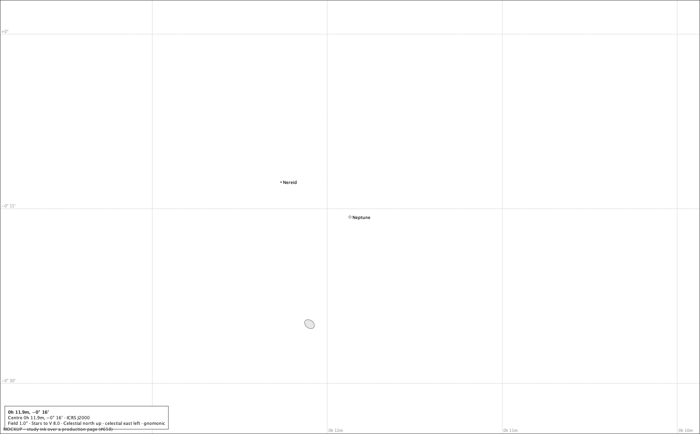

On paper at 1°. Drawn on the page: Neptune by rule M, true disc 1.15 px, drawn 6.00 px, unphased; Triton at neptune, not drawn; Nereid at (704, 457) clear; Where its labels went on this machine is in `platform.md`.

## F. What the measurements support

1. **Rule M, the mark always.** Neptune's true disc never reaches the 6 px mark on any field offered, the closer ones included (section B).
2. **Unphased, round, no colour**, as Uranus's: the dark part and the flattening are fractions of a pixel even at 0.25° (section B).
3. **The pole and tilt are not drawn**; the table gives both in numbers.
4. **No rings** (section C, N-8).
5. **Triton by Mars's rule** (section B): drawn only where its symbol stands clear of Neptune's mark, which happens from 1° in.
6. **Nereid is the new question** (sections B and B2): by Mars's rule alone it stands clear on most pages at every field, among stars several magnitudes brighter.
7. **Jupiter's vocabulary A**, with Neptune's name; no shadow on Neptune.
8. **Selection and Centre on chart** for Neptune as for the other planets; the moons not selectable, as Mars's and Uranus's.
9. **The closer fields** are where Triton separates at all but its widest weeks (section B).
10. **Below the horizon, black sky, Norwegian and paper** as every body's (#615, #526).
11. **The split:** Neptune (the mark) first, then the moons.

