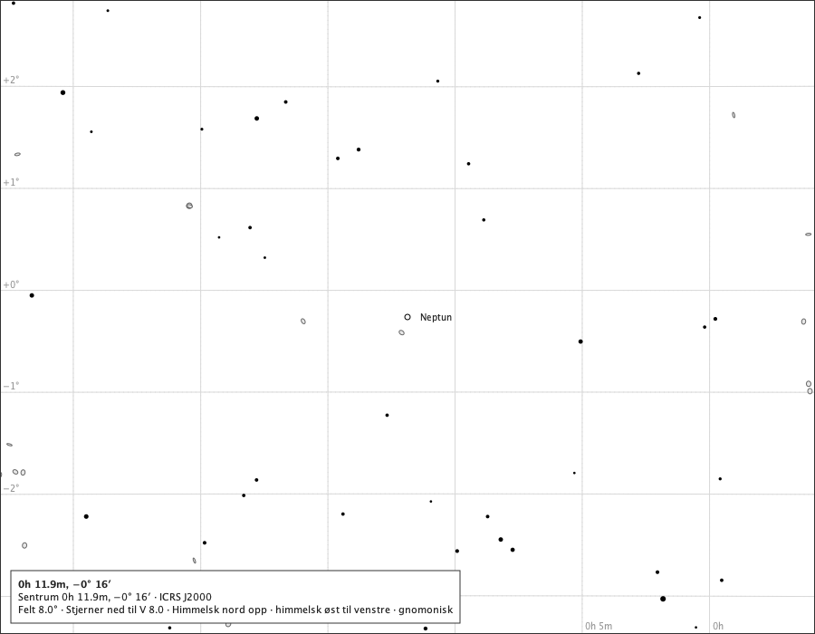
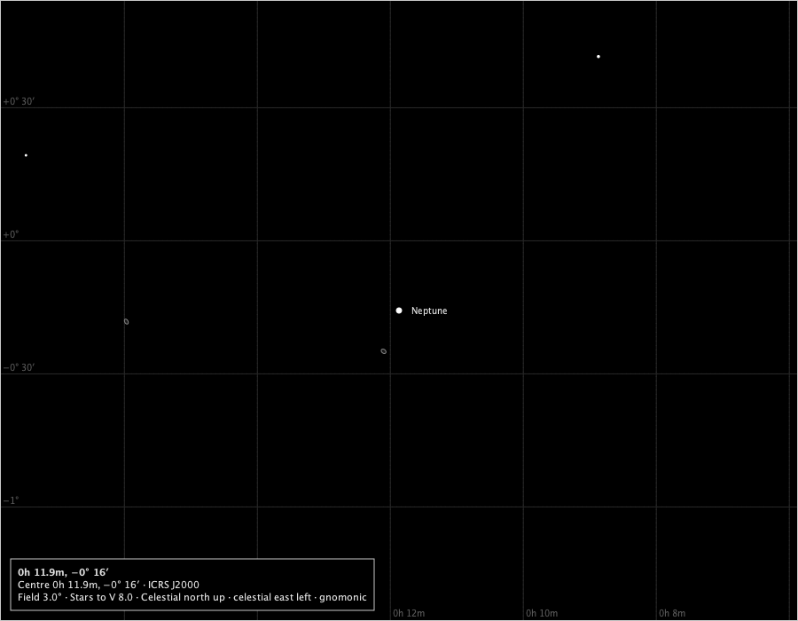
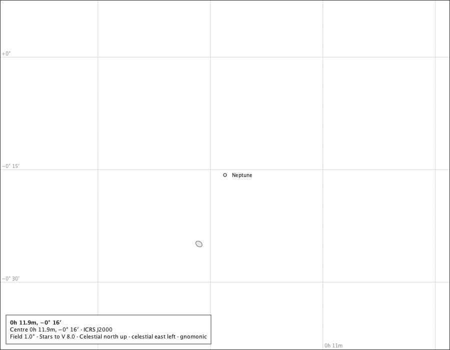
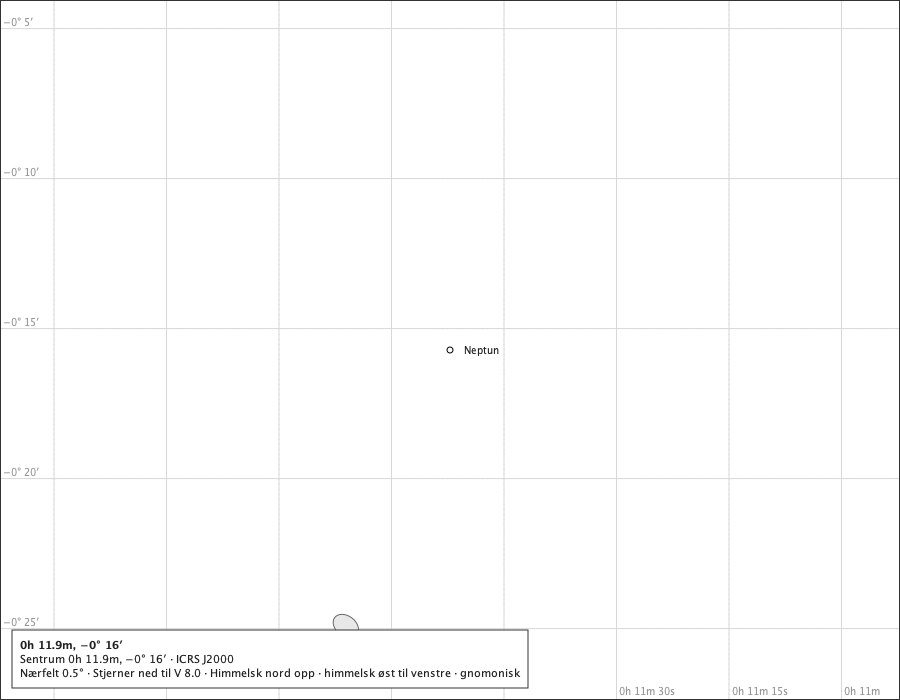
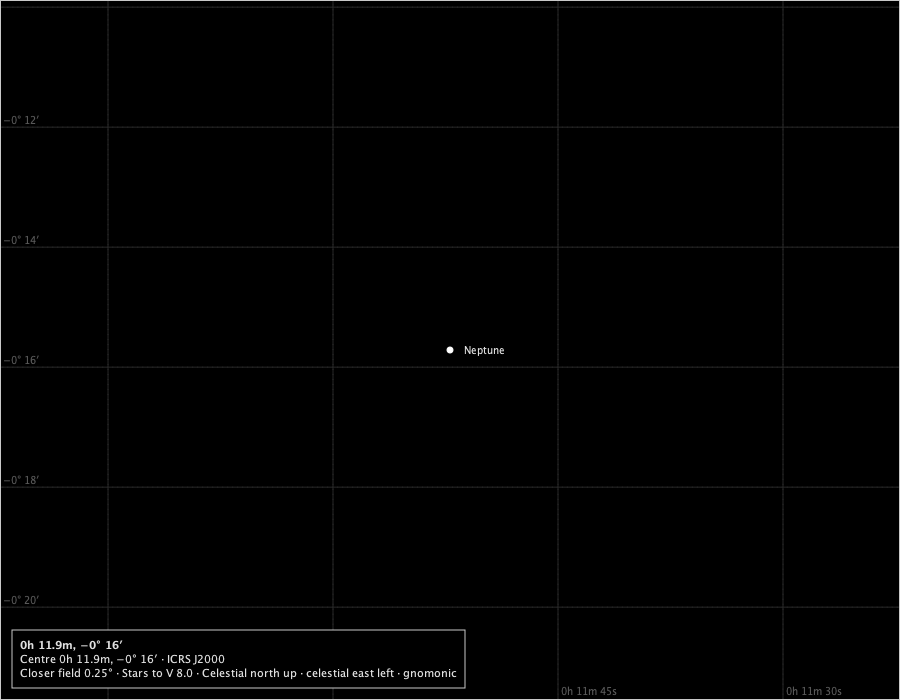
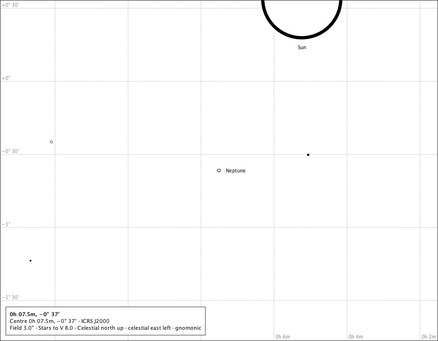
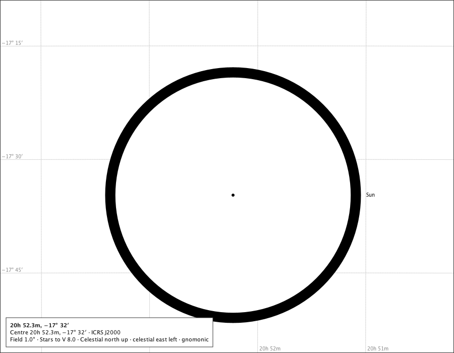
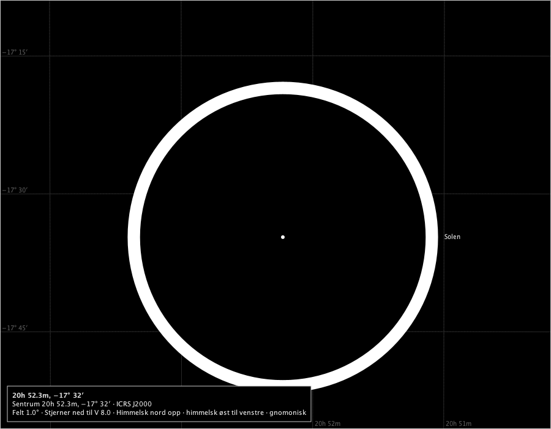

# Neptune on the chart

Issue #659, part 1. The production composition - `ChartComponent` over the bundled catalogue, with the Solar System module attached and Neptune switched on - under the rulings on #658: rule M with the 6 px mark always standing in (R-1), drawn full and round with no colour (R-2), the pole not drawn and no rings (R-3, R-4), the planet selectable and pointed at as an occurrence (R-9), eligible for the closer fields (R-8), on screen and on paper as the other bodies (R-10). The moons are not drawn: they are part 2 (R-6a, R-11). The instants are Espenak's rows in `docs/studies/neptune-system/neptune-events.txt`; positions are the service's for Oslo at sea level. Regenerate with `make neptune-on-the-chart-study`.

## The 2026 opposition, 2026-09-26T00:00:00Z, Oslo

The service: 2.36″ across, 100.000 % lit (phase angle 0.05°), tilt -18.9°, 178.6° from the Sun.

### 8°, the page's words in Norwegian (the page's field 8°)

The true disc is a tenth of a pixel at 8°: the 6 px mark stands in, and the page calls it a symbol. Drawn: Neptun at (450.0, 350.0), symbol 6.0 px, name placed; Spoken: 0h 11.9m, −0° 16′. Sentrum RA 2.9675, Dec -0.2619 (ICRS J2000). Felt 8.0 grader bredt, gnomonisk projeksjon. Stjerner ned til V 8.0. Himmelsk nord er opp, og himmelsk øst er til venstre. Neptun (et kartografisk symbol, ikke Neptuns tilsynelatende diameter).

### 3° on the black sky (the page's field 3°)

The mark in the black sky's star ink; no colour (R-2). Drawn: Neptune at (450.0, 350.0), symbol 6.0 px, name placed; Spoken: Neptune (a cartographic symbol, not Neptune's apparent diameter).

### The minimum field, 1° (the page's field 1°)

Under a pixel even at the minimum field: still the mark. Drawn: Neptune at (450.0, 350.0), symbol 6.0 px, name placed; Spoken: Neptune (a cartographic symbol, not Neptune's apparent diameter).

### The 0.5° closer field, in Norwegian (the page's field 0.5°)

Reached by zooming in from 1°, as the application offers it with Neptune on the page (R-8). Drawn: Neptun at (450.0, 350.0), symbol 6.0 px, name placed; Spoken: 0h 11.9m, −0° 16′. Sentrum RA 2.9675, Dec -0.2619 (ICRS J2000). Nærfelt 0.5 grader bredt, gnomonisk projeksjon. Stjerner ned til V 8.0. Himmelsk nord er opp, og himmelsk øst er til venstre. Neptun (et kartografisk symbol, ikke Neptuns tilsynelatende diameter).

### The 0.25° closer field on the black sky (the page's field 0.25°)

Under 4 px even here: the mark still stands in (R-1). Drawn: Neptune at (450.0, 350.0), symbol 6.0 px, name placed; Spoken: Neptune (a cartographic symbol, not Neptune's apparent diameter).

Measured inside the mark's outline at 0.25°: 12 of 12 pixels in the lit tone, against k = 100.000 %. The mark is drawn full (R-2).

## The 2026 conjunction, Oslo, with the Sun: beside it

The service: 2.21″ across, 100.000 % lit (phase angle 0.04°), tilt -19.4°, 1.3° from the Sun. The conjunction is in ecliptic longitude: the mark stands beside the Sun's disc, not behind it.

### At 3° (the page's field 3°)

The mark beside the production Sun, a degree and more from its centre; nothing covers it and the page states no Sun relation. Drawn: Neptune at (450.0, 350.0), symbol 6.0 px, name placed; Sun at (620.0, -2.7), disc 160.5 px, name placed; Spoken: Neptune (a cartographic symbol, not Neptune's apparent diameter). Sun.

## The 2003 conjunction, Oslo, with the Sun: behind it

The service: 2.20″ across, 100.000 % lit (phase angle 0.00°), tilt -28.2°, 0.0° from the Sun. Its disc meets the Sun's: behind the Sun.

### At 1° (the page's field 1°)

The mark laid beneath the stars and covered by the Sun's ground-filled disc; the page says *behind the Sun* (#514). Drawn: Neptune at (450.0, 350.0), symbol 6.0 px, state neptune.behind, name refused; Sun at (462.0, 386.9), disc 486.8 px, name placed; Spoken: Neptune, behind the Sun (a cartographic symbol, not Neptune's apparent diameter). Sun.

### At 1°, in Norwegian on the black sky (the page's field 1°)

The same, spoken in Norwegian. Drawn: Neptun at (450.0, 350.0), symbol 6.0 px, state neptune.behind, name refused; Solen at (462.0, 386.9), disc 486.8 px, name placed; Spoken: 20h 52.3m, −17° 32′. Sentrum RA 313.0708, Dec -17.5378 (ICRS J2000). Felt 1.0 grader bredt, gnomonisk projeksjon. Stjerner ned til V 8.0. Himmelsk nord er opp, og himmelsk øst er til venstre. Neptun, bak Solen (et kartografisk symbol, ikke Neptuns tilsynelatende diameter). Solen.

## Outside the years

At 1899-12-31T12:00:00Z - before the Neptune System pack's first day, 1900-01-01 - the module draws nothing for Neptune: 0 bodies drawn, and the page says nothing of it.

