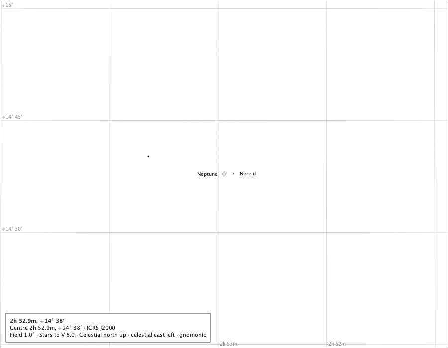
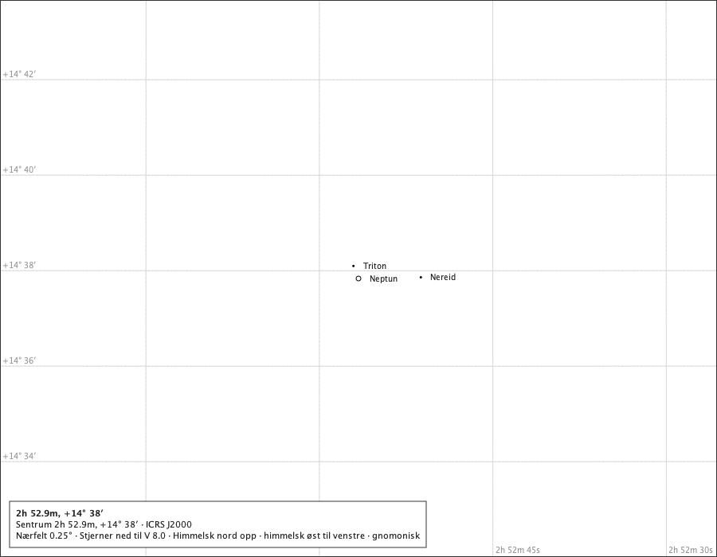
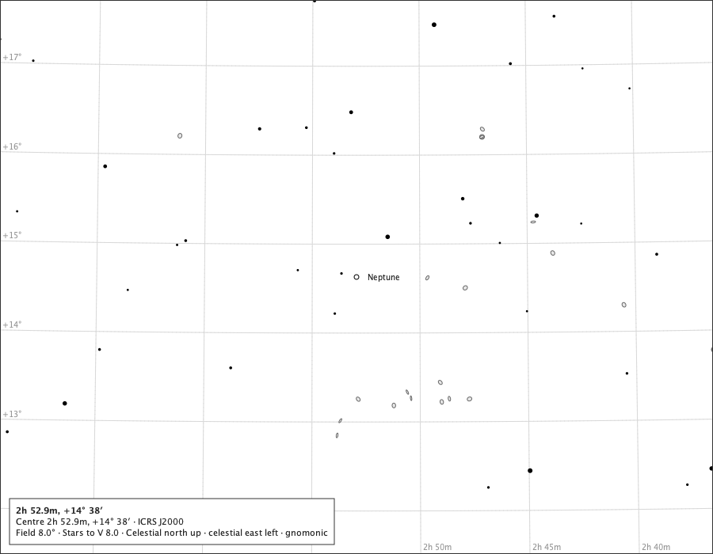
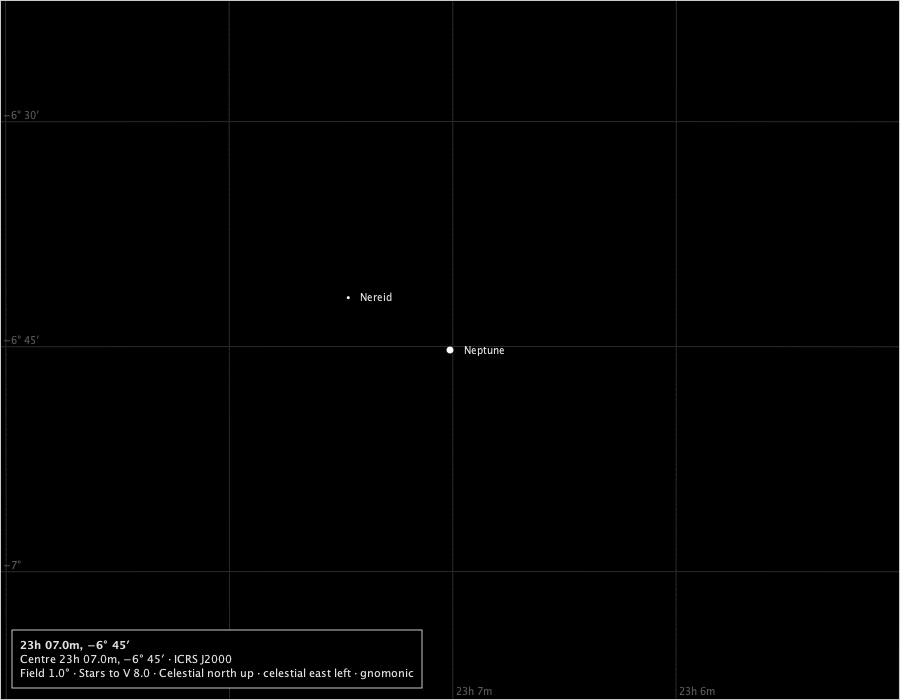
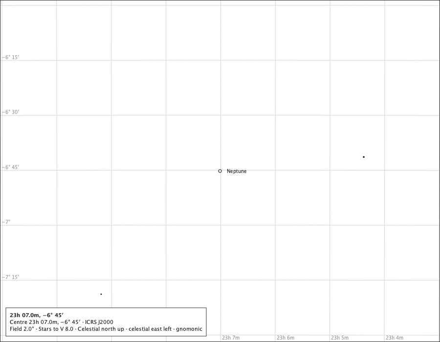
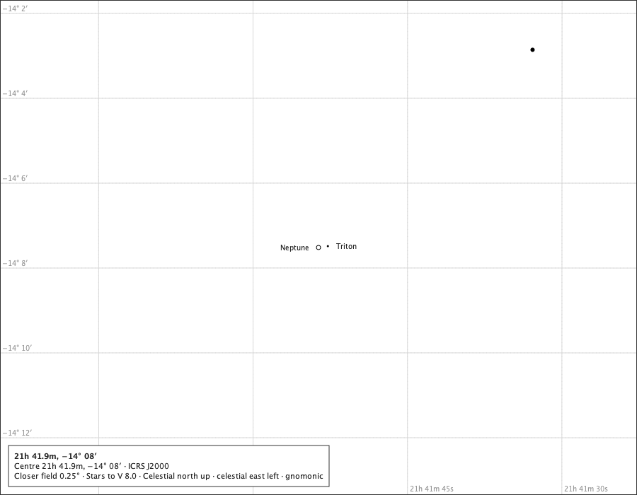
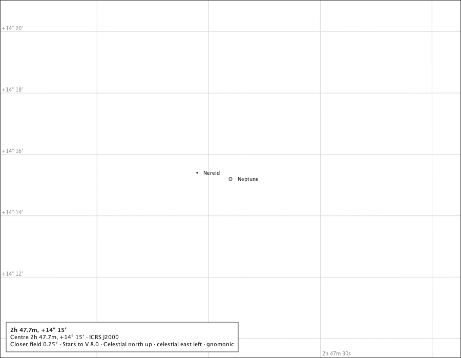
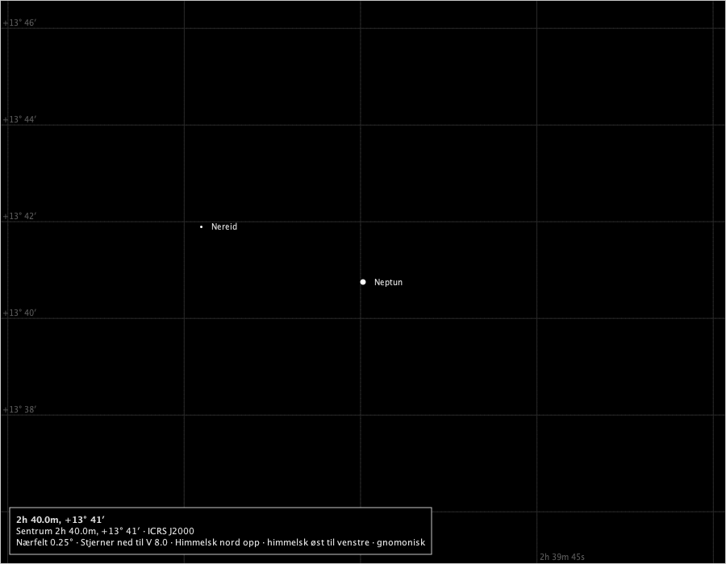
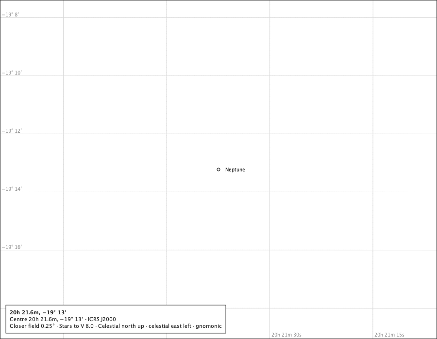

# Neptune on the chart

Issue #659, parts 1 and 2. The production composition - `ChartComponent` over the bundled catalogue, with the Solar System module attached and Neptune switched on - under the rulings on #658: rule M with the 6 px mark always standing in (R-1), drawn full and round with no colour (R-2), the pole not drawn and no rings (R-3, R-4), the planet selectable and pointed at as an occurrence (R-9), eligible for the closer fields (R-8), on screen and on paper as the other bodies (R-10). Since part 2 Triton and Nereid are drawn as 3 px symbols at their own J2000 places, offered only at the 1° field and the closer fields, each there only where it stands clear of Neptune's mark and of the other moon (R-5, R-6a); on wider fields no moon is drawn or spoken; a moon behind, in transit or too close is not drawn and the page says so; none is selectable (R-9). The instants are Espenak's rows in `docs/studies/neptune-system/neptune-events.txt`; positions are the service's for Oslo at sea level. Regenerate with `make neptune-on-the-chart-study`.

## The 2026 opposition, 2026-09-26T00:00:00Z, Oslo

The service: 2.36″ across, 100.000 % lit (phase angle 0.05°), tilt -18.9°, 178.6° from the Sun.

### 8°, the page's words in Norwegian (the page's field 8°)

The true disc is a tenth of a pixel at 8°: the 6 px mark stands in, and the page calls it a symbol. Drawn: Neptun at (450.0, 350.0), symbol 6.0 px, name placed; Spoken: 0h 11.9m, −0° 16′. Sentrum RA 2.9675, Dec -0.2619 (ICRS J2000). Felt 8.0 grader bredt, gnomonisk projeksjon. Stjerner ned til V 8.0. Himmelsk nord er opp, og himmelsk øst er til venstre. Neptun (et kartografisk symbol, ikke Neptuns tilsynelatende diameter).

### 3° on the black sky (the page's field 3°)

The mark in the black sky's star ink; no colour (R-2). Drawn: Neptune at (450.0, 350.0), symbol 6.0 px, name placed; Spoken: Neptune (a cartographic symbol, not Neptune's apparent diameter).

### The minimum field, 1° (the page's field 1°)

Under a pixel even at the minimum field: still the mark. Drawn: Neptune at (450.0, 350.0), symbol 6.0 px, name placed; Nereid at (361.4, 305.0), symbol 3.0 px, name placed; Spoken: Neptune (a cartographic symbol, not Neptune's apparent diameter). Nereid (a cartographic symbol, not Nereid's apparent diameter). Triton, too close to tell apart at this field, not drawn.

### The 0.5° closer field, in Norwegian (the page's field 0.5°)

Reached by zooming in from 1°, as the application offers it with Neptune on the page (R-8). Drawn: Neptun at (450.0, 350.0), symbol 6.0 px, name placed; Nereid at (272.7, 260.1), symbol 3.0 px, name placed; Spoken: 0h 11.9m, −0° 16′. Sentrum RA 2.9675, Dec -0.2619 (ICRS J2000). Nærfelt 0.5 grader bredt, gnomonisk projeksjon. Stjerner ned til V 8.0. Himmelsk nord er opp, og himmelsk øst er til venstre. Neptun (et kartografisk symbol, ikke Neptuns tilsynelatende diameter). Nereid (et kartografisk symbol, ikke Nereids tilsynelatende diameter). Triton, for nær til å skjelnes i dette feltet, ikke tegnet.

### The 0.25° closer field on the black sky (the page's field 0.25°)

Under 4 px even here: the mark still stands in (R-1). Drawn: Neptune at (450.0, 350.0), symbol 6.0 px, name placed; Nereid at (95.4, 170.1), symbol 3.0 px, name placed; Triton at (450.0, 363.6), symbol 3.0 px, name placed; Spoken: Neptune (a cartographic symbol, not Neptune's apparent diameter). Nereid (a cartographic symbol, not Nereid's apparent diameter). Triton (a cartographic symbol, not Triton's apparent diameter).

Measured inside the mark's outline at 0.25°: 12 of 12 pixels in the lit tone, against k = 100.000 %. The mark is drawn full (R-2).

## The 2026 conjunction, Oslo, with the Sun: beside it

The service: 2.21″ across, 100.000 % lit (phase angle 0.04°), tilt -19.4°, 1.3° from the Sun. The conjunction is in ecliptic longitude: the mark stands beside the Sun's disc, not behind it.

### At 3° (the page's field 3°)

The mark beside the production Sun, a degree and more from its centre; nothing covers it and the page states no Sun relation. Drawn: Neptune at (450.0, 350.0), symbol 6.0 px, name placed; Sun at (620.0, -2.7), disc 160.5 px, name placed; Spoken: Neptune (a cartographic symbol, not Neptune's apparent diameter). Sun.

## The 2003 conjunction, Oslo, with the Sun: behind it

The service: 2.20″ across, 100.000 % lit (phase angle 0.00°), tilt -28.2°, 0.0° from the Sun. Its disc meets the Sun's: behind the Sun.

### At 1° (the page's field 1°)

The mark laid beneath the stars and covered by the Sun's ground-filled disc; the page says *behind the Sun* (#514). Drawn: Neptune at (450.0, 350.0), symbol 6.0 px, state neptune.behind, name refused; Sun at (462.0, 386.9), disc 486.8 px, name placed; Nereid at (401.5, 330.5), symbol 3.0 px, name refused; Spoken: Neptune, behind the Sun (a cartographic symbol, not Neptune's apparent diameter). Sun. Nereid (a cartographic symbol, not Nereid's apparent diameter). Triton, too close to tell apart at this field, not drawn.

### At 1°, in Norwegian on the black sky (the page's field 1°)

The same, spoken in Norwegian. Drawn: Neptun at (450.0, 350.0), symbol 6.0 px, state neptune.behind, name refused; Solen at (462.0, 386.9), disc 486.8 px, name placed; Nereid at (401.5, 330.5), symbol 3.0 px, name refused; Spoken: 20h 52.3m, −17° 32′. Sentrum RA 313.0708, Dec -17.5378 (ICRS J2000). Felt 1.0 grader bredt, gnomonisk projeksjon. Stjerner ned til V 8.0. Himmelsk nord er opp, og himmelsk øst er til venstre. Neptun, bak Solen (et kartografisk symbol, ikke Neptuns tilsynelatende diameter). Solen. Nereid (et kartografisk symbol, ikke Nereids tilsynelatende diameter). Triton, for nær til å skjelnes i dette feltet, ikke tegnet.

## The moons

### Triton at its widest, 2045-11-04T00:00:00Z, Oslo

### The minimum field, 1° (the page's field 1°)

Even at its widest Triton stands on Neptune's mark at 1°: spoken, not drawn; Nereid where it stands. Drawn: Neptune at (450.0, 350.0), symbol 6.0 px, name placed; Nereid at (469.6, 349.6), symbol 3.0 px, name placed; Spoken: Neptune (a cartographic symbol, not Neptune's apparent diameter). Nereid (a cartographic symbol, not Nereid's apparent diameter). Triton, too close to tell apart at this field, not drawn.

### The 0.25° closer field, in Norwegian (the page's field 0.25°)

Triton clear of the mark at 0.25°. Drawn: Neptun at (450.0, 350.0), symbol 6.0 px, name placed; Nereid at (528.3, 348.5), symbol 3.0 px, name placed; Triton at (443.6, 334.3), symbol 3.0 px, name placed; Spoken: 2h 52.9m, +14° 38′. Sentrum RA 43.2359, Dec +14.6306 (ICRS J2000). Nærfelt 0.25 grader bredt, gnomonisk projeksjon. Stjerner ned til V 8.0. Himmelsk nord er opp, og himmelsk øst er til venstre. Neptun (et kartografisk symbol, ikke Neptuns tilsynelatende diameter). Nereid (et kartografisk symbol, ikke Nereids tilsynelatende diameter). Triton (et kartografisk symbol, ikke Tritons tilsynelatende diameter).

### 8° (the page's field 8°)

A wider field: the moons are not offered (R-6a), so none is drawn and none is spoken. Drawn: Neptune at (450.0, 350.0), symbol 6.0 px, name placed; Spoken: Neptune (a cartographic symbol, not Neptune's apparent diameter).

### Nereid at its widest, 2018-08-25T00:00:00Z, Oslo

### The minimum field, 1° (the page's field 1°)

Nereid far out on the 1° page, among stars at least ten magnitudes brighter; this is the widest field it is ever drawn on. Drawn: Neptune at (450.0, 350.0), symbol 6.0 px, name placed; Nereid at (348.3, 297.7), symbol 3.0 px, name placed; Spoken: Neptune (a cartographic symbol, not Neptune's apparent diameter). Nereid (a cartographic symbol, not Nereid's apparent diameter). Triton, too close to tell apart at this field, not drawn.

### 2° (the page's field 2°)

At 2° Nereid would stand clear, and is not offered: Neptune alone (R-6a). Drawn: Neptune at (450.0, 350.0), symbol 6.0 px, name placed; Spoken: Neptune (a cartographic symbol, not Neptune's apparent diameter).

### Nereid at its nearest, 2008-03-22T00:00:00Z, Oslo

### The 0.25° closer field (the page's field 0.25°)

At its least separation Nereid stands on the mark even at 0.25°: spoken, not drawn. Drawn: Neptune at (450.0, 350.0), symbol 6.0 px, name placed; Triton at (463.2, 348.1), symbol 3.0 px, name placed; Spoken: Neptune (a cartographic symbol, not Neptune's apparent diameter). Triton (a cartographic symbol, not Triton's apparent diameter). Nereid, too close to tell apart at this field, not drawn.

### Triton behind Neptune in its shadow (Horizons U, 2044-09-26)

### The 0.25° closer field (the page's field 0.25°)

Behind: not drawn, and spoken. Drawn: Neptune at (450.0, 350.0), symbol 6.0 px, name placed; Nereid at (384.8, 338.0), symbol 3.0 px, name placed; Spoken: Neptune (a cartographic symbol, not Neptune's apparent diameter). Nereid (a cartographic symbol, not Nereid's apparent diameter). Triton, behind Neptune, not drawn.

### Triton in front of Neptune (Horizons t, 2043-09-07)

### The 0.25° closer field (the page's field 0.25°)

The mark cannot hold a transit: not drawn, and spoken as too close (R-7). Drawn: Neptun at (450.0, 350.0), symbol 6.0 px, name placed; Nereid at (249.5, 281.6), symbol 3.0 px, name placed; Spoken: 2h 40.0m, +13° 41′. Sentrum RA 39.9991, Dec +13.6792 (ICRS J2000). Nærfelt 0.25 grader bredt, gnomonisk projeksjon. Stjerner ned til V 8.0. Himmelsk nord er opp, og himmelsk øst er til venstre. Neptun (et kartografisk symbol, ikke Neptuns tilsynelatende diameter). Nereid (et kartografisk symbol, ikke Nereids tilsynelatende diameter). Triton, for nær til å skjelnes i dette feltet, ikke tegnet.

### Before the moons' years, 1999-12-31T12:00:00Z

### The 0.25° closer field (the page's field 0.25°)

Neptune alone, as the table shows it. Drawn: Neptune at (450.0, 350.0), symbol 6.0 px, name placed; Spoken: Neptune (a cartographic symbol, not Neptune's apparent diameter).

## Outside the years

At 1899-12-31T12:00:00Z - before the Neptune System pack's first day, 1900-01-01 - the module draws nothing for Neptune: 0 bodies drawn, and the page says nothing of it.

