# Saturn, its rings and the seven moons on the page: measurements and mock-ups

Sprint 53, issue #578. What a cartography rule would mean on the atlas's own pages, measured through the production projections and the accepted Saturn service (#575) under the contract ruled on #574, with candidate marks drawn by this study over pages the production composition painted, as Jupiter's study did (#482) and Mercury's (#539). Nothing here is production rendering; every image is a mock-up and says so in its corner. The closer fields are painted through viewports, as #539 painted them; the ladder still refuses them. Regenerate with `make saturn-cartography-study`.

## A. True scale on every page

Over 1900-2100 (10488 weekly geocentric instants from the service): Saturn's equatorial diameter is 15.0-20.7″ and its polar diameter at the ring opening 13.8-19.1″; the A Ring's outer edge spans 34.1-47.0″ across its major axis and at most 21.0″ across its minor axis (at the widest opening, B = +26.97° on 2076-10-12; the widest the other way -26.99° on 2003-04-07); the gap between the globe's limb and the C Ring's inner edge is 1.77-2.44″; the Cassini Division is at most 0.77″ wide. Over 2000-2100 (5270 weekly instants) the largest moon disc is Titan's 0.88″; the system's largest extent is a moon 625″ (10.4′) from Saturn's centre (Iapetus 2062-12-23), Titan's 215″. The atlas's smallest star mark is 1.4 px across and its largest 10.0 px (the production star policy).

Pixels on the 900 × 700 page at its centre (each field's own projection) - the ladder's fields, then the two closer fields below it; millimetres on the A4 sheet's chart area (272 mm wide, 3208 px at 300 dpi).

| field | globe equator px (min-max) | polar px (max) | rings major px (min-max) | rings minor px (max) | globe-ring gap px (max) | Cassini px (max) | Titan px | extent px | rings on A4 mm (max) |
|---:|---|---:|---|---:|---:|---:|---:|---:|---:|
| 180° | 0.02-0.03 | 0.03 | 0.05-0.07 | 0.03 | 0.00 | 0.00 | 0.001 | 1 | 0.02 |
| 120° | 0.03-0.04 | 0.04 | 0.06-0.09 | 0.04 | 0.00 | 0.00 | 0.002 | 1 | 0.03 |
| 90° | 0.04-0.05 | 0.05 | 0.09-0.12 | 0.06 | 0.01 | 0.00 | 0.002 | 2 | 0.04 |
| 60° | 0.06-0.08 | 0.08 | 0.14-0.19 | 0.09 | 0.01 | 0.00 | 0.004 | 3 | 0.06 |
| 42° | 0.09-0.12 | 0.11 | 0.19-0.27 | 0.12 | 0.01 | 0.00 | 0.005 | 4 | 0.08 |
| 36° | 0.10-0.14 | 0.13 | 0.23-0.32 | 0.14 | 0.02 | 0.01 | 0.006 | 4 | 0.10 |
| 24° | 0.15-0.21 | 0.20 | 0.35-0.48 | 0.22 | 0.03 | 0.01 | 0.009 | 6 | 0.15 |
| 18° | 0.21-0.29 | 0.26 | 0.47-0.65 | 0.29 | 0.03 | 0.01 | 0.012 | 9 | 0.20 |
| 12° | 0.31-0.43 | 0.40 | 0.71-0.97 | 0.44 | 0.05 | 0.02 | 0.018 | 13 | 0.30 |
| 8° | 0.47-0.65 | 0.60 | 1.06-1.47 | 0.65 | 0.08 | 0.02 | 0.028 | 19 | 0.44 |
| 6° | 0.63-0.86 | 0.79 | 1.42-1.96 | 0.87 | 0.10 | 0.03 | 0.037 | 26 | 0.59 |
| 4° | 0.94-1.29 | 1.19 | 2.13-2.93 | 1.31 | 0.15 | 0.05 | 0.055 | 39 | 0.89 |
| 3° | 1.25-1.72 | 1.59 | 2.84-3.91 | 1.75 | 0.20 | 0.06 | 0.074 | 52 | 1.18 |
| 2° | 1.88-2.59 | 2.39 | 4.27-5.87 | 2.62 | 0.31 | 0.10 | 0.111 | 78 | 1.77 |
| 1° | 3.76-5.17 | 4.77 | 8.53-11.74 | 5.24 | 0.61 | 0.19 | 0.221 | 156 | 3.54 |
| 0.5° (closer) | 7.52-10.35 | 9.54 | 17.07-23.48 | 10.48 | 1.22 | 0.38 | 0.442 | 312 | 7.09 |
| 0.25° (closer) | 15.04-20.70 | 19.09 | 34.13-46.97 | 20.96 | 2.44 | 0.77 | 0.885 | 625 | 14.17 |

## B. Where things become resolvable or separable

- **The rings' major axis reaches a pixel** at 11.7° at its largest and 8.5° at its smallest, and **Jupiter's ruled 6 px minimum mark** at 1.96° and 1.42°: on the ordinary ladder the true rings are wider than the mark only at 1°, where they are 8.5-11.7 px across.
- **The globe reaches the atlas's smallest star mark** (1.4 px) at 3.7° and 2.7°, and the 6 px mark at 0.86° and 0.63°: on every ladder field the globe alone is under the mark (3.8-5.2 px at 1°); it passes it only on the closer fields.
- **The rings separate from the globe** - the gap between the limb and the C Ring's inner edge a whole pixel - only at 0.61° at the largest gap and 0.44° at the smallest: at 1° the gap is 0.44-0.61 px, so the globe and the rings merge into one figure; at 0.5° it is 0.89-1.22 px and at 0.25° 1.77-2.44 px.
- **The Cassini Division** is at most 0.19 px at 1°, 0.38 px at 0.5° and 0.77 px at 0.25°: the gap between the ruled annuli is under a pixel on every ladder field and about one pixel on the closest page. The annuli are drawn as the contract rules them; where the gap is under a pixel they read as one band.
- **Edge-on.** In 3191 of the 10488 weeks of 1900-2100 the rings' minor axis is under 2 px at 1° (30.4 %): too thin for a filled band with a hole, so the rings are drawn as a 1 px line through the globe. In 248 weeks (2.4 %) the unlit face is seen.
- **Saturn's oblateness** - the equatorial and polar diameters a whole pixel apart at one instant - is resolved at 0.48° on the 900 px page at the most (0.48 px apart at 1°): on the closer fields only. The rings carry the figure's shape on every page where they are drawn true.
- **The moons' true discs are below a pixel on every page** (Titan, the largest, 0.22 px at 1°, 0.88 px at 0.25°): any moon mark is a symbol. Proposed symbol 3 px, Jupiter's; two symbols are separable 6 px apart (centre to centre).
- **The inner moons keep to the rings' line.** At 1° the A Ring's semi-major axis is 4.3-5.9 px while Mimas's and Enceladus's separations reach at most 8.0 and 10.2 px (the weekly 1900-2100 maxima of 32.2″ and 40.9″ in the contract's `measurements.md`): their marks stand within a few pixels of the figure's edge along its major axis, and inside the ring ellipse when the rings are open (the *over the rings* column below).

**Each moon decided on its own (Jupiter's ruled rule 4, with the rings as the primary's drawn extent).** Over 2026 (every 6 hours at Oslo, 1 460 configurations, 10 220 moon places) each moon is decided independently by the study's `decide`: behind Saturn, omitted; at the chart's normal minimum field (1°, read from the chart and never assumed permanent) and on the closer fields every other moon drawn at its exact J2000 place, overlap allowed; above it, a moon drawn only when its own 3 px mark is distinguishable - 6 px clear of the drawn figure's edge (the ring ellipse where the rings are drawn true, the 6 px mark otherwise) and of every higher-priority moon already drawn (in front, then clear, then shadowed; then by size, Titan, Rhea, Iapetus, Dione, Tethys, Enceladus, Mimas), and a moon in front only when the drawn globe is at least 12 px. A collision suppresses only the lower-priority mark. Shares are of the moon places that are not behind Saturn. *Over the rings* counts drawn moons whose page position lies inside the ring ellipse and outside the globe - geometry, not a state (ruling 5 of #574).

| field | drawn | at the figure's edge | collides | in front, unresolved | over the rings | configurations with a moon drawn | one suppressed, another drawn |
|---:|---:|---:|---:|---:|---:|---:|---:|
| 12° | 7.8 % | 88.4 % | 0.0 % | 3.9 % | 0.0 % | 52.3 % | 764 |
| 8° | 10.6 % | 85.5 % | 0.0 % | 3.9 % | 0.0 % | 71.6 % | 1046 |
| 6° | 13.5 % | 82.6 % | 0.0 % | 3.9 % | 0.0 % | 82.1 % | 1198 |
| 4° | 21.4 % | 74.8 % | 0.0 % | 3.9 % | 0.0 % | 94.2 % | 1376 |
| 3° | 24.5 % | 71.7 % | 0.0 % | 3.9 % | 0.0 % | 99.5 % | 1452 |
| 2° | 32.5 % | 62.8 % | 0.9 % | 3.9 % | 0.0 % | 100.0 % | 1460 |
| 1° | 100.0 % | 0.0 % | 0.0 % | 0.0 % | 2.0 % | 100.0 % | 0 |
| 0.5° (closer) | 100.0 % | 0.0 % | 0.0 % | 0.0 % | 1.4 % | 100.0 % | 0 |
| 0.25° (closer) | 100.0 % | 0.0 % | 0.0 % | 0.0 % | 1.2 % | 100.0 % | 0 |

**Labels, decided separately from marks (Jupiter's ruled rule 6).** For every drawn moon, a label request through the production `LabelPlacement`, with production's eight adjacent candidates (LabelGeometry's order, 3 px gap), the drawn figure, every drawn mark and Saturn's label as obstacles, on an otherwise empty 900 × 700 page; a label is refused when none of its candidates is free and withdrawn, so it blocks no other. How many labels are placed, moved or refused depends on this desktop's font metrics, which is what production uses, so those counts are **this machine's answer** and are in `platform.md`. What holds on every platform, enforced each time this study runs (it refuses to finish otherwise): **no configuration at any field loses every moon label.**

**A finding for the rulings:** at 1° and on the closer fields the seven moons crowd within a few tens of pixels of the figure, and on this machine a third of their labels are refused (`platform.md`): every mark is drawn, but the names of the inner moons often have no clean box. Jupiter's four moons never met this at 1°.

## C. The frame contract

The chart is J2000 (ICRS); the table's X/Y, pole angle and ring opening are apparent and of date. As Jupiter's contract rules and `JovianChartFrameTest` holds, the study rotates nothing by an assumed correction:

- **Positions**: each body's own astrometric J2000 place from the service - Saturn's and each moon's - through the page's ordinary projection.
- **The pole**: the PCK pole vector is stated in the ICRS, so its direction at Saturn's J2000 place is derived there (`SaturnSystemService.poleAngleJ2000Degrees`, Jupiter's rule) and turned onto the page by the page's projected north and east. Over 2000-2100 the derived angle agrees with the table's of-date pole angle carried back by the atlas's own rotation to **0.0007°**; the two frames' angles differ by up to 0.55°, which is why the table's angle is never drawn as it stands.
- **The rings on the page**: the major axis lies along the pole's page direction turned by 90°; each edge's semi-axes are asin(R/Δ) and asin(R/Δ)·|sin B| in the page's pixels per arcsecond at Saturn - the contract's B, planetocentric, never Horizons' planetodetic latitude. The polar diameter is the contract's, taken at B.
- **The near half**: the half of the rings in front of the globe lies away from the projected north pole when B > 0 and toward it when B < 0 (a ring point toward the observer projects at −sin B cos B along the projected pole; the contract's rule). The study paints the far half, then the globe, then the near half.
- **The table's offsets are not the page's**: a moon's J2000 offset from Saturn differs from the table's apparent X/Y by up to **5.95″** over 2000-2100, so a page draws each moon at its own J2000 place, never at Saturn's place plus X/Y.
- **Round trips**: `SaturnCartographyTest` holds that every body's J2000 place projects onto the 1°, 0.5° and 0.25° pages and back within a microarcsecond, that the ring ellipse's axes on the page are the contract's semi-axes at the page's scale, and that the near half is on the ruled side of the pole.

## D. Mock-ups on the atlas's own pages

Each page is painted by the production renderer over the production composition (the bundled catalogue through `Atlas.assembler()`, the Sun from the production Solar System module where a page has it, the meridian module where a page has a horizon; a closer field through a viewport, as #539). Over it this study draws, from the service's J2000 places for the instant and observer stated, the candidate rules of section E: **Saturn's figure** true - the far half of the two ruled annuli, the globe at its equatorial and polar diameters with the minor axis along the pole derived in the chart's frame, the near half over it - where the rings' major axis is at least the 6 px minimum, else the 6 px mark, a cartographic symbol for the whole figure; a ring edge thinner than a pixel drawn as a line (edge-on); the rings in a dimmed ink when the unlit face is seen; **each moon** as a 3 px symbol at its own J2000 place, decided on its own (section B), in Jupiter's state vocabulary A; **labels** through the production `LabelPlacement` with its eight adjacent candidates and the page's own text, the figure and the marks as obstacles, each refused alone when no candidate is free. Where the true system is a few pixels across, an inset magnifies it - a **study magnification, not a field the atlas offers**. Where each page's labels went depends on this desktop's fonts and is in `platform.md`.

### The card's instant, 2026-10-05 00:00 UTC at Oslo, 36° field

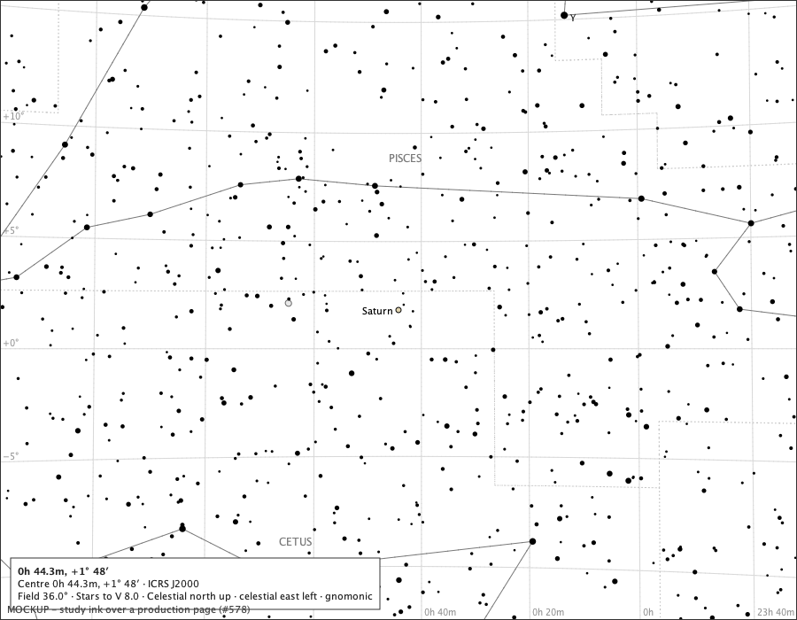

B = -7.43° (south face), B′ = -7.71°; the A Ring's outer edge 0.3 × 0.0 px, the globe 0.1 × 0.1 px here. Above the normal minimum field the rings are under the mark and the figure is the symbol; each moon is drawn only where its own mark is distinguishable. Drawn on the page: Saturn at (450, 350) as the 6 px mark (a cartographic symbol for the whole figure; the rings' true major axis 0.3 px); Mimas at saturn, not drawn; Enceladus at saturn, not drawn; Tethys behind, not drawn; Dione at saturn, not drawn; Rhea at saturn, not drawn; Titan at saturn, not drawn; Iapetus at saturn, not drawn; Where its labels went on this machine is in `platform.md`.

### The card's instant, 2026-10-05 00:00 UTC at Oslo, 8° field

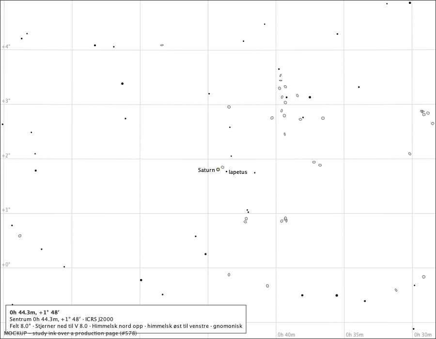

B = -7.43° (south face), B′ = -7.71°; the A Ring's outer edge 1.4 × 0.2 px, the globe 0.6 × 0.6 px here. Above the normal minimum field the rings are under the mark and the figure is the symbol; each moon is drawn only where its own mark is distinguishable. Drawn on the page: Saturn at (450, 350) as the 6 px mark (a cartographic symbol for the whole figure; the rings' true major axis 1.4 px); Mimas at saturn, not drawn; Enceladus at saturn, not drawn; Tethys behind, not drawn; Dione at saturn, not drawn; Rhea at saturn, not drawn; Titan at saturn, not drawn; Iapetus at (468, 354) clear; Where its labels went on this machine is in `platform.md`.

### The card's instant, 2026-10-05 00:00 UTC at Oslo, 3° field

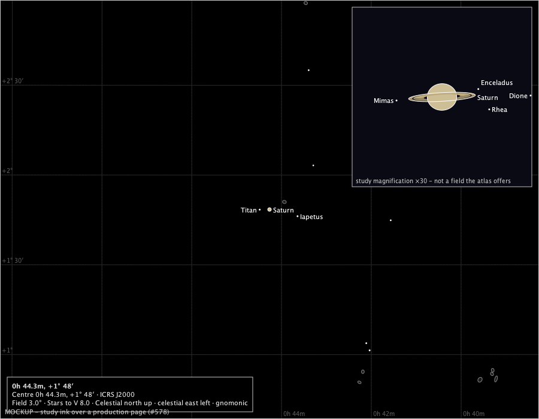

B = -7.43° (south face), B′ = -7.71°; the A Ring's outer edge 3.7 × 0.5 px, the globe 1.6 × 1.5 px here. Above the normal minimum field the rings are under the mark and the figure is the symbol; each moon is drawn only where its own mark is distinguishable. Drawn on the page: Saturn at (450, 350) as the 6 px mark (a cartographic symbol for the whole figure; the rings' true major axis 3.7 px); Mimas at saturn, not drawn; Enceladus at saturn, not drawn; Tethys behind, not drawn; Dione at saturn, not drawn; Rhea at saturn, not drawn; Titan at (434, 350) clear; Iapetus at (497, 361) clear; Where its labels went on this machine is in `platform.md`.

### The card's instant, 2026-10-05 00:00 UTC at Oslo, 1° field

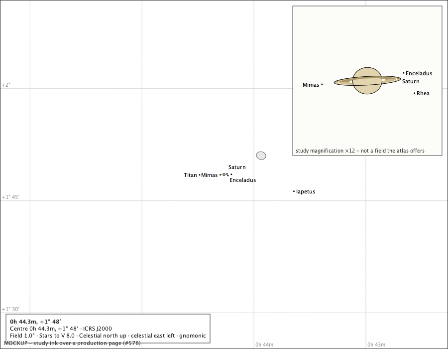

B = -7.43° (south face), B′ = -7.71°; the A Ring's outer edge 11.2 × 1.4 px, the globe 4.9 × 4.5 px here. At the normal minimum field the rings are drawn true around the globe and every moon not behind Saturn is drawn at its exact place. Drawn on the page: Saturn at (450, 350) true: rings 11.2 × 1.4 px (edge-on: a line), globe 4.9 × 4.5 px, B -7.4°; Mimas at (442, 351) clear; Enceladus at (456, 349) clear; Tethys behind, not drawn; Dione at (465, 350) clear; Rhea at (458, 352) clear; Titan at (401, 351) clear; Iapetus at (590, 384) clear; Where its labels went on this machine is in `platform.md`.

### The card's instant, 2026-10-05 00:00 UTC at Oslo, 0.5° field (a closer field, painted through a viewport)

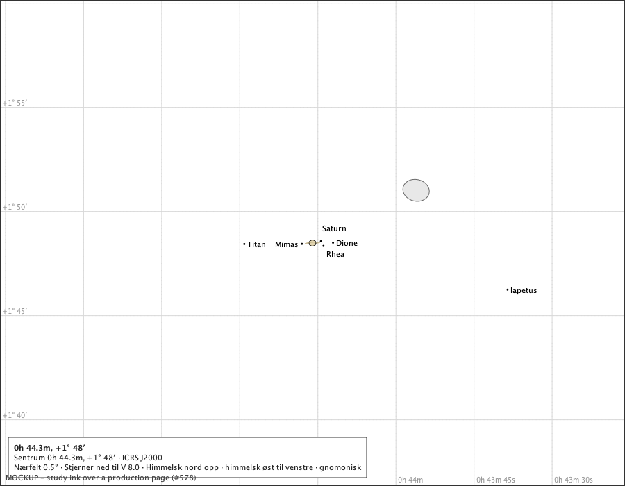

B = -7.43° (south face), B′ = -7.71°; the A Ring's outer edge 22.4 × 2.9 px, the globe 9.9 × 8.9 px here. On a closer field the globe separates from the rings and the inner moons stand clear of the ring ellipse. Drawn on the page: Saturn at (450, 350) true: rings 22.4 × 2.9 px, globe 9.9 × 8.9 px, B -7.4°; Mimas at (435, 351) clear; Enceladus at (462, 347) clear; Tethys behind, not drawn; Dione at (480, 350) clear; Rhea at (466, 354) clear; Titan at (352, 351) clear; Iapetus at (731, 417) clear; Where its labels went on this machine is in `platform.md`.

### The card's instant, 2026-10-05 00:00 UTC at Oslo, 0.25° field (a closer field, painted through a viewport)

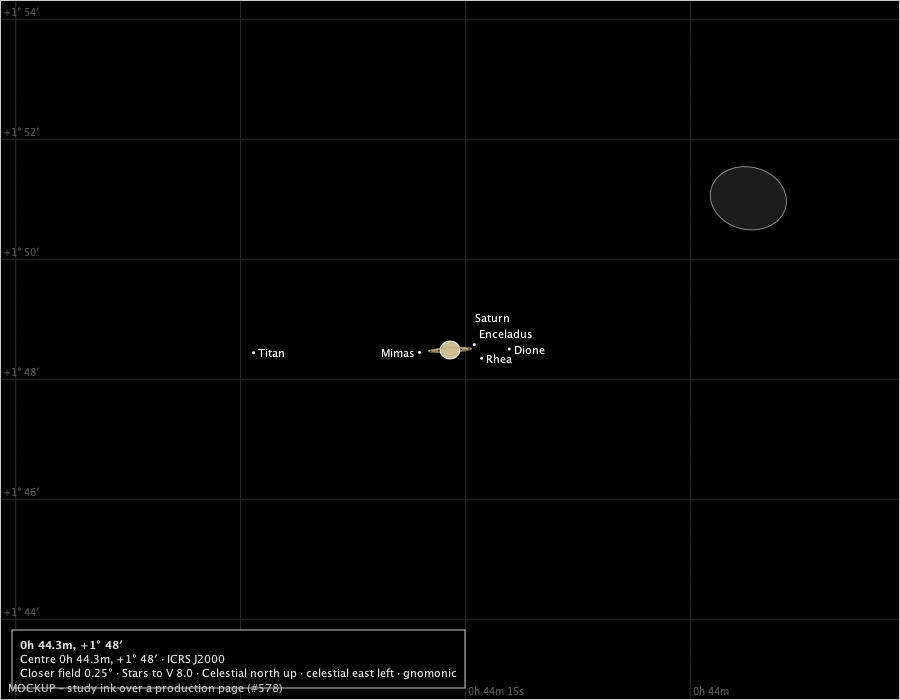

B = -7.43° (south face), B′ = -7.71°; the A Ring's outer edge 44.7 × 5.8 px, the globe 19.7 × 17.8 px here. On a closer field the globe separates from the rings and the inner moons stand clear of the ring ellipse. Drawn on the page: Saturn at (450, 350) true: rings 44.7 × 5.8 px, globe 19.7 × 17.8 px, B -7.4°; Mimas at (420, 352) clear; Enceladus at (474, 345) clear; Tethys behind, not drawn; Dione at (509, 349) clear; Rhea at (482, 358) clear; Titan at (254, 353) clear; Iapetus at (1012, 485) clear; Where its labels went on this machine is in `platform.md`.

### The rings open widest to the north face (2000-2100, weekly geocentric), 2076-10-10 00:00 UTC, Oslo, 1°

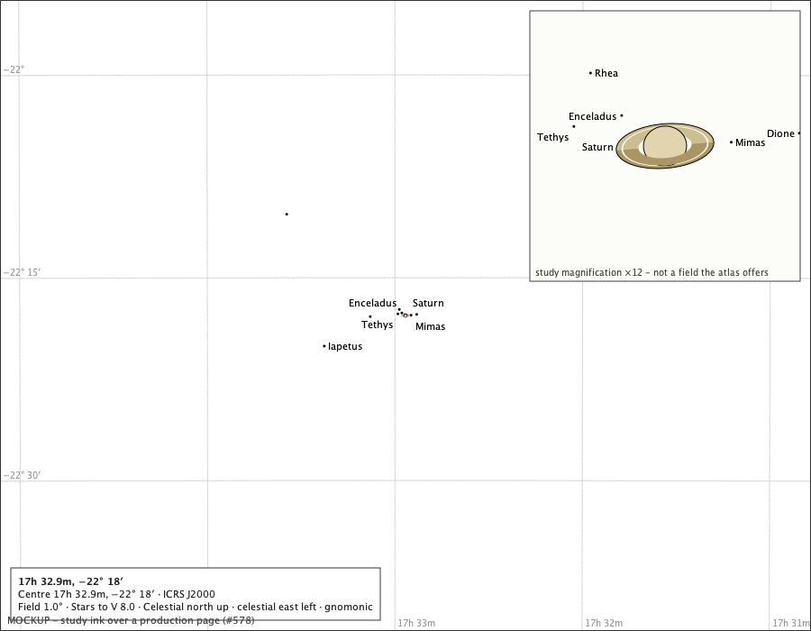

B = +26.97° (north face), B′ = +26.61°; the A Ring's outer edge 9.1 × 4.1 px, the globe 4.0 × 3.7 px here. States: Mimas clear of Saturn; Enceladus clear of Saturn; Tethys clear of Saturn; Dione clear of Saturn; Rhea clear of Saturn; Titan clear of Saturn; Iapetus clear of Saturn; Drawn on the page: Saturn at (450, 350) true: rings 9.1 × 4.1 px, globe 4.0 × 3.7 px, B +27.0°; Mimas at (456, 350) clear; Enceladus at (446, 347) clear; Tethys at (442, 348) clear; Dione at (462, 349) clear; Rhea at (443, 343) clear; Titan at (411, 351) clear; Iapetus at (360, 384) clear; Where its labels went on this machine is in `platform.md`.

### The rings open widest to the south face (2000-2100, weekly geocentric), 2003-04-05 00:00 UTC, Oslo, 1°

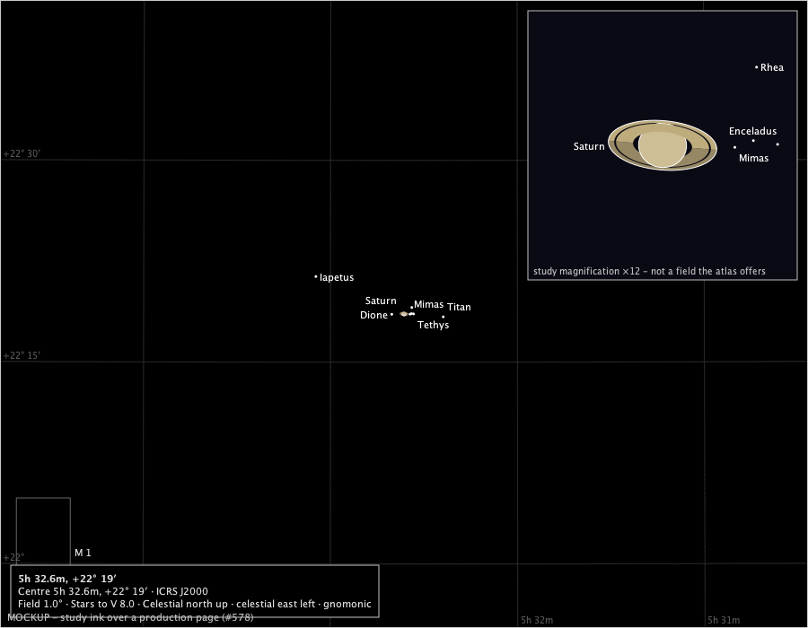

B = -26.99° (south face), B′ = -26.57°; the A Ring's outer edge 10.1 × 4.6 px, the globe 4.4 × 4.1 px here. States: Mimas clear of Saturn; Enceladus clear of Saturn; Tethys clear of Saturn; Dione clear of Saturn; Rhea clear of Saturn; Titan clear of Saturn; Iapetus clear of Saturn; Drawn on the page: Saturn at (450, 350) true: rings 10.1 × 4.6 px, globe 4.4 × 4.1 px, B -27.0°; Mimas at (457, 350) clear; Enceladus at (458, 350) clear; Tethys at (461, 350) clear; Dione at (436, 350) clear; Rhea at (459, 343) clear; Titan at (494, 353) clear; Iapetus at (352, 308) clear; Where its labels went on this machine is in `platform.md`.

### The Earth's ring-plane crossing, the contract's named case, 2025-03-23 17:51 UTC, Oslo, 1°

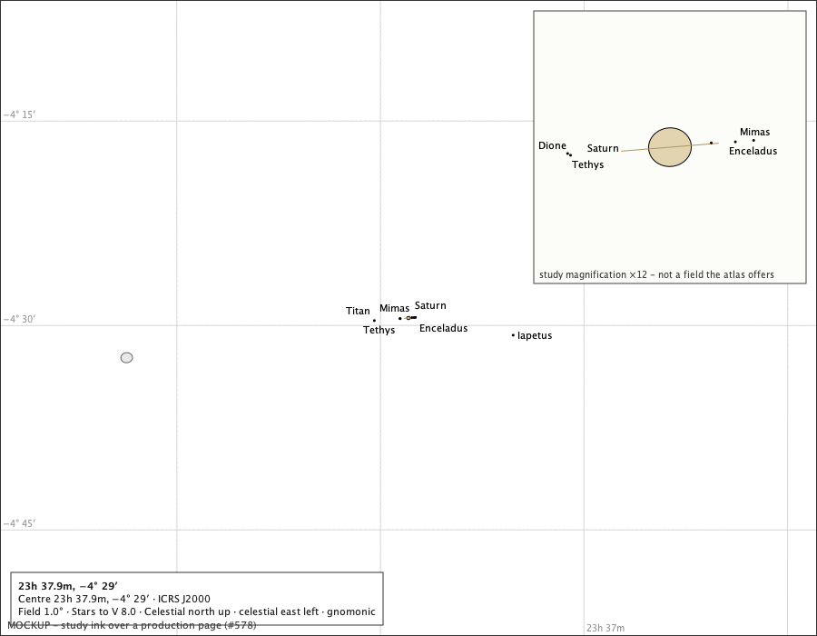

B = +0.00° (north face), B′ = +0.65°; the A Ring's outer edge 8.9 × 0.0 px, the globe 3.9 × 3.5 px here. States: Mimas clear of Saturn; Enceladus clear of Saturn; Tethys clear of Saturn; Dione clear of Saturn; Rhea clear of Saturn; Titan clear of Saturn; Iapetus clear of Saturn; Drawn on the page: Saturn at (450, 350) true: rings 8.9 × 0.0 px (edge-on: a line), globe 3.9 × 3.5 px, B +0.0°; Mimas at (456, 350) clear; Enceladus at (458, 349) clear; Tethys at (441, 351) clear; Dione at (441, 351) clear; Rhea at (454, 350) clear, behind the rings; Titan at (412, 353) clear; Iapetus at (565, 369) clear; Where its labels went on this machine is in `platform.md`.

### Between the Earth's and the Sun's 2025 crossings: the unlit face is seen, 2025-05-06 00:00 UTC, Oslo, 1°

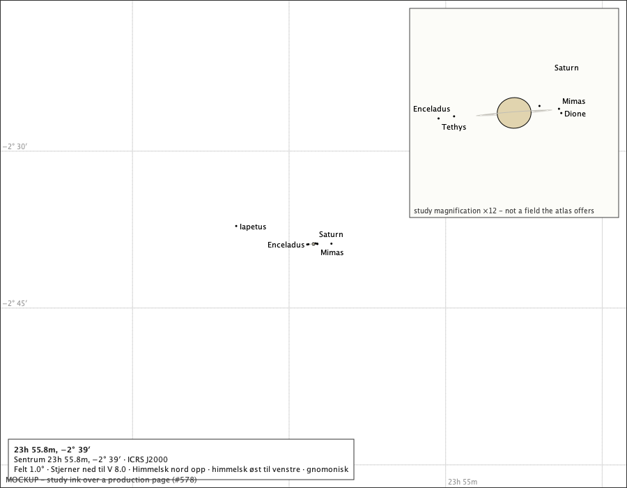

B = -2.19° (south face, the unlit face seen), B′ = +0.01°; the A Ring's outer edge 9.2 × 0.4 px, the globe 4.1 × 3.7 px here. States: Mimas clear of Saturn; Enceladus clear of Saturn; Tethys clear of Saturn; Dione clear of Saturn; Rhea clear of Saturn; Titan clear of Saturn; Iapetus clear of Saturn; Drawn on the page: Saturn at (450, 350) true: rings 9.2 × 0.4 px (edge-on: a line), globe 4.1 × 3.7 px, B -2.2° (the unlit face, dimmed ring ink); Mimas at (455, 350) clear; Enceladus at (443, 350) clear; Tethys at (441, 351) clear; Dione at (456, 350) clear; Rhea at (453, 349) clear; Titan at (476, 349) clear; Iapetus at (339, 324) clear; Where its labels went on this machine is in `platform.md`.

### The rings open widest to the north face (2000-2100, weekly geocentric), 2076-10-10 00:00 UTC, Oslo, 0.25°

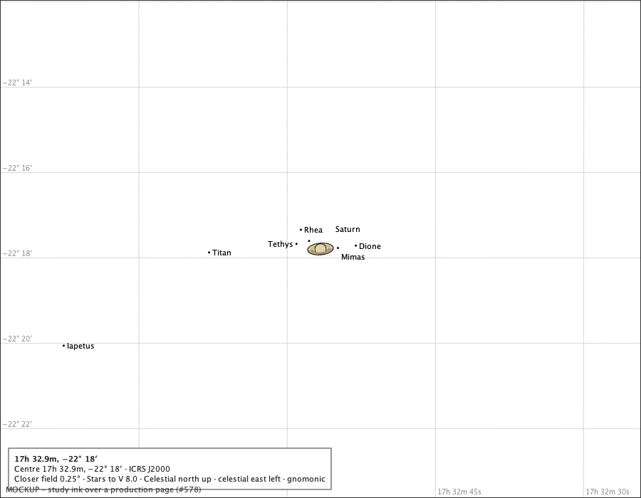

B = +26.97° (north face), B′ = +26.61°; the A Ring's outer edge 36.2 × 16.4 px, the globe 16.0 × 14.7 px here. States: Mimas clear of Saturn; Enceladus clear of Saturn; Tethys clear of Saturn; Dione clear of Saturn; Rhea clear of Saturn; Titan clear of Saturn; Iapetus clear of Saturn; Drawn on the page: Saturn at (450, 350) true: rings 36.2 × 16.4 px, globe 16.0 × 14.7 px, B +27.0°; Mimas at (474, 349) clear; Enceladus at (434, 339) clear; Tethys at (416, 343) clear; Dione at (500, 345) clear; Rhea at (422, 323) clear; Titan at (294, 355) clear; Iapetus at (89, 486) clear; Where its labels went on this machine is in `platform.md`.

### The rings open widest to the south face (2000-2100, weekly geocentric), 2003-04-05 00:00 UTC, Oslo, 0.25°

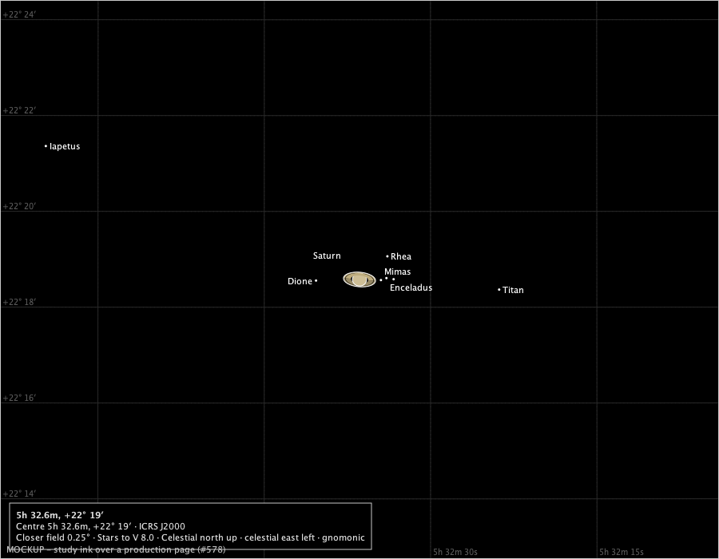

B = -26.99° (south face), B′ = -26.57°; the A Ring's outer edge 40.4 × 18.3 px, the globe 17.8 × 16.4 px here. States: Mimas clear of Saturn; Enceladus clear of Saturn; Tethys clear of Saturn; Dione clear of Saturn; Rhea clear of Saturn; Titan clear of Saturn; Iapetus clear of Saturn; Drawn on the page: Saturn at (450, 350) true: rings 40.4 × 18.3 px, globe 17.8 × 16.4 px, B -27.0°; Mimas at (477, 351) clear; Enceladus at (484, 348) clear; Tethys at (493, 350) clear; Dione at (396, 351) clear; Rhea at (485, 321) clear; Titan at (625, 363) clear; Iapetus at (57, 183) clear; Where its labels went on this machine is in `platform.md`.

### The Earth's ring-plane crossing, the contract's named case, 2025-03-23 17:51 UTC, Oslo, 0.25°

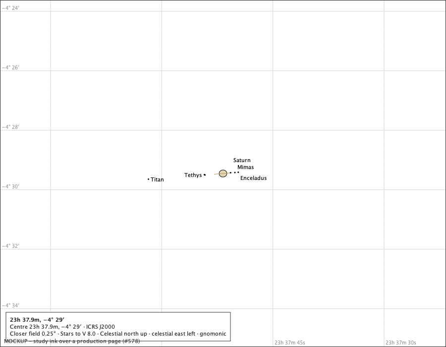

B = +0.00° (north face), B′ = +0.65°; the A Ring's outer edge 35.6 × 0.0 px, the globe 15.7 × 14.2 px here. States: Mimas clear of Saturn; Enceladus clear of Saturn; Tethys clear of Saturn; Dione clear of Saturn; Rhea clear of Saturn; Titan clear of Saturn; Iapetus clear of Saturn; Drawn on the page: Saturn at (450, 350) true: rings 35.6 × 0.0 px (edge-on: a line), globe 15.7 × 14.2 px, B +0.0°; Mimas at (474, 348) clear; Enceladus at (481, 347) clear; Tethys at (412, 352) clear; Dione at (414, 353) clear; Rhea at (465, 348) clear; Titan at (300, 361) clear; Iapetus at (911, 426) clear; Where its labels went on this machine is in `platform.md`.

### Between the Earth's and the Sun's 2025 crossings: the unlit face is seen, 2025-05-06 00:00 UTC, Oslo, 0.25°

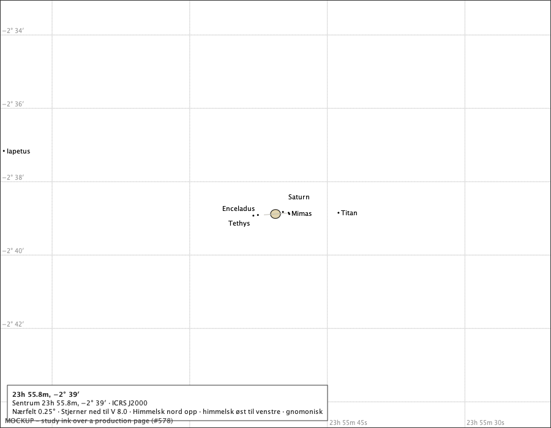

B = -2.19° (south face, the unlit face seen), B′ = +0.01°; the A Ring's outer edge 36.8 × 1.4 px, the globe 16.2 × 14.6 px here. States: Mimas clear of Saturn; Enceladus clear of Saturn; Tethys clear of Saturn; Dione clear of Saturn; Rhea clear of Saturn; Titan clear of Saturn; Iapetus clear of Saturn; Drawn on the page: Saturn at (450, 350) true: rings 36.8 × 1.4 px (edge-on: a line), globe 16.2 × 14.6 px, B -2.2° (the unlit face, dimmed ring ink); Mimas at (471, 348) clear; Enceladus at (421, 352) clear; Tethys at (414, 353) clear; Dione at (473, 350) clear; Rhea at (462, 347) clear; Titan at (553, 348) clear; Iapetus at (6, 247) clear; Where its labels went on this machine is in `platform.md`.

### State vocabulary A with Saturn's figure, on both palettes

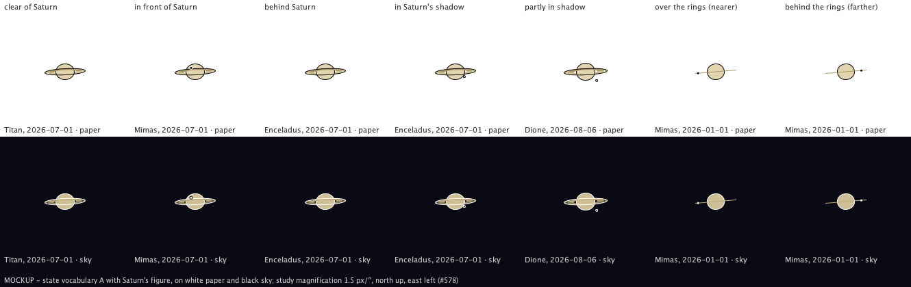

One cell per state, each a real 2026 configuration at Oslo (the first hour from July with the state, when the rings are open), Saturn's figure true (the far half of the rings, the globe, the near half) and the moon at its true J2000 offset, at a study magnification of 1.5 px per arcsecond, on white paper above and black sky below: clear a filled dot; in front a filled dot ringed in the paper's own colour over the globe; behind not drawn; wholly or partly in shadow a hollow ring (the table keeps the distinction). The last two cells are geometry, not states: a clear moon whose sight line crosses the rings, nearer than Saturn and farther than it, both drawn as clear - the contract rules no ring-obscuration state (ruling 5), so the symbol is painted over the rings either way and spoken as clear. Drawn: clear of Saturn: Titan at 2026-07-01 00:00 UTC, offset 179.1″ east, -5.5″ north, state clear of Saturn; in front of Saturn: Mimas at 2026-07-01 03:00 UTC, offset 4.0″ east, 3.8″ north, state in front of Saturn; behind Saturn: Enceladus at 2026-07-01 16:00 UTC, offset 4.8″ east, -5.6″ north, state behind Saturn; in Saturn's shadow: Enceladus at 2026-07-01 14:00 UTC, offset -8.3″ east, -4.8″ north, state in Saturn's shadow; partly in shadow: Dione at 2026-08-06 07:00 UTC, offset -10.9″ east, -8.5″ north, state partly in Saturn's shadow; over the rings (nearer): Mimas at 2026-01-01 01:00 UTC, offset 17.2″ east, -1.4″ north, state clear of Saturn; behind the rings (farther): Mimas at 2026-01-01 13:00 UTC, offset -15.0″ east, 1.2″ north, state clear of Saturn;

### Titan at greatest elongation, 2026-08-01 18:00 UTC, Oslo, 1°

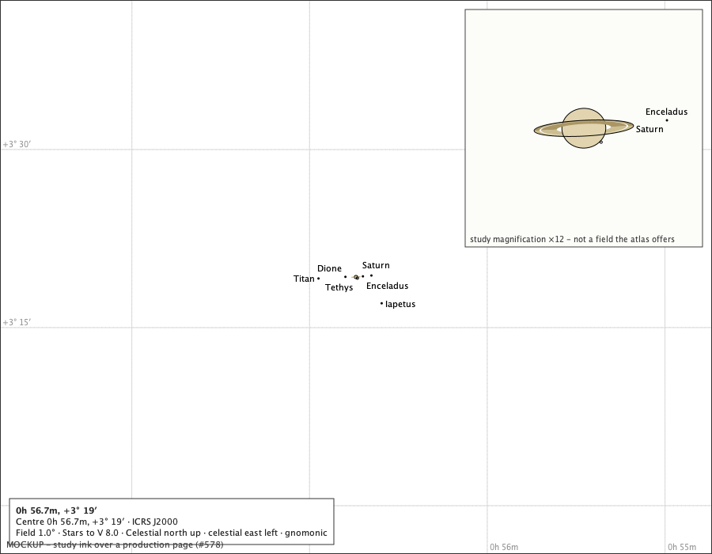

Titan 189.8″ from Saturn, 47.4 px here. States: Mimas behind Saturn; Enceladus clear of Saturn; Tethys in Saturn's shadow; Dione clear of Saturn; Rhea clear of Saturn; Titan clear of Saturn; Iapetus clear of Saturn; Drawn on the page: Saturn at (450, 350) true: rings 10.5 × 1.7 px (edge-on: a line), globe 4.6 × 4.2 px, B -9.1°; Mimas behind, not drawn; Enceladus at (459, 349) clear; Tethys at (452, 351) shadowed; Dione at (437, 350) clear; Rhea at (469, 348) clear; Titan at (403, 352) clear; Iapetus at (482, 383) clear; Where its labels went on this machine is in `platform.md`.

### Iapetus at its farthest 2026 day, 2026-10-03 00:00 UTC, Oslo, 3°

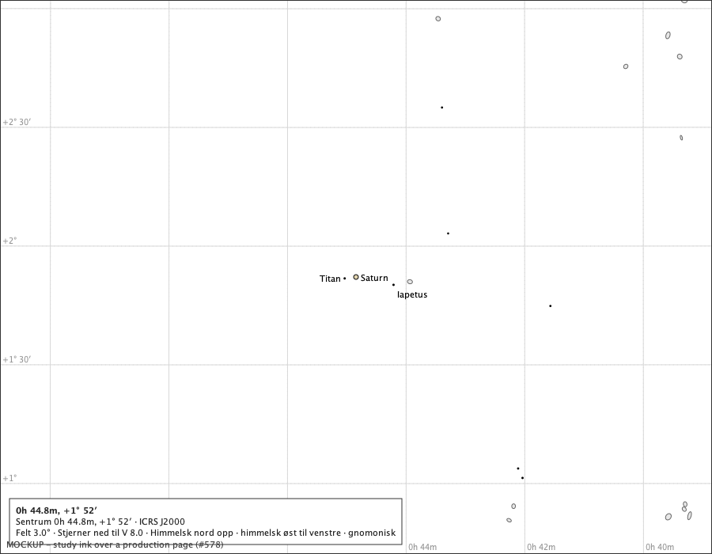

Iapetus 582″ (9.7′) from Saturn, 48 px here: the system's extent on the page. States: Mimas clear of Saturn; Enceladus clear of Saturn; Tethys clear of Saturn; Dione clear of Saturn; Rhea clear of Saturn; Titan clear of Saturn; Iapetus clear of Saturn; Drawn on the page: Saturn at (450, 350) as the 6 px mark (a cartographic symbol for the whole figure; the rings' true major axis 3.7 px); Mimas at saturn, not drawn; Enceladus at saturn, not drawn; Tethys at saturn, not drawn; Dione at saturn, not drawn; Rhea at saturn, not drawn; Titan at (436, 352) clear; Iapetus at (497, 360) clear; Where its labels went on this machine is in `platform.md`.

### Iapetus at its farthest 2026 day, 2026-10-03 00:00 UTC, Oslo, 1°

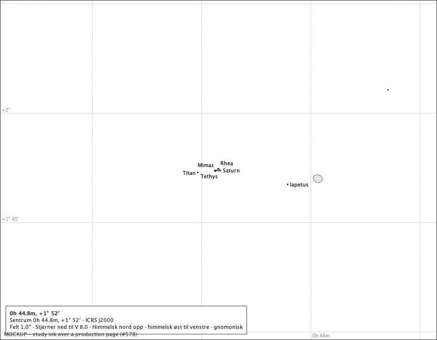

Iapetus 582″ (9.7′) from Saturn, 145 px here: the system's extent on the page. States: Mimas clear of Saturn; Enceladus clear of Saturn; Tethys clear of Saturn; Dione clear of Saturn; Rhea clear of Saturn; Titan clear of Saturn; Iapetus clear of Saturn; Drawn on the page: Saturn at (450, 350) true: rings 11.2 × 1.5 px (edge-on: a line), globe 4.9 × 4.5 px, B -7.5°; Mimas at (445, 351) clear; Enceladus at (442, 351) clear; Tethys at (453, 351) clear; Dione at (444, 352) clear; Rhea at (450, 347) clear; Titan at (407, 355) clear; Iapetus at (592, 380) clear; Where its labels went on this machine is in `platform.md`.

### The most crowded 2026 configuration with all seven moons clear, 2026-04-11 00:00 UTC, Oslo, 1°

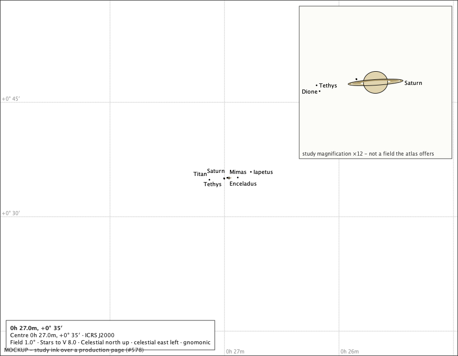

Each mark and each label is decided on its own: a label with no free candidate is refused alone, and the others stand. States: Mimas clear of Saturn; Enceladus clear of Saturn; Tethys clear of Saturn; Dione clear of Saturn; Rhea clear of Saturn; Titan clear of Saturn; Iapetus clear of Saturn; Drawn on the page: Saturn at (450, 350) true: rings 9.0 × 0.9 px (edge-on: a line), globe 4.0 × 3.6 px, B -5.9°; Mimas at (447, 349) clear; Enceladus at (447, 349) clear; Tethys at (440, 350) clear; Dione at (441, 351) clear; Rhea at (467, 349) clear; Titan at (412, 353) clear; Iapetus at (493, 338) clear; Where its labels went on this machine is in `platform.md`.

### The most crowded 2026 configuration with all seven moons clear, 2026-04-11 00:00 UTC, Oslo, 0.25°

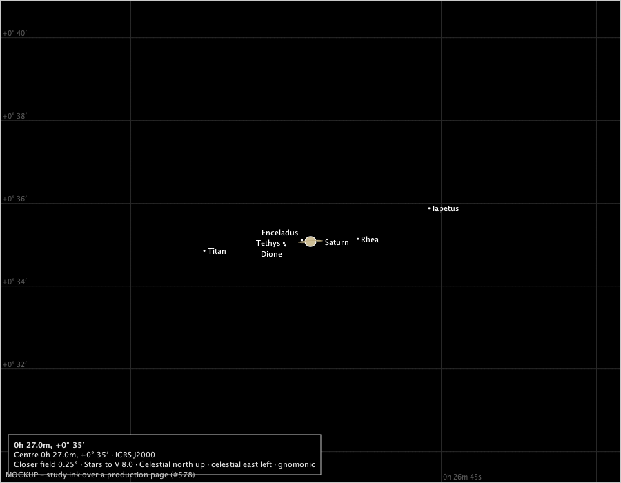

Each mark and each label is decided on its own: a label with no free candidate is refused alone, and the others stand. States: Mimas clear of Saturn; Enceladus clear of Saturn; Tethys clear of Saturn; Dione clear of Saturn; Rhea clear of Saturn; Titan clear of Saturn; Iapetus clear of Saturn; Drawn on the page: Saturn at (450, 350) true: rings 36.1 × 3.7 px, globe 15.9 × 14.4 px, B -5.9°; Mimas at (438, 348) clear; Enceladus at (437, 348) clear; Tethys at (411, 352) clear; Dione at (413, 356) clear; Rhea at (519, 346) clear; Titan at (296, 364) clear; Iapetus at (622, 302) clear; Where its labels went on this machine is in `platform.md`.

### A moon in front of Saturn (the first hour at Oslo from July 2026), 2026-07-01 03:00 UTC, 0.25°

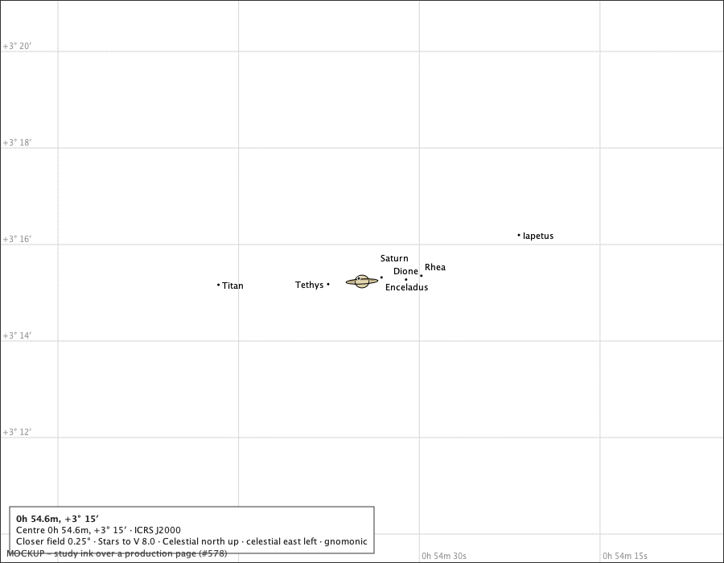

States: Mimas in front of Saturn; Enceladus clear of Saturn; Tethys clear of Saturn; Dione clear of Saturn; Rhea clear of Saturn; Titan clear of Saturn; Iapetus clear of Saturn; Drawn on the page: Saturn at (450, 350) true: rings 39.7 × 6.2 px, globe 17.5 × 15.8 px, B -9.0°; Mimas at (446, 346) in front; Enceladus at (474, 345) clear; Tethys at (408, 353) clear; Dione at (505, 348) clear; Rhea at (524, 343) clear; Titan at (272, 354) clear; Iapetus at (645, 292) clear; Where its labels went on this machine is in `platform.md`.

### A moon in front of Saturn (the first hour at Oslo from July 2026), 2026-07-01 03:00 UTC, 1°

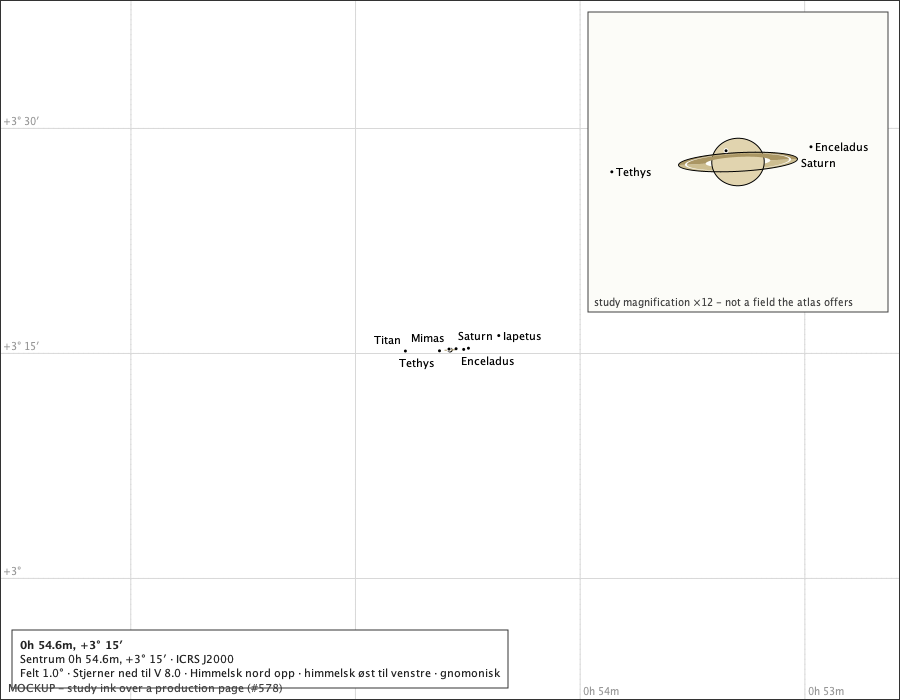

States: Mimas in front of Saturn; Enceladus clear of Saturn; Tethys clear of Saturn; Dione clear of Saturn; Rhea clear of Saturn; Titan clear of Saturn; Iapetus clear of Saturn; Drawn on the page: Saturn at (450, 350) true: rings 9.9 × 1.6 px (edge-on: a line), globe 4.4 × 4.0 px, B -9.0°; Mimas at (449, 349) in front; Enceladus at (456, 349) clear; Tethys at (439, 351) clear; Dione at (464, 349) clear; Rhea at (468, 348) clear; Titan at (405, 351) clear; Iapetus at (499, 336) clear; Where its labels went on this machine is in `platform.md`.

### A moon behind Saturn (the first hour at Oslo from July 2026), 2026-07-01 16:00 UTC, 0.25°

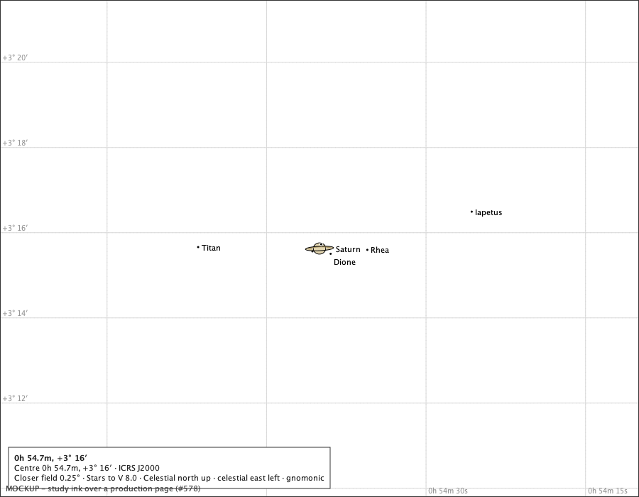

States: Mimas clear of Saturn; Enceladus behind Saturn; Tethys in front of Saturn; Dione clear of Saturn; Rhea clear of Saturn; Titan clear of Saturn; Iapetus clear of Saturn; Drawn on the page: Saturn at (450, 350) true: rings 39.8 × 6.2 px, globe 17.5 × 15.8 px, B -9.0°; Mimas at (440, 354) clear; Enceladus behind, not drawn; Tethys at (452, 344) in front; Dione at (466, 357) clear; Rhea at (517, 352) clear; Titan at (279, 348) clear; Iapetus at (664, 298) clear; Where its labels went on this machine is in `platform.md`.

### A moon behind Saturn (the first hour at Oslo from July 2026), 2026-07-01 16:00 UTC, 1°

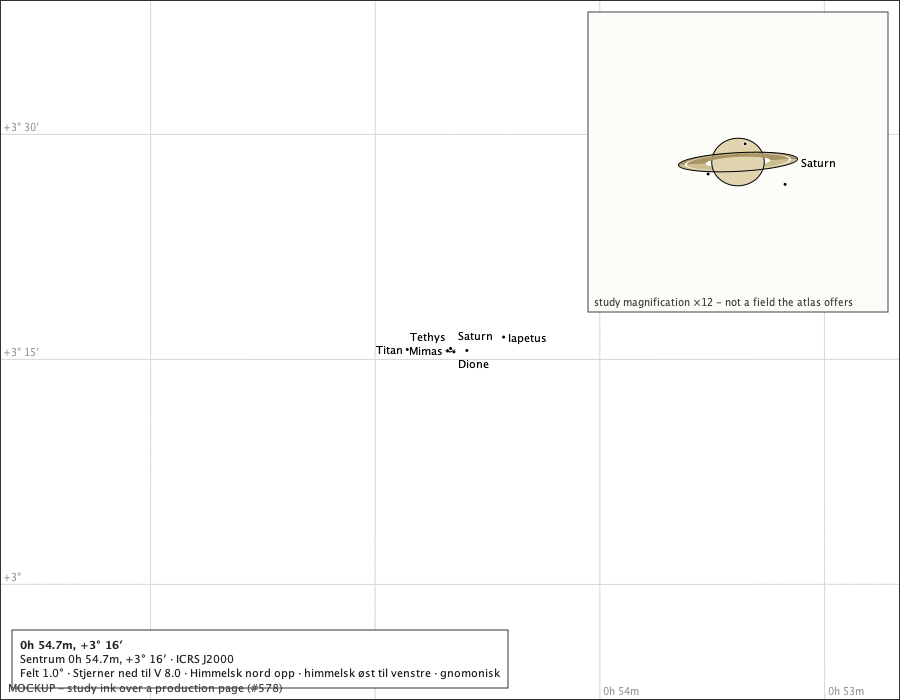

States: Mimas clear of Saturn; Enceladus behind Saturn; Tethys in front of Saturn; Dione clear of Saturn; Rhea clear of Saturn; Titan clear of Saturn; Iapetus clear of Saturn; Drawn on the page: Saturn at (450, 350) true: rings 9.9 × 1.6 px (edge-on: a line), globe 4.4 × 4.0 px, B -9.0°; Mimas at (448, 351) clear; Enceladus behind, not drawn; Tethys at (451, 348) in front; Dione at (454, 352) clear; Rhea at (467, 350) clear; Titan at (407, 350) clear; Iapetus at (504, 337) clear; Where its labels went on this machine is in `platform.md`.

### A moon in Saturn's shadow (the first hour at Oslo from July 2026), 2026-07-01 14:00 UTC, 0.25°

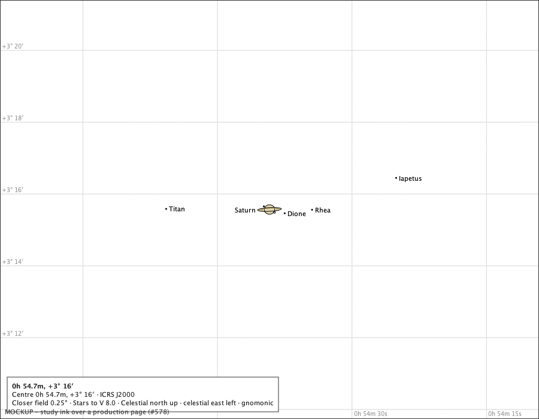

States: Mimas behind Saturn, in its shadow; Enceladus in Saturn's shadow; Tethys clear of Saturn; Dione clear of Saturn; Rhea clear of Saturn; Titan clear of Saturn; Iapetus clear of Saturn; Drawn on the page: Saturn at (450, 350) true: rings 39.8 × 6.2 px, globe 17.5 × 15.8 px, B -9.0°; Mimas behind, not drawn; Enceladus at (458, 355) shadowed; Tethys at (441, 345) clear; Dione at (475, 356) clear; Rhea at (521, 350) clear; Titan at (277, 349) clear; Iapetus at (661, 297) clear; Where its labels went on this machine is in `platform.md`.

### A moon in Saturn's shadow (the first hour at Oslo from July 2026), 2026-07-01 14:00 UTC, 1°

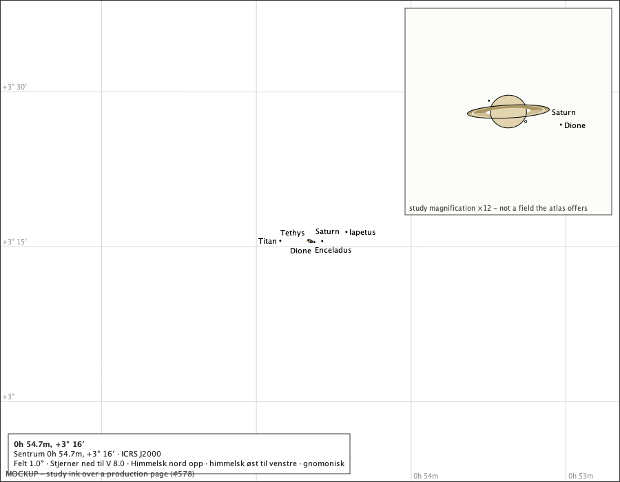

States: Mimas behind Saturn, in its shadow; Enceladus in Saturn's shadow; Tethys clear of Saturn; Dione clear of Saturn; Rhea clear of Saturn; Titan clear of Saturn; Iapetus clear of Saturn; Drawn on the page: Saturn at (450, 350) true: rings 9.9 × 1.6 px (edge-on: a line), globe 4.4 × 4.0 px, B -9.0°; Mimas behind, not drawn; Enceladus at (452, 351) shadowed; Tethys at (448, 349) clear; Dione at (456, 352) clear; Rhea at (468, 350) clear; Titan at (407, 350) clear; Iapetus at (503, 337) clear; Where its labels went on this machine is in `platform.md`.

### A moon partly in Saturn's shadow (the first hour at Oslo from July 2026), 2026-08-06 07:00 UTC, 0.25°

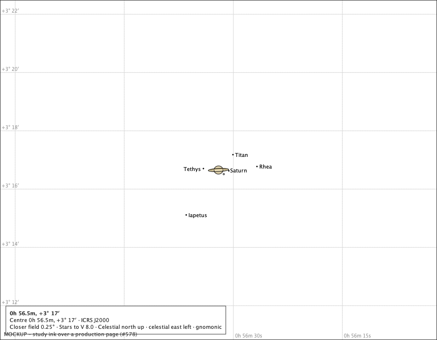

States: Mimas clear of Saturn; Enceladus behind Saturn; Tethys clear of Saturn; Dione partly in Saturn's shadow; Rhea clear of Saturn; Titan clear of Saturn; Iapetus clear of Saturn; Drawn on the page: Saturn at (450, 350) true: rings 42.3 × 6.7 px, globe 18.6 × 16.9 px, B -9.1°; Mimas at (471, 352) clear; Enceladus behind, not drawn; Tethys at (419, 347) clear; Dione at (461, 358) shadowed; Rhea at (529, 343) clear; Titan at (480, 318) clear; Iapetus at (384, 443) clear; Where its labels went on this machine is in `platform.md`.

### A moon partly in Saturn's shadow (the first hour at Oslo from July 2026), 2026-08-06 07:00 UTC, 1°

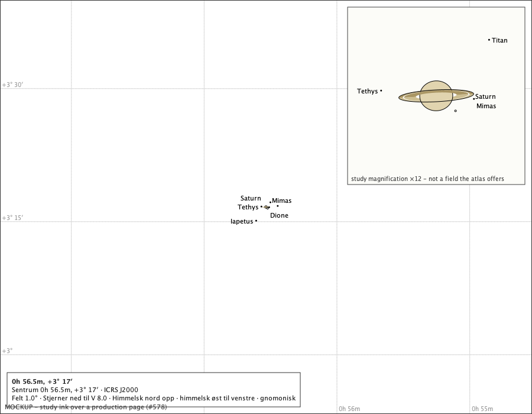

States: Mimas clear of Saturn; Enceladus behind Saturn; Tethys clear of Saturn; Dione partly in Saturn's shadow; Rhea clear of Saturn; Titan clear of Saturn; Iapetus clear of Saturn; Drawn on the page: Saturn at (450, 350) true: rings 10.6 × 1.7 px (edge-on: a line), globe 4.7 × 4.2 px, B -9.1°; Mimas at (455, 350) clear; Enceladus behind, not drawn; Tethys at (442, 349) clear; Dione at (453, 352) shadowed; Rhea at (470, 348) clear; Titan at (457, 342) clear; Iapetus at (433, 373) clear; Where its labels went on this machine is in `platform.md`.

### Saturn just below the drawn horizon, 2026-12-01 12:40 UTC, Oslo, 8°

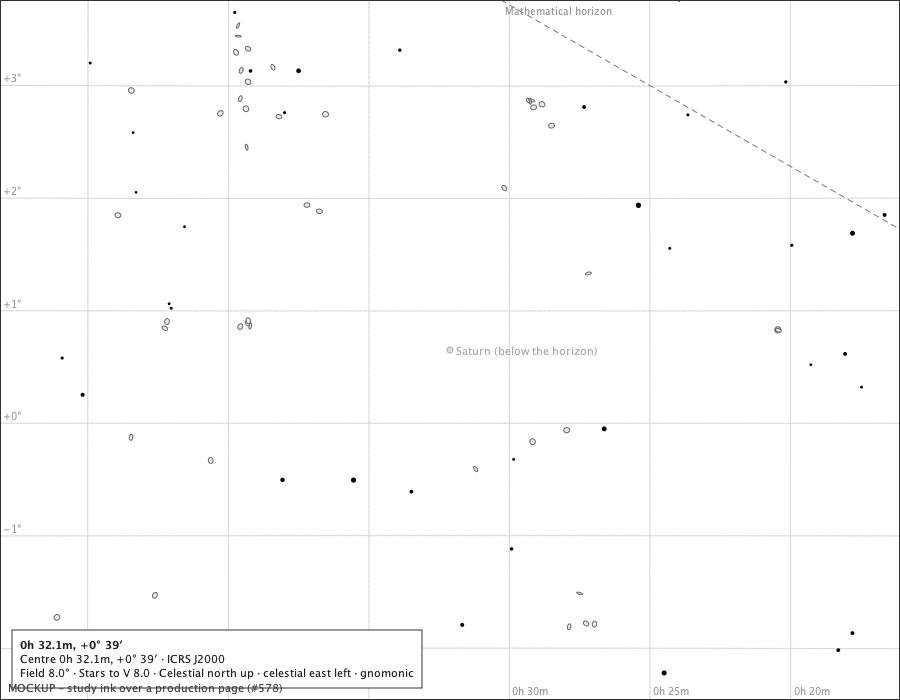

Saturn at -2.9° altitude, drawn in the ground's dimmed ink with its status, as the Sun's, the Moon's and Jupiter's ruling (C4) has it. Drawn on the page: Saturn at (450, 350) as the 6 px mark (a cartographic symbol for the whole figure; the rings' true major axis 1.3 px); Mimas at saturn, not drawn; Enceladus at saturn, not drawn; Tethys in front unresolved, not drawn; Dione at saturn, not drawn; Rhea at saturn, not drawn; Titan at saturn, not drawn; Iapetus at saturn, not drawn; Where its labels went on this machine is in `platform.md`.

### The same instant with the horizon hidden

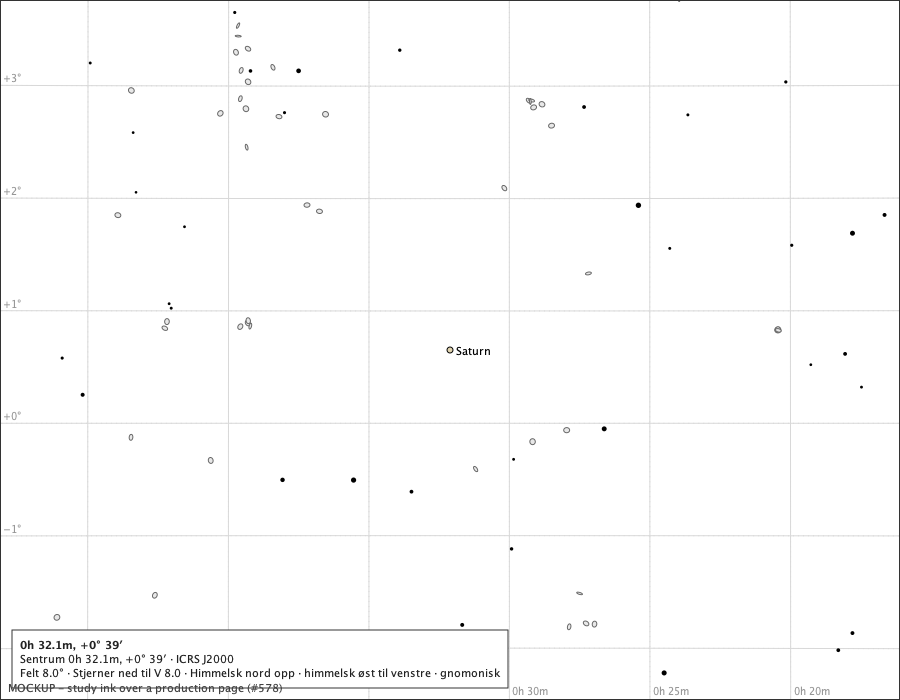

With no horizon drawn the celestial chart draws Saturn normally (C4). Drawn on the page: Saturn at (450, 350) as the 6 px mark (a cartographic symbol for the whole figure; the rings' true major axis 1.3 px); Mimas at saturn, not drawn; Enceladus at saturn, not drawn; Tethys in front unresolved, not drawn; Dione at saturn, not drawn; Rhea at saturn, not drawn; Titan at saturn, not drawn; Iapetus at saturn, not drawn; Where its labels went on this machine is in `platform.md`.

### The 2018 opposition in Sagittarius, 2018-06-28 00:00 UTC, Oslo, 8°

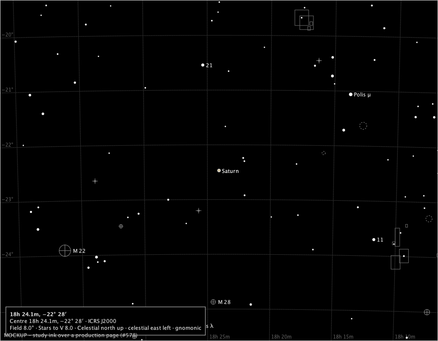

A crowded catalogue field with the rings open 26.0°: the figure's label takes a free adjacent place or is refused; it never overwrites a star's. States: Mimas clear of Saturn; Enceladus clear of Saturn; Tethys clear of Saturn; Dione clear of Saturn; Rhea clear of Saturn; Titan clear of Saturn; Iapetus clear of Saturn; Drawn on the page: Saturn at (450, 350) as the 6 px mark (a cartographic symbol for the whole figure; the rings' true major axis 1.3 px); Mimas at saturn, not drawn; Enceladus at saturn, not drawn; Tethys at saturn, not drawn; Dione at saturn, not drawn; Rhea at saturn, not drawn; Titan at saturn, not drawn; Iapetus at saturn, not drawn; Where its labels went on this machine is in `platform.md`.

### The 2018 opposition in Sagittarius, 2018-06-28 00:00 UTC, Oslo, 3°

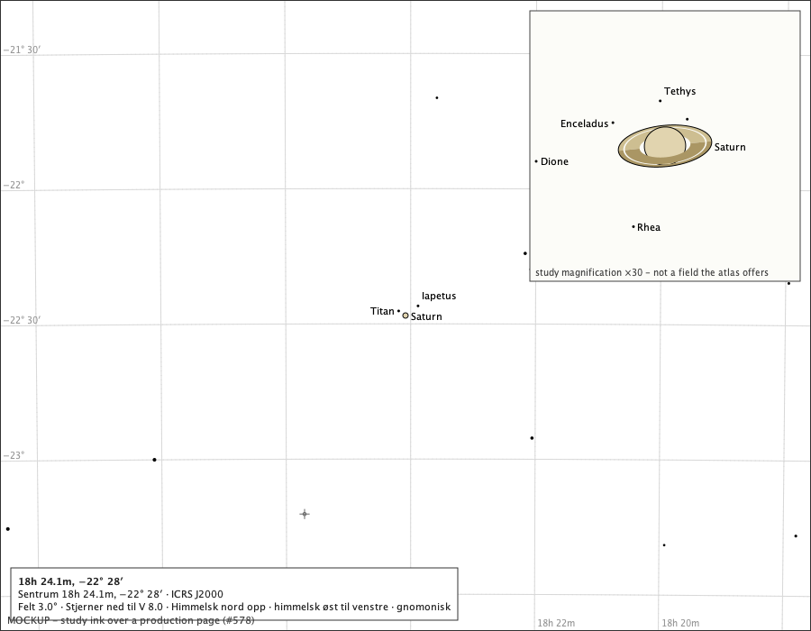

A crowded catalogue field with the rings open 26.0°: the figure's label takes a free adjacent place or is refused; it never overwrites a star's. States: Mimas clear of Saturn; Enceladus clear of Saturn; Tethys clear of Saturn; Dione clear of Saturn; Rhea clear of Saturn; Titan clear of Saturn; Iapetus clear of Saturn; Drawn on the page: Saturn at (450, 350) as the 6 px mark (a cartographic symbol for the whole figure; the rings' true major axis 3.5 px); Mimas at saturn, not drawn; Enceladus at saturn, not drawn; Tethys at saturn, not drawn; Dione at saturn, not drawn; Rhea at saturn, not drawn; Titan at (442, 345) clear; Iapetus at (464, 339) clear; Where its labels went on this machine is in `platform.md`.

### Saturn's 2026 conjunction with the Sun, 2026-03-25 00:00 UTC, Oslo, 8°, the Sun on

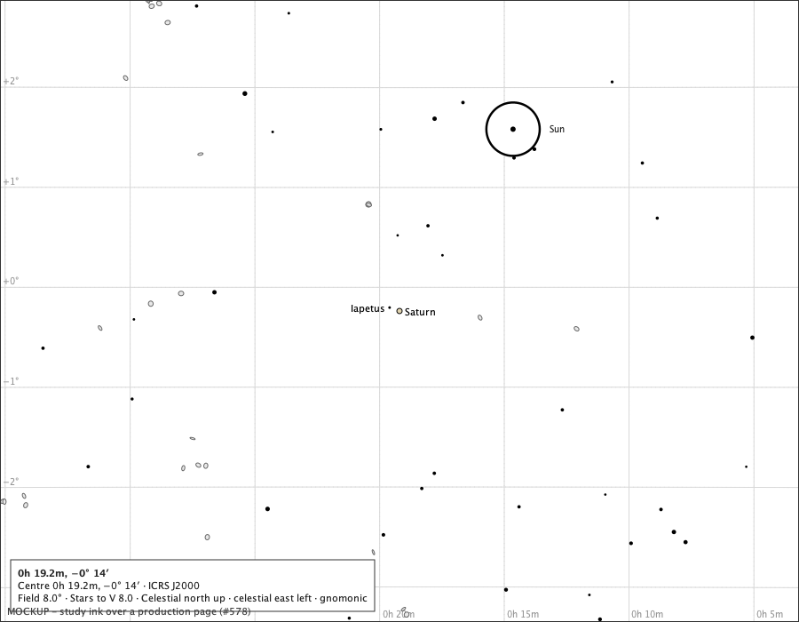

Saturn 2.15° from the Sun's centre on the year's day of least elongation (daily, geocentric): outside the Sun's disc, so both are drawn. The production Sun is painted opaque in the bodies layer after the study's symbol, so a symbol that did fall inside the disc would be covered, as #514 rules for Venus. No Saturn rule is proposed for conjunction beyond painting order and the table's elongation. Drawn on the page: Saturn at (450, 350) as the 6 px mark (a cartographic symbol for the whole figure; the rings' true major axis 1.1 px); Mimas at saturn, not drawn; Enceladus behind, not drawn; Tethys at saturn, not drawn; Dione at saturn, not drawn; Rhea at saturn, not drawn; Titan at saturn, not drawn; Iapetus at (439, 346) clear; Where its labels went on this machine is in `platform.md`.

### The system near the page's left edge, 3° field

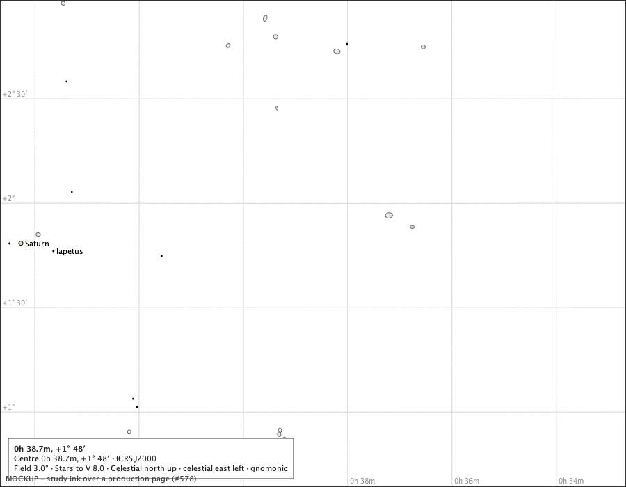

Bodies off the page are not drawn, as stars are not (C4). Drawn on the page: Saturn at (30, 350) as the 6 px mark (a cartographic symbol for the whole figure; the rings' true major axis 3.7 px); Mimas at saturn, not drawn; Enceladus at saturn, not drawn; Tethys behind, not drawn; Dione at saturn, not drawn; Rhea at saturn, not drawn; Titan at (14, 350) clear; Iapetus at (77, 361) clear; Where its labels went on this machine is in `platform.md`.

### The A4 sheet's chart area at 150 dpi (1754 × 1090 px), 8° field

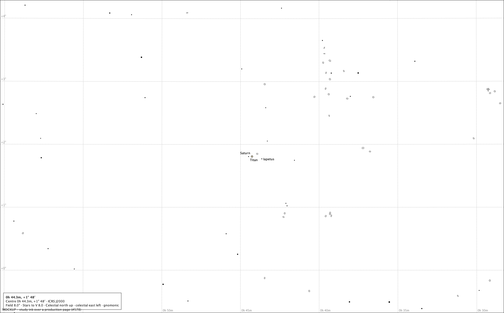

The rings' major axis is 0.42 mm on the sheet: the minimum mark stands for the figure. Drawn on the page: Saturn at (877, 545) as the 6 px mark (a cartographic symbol for the whole figure; the rings' true major axis 2.7 px); Mimas at saturn, not drawn; Enceladus at saturn, not drawn; Tethys behind, not drawn; Dione at saturn, not drawn; Rhea at saturn, not drawn; Titan at (865, 545) clear; Iapetus at (911, 553) clear; Where its labels went on this machine is in `platform.md`.

### The A4 sheet's chart area at 150 dpi (1754 × 1090 px), 1° field

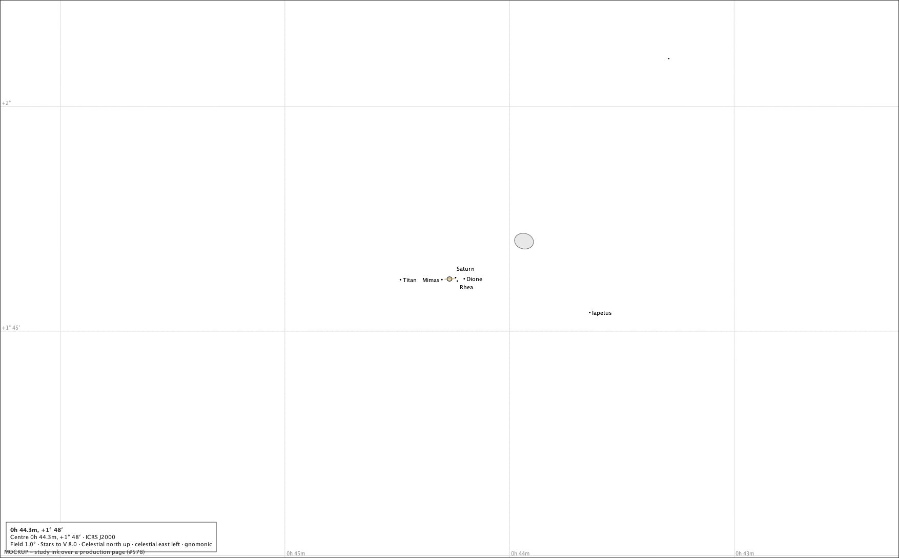

The rings' major axis is 3.37 mm on the sheet: the rings and the globe are drawn true, as on the screen at 1°. Drawn on the page: Saturn at (877, 545) true: rings 21.8 × 2.8 px, globe 9.6 × 8.7 px, B -7.4°; Mimas at (862, 546) clear; Enceladus at (889, 542) clear; Tethys behind, not drawn; Dione at (906, 545) clear; Rhea at (892, 549) clear; Titan at (781, 546) clear; Iapetus at (1151, 611) clear; Where its labels went on this machine is in `platform.md`.

## E. The proposal, for the rulings (#578's eight)

1. **True scale against a minimum mark.** Saturn's mark is the figure - globe and rings - at true scale, or Jupiter's 6 px minimum as a circle standing for the whole figure, whichever is larger, measured by the rings' major axis (section A): on the ordinary ladder the true figure is drawn only at 1°, where the rings are 8.5-11.7 px across, and on the closer fields; from 2° up the symbol stands in. Evidence and accessible text call the symbol *a cartographic symbol, not Saturn's apparent diameter*. The transition is a switch, not Jupiter's blend: a circle cannot grow into a ringed figure.
2. **The rings.** The two ruled annuli (C Ring inner to B Ring outer; Cassini Division outer to A Ring outer), flat, their semi-axes asin(R/Δ) and asin(R/Δ)·|sin B| at the page's scale, the major axis along the pole's page direction turned 90°; filled, with the near half painted over the globe and the far half behind it by the contract's −sin B cos B rule (section C); a hairline outline on the A Ring's outer edge only where the figure is at least 20 px wide and the rings' minor axis at least 6 px. Where the minor axis is under 2 px the rings are a 1 px line through the globe (edge-on: 30.4 % of the century's weeks at 1°). When the unlit face is seen the rings take a dimmed ink, so the page says what the table says; the Cassini gap is drawn only where it is a pixel (the closest page). No shadows, as ruling 4 of #574 keeps them out of 5.4.0.
3. **The moons.** Seven 3 px symbols, Jupiter's rule 4 with the drawn figure as the primary's extent: behind Saturn omitted; at the normal minimum field and the closer fields every other moon drawn at its exact J2000 place; above it only where its mark is 6 px clear of the figure's drawn edge and of every higher-priority moon (in front, clear, shadowed; then Titan, Rhea, Iapetus, Dione, Tethys, Enceladus, Mimas); a moon in front only over a globe at least 12 px wide - on the closer fields only (section B). A collision suppresses only the lower-priority mark. Labels through the adjacent candidates, refused alone, never under duress - and often refused at 1°, where seven names crowd a figure a dozen pixels wide (section B's finding): the owner may prefer a rule that names only the moons whose marks stand clear of the figure.
4. **Vocabulary on the chart.** Jupiter's vocabulary A for the six states (section D's strip). No ring-obscuration state, as #574's ruling 5: a clear moon whose sight line crosses the rings is painted over them whether nearer or farther, and spoken as clear. No satellite shadow spots, no ring shadow, no globe shadow. Spoken: *Saturn (a cartographic symbol, not Saturn's apparent diameter)* while the symbol stands in, *Saturn* when the figure is true; each moon with the table's state words (`saturntable.state.*`) and the symbol note.
5. **Selection and Centre on chart.** Saturn's identity on the page is `saturn`; a selected Saturn is an occurrence (#513), as Jupiter's. The moons are `saturn.mimas` … `saturn.iapetus`, symbols that consume no click, as the Galilean moons; proposed not selectable, as Jupiter's are not. Centre on chart lands at 1°, as for every body. *Saturn on the chart* joins View > Solar System after Jupiter on the chart, and the Controller's Saturn group gains Show on chart and Centre on chart.
6. **The closer fields.** Saturn becomes eligible for 0.5° and 0.25°, joining Mercury, Venus and Jupiter: at 0.25° the rings are 34.1-47.0 px and the globe separates from them (the gap 1.77-2.44 px), the inner moons stand clear of the ring ellipse, and a moon in front is resolved (section B). The pages are painted in section D.
7. **Screen, paper, accessibility and export.** Below a drawn horizon the figure and its moons take the ground's dimmed ink with the status; off the page nothing is drawn; the symbol never erases a star and a symbol in front of an opaque disc paints over it (#514); export draws through the same module in page units, so the A4 sheet agrees with the screen (section D's printable pages); the Solar System labels class (#526) raises Saturn's and the moons' names.
8. **The production split.** #579 in the ruled order: the figure (globe and rings, the switch, Centre on chart, the words) with its packaged checkpoint, then the moons; both wide-route PRs with the on-the-chart evidence; the closer-field eligibility with the figure. Then #580 and #581.

