# Saturn on the chart: production pages

Sprint 53, issue #579 - the figure and the seven moons, #579's two pull requests under the owner's rulings on #578. Each page is the production `ChartComponent` over the bundled catalogue with the Saturn module attached and switched on: Saturn's globe and rings at their true size where the rings' major axis is at least the 6 px minimum, otherwise the 6 px cartographic symbol; the rings' far half behind the globe and the near half over it; a line when edge-on; dimmed when the unlit face is seen; dimmed below a drawn horizon. The seven ruled moons are 3 px symbols, each decided on its own against the drawn figure (ruling 3): behind Saturn omitted; at the normal minimum field and the closer fields every other moon drawn at its own J2000 place; above it only where its mark stands 6 px clear of the figure's drawn edge and of every higher-precedence moon, and in front only over a globe at least 12 px wide. Labels are attempted for every drawn moon and refused one by one. The closer fields are reached as the application reaches them, through the controller's zoom in at the floor. Regenerate with `make saturn-on-the-chart-study`.

## What the figure is at each scale

On the 900 × 700 page at the card's instant: the mark the page draws, and the drawn ink's width and height, by the ruled switch - the true figure where the rings' major axis is at least 6 px, the symbol otherwise.

| field | mark | ink px (width × height) |
|---:|---|---|
| 36° | 6 px symbol | 6.0 × 6.0 |
| 24° | 6 px symbol | 6.0 × 6.0 |
| 12° | 6 px symbol | 6.0 × 6.0 |
| 8° | 6 px symbol | 6.0 × 6.0 |
| 6° | 6 px symbol | 6.0 × 6.0 |
| 4° | 6 px symbol | 6.0 × 6.0 |
| 3° | 6 px symbol | 6.0 × 6.0 |
| 2° | 6 px symbol | 6.0 × 6.0 |
| 1° | true figure | 12.2 × 4.5 |
| 0.5° | true figure | 22.3 × 8.9 |
| 0.25° | true figure | 44.6 × 17.8 |

## The card's instant, 36° field

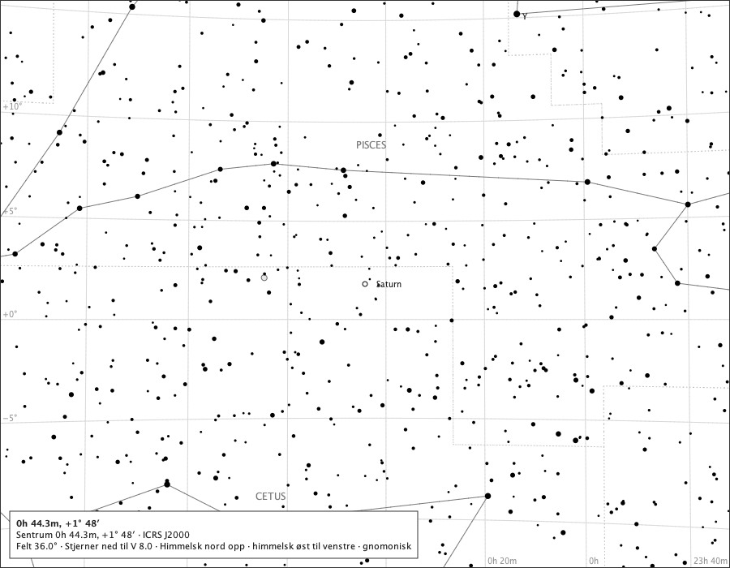

White paper, Norwegian; the page's field 36°. B = -7.43° (south face), B′ = -7.71°; Saturn 31.2° above the horizon.

Saturn drawn at (450.0, 350.0), 0.0000 px off the service's place; the 6 px cartographic symbol, its ink 6.0 × 6.0 px.

Moons: 0 of 7 drawn. Mimas clear, 30.5″ - at primary; Enceladus clear, 24.8″ - at primary; Tethys behind, in shadow, 8.1″ - behind; Dione clear, 59.2″ - at primary; Rhea clear, 32.7″ - at primary; Titan clear, 196.4″ - at primary; Iapetus clear, 577.7″ - at primary.

Spoken: Saturn (et kartografisk symbol, ikke Saturns tilsynelatende diameter).

## The card's instant, 8° field

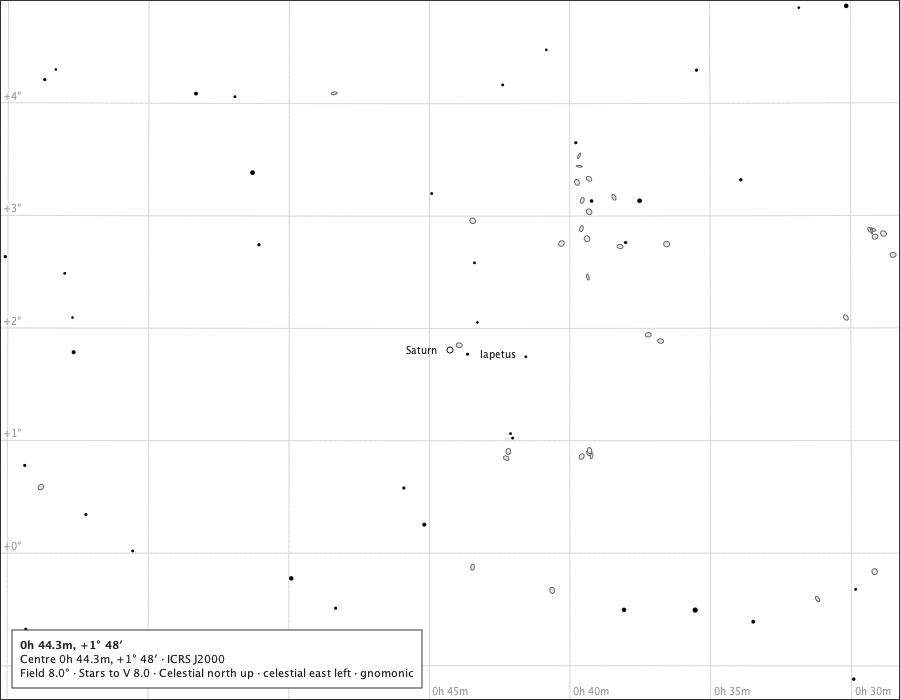

White paper, English; the page's field 8°. B = -7.43° (south face), B′ = -7.71°; Saturn 31.2° above the horizon.

Saturn drawn at (450.0, 350.0), 0.0000 px off the service's place; the 6 px cartographic symbol, its ink 6.0 × 6.0 px.

Moons: 1 of 7 drawn. Mimas clear, 30.5″ - at primary; Enceladus clear, 24.8″ - at primary; Tethys behind, in shadow, 8.1″ - behind; Dione clear, 59.2″ - at primary; Rhea clear, 32.7″ - at primary; Titan clear, 196.4″ - at primary; Iapetus clear, 577.7″ - drawn.

Spoken: Saturn (a cartographic symbol, not Saturn's apparent diameter). Iapetus (a cartographic symbol, not Iapetus's apparent diameter).

## The card's instant, 3° field, black sky

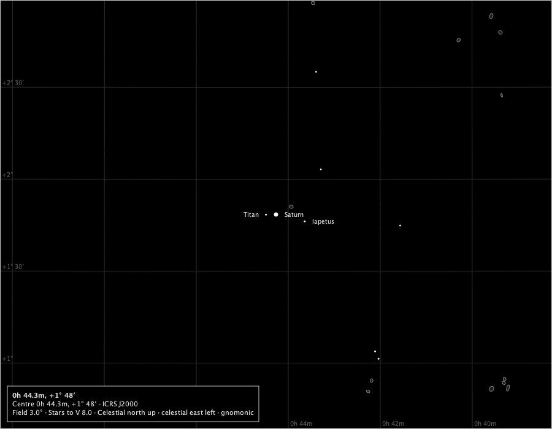

Black sky, English; the page's field 3°. B = -7.43° (south face), B′ = -7.71°; Saturn 31.2° above the horizon.

Saturn drawn at (450.0, 350.0), 0.0000 px off the service's place; the 6 px cartographic symbol, its ink 6.0 × 6.0 px.

Moons: 2 of 7 drawn. Mimas clear, 30.5″ - at primary; Enceladus clear, 24.8″ - at primary; Tethys behind, in shadow, 8.1″ - behind; Dione clear, 59.2″ - at primary; Rhea clear, 32.7″ - at primary; Titan clear, 196.4″ - drawn; Iapetus clear, 577.7″ - drawn.

Spoken: Saturn (a cartographic symbol, not Saturn's apparent diameter). Iapetus (a cartographic symbol, not Iapetus's apparent diameter). Titan (a cartographic symbol, not Titan's apparent diameter).

## The card's instant, 1° field

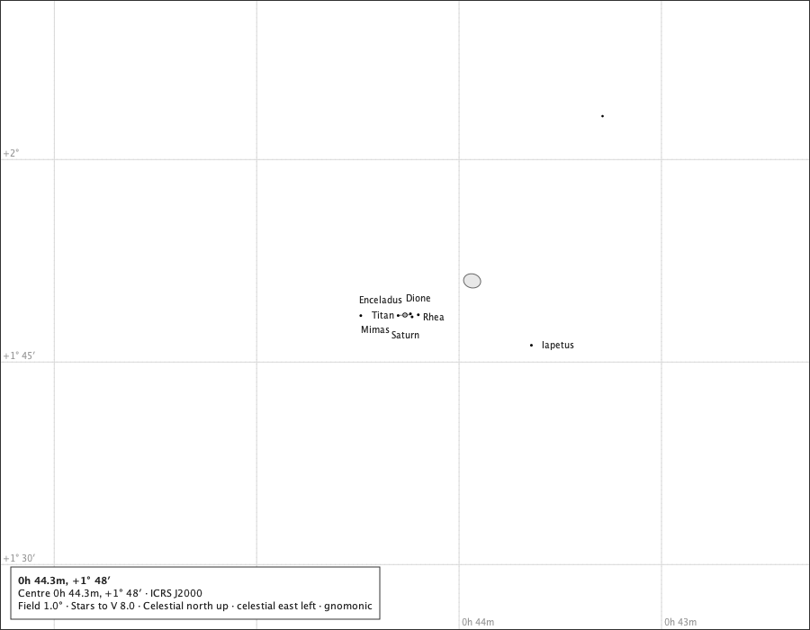

White paper, English; the page's field 1°. B = -7.43° (south face), B′ = -7.71°; Saturn 31.2° above the horizon.

Saturn drawn at (450.0, 350.0), 0.0000 px off the service's place; the true figure, its ink 12.2 × 4.5 px.

Moons: 6 of 7 drawn. Mimas clear, 30.5″ - drawn; Enceladus clear, 24.8″ - drawn; Tethys behind, in shadow, 8.1″ - behind; Dione clear, 59.2″ - drawn; Rhea clear, 32.7″ - drawn; Titan clear, 196.4″ - drawn; Iapetus clear, 577.7″ - drawn.

Spoken: Saturn. Mimas (a cartographic symbol, not Mimas's apparent diameter). Enceladus (a cartographic symbol, not Enceladus's apparent diameter). Dione (a cartographic symbol, not Dione's apparent diameter). Iapetus (a cartographic symbol, not Iapetus's apparent diameter). Rhea (a cartographic symbol, not Rhea's apparent diameter). Titan (a cartographic symbol, not Titan's apparent diameter).

## The card's instant, the 0.5° closer field

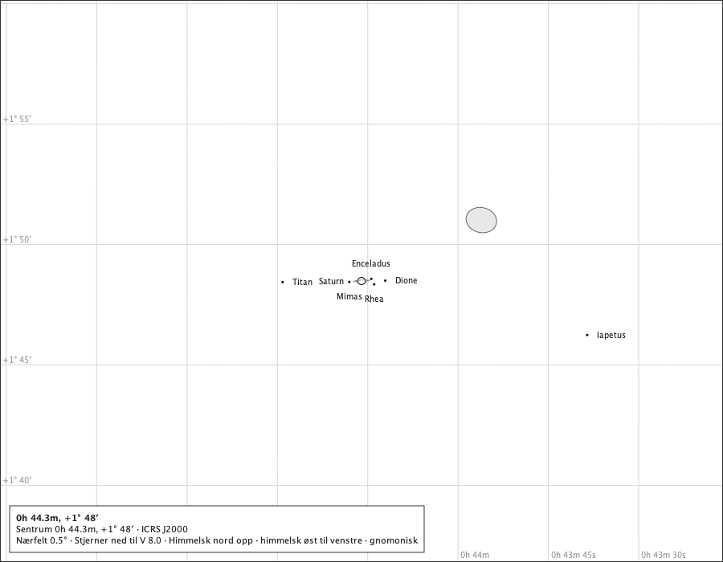

White paper, Norwegian; the page's field 0.5°. B = -7.43° (south face), B′ = -7.71°; Saturn 31.2° above the horizon.

Saturn drawn at (450.0, 350.0), 0.0000 px off the service's place; the true figure, its ink 22.3 × 8.9 px.

Moons: 6 of 7 drawn. Mimas clear, 30.5″ - drawn; Enceladus clear, 24.8″ - drawn; Tethys behind, in shadow, 8.1″ - behind; Dione clear, 59.2″ - drawn; Rhea clear, 32.7″ - drawn; Titan clear, 196.4″ - drawn; Iapetus clear, 577.7″ - drawn.

Spoken: Saturn. Mimas (et kartografisk symbol, ikke Mimas' tilsynelatende diameter). Enceladus (et kartografisk symbol, ikke Enceladus' tilsynelatende diameter). Dione (et kartografisk symbol, ikke Diones tilsynelatende diameter). Iapetus (et kartografisk symbol, ikke Iapetus' tilsynelatende diameter). Rhea (et kartografisk symbol, ikke Rheas tilsynelatende diameter). Titan (et kartografisk symbol, ikke Titans tilsynelatende diameter).

## The card's instant, the 0.25° closer field, black sky

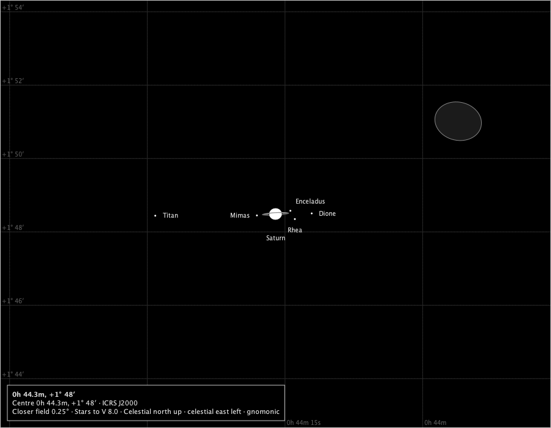

Black sky, English; the page's field 0.25°. B = -7.43° (south face), B′ = -7.71°; Saturn 31.2° above the horizon.

Saturn drawn at (450.0, 350.0), 0.0000 px off the service's place; the true figure, its ink 44.6 × 17.8 px.

Moons: 5 of 7 drawn. Mimas clear, 30.5″ - drawn; Enceladus clear, 24.8″ - drawn; Tethys behind, in shadow, 8.1″ - behind; Dione clear, 59.2″ - drawn; Rhea clear, 32.7″ - drawn; Titan clear, 196.4″ - drawn; Iapetus clear, 577.7″ - off page.

Spoken: Saturn. Mimas (a cartographic symbol, not Mimas's apparent diameter). Enceladus (a cartographic symbol, not Enceladus's apparent diameter). Dione (a cartographic symbol, not Dione's apparent diameter). Rhea (a cartographic symbol, not Rhea's apparent diameter). Titan (a cartographic symbol, not Titan's apparent diameter).

## The rings widest to the north face, 2076-10-10 00:00 UTC, 1° field

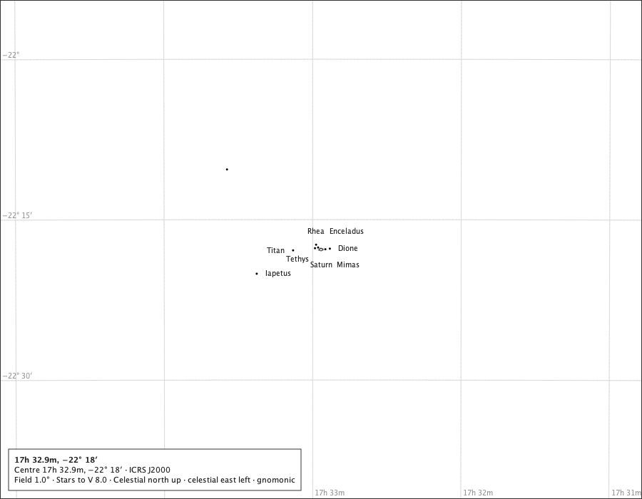

White paper, English; the page's field 1°. B = +26.97° (north face), B′ = +26.61°; Saturn 36.9° below the horizon.

Saturn drawn at (450.0, 350.0), 0.0000 px off the service's place; the true figure, its ink 9.0 × 4.2 px.

Moons: 7 of 7 drawn. Mimas clear, 24.5″ - drawn; Enceladus clear, 19.6″ - drawn; Tethys clear, 34.5″ - drawn; Dione clear, 49.9″ - drawn; Rhea clear, 38.6″ - drawn; Titan clear, 156.5″ - drawn; Iapetus clear, 385.3″ - drawn.

Spoken: Saturn. Mimas (a cartographic symbol, not Mimas's apparent diameter). Enceladus (a cartographic symbol, not Enceladus's apparent diameter). Tethys (a cartographic symbol, not Tethys's apparent diameter). Dione (a cartographic symbol, not Dione's apparent diameter). Iapetus (a cartographic symbol, not Iapetus's apparent diameter). Rhea (a cartographic symbol, not Rhea's apparent diameter). Titan (a cartographic symbol, not Titan's apparent diameter).

## The rings widest to the north face, 2076-10-10 00:00 UTC, the 0.25° closer field

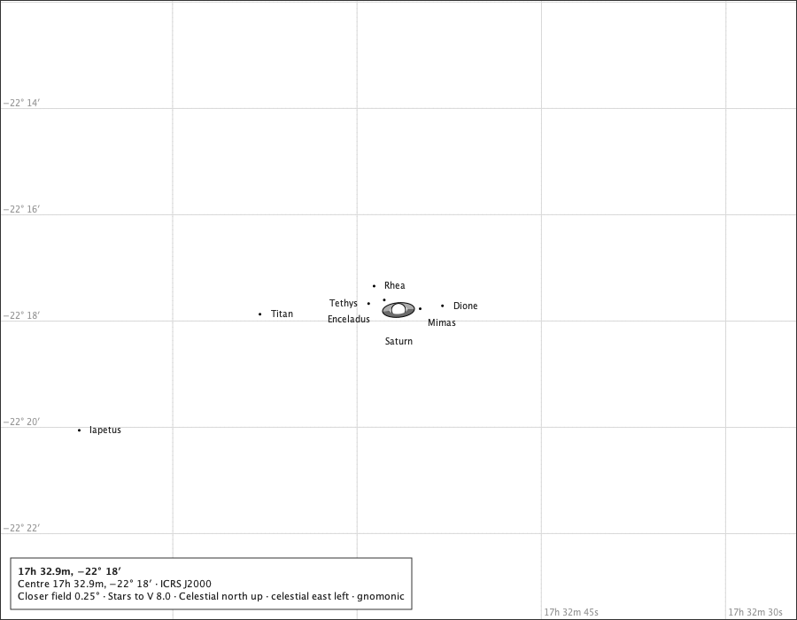

White paper, English; the page's field 0.25°. B = +26.97° (north face), B′ = +26.61°; Saturn 36.9° below the horizon.

Saturn drawn at (450.0, 350.0), 0.0000 px off the service's place; the true figure, its ink 36.1 × 16.7 px.

Moons: 7 of 7 drawn. Mimas clear, 24.5″ - drawn; Enceladus clear, 19.6″ - drawn; Tethys clear, 34.5″ - drawn; Dione clear, 49.9″ - drawn; Rhea clear, 38.6″ - drawn; Titan clear, 156.5″ - drawn; Iapetus clear, 385.3″ - drawn.

Spoken: Saturn. Mimas (a cartographic symbol, not Mimas's apparent diameter). Enceladus (a cartographic symbol, not Enceladus's apparent diameter). Tethys (a cartographic symbol, not Tethys's apparent diameter). Dione (a cartographic symbol, not Dione's apparent diameter). Iapetus (a cartographic symbol, not Iapetus's apparent diameter). Rhea (a cartographic symbol, not Rhea's apparent diameter). Titan (a cartographic symbol, not Titan's apparent diameter).

## The rings widest to the south face, 2003-04-05 00:00 UTC, the 0.25° closer field, black sky

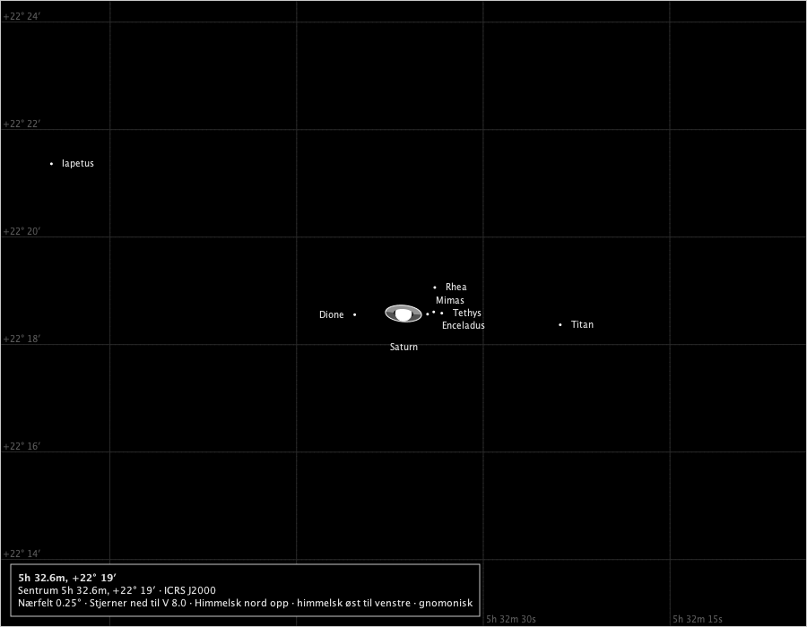

Black sky, Norwegian; the page's field 0.25°. B = -26.99° (south face), B′ = -26.57°; Saturn 5.4° above the horizon.

Saturn drawn at (450.0, 350.0), 0.0000 px off the service's place; the true figure, its ink 40.2 × 18.6 px.

Moons: 7 of 7 drawn. Mimas clear, 26.8″ - drawn; Enceladus clear, 33.8″ - drawn; Tethys clear, 42.7″ - drawn; Dione clear, 54.4″ - drawn; Rhea clear, 45.4″ - drawn; Titan clear, 175.3″ - drawn; Iapetus clear, 426.8″ - drawn.

Spoken: Saturn. Mimas (et kartografisk symbol, ikke Mimas' tilsynelatende diameter). Enceladus (et kartografisk symbol, ikke Enceladus' tilsynelatende diameter). Tethys (et kartografisk symbol, ikke Tethys' tilsynelatende diameter). Dione (et kartografisk symbol, ikke Diones tilsynelatende diameter). Iapetus (et kartografisk symbol, ikke Iapetus' tilsynelatende diameter). Rhea (et kartografisk symbol, ikke Rheas tilsynelatende diameter). Titan (et kartografisk symbol, ikke Titans tilsynelatende diameter).

## The Earth's ring-plane crossing, 2025-03-23 17:51 UTC, the 0.25° closer field

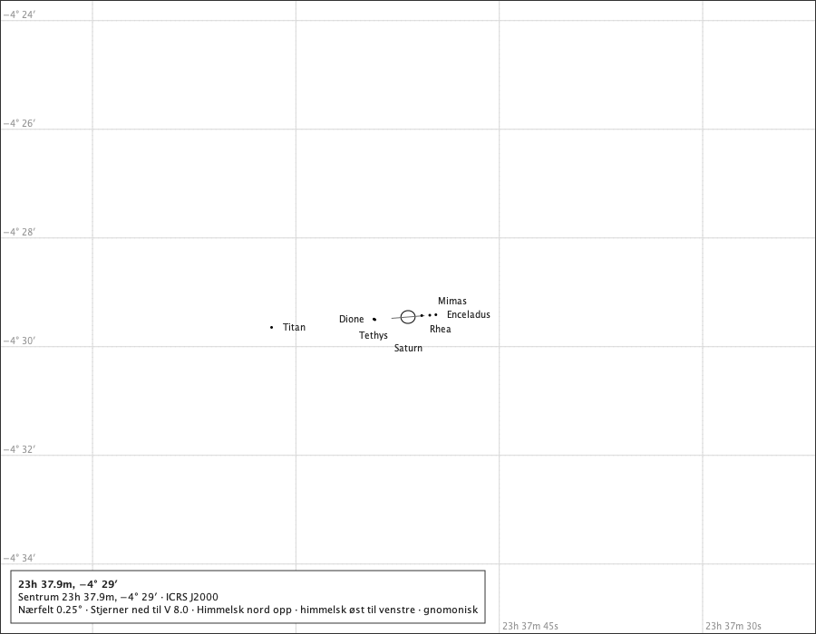

White paper, Norwegian; the page's field 0.25°. B = +0.00° (north face), B′ = +0.65°; Saturn 11.3° below the horizon.

Saturn drawn at (450.0, 350.0), 0.0000 px off the service's place; the true figure, its ink 36.6 × 14.2 px.

Moons: 6 of 7 drawn. Mimas clear, 24.1″ - drawn; Enceladus clear, 30.8″ - drawn; Tethys clear, 37.6″ - drawn; Dione clear, 36.6″ - drawn; Rhea clear, 15.3″ - drawn; Titan clear, 150.9″ - drawn; Iapetus clear, 467.4″ - off page.

Spoken: Saturn. Mimas (et kartografisk symbol, ikke Mimas' tilsynelatende diameter). Enceladus (et kartografisk symbol, ikke Enceladus' tilsynelatende diameter). Tethys (et kartografisk symbol, ikke Tethys' tilsynelatende diameter). Dione (et kartografisk symbol, ikke Diones tilsynelatende diameter). Rhea (et kartografisk symbol, ikke Rheas tilsynelatende diameter). Titan (et kartografisk symbol, ikke Titans tilsynelatende diameter).

## The unlit face seen, 2025-05-06 00:00 UTC, the 0.25° closer field

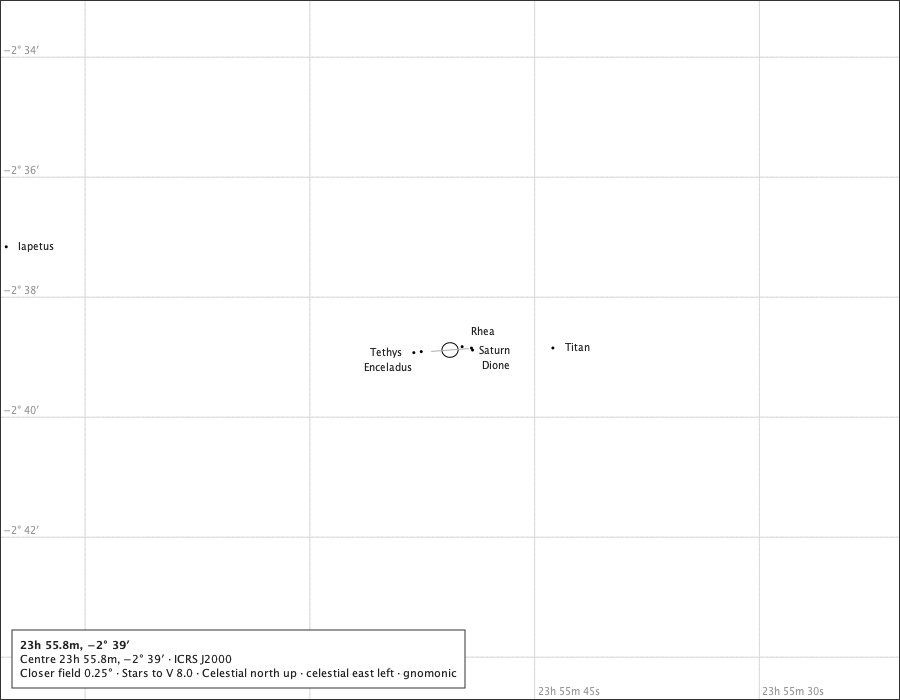

White paper, English; the page's field 0.25°. B = -2.19° (south face, the unlit face seen), B′ = +0.01°; Saturn 18.7° below the horizon.

Saturn drawn at (450.0, 350.0), 0.0000 px off the service's place; the true figure, its ink 37.8 × 14.6 px.

Moons: 7 of 7 drawn. Mimas clear, 21.5″ - drawn; Enceladus clear, 28.8″ - drawn; Tethys clear, 36.3″ - drawn; Dione clear, 22.6″ - drawn; Rhea clear, 12.6″ - drawn; Titan clear, 102.9″ - drawn; Iapetus clear, 455.5″ - drawn.

Spoken: Saturn. Mimas (a cartographic symbol, not Mimas's apparent diameter). Enceladus (a cartographic symbol, not Enceladus's apparent diameter). Tethys (a cartographic symbol, not Tethys's apparent diameter). Dione (a cartographic symbol, not Dione's apparent diameter). Iapetus (a cartographic symbol, not Iapetus's apparent diameter). Rhea (a cartographic symbol, not Rhea's apparent diameter). Titan (a cartographic symbol, not Titan's apparent diameter).

## Saturn below the drawn horizon, 2026-12-01 12:40 UTC, 8° field

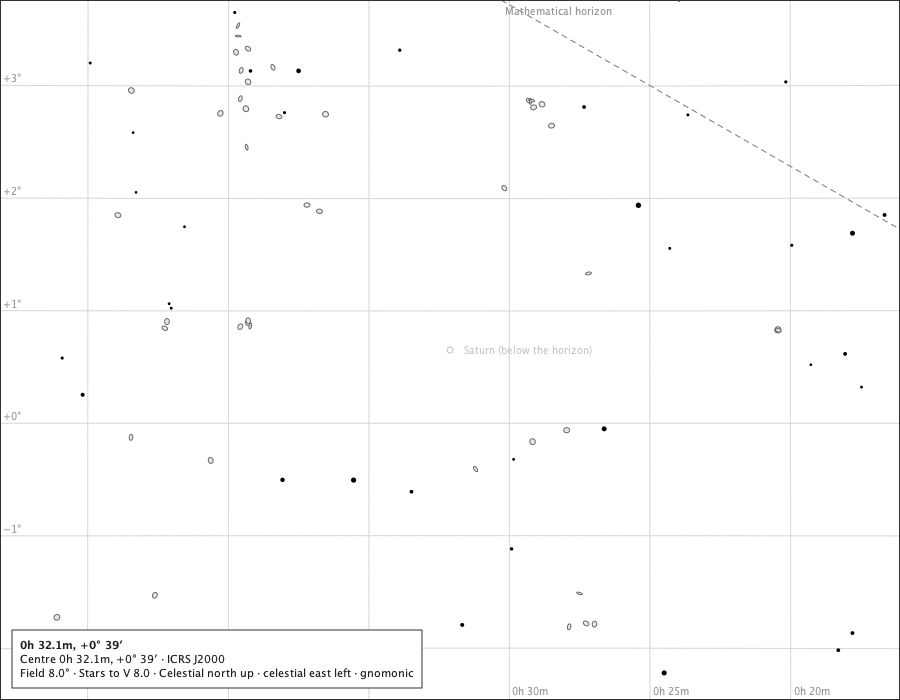

White paper, English; the page's field 8°. B = -6.10° (south face), B′ = -8.56°; Saturn 2.9° below the horizon.

Saturn drawn at (450.0, 350.0), 0.0000 px off the service's place; the 6 px cartographic symbol, its ink 6.0 × 6.0 px; below the horizon, dimmed.

Moons: 0 of 7 drawn. Mimas clear, 27.9″ - at primary; Enceladus clear, 21.9″ - at primary; Tethys in front, 4.1″ - in front unresolved; Dione clear, 52.5″ - at primary; Rhea clear, 74.6″ - at primary; Titan clear, 111.7″ - at primary; Iapetus clear, 104.6″ - at primary.

Spoken: Saturn (below the horizon) (a cartographic symbol, not Saturn's apparent diameter).

## The same page with the horizon hidden

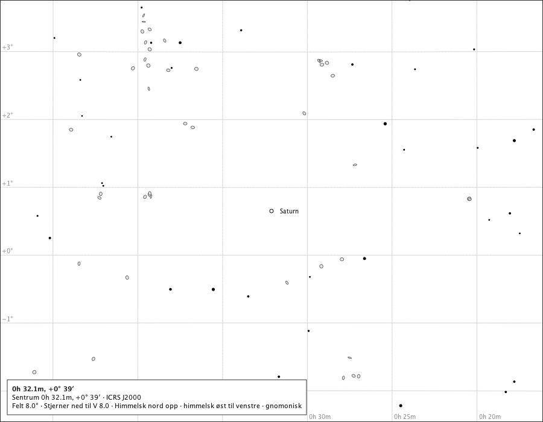

White paper, Norwegian; the page's field 8°. B = -6.10° (south face), B′ = -8.56°; Saturn 2.9° below the horizon.

Saturn drawn at (450.0, 350.0), 0.0000 px off the service's place; the 6 px cartographic symbol, its ink 6.0 × 6.0 px.

Moons: 0 of 7 drawn. Mimas clear, 27.9″ - at primary; Enceladus clear, 21.9″ - at primary; Tethys in front, 4.1″ - in front unresolved; Dione clear, 52.5″ - at primary; Rhea clear, 74.6″ - at primary; Titan clear, 111.7″ - at primary; Iapetus clear, 104.6″ - at primary.

Spoken: Saturn (et kartografisk symbol, ikke Saturns tilsynelatende diameter).

## The moons

Each moon decided on its own by the page against the drawn figure (ruling 3 on #578): the rings' ellipse where the figure is true, the 6 px mark otherwise, and the globe's width for a moon in front. At the card's instant, by field:

| field | drawn | at Saturn | collides | in front unresolved | behind |
|---|---|---|---|---|---|
| 36° | 0 | 6 | 0 | 0 | 1 |
| 12° | 1 | 5 | 0 | 0 | 1 |
| 8° | 1 | 5 | 0 | 0 | 1 |
| 3° | 2 | 4 | 0 | 0 | 1 |
| 2° | 2 | 4 | 0 | 0 | 1 |
| 1° | 6 | 0 | 0 | 0 | 1 |

## Titan at greatest elongation (the handover's named case), 2026-08-01 18:00 UTC, 1° field

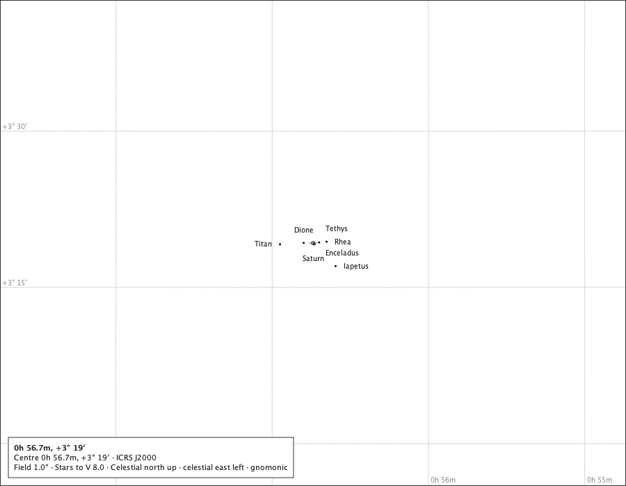

White paper, English; the page's field 1°. B = -9.10° (south face), B′ = -6.76°; Saturn 20.5° below the horizon.

Saturn drawn at (450.0, 350.0), 0.0000 px off the service's place; the true figure, its ink 11.5 × 4.2 px.

Moons: 6 of 7 drawn. Mimas behind, 9.1″ - behind; Enceladus clear, 35.2″ - drawn; Tethys in shadow, 9.3″ - drawn; Dione clear, 53.5″ - drawn; Rhea clear, 78.3″ - drawn; Titan clear, 189.8″ - drawn; Iapetus clear, 185.8″ - drawn.

Spoken: Saturn. Tethys, in Saturn's shadow (a cartographic symbol, not Tethys's apparent diameter). Enceladus (a cartographic symbol, not Enceladus's apparent diameter). Dione (a cartographic symbol, not Dione's apparent diameter). Iapetus (a cartographic symbol, not Iapetus's apparent diameter). Rhea (a cartographic symbol, not Rhea's apparent diameter). Titan (a cartographic symbol, not Titan's apparent diameter).

## Iapetus at its farthest 2026 day, 2026-10-03 00:00 UTC, 3° field

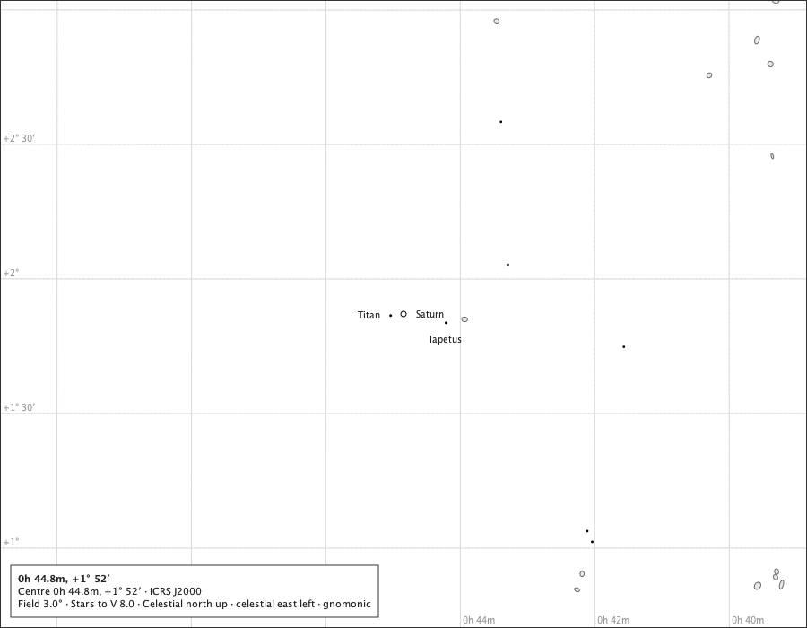

White paper, English; the page's field 3°. B = -7.50° (south face), B′ = -7.68°; Saturn 31.5° above the horizon.

Saturn drawn at (450.0, 350.0), 0.0000 px off the service's place; the 6 px cartographic symbol, its ink 6.0 × 6.0 px.

Moons: 2 of 7 drawn. Mimas clear, 19.8″ - at primary; Enceladus clear, 31.6″ - at primary; Tethys clear, 13.1″ - at primary; Dione clear, 25.8″ - at primary; Rhea clear, 11.1″ - at primary; Titan clear, 173.0″ - drawn; Iapetus clear, 581.8″ - drawn.

Spoken: Saturn (a cartographic symbol, not Saturn's apparent diameter). Iapetus (a cartographic symbol, not Iapetus's apparent diameter). Titan (a cartographic symbol, not Titan's apparent diameter).

## The most crowded 2026 configuration with all seven moons clear, 2026-04-11 00:00 UTC, 1° field

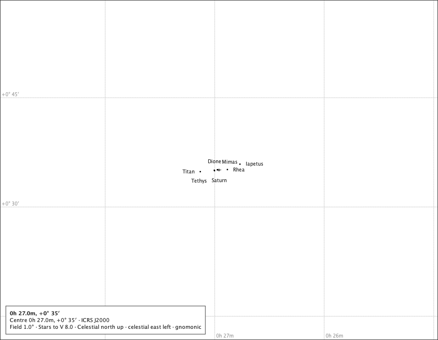

White paper, English; the page's field 1°. B = -5.95° (south face), B′ = -5.07°; Saturn 26.8° below the horizon.

Saturn drawn at (450.0, 350.0), 0.0000 px off the service's place; the true figure, its ink 10.1 × 3.6 px.

Moons: 7 of 7 drawn. Mimas clear, 12.6″ - drawn; Enceladus clear, 12.8″ - drawn; Tethys clear, 38.7″ - drawn; Dione clear, 37.1″ - drawn; Rhea clear, 69.0″ - drawn; Titan clear, 154.5″ - drawn; Iapetus clear, 178.8″ - drawn.

Spoken: Saturn. Mimas (a cartographic symbol, not Mimas's apparent diameter). Enceladus (a cartographic symbol, not Enceladus's apparent diameter). Tethys (a cartographic symbol, not Tethys's apparent diameter). Dione (a cartographic symbol, not Dione's apparent diameter). Iapetus (a cartographic symbol, not Iapetus's apparent diameter). Rhea (a cartographic symbol, not Rhea's apparent diameter). Titan (a cartographic symbol, not Titan's apparent diameter).

## The most crowded 2026 configuration, 2026-04-11 00:00 UTC, the 0.25° closer field, black sky

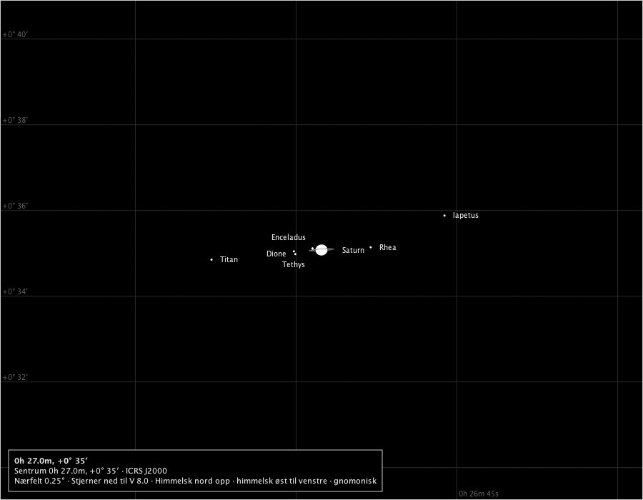

Black sky, Norwegian; the page's field 0.25°. B = -5.95° (south face), B′ = -5.07°; Saturn 26.8° below the horizon.

Saturn drawn at (450.0, 350.0), 0.0000 px off the service's place; the true figure, its ink 36.0 × 14.4 px.

Moons: 7 of 7 drawn. Mimas clear, 12.6″ - drawn; Enceladus clear, 12.8″ - drawn; Tethys clear, 38.7″ - drawn; Dione clear, 37.1″ - drawn; Rhea clear, 69.0″ - drawn; Titan clear, 154.5″ - drawn; Iapetus clear, 178.8″ - drawn.

Spoken: Saturn. Mimas (et kartografisk symbol, ikke Mimas' tilsynelatende diameter). Enceladus (et kartografisk symbol, ikke Enceladus' tilsynelatende diameter). Tethys (et kartografisk symbol, ikke Tethys' tilsynelatende diameter). Dione (et kartografisk symbol, ikke Diones tilsynelatende diameter). Iapetus (et kartografisk symbol, ikke Iapetus' tilsynelatende diameter). Rhea (et kartografisk symbol, ikke Rheas tilsynelatende diameter). Titan (et kartografisk symbol, ikke Titans tilsynelatende diameter).

## A moon in front of Saturn, 2026-07-01 03:00 UTC, 1° field

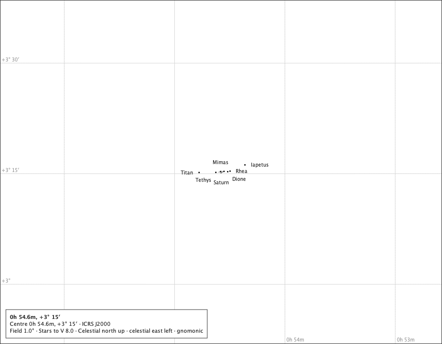

White paper, English; the page's field 1°. B = -9.01° (south face), B′ = -6.29°; Saturn 26.1° above the horizon.

Saturn drawn at (450.0, 350.0), 0.0000 px off the service's place; the true figure, its ink 11.0 × 4.0 px.

Moons: 7 of 7 drawn. Mimas in front, 5.5″ - drawn; Enceladus clear, 24.8″ - drawn; Tethys clear, 42.2″ - drawn; Dione clear, 54.8″ - drawn; Rhea clear, 74.1″ - drawn; Titan clear, 178.5″ - drawn; Iapetus clear, 203.4″ - drawn.

Spoken: Saturn. Enceladus (a cartographic symbol, not Enceladus's apparent diameter). Tethys (a cartographic symbol, not Tethys's apparent diameter). Dione (a cartographic symbol, not Dione's apparent diameter). Iapetus (a cartographic symbol, not Iapetus's apparent diameter). Rhea (a cartographic symbol, not Rhea's apparent diameter). Titan (a cartographic symbol, not Titan's apparent diameter). Mimas, in front of Saturn (a cartographic symbol, not Mimas's apparent diameter).

## A moon in front of Saturn, 2026-07-01 03:00 UTC, the 0.25° closer field

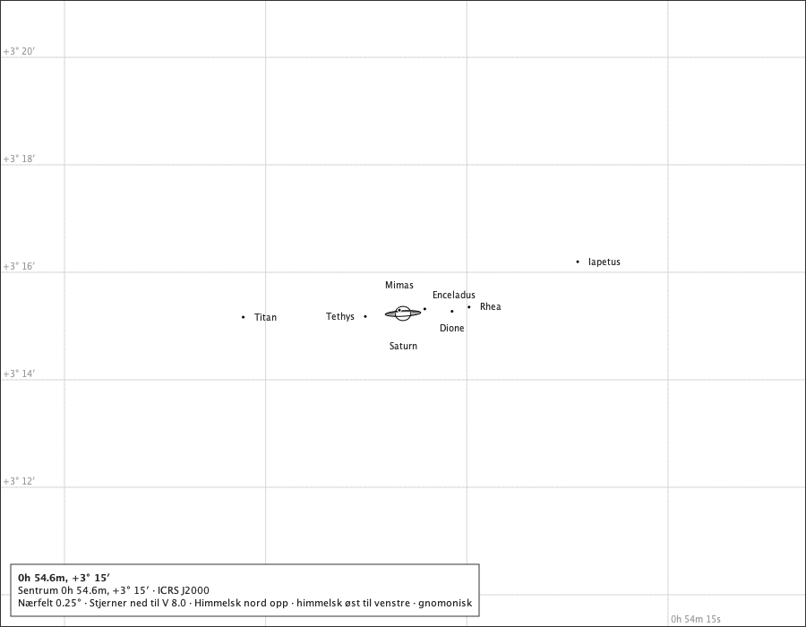

White paper, Norwegian; the page's field 0.25°. B = -9.01° (south face), B′ = -6.29°; Saturn 26.1° above the horizon.

Saturn drawn at (450.0, 350.0), 0.0000 px off the service's place; the true figure, its ink 39.7 × 15.8 px.

Moons: 7 of 7 drawn. Mimas in front, 5.5″ - drawn; Enceladus clear, 24.8″ - drawn; Tethys clear, 42.2″ - drawn; Dione clear, 54.8″ - drawn; Rhea clear, 74.1″ - drawn; Titan clear, 178.5″ - drawn; Iapetus clear, 203.4″ - drawn.

Spoken: Saturn. Enceladus (et kartografisk symbol, ikke Enceladus' tilsynelatende diameter). Tethys (et kartografisk symbol, ikke Tethys' tilsynelatende diameter). Dione (et kartografisk symbol, ikke Diones tilsynelatende diameter). Iapetus (et kartografisk symbol, ikke Iapetus' tilsynelatende diameter). Rhea (et kartografisk symbol, ikke Rheas tilsynelatende diameter). Titan (et kartografisk symbol, ikke Titans tilsynelatende diameter). Mimas, foran Saturn (et kartografisk symbol, ikke Mimas' tilsynelatende diameter).

## A moon behind Saturn, not drawn, 2026-07-01 16:00 UTC, the 0.25° closer field

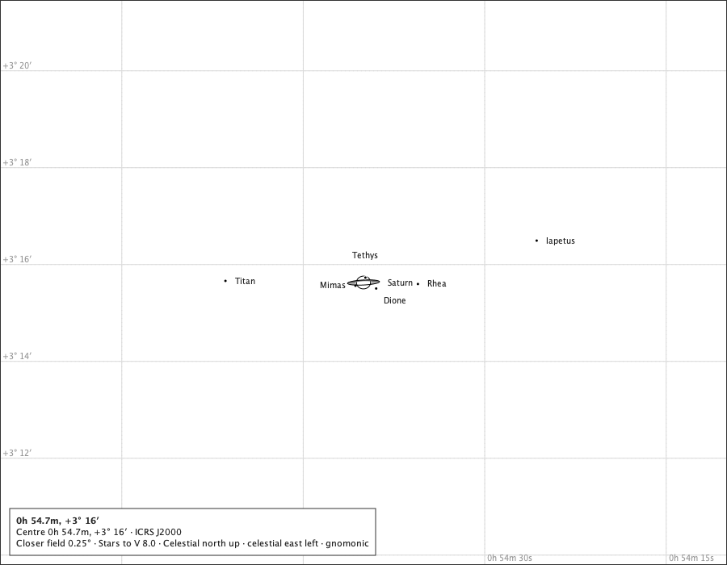

White paper, English; the page's field 0.25°. B = -9.02° (south face), B′ = -6.29°; Saturn 24.0° below the horizon.

Saturn drawn at (450.0, 350.0), 0.0000 px off the service's place; the true figure, its ink 39.7 × 15.9 px.

Moons: 6 of 7 drawn. Mimas clear, 10.7″ - drawn; Enceladus behind, 7.4″ - behind; Tethys in front, 6.5″ - drawn; Dione clear, 17.4″ - drawn; Rhea clear, 67.4″ - drawn; Titan clear, 170.9″ - drawn; Iapetus clear, 220.6″ - drawn.

Spoken: Saturn. Mimas (a cartographic symbol, not Mimas's apparent diameter). Dione (a cartographic symbol, not Dione's apparent diameter). Iapetus (a cartographic symbol, not Iapetus's apparent diameter). Rhea (a cartographic symbol, not Rhea's apparent diameter). Titan (a cartographic symbol, not Titan's apparent diameter). Tethys, in front of Saturn (a cartographic symbol, not Tethys's apparent diameter).

## A moon in Saturn's shadow, 2026-07-01 14:00 UTC, the 0.25° closer field, black sky

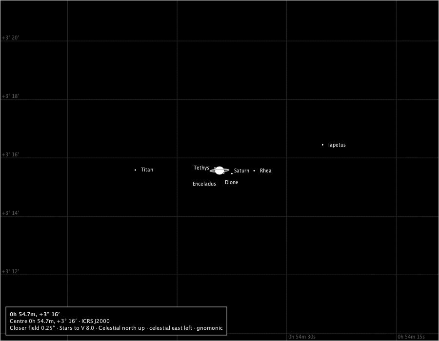

Black sky, English; the page's field 0.25°. B = -9.02° (south face), B′ = -6.29°; Saturn 14.2° below the horizon.

Saturn drawn at (450.0, 350.0), 0.0000 px off the service's place; the true figure, its ink 39.7 × 15.9 px.

Moons: 6 of 7 drawn. Mimas behind, in shadow, 6.0″ - behind; Enceladus in shadow, 9.6″ - drawn; Tethys clear, 10.8″ - drawn; Dione clear, 26.2″ - drawn; Rhea clear, 71.1″ - drawn; Titan clear, 172.5″ - drawn; Iapetus clear, 217.9″ - drawn.

Spoken: Saturn. Enceladus, in Saturn's shadow (a cartographic symbol, not Enceladus's apparent diameter). Tethys (a cartographic symbol, not Tethys's apparent diameter). Dione (a cartographic symbol, not Dione's apparent diameter). Iapetus (a cartographic symbol, not Iapetus's apparent diameter). Rhea (a cartographic symbol, not Rhea's apparent diameter). Titan (a cartographic symbol, not Titan's apparent diameter).

## A moon partly in Saturn's shadow, 2026-08-06 07:00 UTC, 1° field

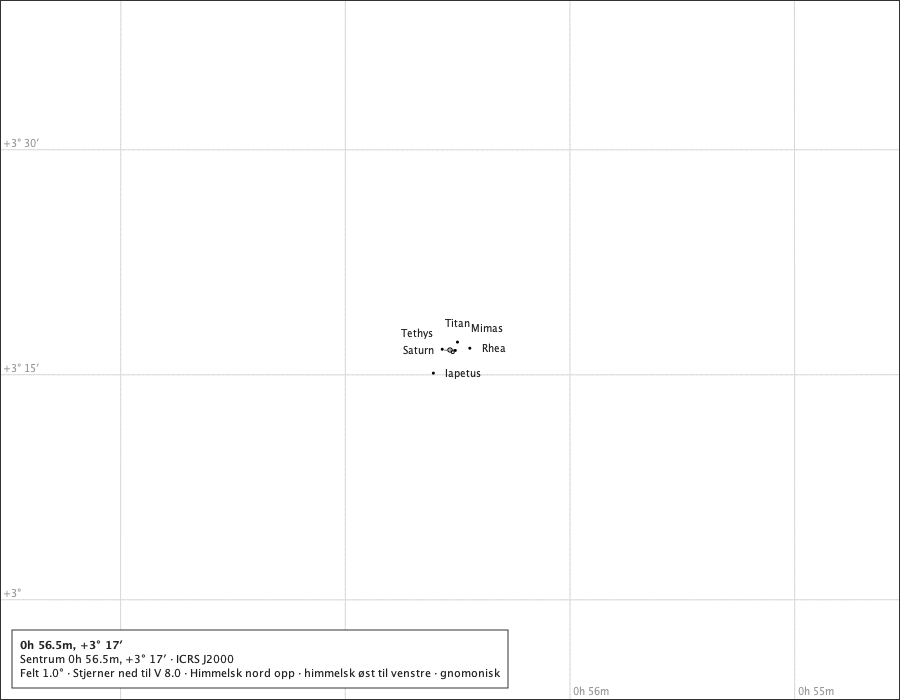

White paper, Norwegian; the page's field 1°. B = -9.06° (south face), B′ = -6.82°; Saturn 19.3° above the horizon.

Saturn drawn at (450.0, 350.0), 0.0000 px off the service's place; the true figure, its ink 11.6 × 4.2 px.

Moons: 6 of 7 drawn. Mimas clear, 21.3″ - drawn; Enceladus behind, 7.9″ - behind; Tethys clear, 31.2″ - drawn; Dione partly in shadow, 13.8″ - drawn; Rhea clear, 79.6″ - drawn; Titan clear, 43.4″ - drawn; Iapetus clear, 113.9″ - drawn.

Spoken: Saturn. Dione, delvis i Saturns skygge (et kartografisk symbol, ikke Diones tilsynelatende diameter). Mimas (et kartografisk symbol, ikke Mimas' tilsynelatende diameter). Tethys (et kartografisk symbol, ikke Tethys' tilsynelatende diameter). Iapetus (et kartografisk symbol, ikke Iapetus' tilsynelatende diameter). Rhea (et kartografisk symbol, ikke Rheas tilsynelatende diameter). Titan (et kartografisk symbol, ikke Titans tilsynelatende diameter).

The moons' names are attempted for every drawn moon and refused one by one, a refused label never blocking another (ruling 3 on #578); which names this desktop's fonts place is in `platform.md`, with the count over 2026.

## The exported sheet

**The sheet: A4, 1°**, centred on Saturn at the card's instant, as `sheet-a4-saturn.png` (300 dpi, 3508 × 2480 px) and `sheet-a4-saturn.pdf`. The figure is drawn in page units, as the screen draws it: the rings' major axis is 3.37 mm on the sheet and the globe 1.49 mm; the screen and the exported sheet draw the same centre, pole, opening, figure and name (ruling 7 on #578).

