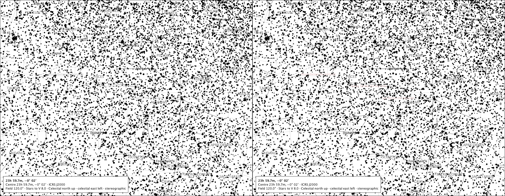
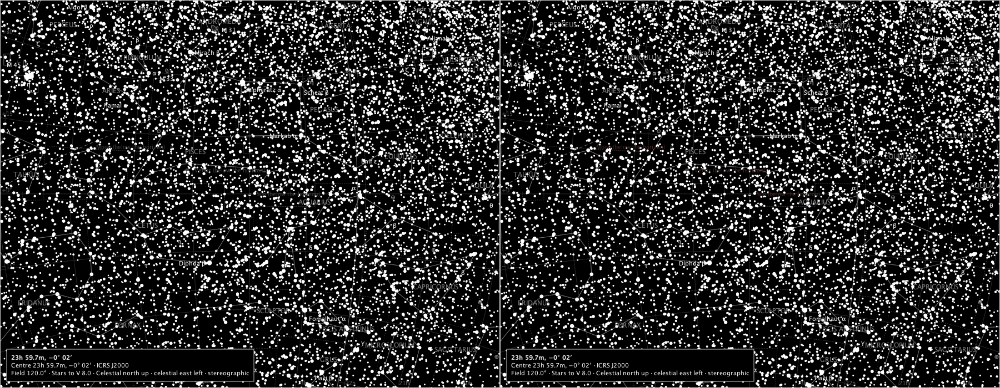
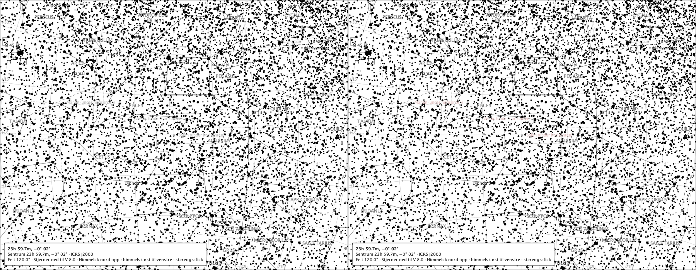
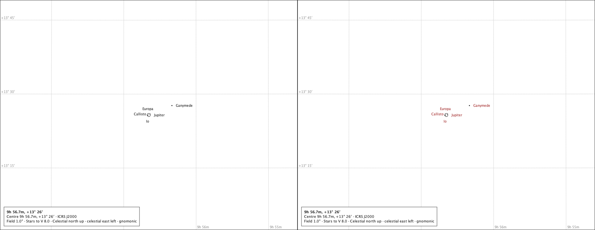
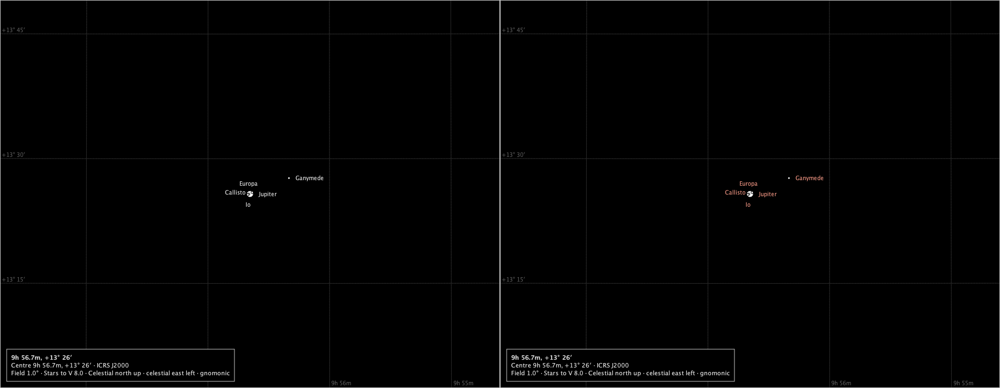
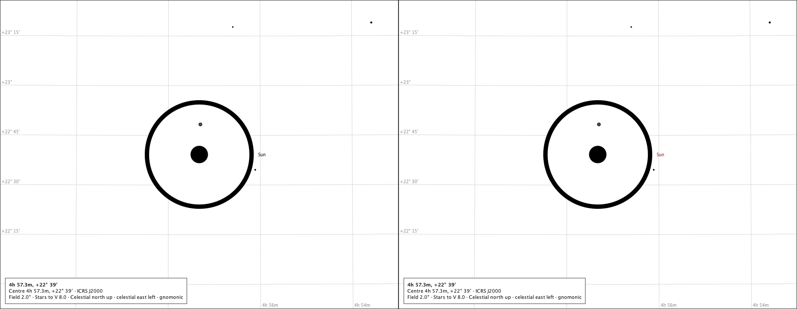

# The Solar System labels as one emphasis class

Sprint 49, issue #526. One emphasis choice, *Solar System labels* / *Solsystemetiketter*, raises the label of every drawn Solar System body - the Sun, the Moon, every drawn planet, the Galilean moons when their names are drawn - in the atlas's existing deep red, the meridian's frozen accent (#361): `#a42e2e` on white paper, `#e8907e` on the black sky. Labels only: the discs, marks, phase geometry and state marks keep their ink and rules; a name the placement refuses is not forced; a name below the drawn horizon is quieted exactly as the text ink is; the label-placement order is unchanged. Each page below is the production composition drawn canonical (left) and with the class raised (right); the counts of changed pixels are this desktop's fonts' and stand in `platform.md`. The class joins the set the reader raises - transient, never persisted, like the six line structures - and an export carries its token `solar-system-labels`. Regenerate with `make solar-system-labels-study`.

## A wide page: the Sun, the Moon and Venus under the horizon

Oslo, 2026-03-20 21:33 UTC - the packaged emphasis journey's instant - at 120°, the meridian module's horizon drawn: the Sun is below it, its name carrying the language's status, quieted on both pages.

### 120°, white paper, English

Canonical left, the class raised right. Placed: venus (below the horizon), sun (below the horizon), moon (below the horizon). Refused: none. The placements are identical on both pages; every changed pixel lies inside a placed name's box: yes.

### 120°, black sky, English

Canonical left, the class raised right. Placed: venus (below the horizon), sun (below the horizon), moon (below the horizon). Refused: none. The placements are identical on both pages; every changed pixel lies inside a placed name's box: yes.

### 120°, white paper, Norwegian

Canonical left, the class raised right. Placed: venus (below the horizon), sun (below the horizon), moon (below the horizon). Refused: none. The placements are identical on both pages; every changed pixel lies inside a placed name's box: yes.

## A close page: Jupiter and its moons at the minimum field

Oslo, 2026-12-11 22:45 UTC, the named triple transit, at 1°: Jupiter's name and the drawn moons' take the red together; a moon whose name the placement refused keeps no name on either page.

### 1°, white paper, English

Canonical left, the class raised right. Placed: jovian.jupiter, jovian.ganymede, jovian.europa, jovian.io, jovian.callisto. Refused: none. The placements are identical on both pages; every changed pixel lies inside a placed name's box: yes.

### 1°, black sky, English

Canonical left, the class raised right. Placed: jovian.jupiter, jovian.ganymede, jovian.europa, jovian.io, jovian.callisto. Refused: none. The placements are identical on both pages; every changed pixel lies inside a placed name's box: yes.

## A refused name: Venus in front of the Sun

Oslo, 2012-06-06 01:00 UTC at 2° (#514): every candidate box for Venus's name lies inside the Sun's ink, so the name is refused - and the class does not force it; only the Sun's name takes the red.

### 2°, white paper, English

Canonical left, the class raised right. Placed: sun. Refused: venus. The placements are identical on both pages; every changed pixel lies inside a placed name's box: yes.

