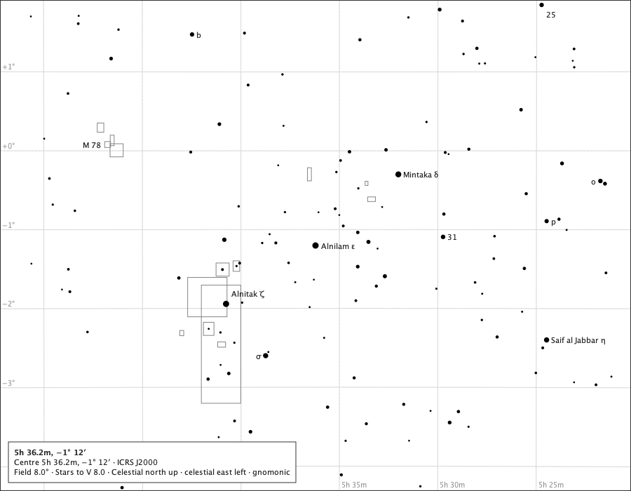
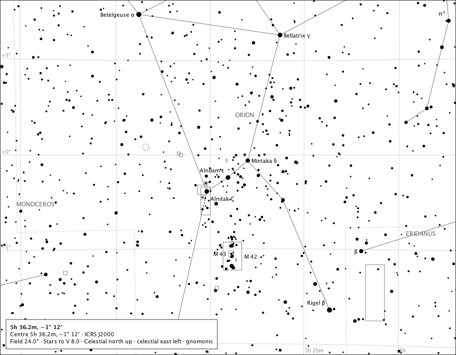
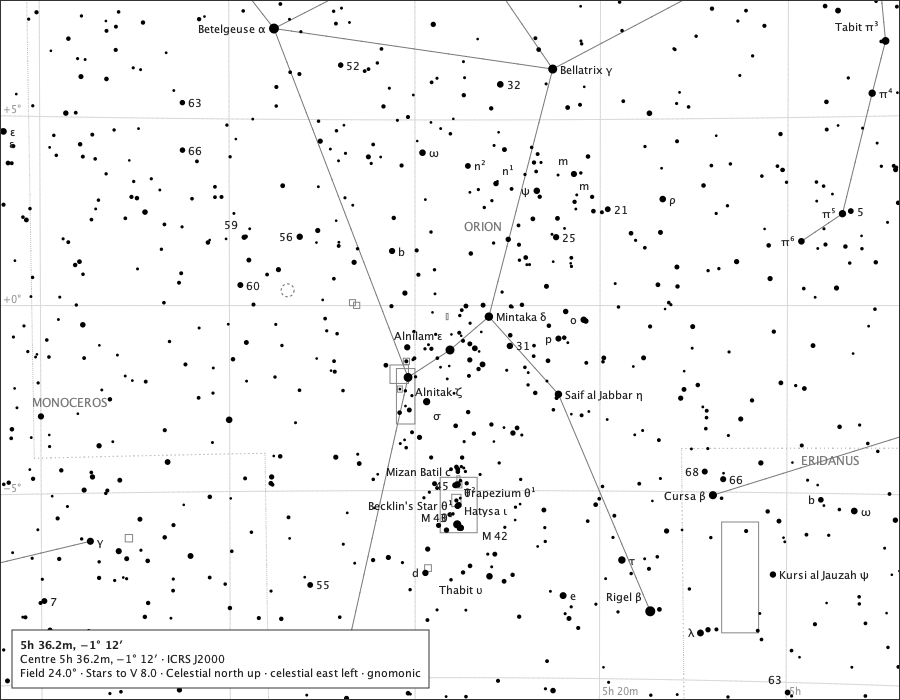
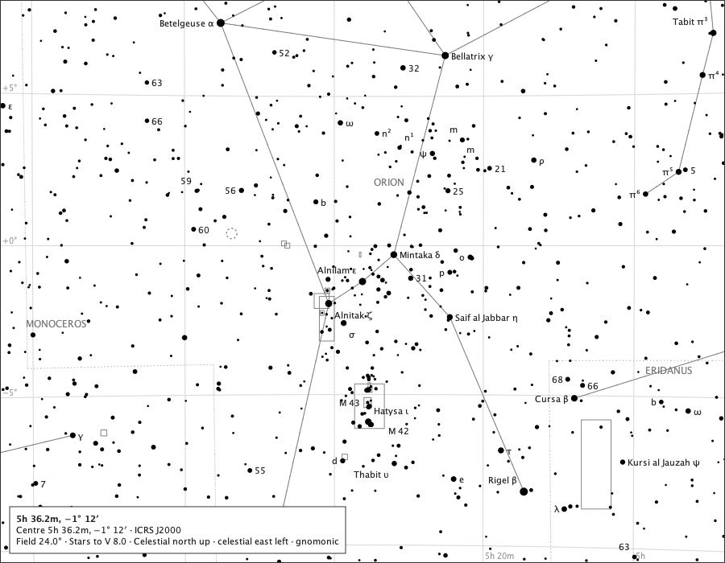
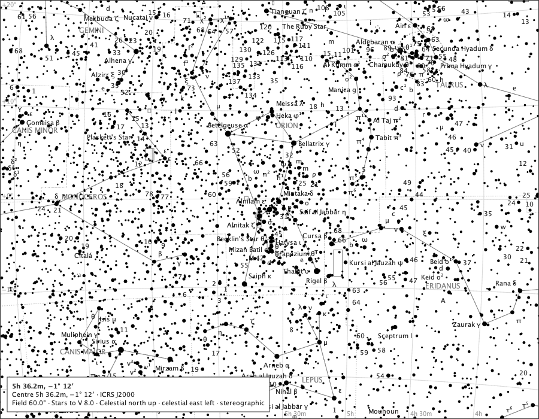
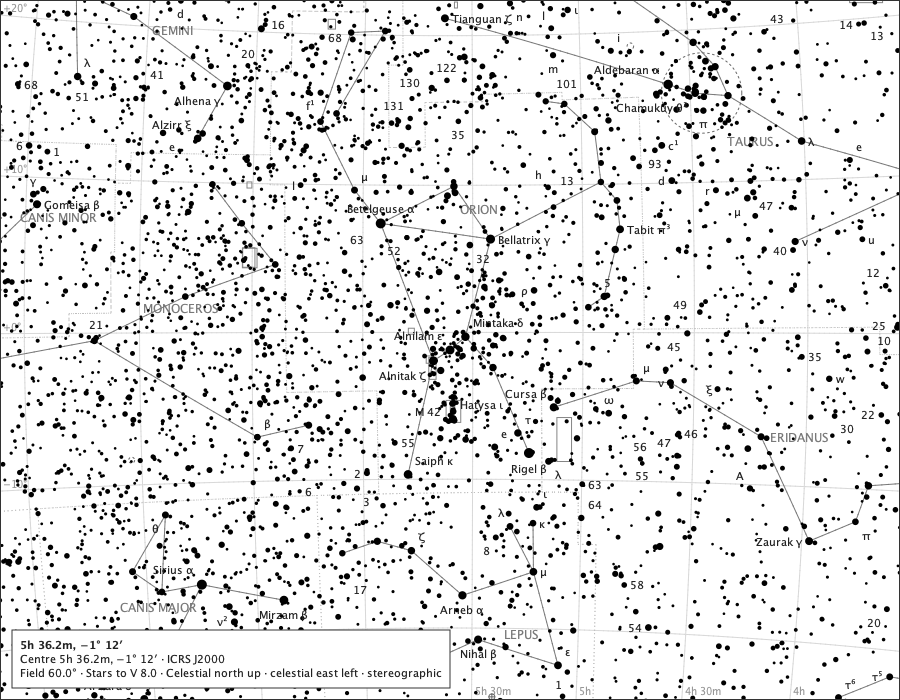
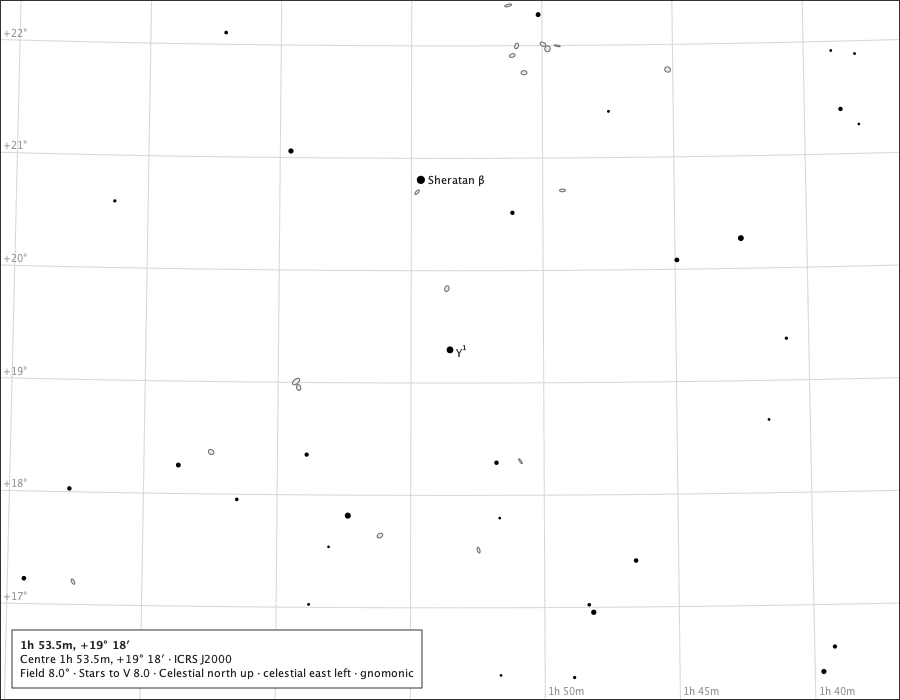
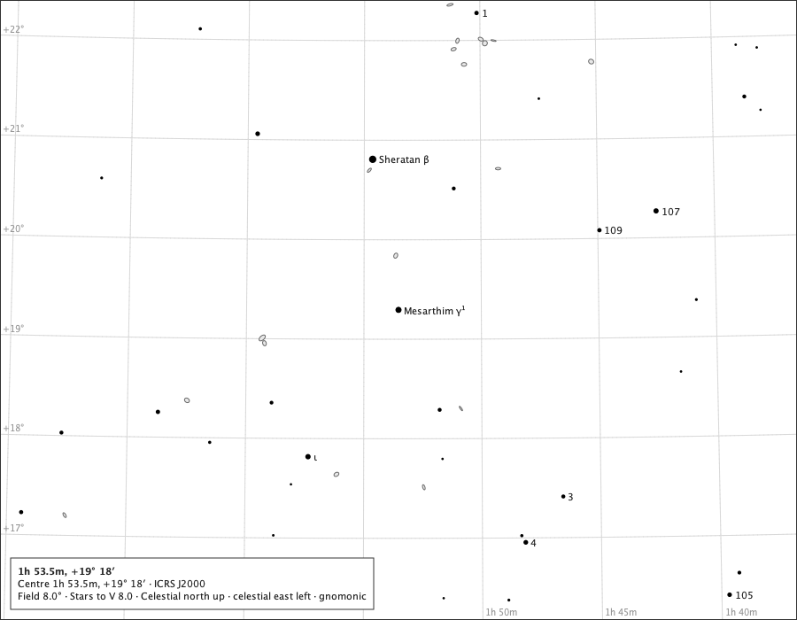
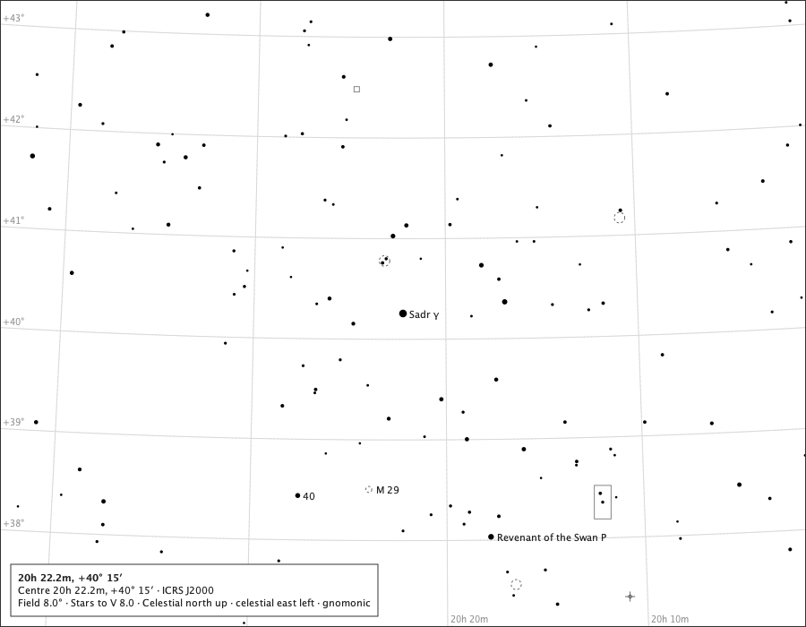
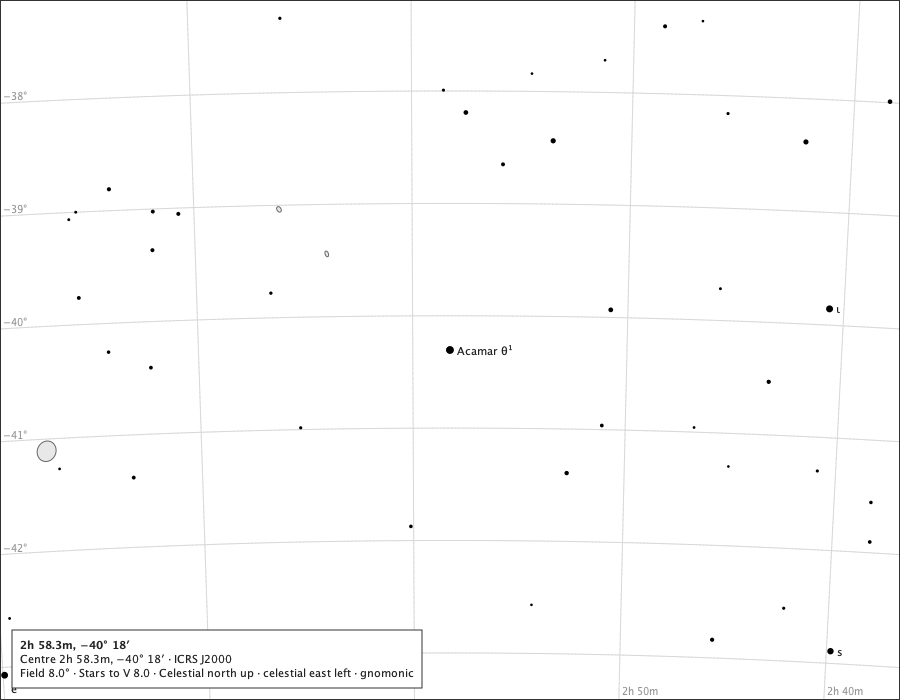

# All star identities where they fit: measurements

Sprint 51, issue #557, a study ahead of #558. Every page is a production scene (900 × 700 px, limit V 8, the released default options) labelled by the production `LabelPlacement` against the production obstacles. **A - as stars**: every identity competes as a star label, brightest first, ahead of deep-sky labels and constellation names, least-bad placement kept. **B - after the page**: the released page placed exactly as it is, then every extra identity, brightest first, in clean room only - never under duress. **C - the page, fuller**: the released requests in their released order, each star's text upgraded to its full identity, then the extra identities as in B. Regions are found by searching the bundled catalogue for the named star. Counts of what is placed depend on this desktop's fonts and are in `platform.md`. Regenerate with `make star-identity-density-study`.

## Identities on each page

A star is *offered* by the density mode when it is on the page, within the page's magnitude limit, carries a name, a Bayer designation or a Flamsteed number in the star-identity pack, and is not already asked for by the released policy. *Released* counts the released policy's star requests.

| page | field | stars with an identity | released requests | offered in addition |
|---|---:|---:|---:|---:|
| orion-2 | 2° | 1 | 1 | 0 |
| orion-4 | 4° | 5 | 5 | 0 |
| orion-8 | 8° | 10 | 9 | 1 |
| orion-12 | 12° | 23 | 6 | 17 |
| orion-24 | 24° | 60 | 10 | 50 |
| orion-42 | 42° | 153 | 14 | 139 |
| orion-60 | 60° | 295 | 25 | 270 |
| aries-2 | 2° | 1 | 1 | 0 |
| aries-4 | 4° | 3 | 2 | 1 |
| aries-8 | 8° | 9 | 2 | 7 |
| aries-12 | 12° | 20 | 3 | 17 |
| aries-24 | 24° | 52 | 2 | 50 |
| aries-42 | 42° | 152 | 6 | 146 |
| aries-60 | 60° | 291 | 14 | 277 |
| cygnus-2 | 2° | 1 | 1 | 0 |
| cygnus-4 | 4° | 1 | 1 | 0 |
| cygnus-8 | 8° | 3 | 2 | 1 |
| cygnus-12 | 12° | 14 | 1 | 13 |
| cygnus-24 | 24° | 49 | 4 | 45 |
| cygnus-42 | 42° | 136 | 8 | 128 |
| cygnus-60 | 60° | 259 | 15 | 244 |
| eridanus-2 | 2° | 1 | 1 | 0 |
| eridanus-4 | 4° | 1 | 1 | 0 |
| eridanus-8 | 8° | 5 | 4 | 1 |
| eridanus-12 | 12° | 9 | 2 | 7 |
| eridanus-24 | 24° | 26 | 1 | 25 |
| eridanus-42 | 42° | 80 | 3 | 77 |
| eridanus-60 | 60° | 155 | 11 | 144 |

## The issue's case: Mesarthim

What the released policy writes beside Mesarthim at each field, and its full identity. The released policy already labels it, by its letter: it is a *richer* case, not an extra one - ordering B, which leaves every released label as it is, would never show the name; ordering C does.

| field | magnitude | released text | full identity |
|---:|---|---|---|
| 2° | V 4.52 | γ¹ | Mesarthim γ¹ |
| 4° | V 4.52 | γ¹ | Mesarthim γ¹ |
| 8° | V 4.52 | γ¹ | Mesarthim γ¹ |
| 12° | V 4.52 | (none) | Mesarthim γ¹ |
| 24° | V 4.52 | (none) | Mesarthim γ¹ |
| 42° | V 4.52 | (none) | Mesarthim γ¹ |
| 60° | V 4.52 | (none) | Mesarthim γ¹ |

## The pages

Each comparison is the same production page three times: the released labels, ordering A and ordering B. Placement depends on this desktop's fonts, so the images are this machine's answer; what they show - whether the released page survives, and how much the crowded fields carry - is the decision's evidence.

### orion-8-released

Orion, centred on Alnilam - the owner's crowded named field. 8°: the released labels.

### orion-8-a

Orion, centred on Alnilam - the owner's crowded named field. 8°: A - every identity as a star label, least-bad placement kept.

### orion-8-c

Orion, centred on Alnilam - the owner's crowded named field. 8°: C - the released labels in their released order with each star's full identity, then extra identities in clean room.

### orion-24-released

Orion, centred on Alnilam - the owner's crowded named field. 24°: the released labels.

### orion-24-a

Orion, centred on Alnilam - the owner's crowded named field. 24°: A - every identity as a star label, least-bad placement kept.

### orion-24-c

Orion, centred on Alnilam - the owner's crowded named field. 24°: C - the released labels in their released order with each star's full identity, then extra identities in clean room.

### orion-60-released

Orion, centred on Alnilam - the owner's crowded named field. 60°: the released labels.

### orion-60-a

Orion, centred on Alnilam - the owner's crowded named field. 60°: A - every identity as a star label, least-bad placement kept.

### orion-60-c

Orion, centred on Alnilam - the owner's crowded named field. 60°: C - the released labels in their released order with each star's full identity, then extra identities in clean room.

### aries-8-released

Aries, centred on Mesarthim - the issue's case: galaxies in Aries, keeping Mesarthim. 8°: the released labels.

### aries-8-a

Aries, centred on Mesarthim - the issue's case: galaxies in Aries, keeping Mesarthim. 8°: A - every identity as a star label, least-bad placement kept.

### aries-8-c

Aries, centred on Mesarthim - the issue's case: galaxies in Aries, keeping Mesarthim. 8°: C - the released labels in their released order with each star's full identity, then extra identities in clean room.

### cygnus-8-released

Cygnus, centred on Sadr - the Milky Way, crowded with faint identities. 8°: the released labels.

### cygnus-8-a

Cygnus, centred on Sadr - the Milky Way, crowded with faint identities. 8°: A - every identity as a star label, least-bad placement kept.

### cygnus-8-c

Cygnus, centred on Sadr - the Milky Way, crowded with faint identities. 8°: C - the released labels in their released order with each star's full identity, then extra identities in clean room.

### eridanus-8-released

Eridanus, centred on Acamar - a sparse southern field. 8°: the released labels.

### eridanus-8-a

Eridanus, centred on Acamar - a sparse southern field. 8°: A - every identity as a star label, least-bad placement kept.

### eridanus-8-c

Eridanus, centred on Acamar - a sparse southern field. 8°: C - the released labels in their released order with each star's full identity, then extra identities in clean room.

