# Uranus and its five moons on the page: measurements and mock-ups

Issue #637. What a cartography rule would mean on the atlas's own pages, measured through the production projections and the accepted Uranus service (#634) under the contract ruled on #633 and handed over by #636, with candidate marks drawn by this study over pages the production composition painted, as the Venus (#512), Saturn (#578) and Mars (#605) studies did. Nothing here is production rendering; every image is a mock-up and says so in its corner. The closer fields are painted through viewports, as #539 painted them; the ladder still refuses them. Regenerate with `make uranus-cartography-study`.

## A. True scale on every page

Over 1900-2100 (10488 weekly geocentric instants from the service): Uranus's equatorial diameter is 3.34-4.08″, its polar diameter at the tilt never more than 0.093″ smaller; it is never less than 99.9229 % lit (on 2052-06-17), and the dark part of its disc - the diameter times (1 − k) - is at most 0.0030″. The planetocentric tilt reaches 82.27° (on 2029-08-20: the Earth almost over a pole) and comes within 0.01° of the equator (on 1966-03-21). The Epsilon ring, the outermost (51149 km), is 6.69-8.16″ across. Over the moons' years (5270 weekly instants, 2000-2100) the moons stand from Uranus's centre: Miranda 0.06-10.32″ (the most on 2046-02-10), Ariel 0.25-15.17″ (the most on 2054-03-28), Umbriel 0.37-21.21″ (the most on 2054-03-28), Titania 1.11-34.73″ (the most on 2052-03-23), Oberon 0.97-46.46″ (the most on 2052-03-23); the largest moon disc is 0.126″. The atlas's smallest star mark is 1.4 px across.

Pixels on the 900 × 700 page at its centre (each field's own projection) - the ladder's fields, then the two closer fields below it; millimetres on the A4 sheet's chart area (272 mm wide).

| field | Uranus px (min-max) | flattening px (max) | dark part px (max) | Miranda from Uranus px (max) | Ariel from Uranus px (max) | Umbriel from Uranus px (max) | Titania from Uranus px (max) | Oberon from Uranus px (max) | Epsilon ring px (max) | Uranus on A4 mm (max) |
|---:|---|---:|---:|---:|---:|---:|---:|---:|---:|---:|
| 180° | 0.01-0.01 | 0.000 | 0.000 | 0.02 | 0.02 | 0.03 | 0.05 | 0.07 | 0.01 | 0.002 |
| 120° | 0.01-0.01 | 0.000 | 0.000 | 0.02 | 0.03 | 0.04 | 0.07 | 0.09 | 0.02 | 0.003 |
| 90° | 0.01-0.01 | 0.000 | 0.000 | 0.03 | 0.04 | 0.06 | 0.09 | 0.12 | 0.02 | 0.003 |
| 60° | 0.01-0.02 | 0.000 | 0.000 | 0.04 | 0.06 | 0.09 | 0.14 | 0.19 | 0.03 | 0.005 |
| 42° | 0.02-0.02 | 0.001 | 0.000 | 0.06 | 0.09 | 0.12 | 0.20 | 0.26 | 0.05 | 0.007 |
| 36° | 0.02-0.03 | 0.001 | 0.000 | 0.07 | 0.10 | 0.14 | 0.23 | 0.31 | 0.05 | 0.009 |
| 24° | 0.03-0.04 | 0.001 | 0.000 | 0.11 | 0.16 | 0.22 | 0.36 | 0.48 | 0.08 | 0.013 |
| 18° | 0.05-0.06 | 0.001 | 0.000 | 0.14 | 0.21 | 0.29 | 0.48 | 0.64 | 0.11 | 0.017 |
| 12° | 0.07-0.08 | 0.002 | 0.000 | 0.21 | 0.31 | 0.44 | 0.72 | 0.96 | 0.17 | 0.026 |
| 8° | 0.10-0.13 | 0.003 | 0.000 | 0.32 | 0.47 | 0.66 | 1.08 | 1.45 | 0.25 | 0.038 |
| 6° | 0.14-0.17 | 0.004 | 0.000 | 0.43 | 0.63 | 0.88 | 1.45 | 1.93 | 0.34 | 0.051 |
| 4° | 0.21-0.25 | 0.006 | 0.000 | 0.64 | 0.95 | 1.33 | 2.17 | 2.90 | 0.51 | 0.077 |
| 3° | 0.28-0.34 | 0.008 | 0.000 | 0.86 | 1.26 | 1.77 | 2.89 | 3.87 | 0.68 | 0.103 |
| 2° | 0.42-0.51 | 0.012 | 0.000 | 1.29 | 1.90 | 2.65 | 4.34 | 5.81 | 1.02 | 0.154 |
| 1° | 0.84-1.02 | 0.023 | 0.001 | 2.58 | 3.79 | 5.30 | 8.68 | 11.61 | 2.04 | 0.308 |
| 0.5° (closer) | 1.67-2.04 | 0.047 | 0.001 | 5.16 | 7.59 | 10.61 | 17.36 | 23.23 | 4.08 | 0.615 |
| 0.25° (closer) | 3.34-4.08 | 0.093 | 0.003 | 10.32 | 15.17 | 21.21 | 34.73 | 46.46 | 8.16 | 1.230 |

## B. Where things become resolvable or separable

**Uranus against the 6 px minimum mark (rule M).** The page scale at its centre is 0.2500 px per arcsecond at 1° and scales with 1/field. Uranus's largest disc would reach 6 px only at 0.170°, its smallest at 0.139° - narrower than every field offered, the closer ones included: **on every page the mark stands for Uranus.**

**The phase and the figure.** The dark part is at most 0.0030 px at 0.25°; on a 6 px mark at k = 0.99923 it is 0.005 px. The flattening is at most 0.093 px at 0.25°. Neither is ever visible: a phased or an oblate mark would draw nothing a reader could see.

**Each moon decided on its own (Jupiter's rule 4, Mars's R-3).** Over the 5270 weekly geocentric configurations of the moons' years, on each field: behind Uranus, omitted; a moon in front is drawn only on a drawn disc of at least 12 px; a moon whose 3 px symbol comes within 3 px of Uranus's drawn edge is not drawn (at Uranus); and a moon within 6 px of one already drawn is not drawn (collides); priority in front, clear, shadowed, then outward from Uranus. Uranus's drawn disc is the larger of its true disc and the 6 px mark.

The moons' columns and *all five* are the geometry alone, Mars's rule: whether a moon's symbol would stand clear of Uranus's drawn mark and of the moons already drawn. The last column is what Jupiter's floor rule draws, on the fields it covers (the normal minimum and narrower), where every moon not behind Uranus is drawn whatever it overlaps: the share of moon places drawn.

| field | Miranda clear | Ariel clear | Umbriel clear | Titania clear | Oberon clear | some moon drawn | all five drawn | collides | moon places drawn by the floor |
|---:|---:|---:|---:|---:|---:|---:|---:|---:|---:|
| 180° | 0.0 % | 0.0 % | 0.0 % | 0.0 % | 0.0 % | 0.0 % | 0.0 % | 0.0 % | - |
| 120° | 0.0 % | 0.0 % | 0.0 % | 0.0 % | 0.0 % | 0.0 % | 0.0 % | 0.0 % | - |
| 90° | 0.0 % | 0.0 % | 0.0 % | 0.0 % | 0.0 % | 0.0 % | 0.0 % | 0.0 % | - |
| 60° | 0.0 % | 0.0 % | 0.0 % | 0.0 % | 0.0 % | 0.0 % | 0.0 % | 0.0 % | - |
| 42° | 0.0 % | 0.0 % | 0.0 % | 0.0 % | 0.0 % | 0.0 % | 0.0 % | 0.0 % | - |
| 36° | 0.0 % | 0.0 % | 0.0 % | 0.0 % | 0.0 % | 0.0 % | 0.0 % | 0.0 % | - |
| 24° | 0.0 % | 0.0 % | 0.0 % | 0.0 % | 0.0 % | 0.0 % | 0.0 % | 0.0 % | - |
| 18° | 0.0 % | 0.0 % | 0.0 % | 0.0 % | 0.0 % | 0.0 % | 0.0 % | 0.0 % | - |
| 12° | 0.0 % | 0.0 % | 0.0 % | 0.0 % | 0.0 % | 0.0 % | 0.0 % | 0.0 % | - |
| 8° | 0.0 % | 0.0 % | 0.0 % | 0.0 % | 0.0 % | 0.0 % | 0.0 % | 0.0 % | - |
| 6° | 0.0 % | 0.0 % | 0.0 % | 0.0 % | 0.0 % | 0.0 % | 0.0 % | 0.0 % | - |
| 4° | 0.0 % | 0.0 % | 0.0 % | 0.0 % | 0.0 % | 0.0 % | 0.0 % | 0.0 % | - |
| 3° | 0.0 % | 0.0 % | 0.0 % | 0.0 % | 0.0 % | 0.0 % | 0.0 % | 0.0 % | - |
| 2° | 0.0 % | 0.0 % | 0.0 % | 0.0 % | 0.0 % | 0.0 % | 0.0 % | 0.0 % | - |
| 1° | 0.0 % | 0.0 % | 0.0 % | 30.8 % | 67.0 % | 77.3 % | 0.0 % | 1.4 % | 99.7 % |
| 0.5° | 0.0 % | 0.3 % | 66.9 % | 82.5 % | 83.5 % | 98.8 % | 0.0 % | 3.4 % | 99.7 % |
| 0.25° | 64.2 % | 73.2 % | 82.0 % | 94.6 % | 95.5 % | 100.0 % | 40.0 % | 5.8 % | 99.7 % |

A moon's column and *some*/*all* are shares of the weekly configurations; *collides* is a share of all moon places; a moon behind Uranus is drawn in none.

## C. The rings at their true projected size

The nine classical rings lie in Uranus's equator, from the Six ring (41837 km) to Epsilon (51149 km), with widths of a few to 96 km (`uranus-system.md`). Their opening to us is the planetocentric tilt, which the table already gives. On a page the Epsilon ring would be an ellipse 6.69-8.16″ across its major axis, its minor axis that times |sin tilt|. In pixels (the major axis, at its largest; a ring's width is far under a pixel on every field):

| field | Epsilon across, px (max) | beyond the 6 px mark by, px | Six ring across, px (max) |
|---:|---:|---:|---:|
| 180° | 0.01 | inside it | 0.01 |
| 120° | 0.02 | inside it | 0.01 |
| 90° | 0.02 | inside it | 0.02 |
| 60° | 0.03 | inside it | 0.03 |
| 42° | 0.05 | inside it | 0.04 |
| 36° | 0.05 | inside it | 0.04 |
| 24° | 0.08 | inside it | 0.07 |
| 18° | 0.11 | inside it | 0.09 |
| 12° | 0.17 | inside it | 0.14 |
| 8° | 0.25 | inside it | 0.21 |
| 6° | 0.34 | inside it | 0.28 |
| 4° | 0.51 | inside it | 0.42 |
| 3° | 0.68 | inside it | 0.56 |
| 2° | 1.02 | inside it | 0.83 |
| 1° | 2.04 | inside it | 1.67 |
| 0.5° | 4.08 | inside it | 3.34 |
| 0.25° | 8.16 | 1.08 | 6.67 |

The Epsilon ring is wider than Uranus's 6 px mark only where the field is narrower than 0.34°: on the ordinary ladder it lies inside the mark, and only the 0.25° closer field draws it 1.08 px beyond the mark's edge. Drawn true, it would be a hairline ellipse, at an equator-on week a line; it is never enlarged without an explicit cartographic ruling (#637).

## D. The frame: each body at its own J2000 place

The chart is drawn in J2000. As for Jupiter, Saturn and Mars, each moon is proposed at its own astrometric J2000 place, never at Uranus's place plus the table's apparent-of-date offsets: over the moons' years the two differ by at most 0.342″ (0.34 px at 0.25°). Where a mock-up draws a ring it is oriented by the pole's J2000 position angle (`UranusService.poleAngleJ2000Degrees`) turned onto the page by the page's own projected north and east, its major axis across the pole.

## E. Mock-ups on the atlas's own pages

Each page is painted by the production renderer over the bundled catalogue. Over it this study draws, from the service's J2000 places: **Uranus by rule M** - the larger of its true equatorial disc and a 6 px mark, unphased and in the page's ink with no colour; **each moon** as a 3 px symbol at its own J2000 place, decided on its own (section B): filled when clear, filled over a ground ring when in front, an outline when in Uranus's shadow, not drawn when behind; where named, **the Epsilon ring** as a hairline at its true projected size (section C); **labels** through the production `LabelPlacement`, each refused alone. Below the horizon the marks take the subdued tone. Where the system is a few pixels across an inset magnifies it - a **study magnification, not a field the atlas offers** - drawing Uranus's true disc rather than the mark, so the moons stand where they truly are.

### The 2026 opposition (Espenak's hour, 2026-11-25 23:00 UTC), from the Earth's centre, 8° field

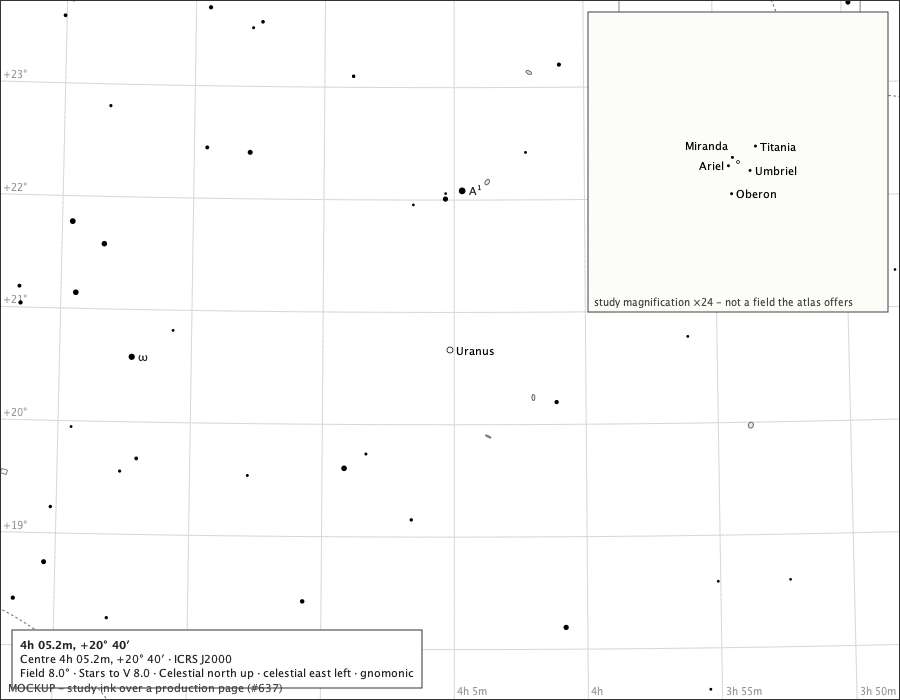

The next opposition: the five moons beside the mark, the field narrowing. Drawn on the page: Uranus by rule M, true disc 0.12 px, drawn 6.00 px, unphased; Miranda at uranus, not drawn; Ariel at uranus, not drawn; Umbriel at uranus, not drawn; Titania at uranus, not drawn; Oberon at uranus, not drawn; Where its labels went on this machine is in `platform.md`.

### The 2026 opposition (Espenak's hour, 2026-11-25 23:00 UTC), from the Earth's centre, 2° field

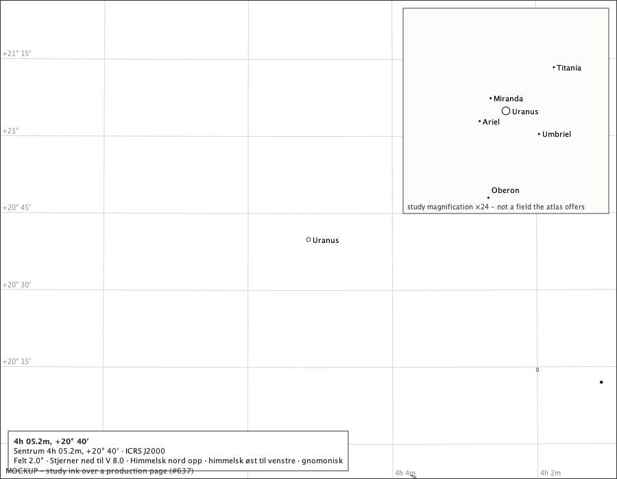

The next opposition: the five moons beside the mark, the field narrowing. Drawn on the page: Uranus by rule M, true disc 0.48 px, drawn 6.00 px, unphased; Miranda at uranus, not drawn; Ariel at uranus, not drawn; Umbriel at uranus, not drawn; Titania at uranus, not drawn; Oberon at uranus, not drawn; Where its labels went on this machine is in `platform.md`.

### The 2026 opposition (Espenak's hour, 2026-11-25 23:00 UTC), from the Earth's centre, 1° field

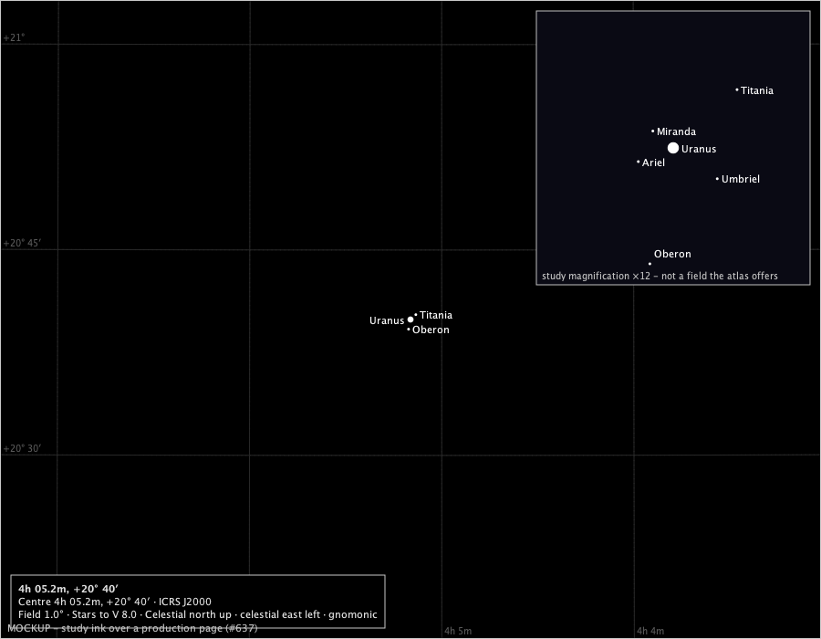

The next opposition: the five moons beside the mark, the field narrowing. Drawn on the page: Uranus by rule M, true disc 0.96 px, drawn 6.00 px, unphased; Miranda at uranus, not drawn; Ariel at uranus, not drawn; Umbriel at uranus, not drawn; Titania at (456, 345) clear; Oberon at (448, 361) clear; Where its labels went on this machine is in `platform.md`.

### The 2026 opposition (Espenak's hour, 2026-11-25 23:00 UTC), from the Earth's centre, 0.5° field

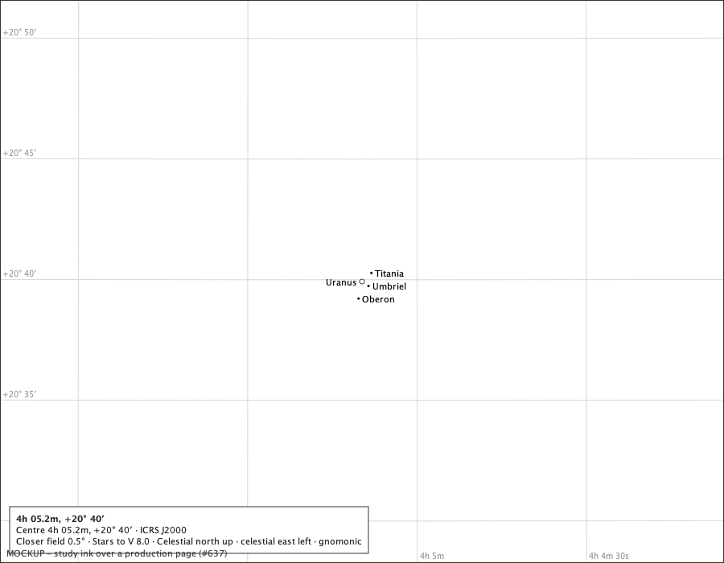

The next opposition: the five moons beside the mark, the field narrowing. Drawn on the page: Uranus by rule M, true disc 1.91 px, drawn 6.00 px, unphased; Miranda at uranus, not drawn; Ariel at uranus, not drawn; Umbriel at (458, 356) clear; Titania at (462, 339) clear; Oberon at (446, 371) clear; Where its labels went on this machine is in `platform.md`.

### The 2026 opposition (Espenak's hour, 2026-11-25 23:00 UTC), from the Earth's centre, 0.25° field

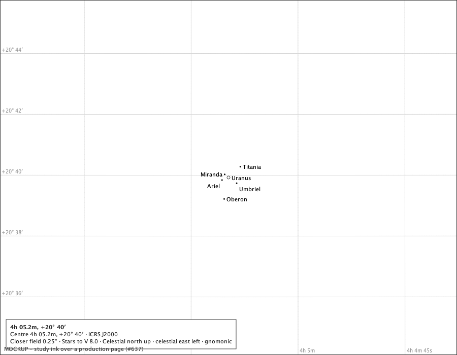

The next opposition: the five moons beside the mark, the field narrowing. Drawn on the page: Uranus by rule M, true disc 3.82 px, drawn 6.00 px, unphased; Miranda at (443, 344) clear; Ariel at (437, 355) clear; Umbriel at (466, 361) clear; Titania at (473, 329) clear; Oberon at (441, 392) clear; Where its labels went on this machine is in `platform.md`.

### Uranus at its largest (2051-03-13), Oslo, 0.25° field

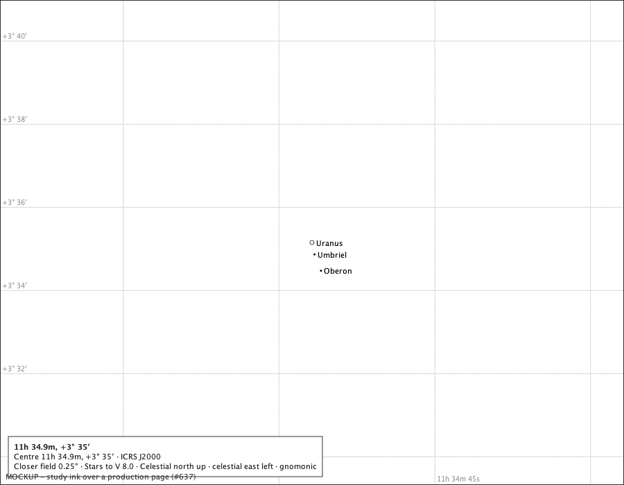

The century's largest disc, still inside the 6 px mark. Drawn on the page: Uranus by rule M, true disc 4.08 px, drawn 6.00 px, unphased; Miranda in front unresolved, not drawn; Ariel at uranus, not drawn; Umbriel at (454, 367) clear; Titania collides, not drawn; Oberon at (463, 391) clear; Where its labels went on this machine is in `platform.md`.

### Titania and Oberon at their widest (2052-03-23), Oslo, 1° field

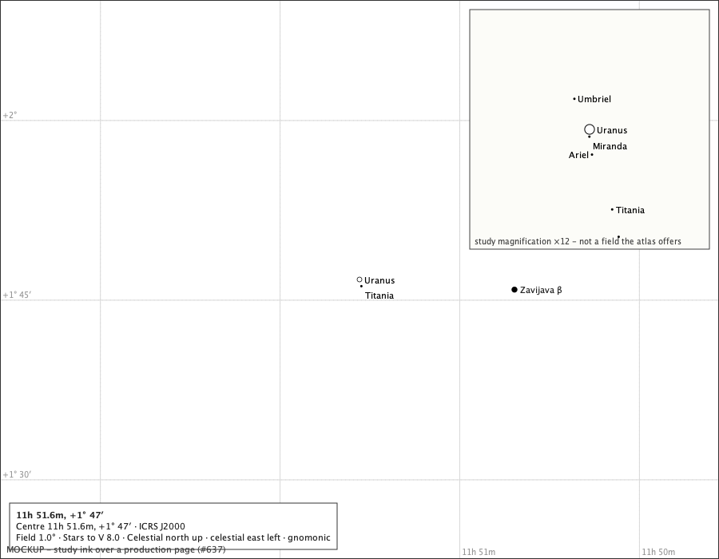

The widest the system stands on the ladder's narrowest field. Drawn on the page: Uranus by rule M, true disc 1.02 px, drawn 6.00 px, unphased; Miranda at uranus, not drawn; Ariel at uranus, not drawn; Umbriel at uranus, not drawn; Titania at (452, 358) clear; Oberon collides, not drawn; Where its labels went on this machine is in `platform.md`.

### Titania and Oberon at their widest (2052-03-23), Oslo, 0.25° field

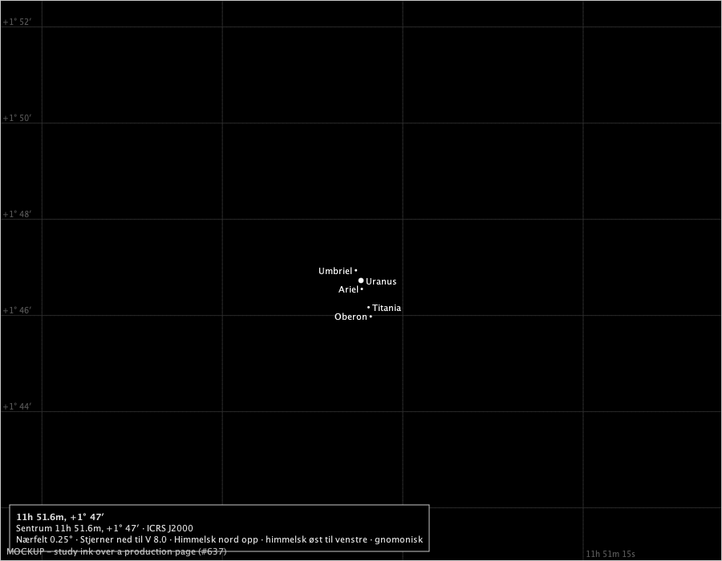

The widest the system ever stands on a page. Drawn on the page: Uranus by rule M, true disc 4.07 px, drawn 6.00 px, unphased; Miranda at uranus, not drawn; Ariel at (451, 361) clear; Umbriel at (444, 337) clear; Titania at (459, 383) clear; Oberon at (462, 395) clear; Where its labels went on this machine is in `platform.md`.

### The Epsilon ring at its true size, the Earth nearly over a pole (2029-08-20), from the Earth's centre, 0.25° field

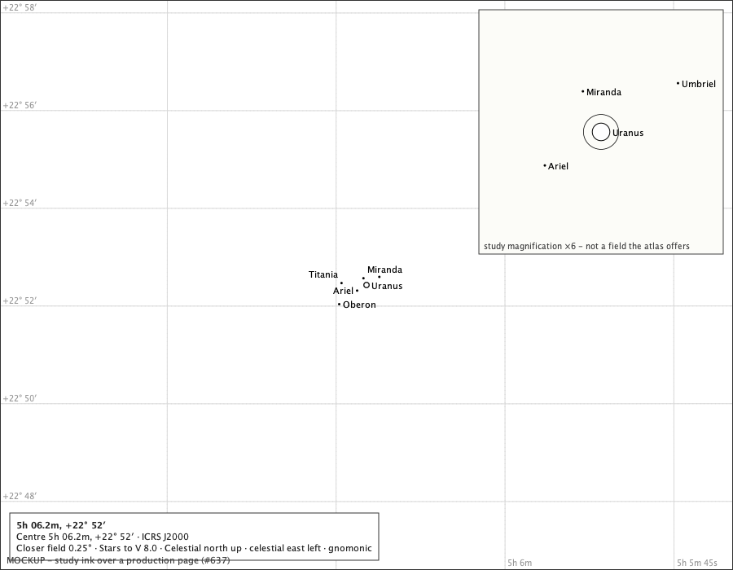

Pole-on, the ring is nearly a circle: on the page a hairline just outside the mark, at the narrowest field the study paints; the inset shows it around the true disc. Drawn on the page: Uranus by rule M, true disc 3.60 px, drawn 6.00 px, unphased; the Epsilon ring at its true size, 7.20 × 7.14 px, tilt 82.3°; Miranda at (446, 342) clear; Ariel at (438, 357) clear; Umbriel at (466, 340) clear; Titania at (419, 348) clear; Oberon at (416, 374) clear; Where its labels went on this machine is in `platform.md`.

### The Epsilon ring at its true size, the Earth nearly in the equator (1966-03-21), from the Earth's centre, 0.25° field

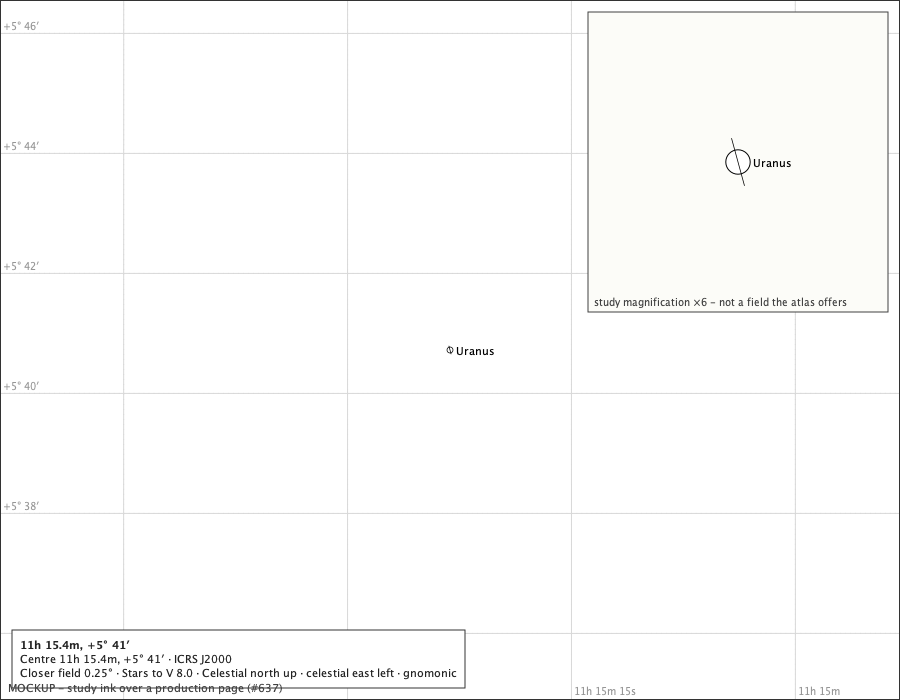

Equator-on, the ring is a line through the mark; the inset shows it across the true disc. Drawn on the page: Uranus by rule M, true disc 4.07 px, drawn 6.00 px, unphased; the Epsilon ring at its true size, 8.15 × 0.00 px, tilt 0.0°; the moons not computed at this instant (2000-2100 only); Where its labels went on this machine is in `platform.md`.

### The Epsilon ring at its true size, pole-on (2029-08-20), from the Earth's centre, 1° field

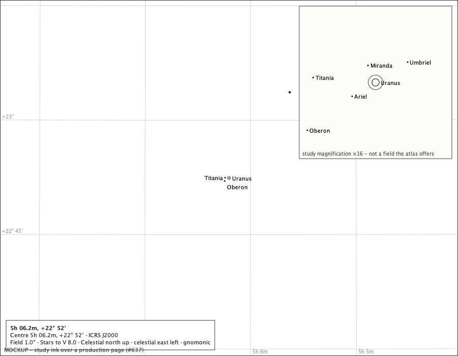

On the ladder's narrowest field the ring lies inside the mark; the inset shows where. Drawn on the page: Uranus by rule M, true disc 0.90 px, drawn 6.00 px, unphased; the Epsilon ring at its true size, 1.80 × 1.78 px, tilt 82.3°; Miranda at uranus, not drawn; Ariel at uranus, not drawn; Umbriel at uranus, not drawn; Titania at (442, 349) clear; Oberon at (442, 356) clear; Where its labels went on this machine is in `platform.md`.

### The 2026 conjunction (Espenak's hour, 2026-05-22 16:00 UTC), Oslo, 3° field, with the Sun

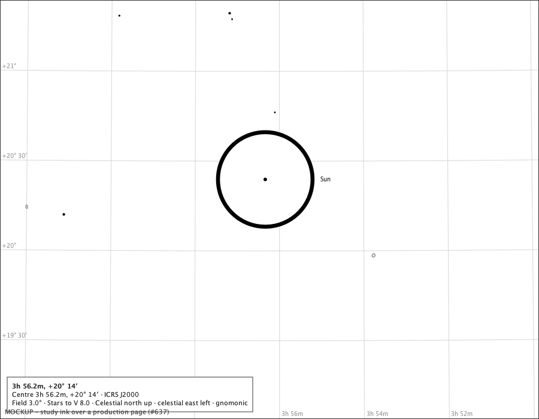

Uranus behind the Sun: the Sun's opaque disc is painted after the mark and covers it (#514). Drawn on the page: Uranus by rule M, true disc 0.29 px, drawn 6.00 px, unphased; Miranda at uranus, not drawn; Ariel at uranus, not drawn; Umbriel at uranus, not drawn; Titania at uranus, not drawn; Oberon at uranus, not drawn; the Sun painted after Uranus, nearer; Where its labels went on this machine is in `platform.md`.

### Miranda behind Uranus in its shadow (Horizons U, 2005-03-19), Oslo, 0.25° field

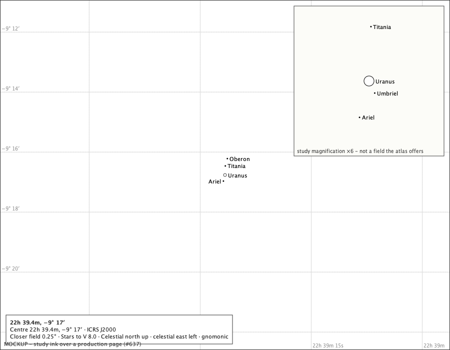

A moon behind Uranus is not drawn, on the page or in the inset; its state is spoken, never drawn. Drawn on the page: Uranus by rule M, true disc 3.36 px, drawn 6.00 px, unphased; Miranda behind, not drawn; Ariel at (447, 362) clear; Umbriel at uranus, not drawn; Titania at (451, 332) clear; Oberon at (455, 317) clear; Where its labels went on this machine is in `platform.md`.

### Ariel in Uranus's shadow (Horizons u, 2006-02-04), Oslo, 0.25° field

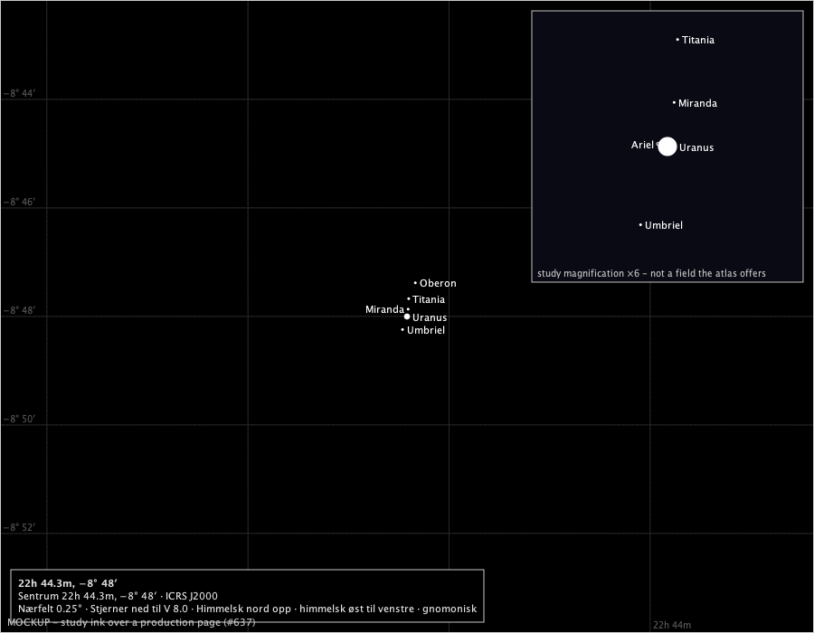

An eclipsed moon stands beside the limb, in the shadow's width: even at 0.25° it is not clear of the mark, so the page does not draw it. The inset shows the outline it would take. Drawn on the page: Uranus by rule M, true disc 3.36 px, drawn 6.00 px, unphased; Miranda at (451, 342) clear; Ariel at uranus, not drawn; Umbriel at (445, 364) clear; Titania at (452, 330) clear; Oberon at (459, 313) clear; Where its labels went on this machine is in `platform.md`.

### Miranda in front of Uranus (Horizons t, 2005-05-28), Oslo, 0.25° field

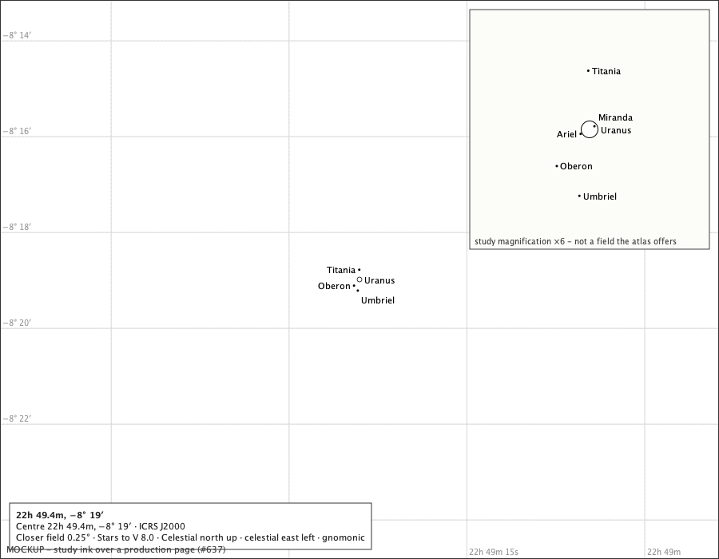

In transit, on a disc far too small to show it: unresolved by rule on the page; the inset shows the symbol over its ground ring on the true disc. Drawn on the page: Uranus by rule M, true disc 3.51 px, drawn 6.00 px, unphased; Miranda in front unresolved, not drawn; Ariel at uranus, not drawn; Umbriel at (448, 364) clear; Titania at (450, 338) clear; Oberon at (443, 358) clear; Where its labels went on this machine is in `platform.md`.

### Umbriel behind Uranus (Horizons O, 2009-12-05), Oslo, 0.25° field

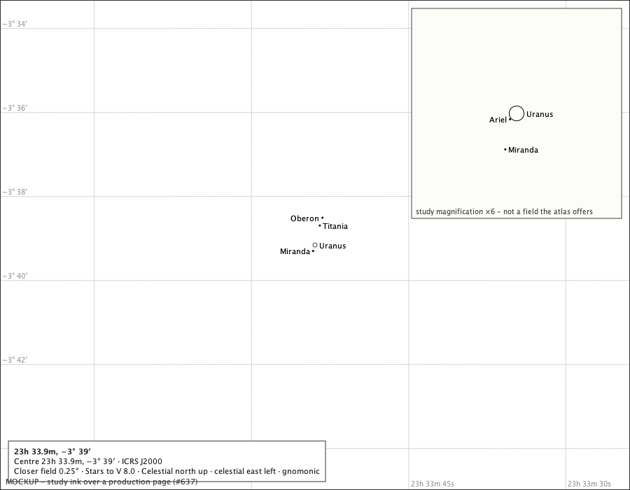

Occulted: not drawn, and spoken. Drawn on the page: Uranus by rule M, true disc 3.54 px, drawn 6.00 px, unphased; Miranda at (447, 359) clear; Ariel at uranus, not drawn; Umbriel behind, not drawn; Titania at (457, 322) clear; Oberon at (461, 311) clear; Where its labels went on this machine is in `platform.md`.

### Uranus before the moons' years (1999-12-31 23:00 UTC), from the Earth's centre, 1° field

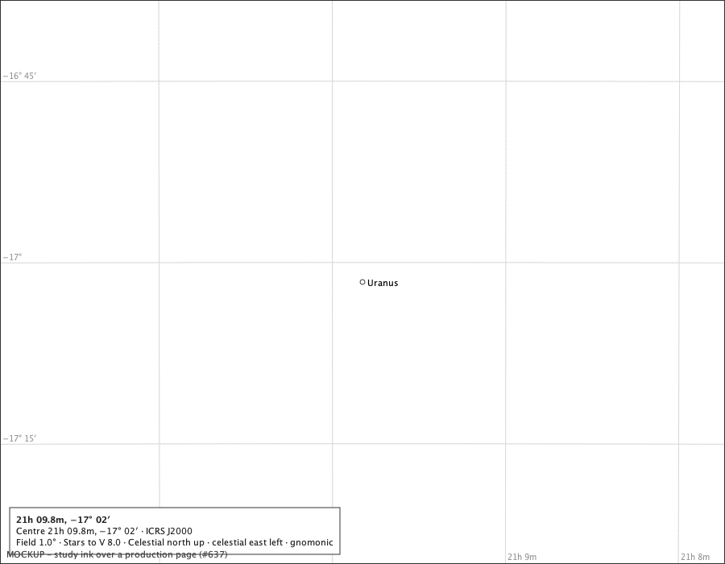

Uranus alone, as the table shows it. Drawn on the page: Uranus by rule M, true disc 0.85 px, drawn 6.00 px, unphased; the moons not computed at this instant (2000-2100 only); Where its labels went on this machine is in `platform.md`.

### Uranus below the horizon (2026-10-27 12:00 UTC), Oslo, 8° field, the horizon drawn

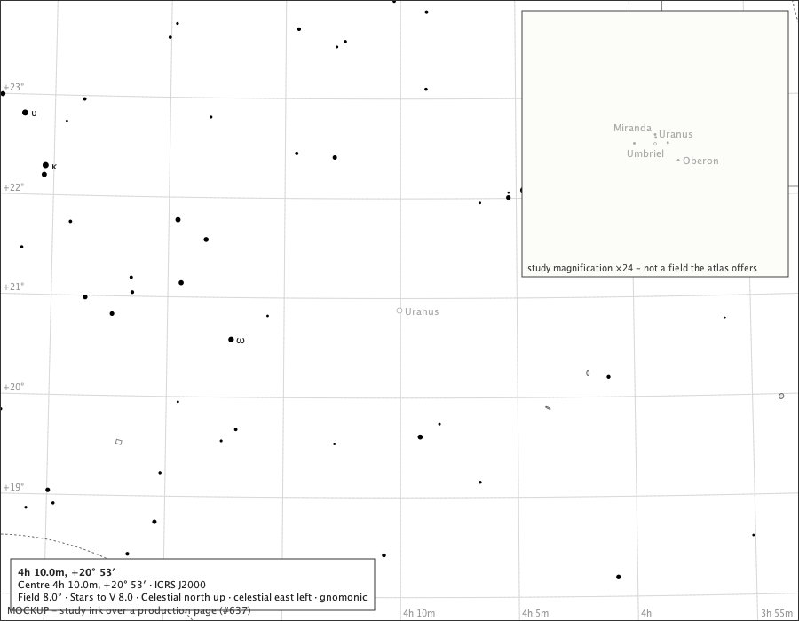

Below the drawn horizon the marks and labels take the subdued tone (#615). Drawn on the page: Uranus by rule M, true disc 0.12 px, drawn 6.00 px, unphased, below the horizon; Miranda at uranus, not drawn; Ariel at uranus, not drawn; Umbriel at uranus, not drawn; Titania at uranus, not drawn; Oberon at uranus, not drawn; Where its labels went on this machine is in `platform.md`.

### The 2026 opposition on the A4 sheet's chart area at 150 dpi (1754 × 1090 px), 1° field

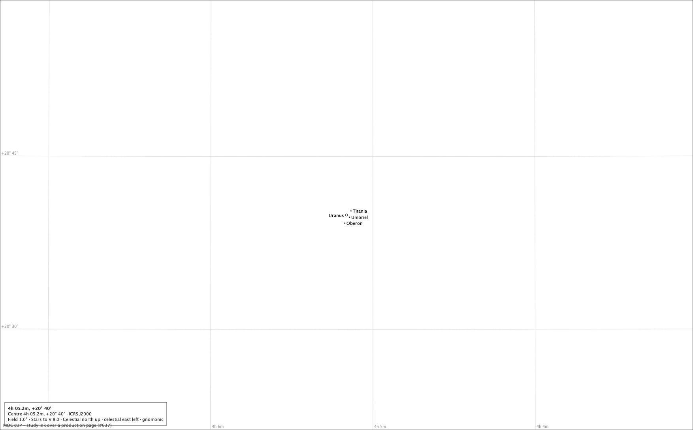

On paper the outer moons stand clear at 1° without magnification. Drawn on the page: Uranus by rule M, true disc 1.86 px, drawn 6.00 px, unphased; Miranda at uranus, not drawn; Ariel at uranus, not drawn; Umbriel at (885, 550) clear; Titania at (888, 535) clear; Oberon at (873, 566) clear; Where its labels went on this machine is in `platform.md`.

## F. What the measurements support

1. **Rule M, the mark always.** Uranus's true disc never reaches the 6 px mark on any field offered, the closer ones included (section B): the mark stands for Uranus on every page, a symbol, spoken as one.
2. **Unphased, round, no colour.** The dark part and the flattening are fractions of a pixel even at 0.25° (section B); nothing in the contract measures a colour, so the mark is drawn full, round and in the page's ink, as every other body.
3. **The pole and tilt are not drawn.** On a 6 px symbol they have nothing to orient; the table gives both in numbers.
4. **The rings: table-only.** The Epsilon ring lies inside the mark on every ladder field and is a hairline just beyond it at 0.25° (section C); its opening is the tilt the table already gives. Never enlarged.
5. **Moons decided on their own, Mars's rule** (section B): drawn only where a moon's symbol stands clear of Uranus's mark and of the moons already drawn, on every field.
6. **Jupiter's vocabulary A**, with Uranus's name; no shadow on Uranus.
7. **Selection and Centre on chart** for Uranus as for the other planets; the moons not selectable, as Mars's.
8. **The closer fields** are where the inner moons separate (section B), Miranda only there; eligibility is the owner's.
9. **Below the horizon, black sky, Norwegian and paper** as every body's (#615, #526).
10. **The split:** Uranus (the mark) first, then the moons.

