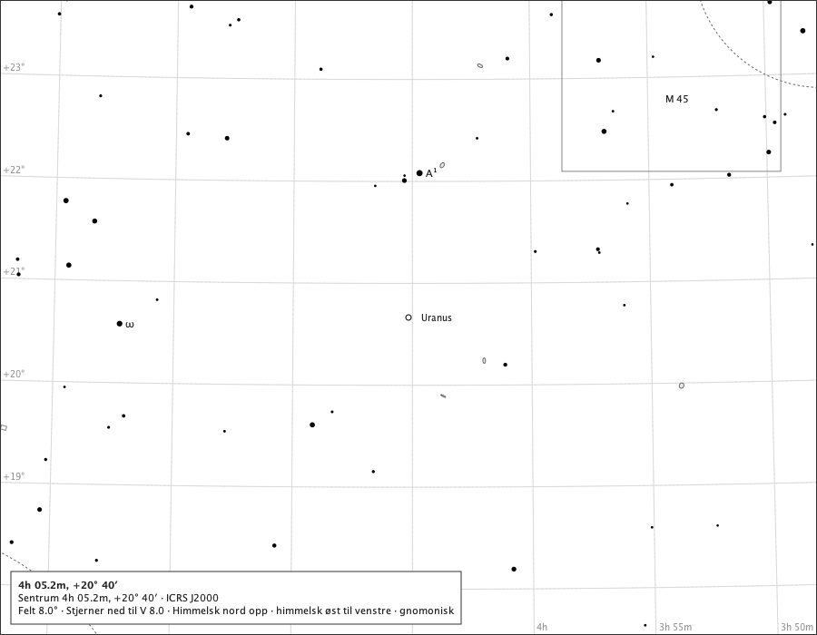
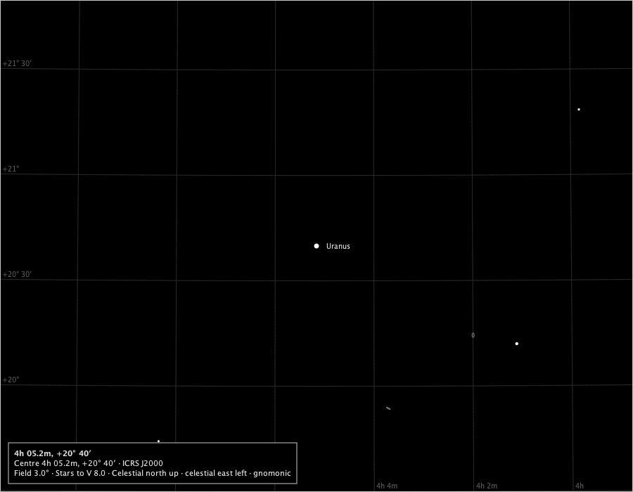
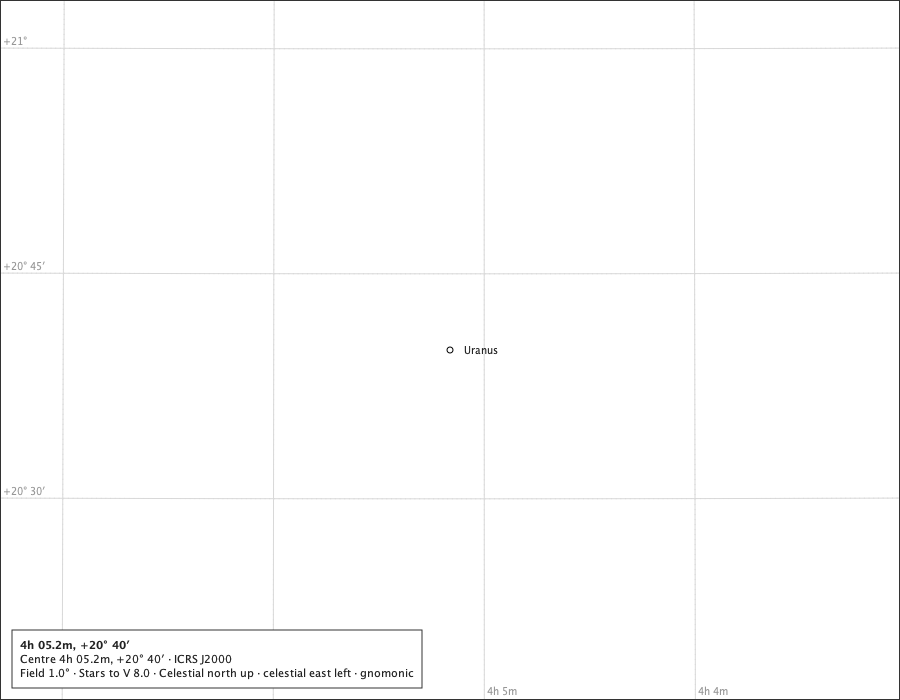
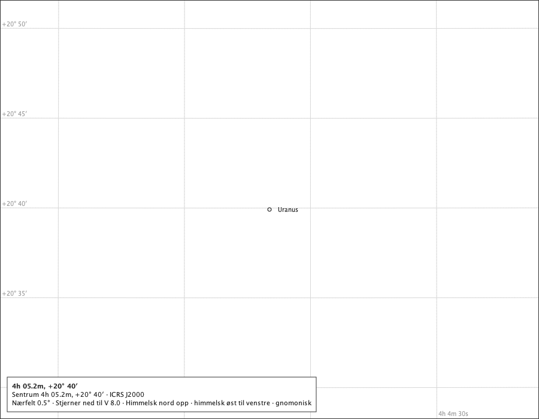
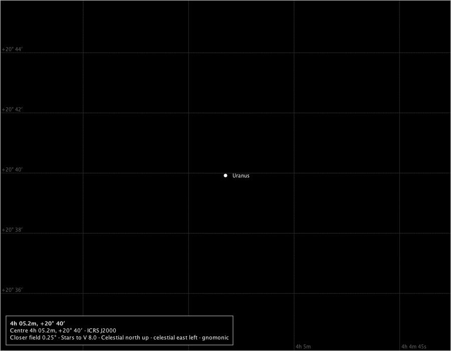
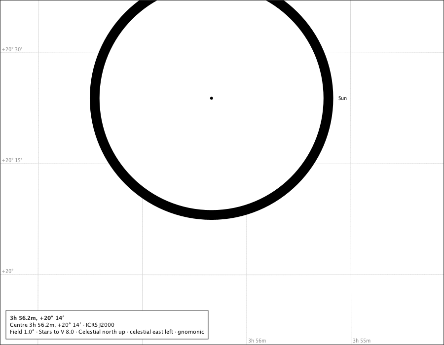
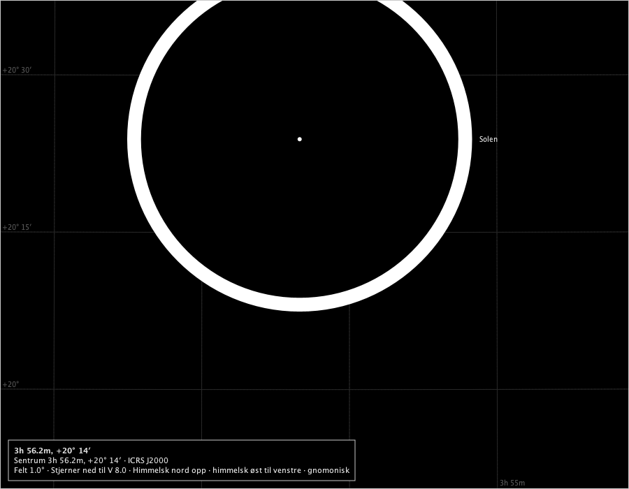

# Uranus on the chart

Issue #638, part 1. The production composition - `ChartComponent` over the bundled catalogue, with the Solar System module attached and Uranus switched on - under the rulings on #637: rule M with the 6 px mark always standing in (R-1), drawn full and round with no colour (R-2), the pole and the rings not drawn (R-3, R-4), the planet selectable and pointed at as an occurrence (R-8), eligible for the closer fields (R-7), on screen and on paper as the other bodies (R-9). The moons are not drawn: they are part 2 (R-10). The instants are Espenak's rows in `docs/studies/uranus-system/uranus-events.txt`; positions are the service's for Oslo at sea level. Regenerate with `make uranus-on-the-chart-study`.

## The 2026 opposition, 2026-11-25T23:00:00Z, Oslo

The service: 3.82″ across, 100.000 % lit (phase angle 0.01°), tilt 73.8°, 179.8° from the Sun.

### 8°, the page's words in Norwegian (the page's field 8°)

The true disc is a tenth of a pixel at 8°: the 6 px mark stands in, and the page calls it a symbol. Drawn: Uranus at (450.0, 350.0), symbol 6.0 px, name placed; Spoken: Uranus (et kartografisk symbol, ikke Uranus' tilsynelatende diameter).

### 3° on the black sky (the page's field 3°)

The mark in the black sky's star ink; no colour (R-2). Drawn: Uranus at (450.0, 350.0), symbol 6.0 px, name placed; Spoken: Uranus (a cartographic symbol, not Uranus's apparent diameter).

### The minimum field, 1° (the page's field 1°)

Under a pixel even at the minimum field: still the mark. Drawn: Uranus at (450.0, 350.0), symbol 6.0 px, name placed; Spoken: Uranus (a cartographic symbol, not Uranus's apparent diameter).

### The 0.5° closer field, in Norwegian (the page's field 0.5°)

Reached by zooming in from 1°, as the application offers it with Uranus on the page (R-7). Drawn: Uranus at (450.0, 350.0), symbol 6.0 px, name placed; Spoken: Uranus (et kartografisk symbol, ikke Uranus' tilsynelatende diameter).

### The 0.25° closer field on the black sky (the page's field 0.25°)

Under 4 px even here: the mark still stands in (R-1). Drawn: Uranus at (450.0, 350.0), symbol 6.0 px, name placed; Spoken: Uranus (a cartographic symbol, not Uranus's apparent diameter).

Measured inside the mark's outline at 0.25°: 12 of 12 pixels in the lit tone, against k = 100.000 %. The mark is drawn full (R-2).

## The 2026 conjunction, Oslo, with the Sun

The service: 3.44″ across, 100.000 % lit (phase angle 0.01°), tilt 71.9°, 0.2° from the Sun. Its disc meets the Sun's: behind the Sun.

### At 1° (the page's field 1°)

The mark laid beneath the stars and covered by the Sun's ground-filled disc; the page says *behind the Sun* (#514). Drawn: Uranus at (450.0, 350.0), symbol 6.0 px, state uranus.behind, name refused; Sun at (428.7, 199.3), disc 473.8 px, name placed; Spoken: Uranus, behind the Sun (a cartographic symbol, not Uranus's apparent diameter). Sun.

### At 1°, in Norwegian on the black sky (the page's field 1°)

The same, spoken in Norwegian. Drawn: Uranus at (450.0, 350.0), symbol 6.0 px, state uranus.behind, name refused; Solen at (428.7, 199.3), disc 473.8 px, name placed; Spoken: Uranus, bak Solen (et kartografisk symbol, ikke Uranus' tilsynelatende diameter). Solen.

## Outside the years

At 1899-12-31T12:00:00Z - before the Uranus System pack's first day, 1900-01-01 - the module draws nothing for Uranus: 0 bodies drawn, and the page says nothing of it.

