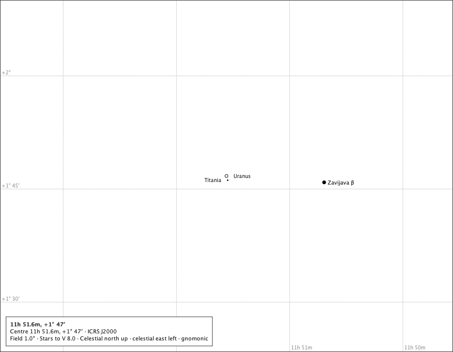
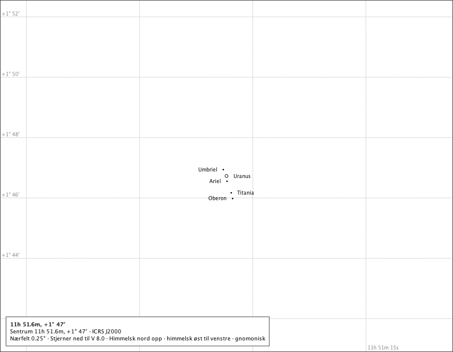
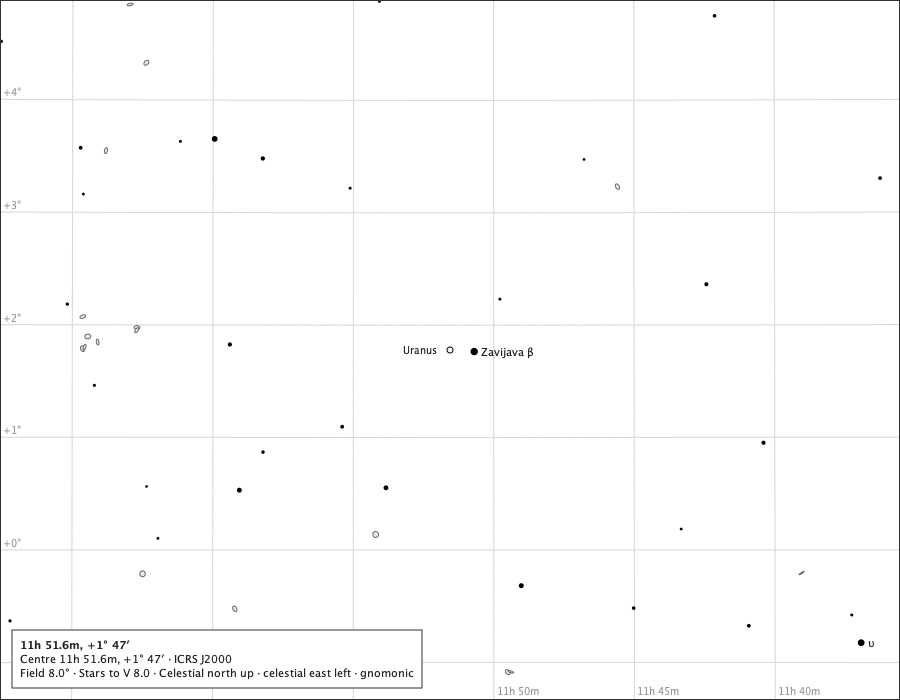
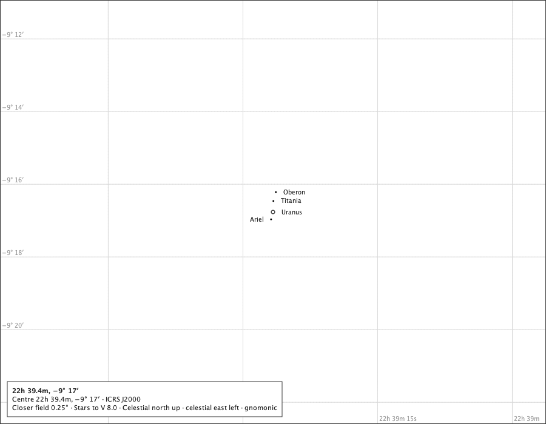
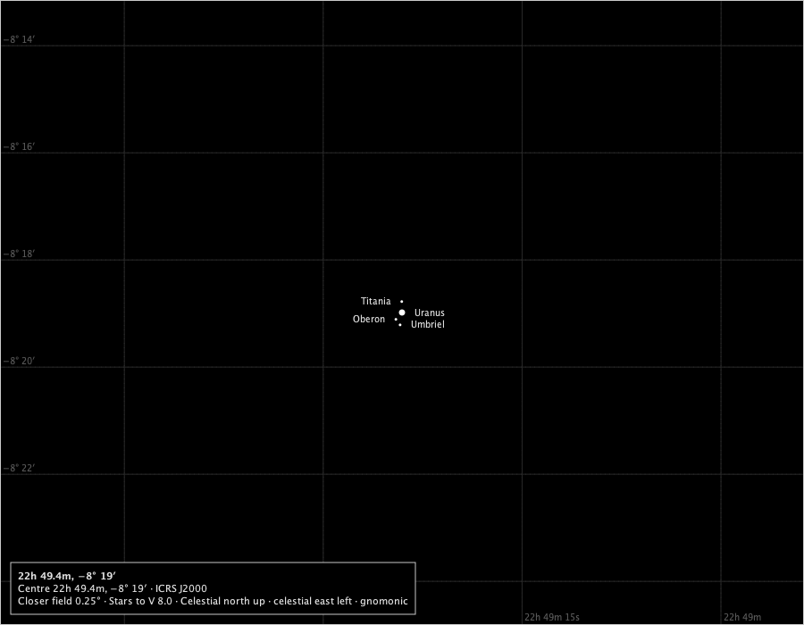
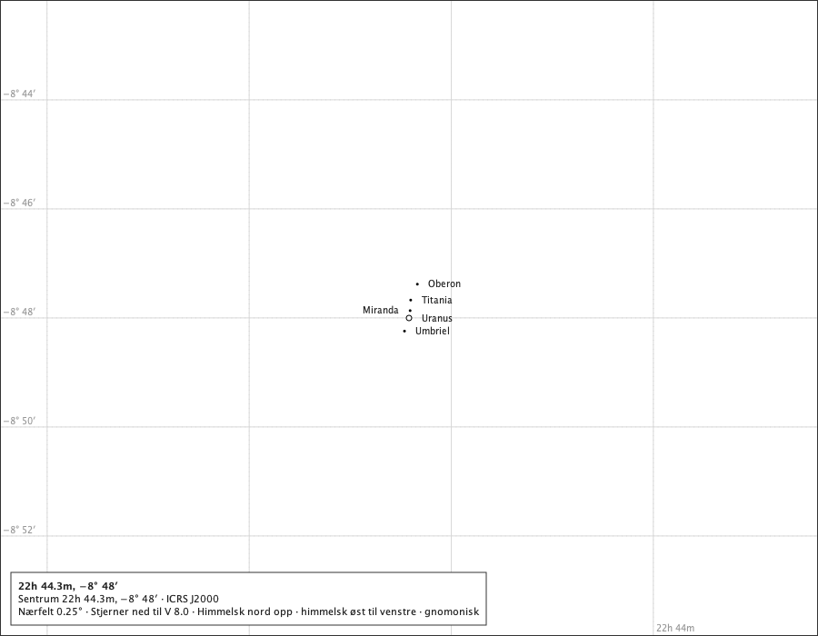
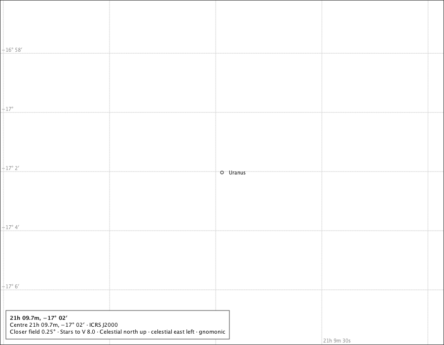

# Uranus on the chart

Issue #638, parts 1 and 2. The production composition - `ChartComponent` over the bundled catalogue, with the Solar System module attached and Uranus switched on - under the rulings on #637: rule M with the 6 px mark always standing in (R-1), drawn full and round with no colour (R-2), the pole and the rings not drawn (R-3, R-4), the planet selectable and pointed at as an occurrence (R-8), eligible for the closer fields (R-7), on screen and on paper as the other bodies (R-9). Since part 2 the five moons are drawn as 3 px symbols at their own J2000 places, each only where it stands clear of Uranus's mark and of the moons already drawn, on every field (R-5); a moon behind, in transit or too close is not drawn and the page says so (R-6); none is selectable (R-8). The instants are Espenak's rows in `docs/studies/uranus-system/uranus-events.txt` and the Horizons rows in `docs/studies/uranus-system/horizons/`; positions are the service's for Oslo at sea level. Regenerate with `make uranus-on-the-chart-study`.

## The 2026 opposition, 2026-11-25T23:00:00Z, Oslo

The service: 3.82″ across, 100.000 % lit (phase angle 0.01°), tilt 73.8°, 179.8° from the Sun.

### 8°, the page's words in Norwegian (the page's field 8°)

The true disc is a tenth of a pixel at 8°: the 6 px mark stands in, and the page calls it a symbol. Drawn: Uranus at (450.0, 350.0), symbol 6.0 px, name placed; Spoken: Uranus (et kartografisk symbol, ikke Uranus' tilsynelatende diameter). Miranda, for nær til å skjelnes i dette feltet, ikke tegnet. Ariel, for nær til å skjelnes i dette feltet, ikke tegnet. Umbriel, for nær til å skjelnes i dette feltet, ikke tegnet. Titania, for nær til å skjelnes i dette feltet, ikke tegnet. Oberon, for nær til å skjelnes i dette feltet, ikke tegnet.

### 3° on the black sky (the page's field 3°)

The mark in the black sky's star ink; no colour (R-2). Drawn: Uranus at (450.0, 350.0), symbol 6.0 px, name placed; Spoken: Uranus (a cartographic symbol, not Uranus's apparent diameter). Miranda, too close to tell apart at this field, not drawn. Ariel, too close to tell apart at this field, not drawn. Umbriel, too close to tell apart at this field, not drawn. Titania, too close to tell apart at this field, not drawn. Oberon, too close to tell apart at this field, not drawn.

### The minimum field, 1° (the page's field 1°)

Under a pixel even at the minimum field: still the mark. Drawn: Uranus at (450.0, 350.0), symbol 6.0 px, name placed; Oberon at (447.9, 360.6), symbol 3.0 px, name placed; Titania at (455.8, 344.7), symbol 3.0 px, name placed; Spoken: Uranus (a cartographic symbol, not Uranus's apparent diameter). Oberon (a cartographic symbol, not Oberon's apparent diameter). Titania (a cartographic symbol, not Titania's apparent diameter). Miranda, too close to tell apart at this field, not drawn. Ariel, too close to tell apart at this field, not drawn. Umbriel, too close to tell apart at this field, not drawn.

### The 0.5° closer field, in Norwegian (the page's field 0.5°)

Reached by zooming in from 1°, as the application offers it with Uranus on the page (R-7). Drawn: Uranus at (450.0, 350.0), symbol 6.0 px, name placed; Oberon at (445.7, 371.2), symbol 3.0 px, name placed; Titania at (461.7, 339.4), symbol 3.0 px, name placed; Umbriel at (458.0, 355.6), symbol 3.0 px, name placed; Spoken: Uranus (et kartografisk symbol, ikke Uranus' tilsynelatende diameter). Oberon (et kartografisk symbol, ikke Oberons tilsynelatende diameter). Titania (et kartografisk symbol, ikke Titanias tilsynelatende diameter). Umbriel (et kartografisk symbol, ikke Umbriels tilsynelatende diameter). Miranda, for nær til å skjelnes i dette feltet, ikke tegnet. Ariel, for nær til å skjelnes i dette feltet, ikke tegnet.

### The 0.25° closer field on the black sky (the page's field 0.25°)

Under 4 px even here: the mark still stands in (R-1). Drawn: Uranus at (450.0, 350.0), symbol 6.0 px, name placed; Oberon at (441.5, 392.3), symbol 3.0 px, name placed; Titania at (473.3, 328.7), symbol 3.0 px, name placed; Umbriel at (466.1, 361.3), symbol 3.0 px, name placed; Ariel at (437.2, 355.0), symbol 3.0 px, name placed; Miranda at (442.6, 343.8), symbol 3.0 px, name placed; Spoken: Uranus (a cartographic symbol, not Uranus's apparent diameter). Oberon (a cartographic symbol, not Oberon's apparent diameter). Titania (a cartographic symbol, not Titania's apparent diameter). Umbriel (a cartographic symbol, not Umbriel's apparent diameter). Ariel (a cartographic symbol, not Ariel's apparent diameter). Miranda (a cartographic symbol, not Miranda's apparent diameter).

Measured inside the mark's outline at 0.25°: 12 of 12 pixels in the lit tone, against k = 100.000 %. The mark is drawn full (R-2).

## The 2026 conjunction, Oslo, with the Sun

The service: 3.44″ across, 100.000 % lit (phase angle 0.01°), tilt 71.9°, 0.2° from the Sun. Its disc meets the Sun's: behind the Sun.

### At 1° (the page's field 1°)

The mark laid beneath the stars and covered by the Sun's ground-filled disc; the page says *behind the Sun* (#514). Drawn: Uranus at (450.0, 350.0), symbol 6.0 px, state uranus.behind, name refused; Sun at (428.7, 199.3), disc 473.8 px, name placed; Oberon at (443.5, 356.9), symbol 3.0 px, name refused; Spoken: Uranus, behind the Sun (a cartographic symbol, not Uranus's apparent diameter). Sun. Oberon (a cartographic symbol, not Oberon's apparent diameter). Miranda, too close to tell apart at this field, not drawn. Ariel, too close to tell apart at this field, not drawn. Umbriel, too close to tell apart at this field, not drawn. Titania, too close to tell apart at this field, not drawn.

### At 1°, in Norwegian on the black sky (the page's field 1°)

The same, spoken in Norwegian. Drawn: Uranus at (450.0, 350.0), symbol 6.0 px, state uranus.behind, name refused; Solen at (428.7, 199.3), disc 473.8 px, name placed; Oberon at (443.5, 356.9), symbol 3.0 px, name refused; Spoken: Uranus, bak Solen (et kartografisk symbol, ikke Uranus' tilsynelatende diameter). Solen. Oberon (et kartografisk symbol, ikke Oberons tilsynelatende diameter). Miranda, for nær til å skjelnes i dette feltet, ikke tegnet. Ariel, for nær til å skjelnes i dette feltet, ikke tegnet. Umbriel, for nær til å skjelnes i dette feltet, ikke tegnet. Titania, for nær til å skjelnes i dette feltet, ikke tegnet.

## The moons

### Titania and Oberon at their widest, 2052-03-23T00:00:00Z, Oslo

### The minimum field, 1° (the page's field 1°)

The outer moons stand clear of the mark; the inner ones are spoken. Drawn: Uranus at (450.0, 350.0), symbol 6.0 px, name placed; Titania at (452.4, 358.4), symbol 3.0 px, name placed; Spoken: Uranus (a cartographic symbol, not Uranus's apparent diameter). Titania (a cartographic symbol, not Titania's apparent diameter). Miranda, too close to tell apart at this field, not drawn. Ariel, too close to tell apart at this field, not drawn. Umbriel, too close to tell apart at this field, not drawn. Oberon, too close to tell apart at this field, not drawn.

### The 0.25° closer field, in Norwegian (the page's field 0.25°)

Where most of the system stands apart. Drawn: Uranus at (450.0, 350.0), symbol 6.0 px, name placed; Oberon at (462.1, 394.8), symbol 3.0 px, name placed; Titania at (459.4, 383.4), symbol 3.0 px, name placed; Umbriel at (443.7, 337.2), symbol 3.0 px, name placed; Ariel at (451.0, 360.5), symbol 3.0 px, name placed; Spoken: Uranus (et kartografisk symbol, ikke Uranus' tilsynelatende diameter). Oberon (et kartografisk symbol, ikke Oberons tilsynelatende diameter). Titania (et kartografisk symbol, ikke Titanias tilsynelatende diameter). Umbriel (et kartografisk symbol, ikke Umbriels tilsynelatende diameter). Ariel (et kartografisk symbol, ikke Ariels tilsynelatende diameter). Miranda, for nær til å skjelnes i dette feltet, ikke tegnet.

### 8° (the page's field 8°)

No moon clears the mark: none drawn, each spoken (R-5, no floor). Drawn: Uranus at (450.0, 350.0), symbol 6.0 px, name placed; Spoken: Uranus (a cartographic symbol, not Uranus's apparent diameter). Miranda, too close to tell apart at this field, not drawn. Ariel, too close to tell apart at this field, not drawn. Umbriel, too close to tell apart at this field, not drawn. Titania, too close to tell apart at this field, not drawn. Oberon, too close to tell apart at this field, not drawn.

### Miranda behind Uranus in its shadow (Horizons U, 2005-03-19)

### The 0.25° closer field (the page's field 0.25°)

Behind: not drawn, and spoken. Drawn: Uranus at (450.0, 350.0), symbol 6.0 px, name placed; Oberon at (454.7, 317.2), symbol 3.0 px, name placed; Titania at (450.7, 331.9), symbol 3.0 px, name placed; Ariel at (446.8, 362.1), symbol 3.0 px, name placed; Spoken: Uranus (a cartographic symbol, not Uranus's apparent diameter). Oberon (a cartographic symbol, not Oberon's apparent diameter). Titania (a cartographic symbol, not Titania's apparent diameter). Ariel (a cartographic symbol, not Ariel's apparent diameter). Miranda, behind Uranus, not drawn. Umbriel, too close to tell apart at this field, not drawn.

### Miranda in front of Uranus (Horizons t, 2005-05-28)

### The 0.25° closer field (the page's field 0.25°)

The mark cannot hold a transit: not drawn, and spoken as too close (R-6). Drawn: Uranus at (450.0, 350.0), symbol 6.0 px, name placed; Oberon at (443.2, 357.7), symbol 3.0 px, name placed; Titania at (449.7, 337.8), symbol 3.0 px, name placed; Umbriel at (447.9, 363.9), symbol 3.0 px, name placed; Spoken: Uranus (a cartographic symbol, not Uranus's apparent diameter). Oberon (a cartographic symbol, not Oberon's apparent diameter). Titania (a cartographic symbol, not Titania's apparent diameter). Umbriel (a cartographic symbol, not Umbriel's apparent diameter). Miranda, too close to tell apart at this field, not drawn. Ariel, too close to tell apart at this field, not drawn.

### Ariel in Uranus's shadow (Horizons u, 2006-02-04)

### The 0.25° closer field (the page's field 0.25°)

An eclipsed moon stands beside the limb, not clear of the mark: not drawn, and spoken. Drawn: Uranus at (450.0, 350.0), symbol 6.0 px, name placed; Oberon at (459.2, 312.8), symbol 3.0 px, name placed; Titania at (451.9, 330.3), symbol 3.0 px, name placed; Umbriel at (445.0, 364.4), symbol 3.0 px, name placed; Miranda at (451.2, 341.9), symbol 3.0 px, name placed; Spoken: Uranus (et kartografisk symbol, ikke Uranus' tilsynelatende diameter). Oberon (et kartografisk symbol, ikke Oberons tilsynelatende diameter). Titania (et kartografisk symbol, ikke Titanias tilsynelatende diameter). Umbriel (et kartografisk symbol, ikke Umbriels tilsynelatende diameter). Miranda (et kartografisk symbol, ikke Mirandas tilsynelatende diameter). Ariel, for nær til å skjelnes i dette feltet, ikke tegnet.

### Before the moons' years, 1999-12-31T12:00:00Z

### The 0.25° closer field (the page's field 0.25°)

Uranus alone, as the table shows it. Drawn: Uranus at (450.0, 350.0), symbol 6.0 px, name placed; Spoken: Uranus (a cartographic symbol, not Uranus's apparent diameter).

## Outside the years

At 1899-12-31T12:00:00Z - before the Uranus System pack's first day, 1900-01-01 - the module draws nothing for Uranus: 0 bodies drawn, and the page says nothing of it.

