# Venus on the page: measurements and mock-ups

Sprint 48, issue #512. What drawing Venus honestly needs, measured through the production projections and the accepted Venus service (#501) over the bundled packs, with the two candidate rules drawn by this study over pages the production composition painted, as the Sun-Moon (#414) and Jovian (#482) studies did. Venus's lit shape is the page's own `litRegion` - the Moon's ruled geometry (C3) - turned to χ of date through the page's north and east at Venus. Nothing here is production rendering; every image is a mock-up and says so in its corner. The readability criterion (a disc of at least 6 px, its lit and dark parts each at least 1 px along the bright limb's axis) is the handover's study measure, not a rendering rule (#500, ruling 8). Regenerate with `make venus-cartography-study`.

## A. Size on every page

Over 1900-2100 (10488 weekly instants at Oslo from the service, topocentric) Venus's solid-body diameter is 9.61″ (1952-06-23 00:00, farthest) to 63.03″ (2061-12-26 00:00, nearest). The atlas's smallest star mark is 1.4 px across and its largest 10.0 px (the production star policy); Jupiter's ruled minimum mark is 6 px.

Pixels on the 900 × 700 page at its centre, through each field's own projection; millimetres on the A4 sheet's chart area (272 mm wide, 3508 px at 300 dpi) and the Letter sheet's (254 mm, 3300 px).

| field | diameter px (min-max) | under the smallest star mark | A4 mm (max) | Letter mm (max) | A4 px at 300 dpi (min-max) | Letter px (max) |
|---:|---|---|---:|---:|---|---:|
| 180° | 0.01-0.10 | always | 0.03 | 0.02 | 0.1-0.3 | 0.3 |
| 120° | 0.02-0.12 | always | 0.04 | 0.04 | 0.1-0.5 | 0.5 |
| 90° | 0.03-0.17 | always | 0.05 | 0.05 | 0.1-0.7 | 0.6 |
| 60° | 0.04-0.26 | always | 0.08 | 0.07 | 0.2-1.0 | 1.0 |
| 42° | 0.05-0.36 | always | 0.11 | 0.11 | 0.2-1.5 | 1.4 |
| 36° | 0.06-0.42 | always | 0.13 | 0.12 | 0.3-1.7 | 1.6 |
| 24° | 0.10-0.65 | always | 0.20 | 0.19 | 0.4-2.6 | 2.4 |
| 18° | 0.13-0.87 | always | 0.26 | 0.25 | 0.5-3.4 | 3.2 |
| 12° | 0.20-1.31 | always | 0.40 | 0.37 | 0.8-5.1 | 4.8 |
| 8° | 0.30-1.97 | at its smallest | 0.59 | 0.56 | 1.2-7.7 | 7.2 |
| 6° | 0.40-2.62 | at its smallest | 0.79 | 0.74 | 1.6-10.2 | 9.6 |
| 4° | 0.60-3.94 | at its smallest | 1.19 | 1.11 | 2.3-15.4 | 14.4 |
| 3° | 0.80-5.25 | at its smallest | 1.59 | 1.48 | 3.1-20.5 | 19.3 |
| 2° | 1.20-7.88 | at its smallest | 2.38 | 2.22 | 4.7-30.7 | 28.9 |
| 1° | 2.40-15.76 | never | 4.76 | 4.45 | 9.4-61.4 | 57.8 |

- **Where the true disc reaches a size** (scale as 1/field from the 1° page's 0.250 px per arcsecond): the smallest star mark (1.4 px) at 11.3° at its largest and 1.7° at its smallest; a shape rather than a dot (3 px) at 5.3° and 0.8°; Jupiter's 6 px mark at 2.63° and 0.40°; the largest star mark (10 px) at 1.58° and 0.24°.
- **At 1°, the ordinary minimum field, the true disc is 2.40-15.76 px**: a shape in every week, and under Jupiter's 6 px mark in 75.5 % of them.

### The named instants at 1°, Oslo

| instant (UTC) | what | diameter ″ | px | lit px (k·D) | dark px | k | phase | χ of date | readable |
|---|---|---:|---:|---:|---:|---:|---|---:|---|
| 2012-03-27 07:00 | 2012-greatest-elongation-east | 23.53 | 5.88 | 3.01 | 2.87 | 0.511 | near half lit | 252.1° | no |
| 2012-06-06 01:00 | 2012-inferior-conjunction | 57.80 | 14.45 | 0.00 | 14.45 | 0.000 | in front of sun | 177.9° | no |
| 2012-08-15 10:00 | 2012-greatest-elongation-west | 23.58 | 5.89 | 2.95 | 2.94 | 0.501 | near half lit | 89.9° | no |
| 2026-01-06 16:00 | 2026-superior-conjunction | 9.75 | 2.44 | 2.44 | 0.00 | 1.000 | near full | 353.4° | no |
| 2026-08-15 06:00 | 2026-greatest-elongation-east | 24.32 | 6.08 | 2.96 | 3.12 | 0.487 | near half lit | 294.6° | yes |
| 2026-10-24 03:00 | 2026-inferior-conjunction | 61.14 | 15.28 | 0.09 | 15.19 | 0.006 | near inferior conjunction | 20.6° | no |
| 2100-03-02 06:00 | 2100-greatest-elongation-east | 23.77 | 5.94 | 3.05 | 2.89 | 0.514 | near half lit | 246.8° | no |
| 2100-05-12 12:00 | 2100-inferior-conjunction | 58.21 | 14.55 | 0.03 | 14.52 | 0.002 | near inferior conjunction | 165.0° | no |
| 2100-07-21 16:00 | 2100-greatest-elongation-west | 23.57 | 5.89 | 2.94 | 2.95 | 0.499 | near half lit | 79.7° | no |
| 2026-06-15 00:00 | appearance 2026-Jun-15 | 14.38 | 3.59 | 2.69 | 0.90 | 0.749 | gibbous | 280.4° | no |
| 2026-09-21 00:00 | appearance 2026-Sep-21 | 40.78 | 10.20 | 2.43 | 7.76 | 0.239 | crescent | 297.6° | yes |
| 2026-11-30 00:00 | appearance 2026-Nov-30 | 39.75 | 9.94 | 2.68 | 7.26 | 0.269 | crescent | 112.5° | yes |
| 2027-03-08 00:00 | appearance 2027-Mar-08 | 14.71 | 3.68 | 2.76 | 0.91 | 0.751 | gibbous | 75.5° | no |

## B. The phase on the page

A week counts as readable when the disc is at least 6 px across and its lit and dark parts, along the bright limb's axis, are each at least 1 px (k·D and (1 − k)·D). The share of the century's weeks that read, by field; the screen page through each field's own projection, the sheets at 300 dpi.

| field | screen page | A4 at 300 dpi | Letter at 300 dpi |
|---:|---:|---:|---:|
| 12° | 0.0 % | 0.0 % | 0.0 % |
| 8° | 0.0 % | 0.0 % | 0.0 % |
| 6° | 0.0 % | 6.4 % | 4.7 % |
| 4° | 0.0 % | 18.6 % | 16.6 % |
| 3° | 0.0 % | 29.6 % | 27.0 % |
| 2° | 0.0 % | 52.4 % | 49.0 % |
| 1° | 19.5 % | 64.9 % | 63.9 % |

**By phase word, at 1° on the screen page** (the share of that word's weeks that read):

| phase | weeks | readable at 1° | at 0.5° | at 0.25° |
|---|---:|---:|---:|---:|
| behind sun | 3 | 0.0 % | 0.0 % | 0.0 % |
| near inferior conjunction | 228 | 0.0 % | 0.0 % | 12.7 % |
| crescent | 2188 | 86.2 % | 95.4 % | 100.0 % |
| near half lit | 265 | 57.7 % | 100.0 % | 100.0 % |
| gibbous | 6192 | 0.0 % | 51.7 % | 70.4 % |
| near full | 1612 | 0.0 % | 0.0 % | 0.0 % |

Fields below 1° are measured through the projection at 1/field of the 1° page's scale; the atlas's ladder offers none of them (#481, section F).

### The 2026-27 apparition, day by day

From the 2026 superior conjunction (2026-01-06 16:00, Espenak) through the inferior conjunction (2026-10-24 03:00) to the end of 2027, at 00:00 UTC each day at Oslo: on which days the phase reads, at 1° and at the candidate closer fields.

| field | evening (east of the Sun) days readable | first | last | morning (west) days readable | first | last |
|---:|---:|---|---|---:|---|---|
| 1° | 56 | 2026-08-15 | 2026-10-09 | 60 | 2026-11-08 | 2027-01-06 |
| 0.5° | 151 | 2026-05-18 | 2026-10-15 | 168 | 2026-11-03 | 2027-12-31 |
| 0.25° | 186 | 2026-04-17 | 2026-10-19 | 239 | 2026-10-31 | 2027-12-31 |
| 0.1° | 222 | 2026-03-16 | 2026-10-23 | 313 | 2026-10-26 | 2027-12-31 |

The morning half runs only to the end of 2027 here; the apparition's own end is the next superior conjunction, outside the cited rows.

## C. At the conjunctions

What the page would hold at the cited instants, Oslo, 1°: Venus's disc, the Sun's, and which is nearer - the page paints the farther first, so the nearer covers it (#414, ruling C4 as the Moon over the Sun at a new Moon).

| instant (UTC) | event | elongation | Venus px | lit px | Sun px | nearer | state | what the page would show |
|---|---|---:|---:|---:|---:|---|---|---|
| 2012-06-06 01:00 | 2012-inferior-conjunction | 0.15° | 14.45 | 0.000 | 472.6 | Venus | in front of sun | Venus's dark disc inside the Sun's ring, painted over the Sun's ground-filled disc |
| 2026-01-06 16:00 | 2026-superior-conjunction | 0.71° | 2.44 | 2.438 | 487.7 | the Sun | near full | a full disc of 2.4 px beside the Sun's ring, 0.71° away: the published conjunction is in ecliptic longitude, and the disc clears the Sun's |
| 2026-10-24 03:00 | 2026-inferior-conjunction | 6.52° | 15.28 | 0.094 | 482.1 | Venus | near inferior conjunction | a dark disc with its limb; the lit sliver is under a tenth of a pixel |
| 2100-05-12 12:00 | 2100-inferior-conjunction | 3.72° | 14.55 | 0.030 | 474.9 | Venus | near inferior conjunction | a dark disc with its limb; the lit sliver is under a tenth of a pixel |

The Sun is drawn as a ring with its centre dot, its disc filled with the ground; a transit therefore shows as a dark disc inside the ring on either palette, and a superior conjunction shows nothing - both without a rule of their own, by painting order and distance. At inferior conjunction clear of the Sun the page draws what the geometry gives: a disc whose lit part is below a pixel. What a reader who cannot see the page is told at each is a Part II question (section G).

## D. The lit shape on the J2000 page

The lit region is the page's own (`ReferenceInk.litRegion`, #414 ruling C3): the half disc towards the bright limb with the terminator's half-ellipse of semi-axis r·|cos i| added when gibbous and taken away when crescent, its area k = (1 + cos i)/2 of the disc's; turned to χ through the page's north and east at Venus (`PageBasis`), never recomputed from J2000 inputs. At the page's centre local north is the page's top; with Venus near the page's edge the basis turns with the projection - by up to 0.24° on the 1° page (largest at 2093-11-02 00:00) and up to 1.90° on the 8° page (at 2093-11-02 00:00), every 13th week over the century - as the Moon's does. χ is of date (#500, ruling 3); the #500 study measured the J2000 χ up to the precession since 2000 away from it, which is why the page rotates the of-date angle into its own basis rather than recomputing.

Two things the Moon's geometry does not settle for Venus, for the ruling: (1) at inferior conjunction clear of the Sun the lit sliver is under a tenth of a pixel on the 1° page (section C) - the disc is drawn dark with its limb, as the geometry gives, and no sliver is invented; (2) near full the dark sliver is likewise under a pixel, and the disc reads as full.

The projection's page rectangle is 900 × 700 at 1° here; the basis is read from `GnomonicProjection`.

## F. Fields below 1° (#481), measured

For each week the widest field at which its phase reads, from the criterion and the 1° page's scale; the field at which a share of the century's weeks read is that share's quantile. The atlas offers no field below 1°; these are what #481 would have to offer, measured through the projection alone.

| share of weeks whose phase reads | needs a field of at most |
|---:|---:|
| 25 % | 0.86° |
| 50 % | 0.54° |
| 75 % | 0.13° |
| 90 % | 0.02° |
| 95 % | 0.01° |

| candidate field | screen page: weeks readable | Venus px (min-max) | the 2026 greatest elongation's disc px |
|---:|---:|---|---:|
| 1° | 19.5 % | 2.4-15.8 | 6.1 |
| 0.5° | 52.9 % | 4.8-31.5 | 12.2 |
| 0.25° | 65.3 % | 9.6-63.0 | 24.3 |
| 0.1° | 77.9 % | 24.0-157.6 | 60.8 |

Measured through the projection, half the century's weeks read on screen at about 0.5°, two thirds at 0.25° and three quarters at 0.1°; the rest are the gibbous and near-full weeks whose dark part is under a pixel at any of these fields - by the criterion's construction, a full disc never "reads" as a phase. Jupiter's record (#482) measured its oblateness resolved only below 1° on screen and on A4 from 2.9°, and ruled no close zoom then; Mercury and Saturn have no service and are not measured here - their needs are each planet's own study's. What projection, labels, export, keyboard zoom, persistence and evidence would have to prove below 1° is listed in section G for the ruling, not decided.

## E. Mock-ups on the atlas's own pages

Each page is painted by the production composition (`ChartComponent` over the bundled catalogue). Over it this study draws, from the service's J2000 place for the instant and observer stated: **rule T**, Venus at its true solid-body diameter, phased by the page's own lit region - the Sun's and the Moon's rule (C1); or **rule M**, the larger of the true disc and a 6 px minimum mark phased the same way - Jupiter's rule (#482, ruling 2) with the phase kept. The Sun, where it is on the page, as its ring. Where the true disc is a few pixels across an inset magnifies it - a **study magnification, not a field the atlas offers**. Captions name the rule drawn.

### Rule T at the 2026 greatest eastern elongation, 2026-08-15 06:00 UTC, Oslo, 8° field

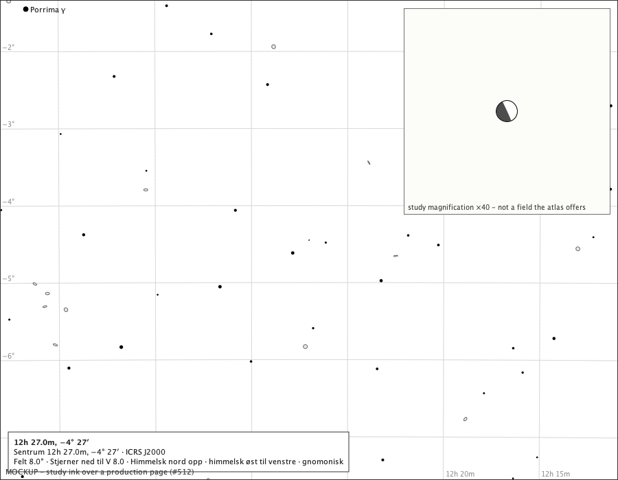

Venus near half lit, drawn at true scale; the inset shows the phase the page cannot. Drawn on the page: Venus by rule T, true disc 0.76 px, drawn 0.76 px, k = 0.49, χ = 294.6°;

### Rule T at the 2026 greatest eastern elongation, 2026-08-15 06:00 UTC, Oslo, 3° field

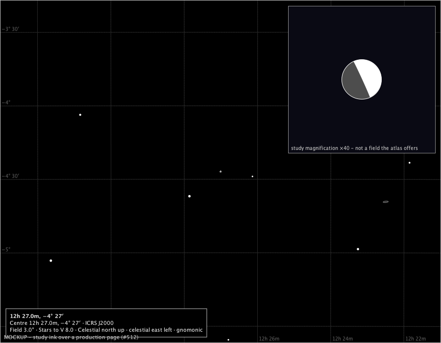

Venus near half lit, drawn at true scale; the inset shows the phase the page cannot. Drawn on the page: Venus by rule T, true disc 2.03 px, drawn 2.03 px, k = 0.49, χ = 294.6°;

### Rule T at the 2026 greatest eastern elongation, 2026-08-15 06:00 UTC, Oslo, 1° field

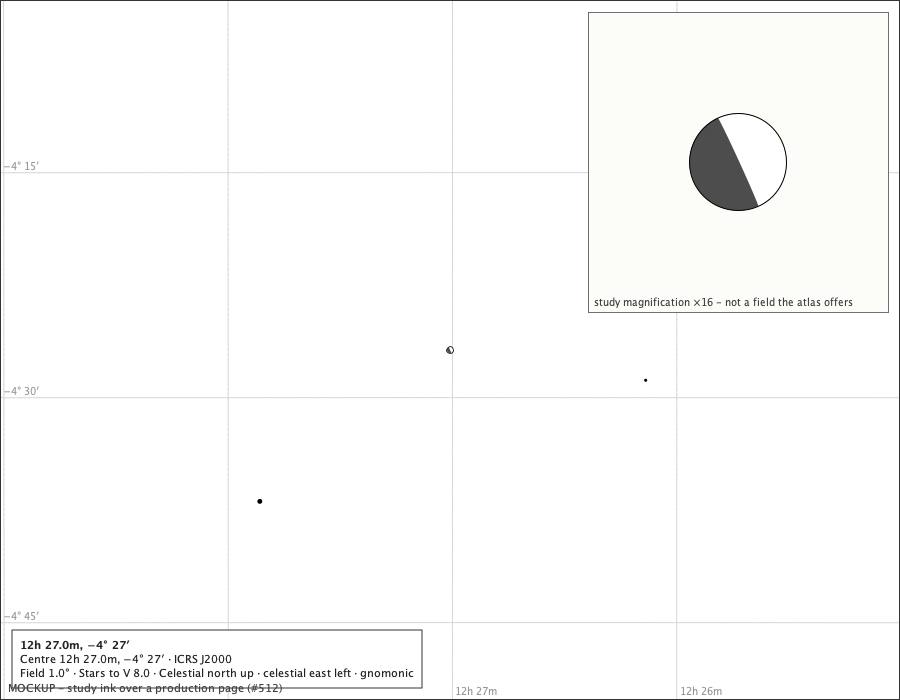

Venus near half lit, drawn at true scale; the inset shows the phase the page cannot. Drawn on the page: Venus by rule T, true disc 6.08 px, drawn 6.08 px, k = 0.49, χ = 294.6°;

### Rule M at the same instant, 3° field

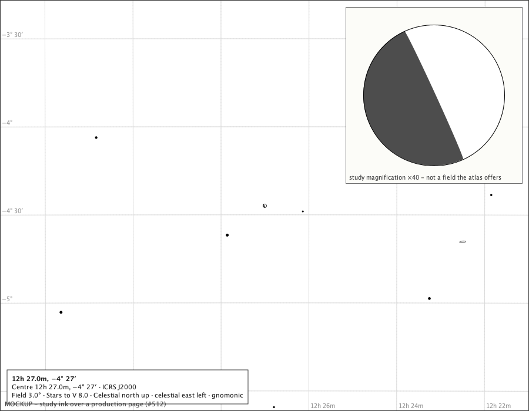

The 6 px minimum mark stands for the true disc, phased; a reader sees a shape that is not Venus's apparent size. Drawn on the page: Venus by rule M, true disc 2.03 px, drawn 6.00 px, k = 0.49, χ = 294.6°;

### Rule M at the same instant, 8° field

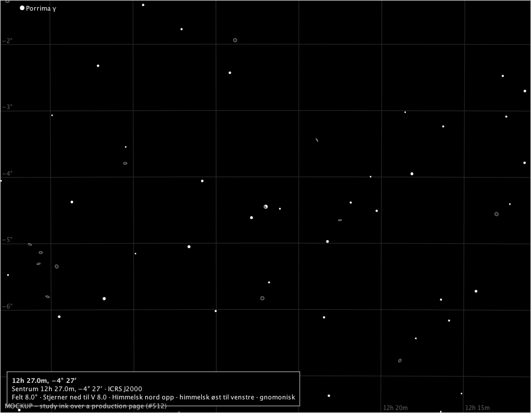

At 8° the true disc is under a pixel; rule M draws the mark, rule T a dot the size of a faint star. Drawn on the page: Venus by rule M, true disc 0.76 px, drawn 6.00 px, k = 0.49, χ = 294.6°;

### Rule T, appearance 2026-Jun-15 (gibbous), 2026-06-15 00:00 UTC, Oslo, 1° field

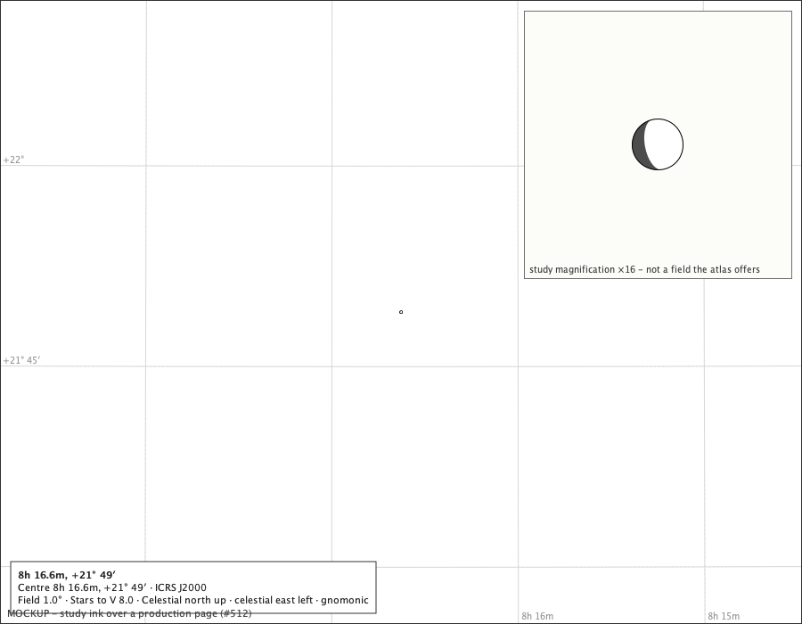

k = 0.75, χ = 280.4°; lit 2.7 px of 3.6 px. Drawn on the page: Venus by rule T, true disc 3.59 px, drawn 3.59 px, k = 0.75, χ = 280.4°;

### Rule T, appearance 2026-Sep-21 (crescent), 2026-09-21 00:00 UTC, Oslo, 1° field

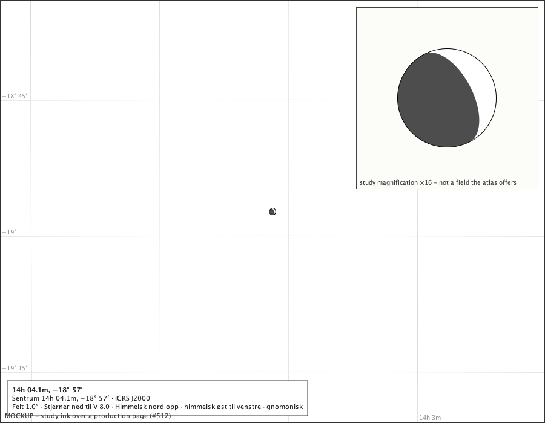

k = 0.24, χ = 297.6°; lit 2.4 px of 10.2 px. Drawn on the page: Venus by rule T, true disc 10.20 px, drawn 10.20 px, k = 0.24, χ = 297.6°;

### Rule T, appearance 2026-Nov-30 (crescent), 2026-11-30 00:00 UTC, Oslo, 1° field

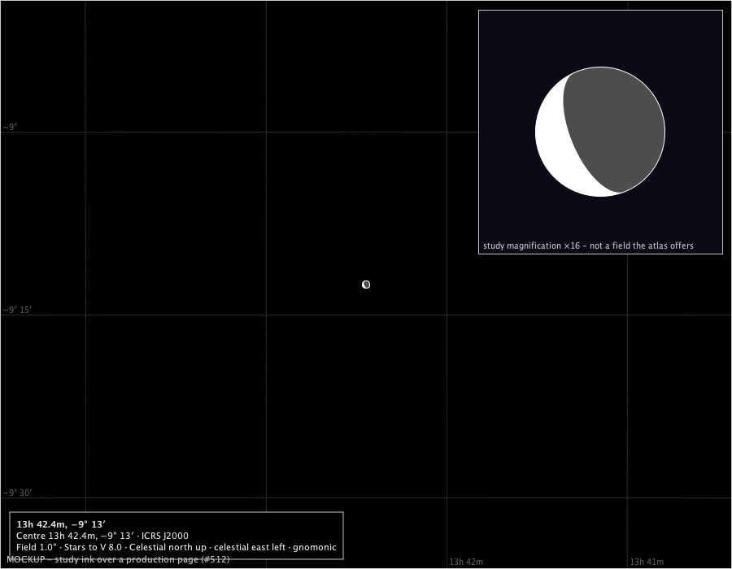

k = 0.27, χ = 112.5°; lit 2.7 px of 9.9 px. Drawn on the page: Venus by rule T, true disc 9.94 px, drawn 9.94 px, k = 0.27, χ = 112.5°;

### Rule T, appearance 2027-Mar-08 (gibbous), 2027-03-08 00:00 UTC, Oslo, 1° field

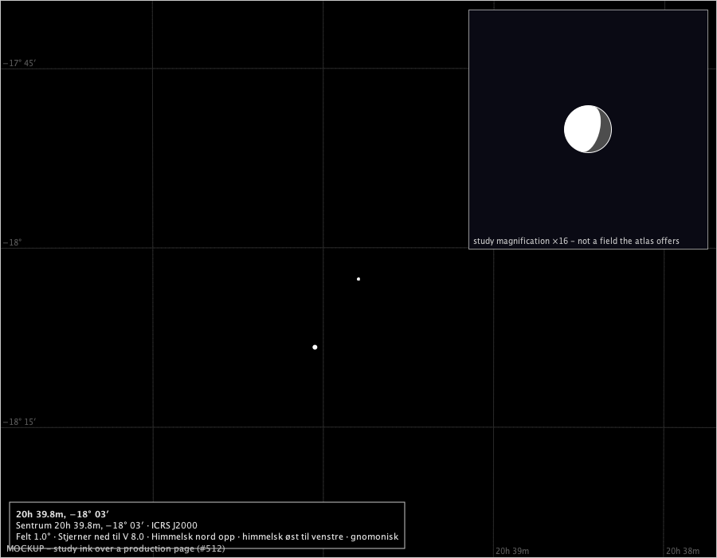

k = 0.75, χ = 75.5°; lit 2.8 px of 3.7 px. Drawn on the page: Venus by rule T, true disc 3.68 px, drawn 3.68 px, k = 0.75, χ = 75.5°;

### Rule T at the 2026 inferior conjunction, 2026-10-24 03:00 UTC, Oslo, 1° field

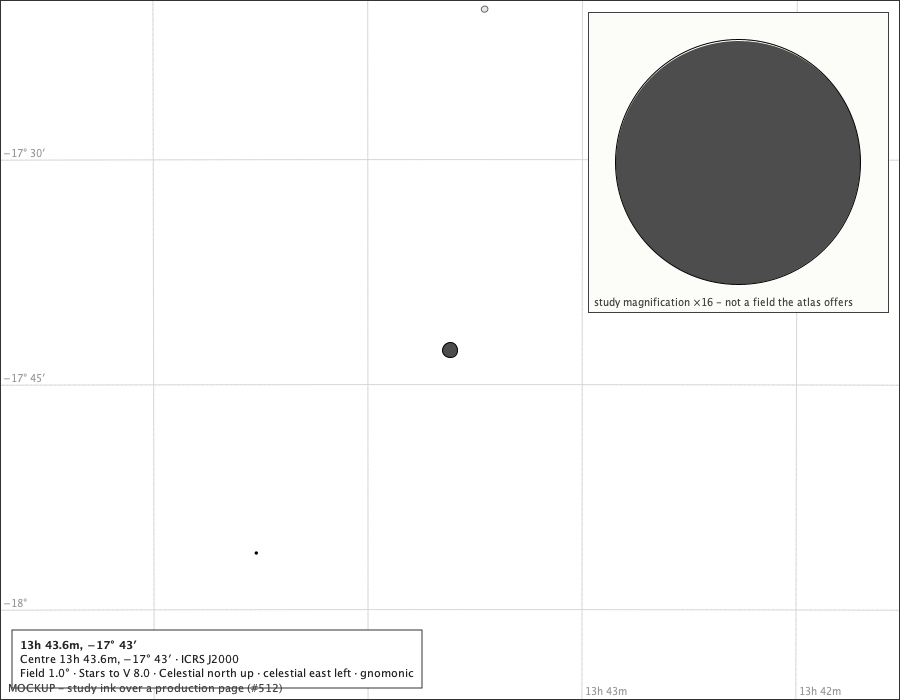

The largest disc of the apparition, its lit sliver under a tenth of a pixel: drawn dark with its limb, as the geometry gives. Drawn on the page: Venus by rule T, true disc 15.28 px, drawn 15.28 px, k = 0.01, χ = 20.6°;

### Rule T at the 2012 transit, 2012-06-06 01:00 UTC, Oslo, 1° field

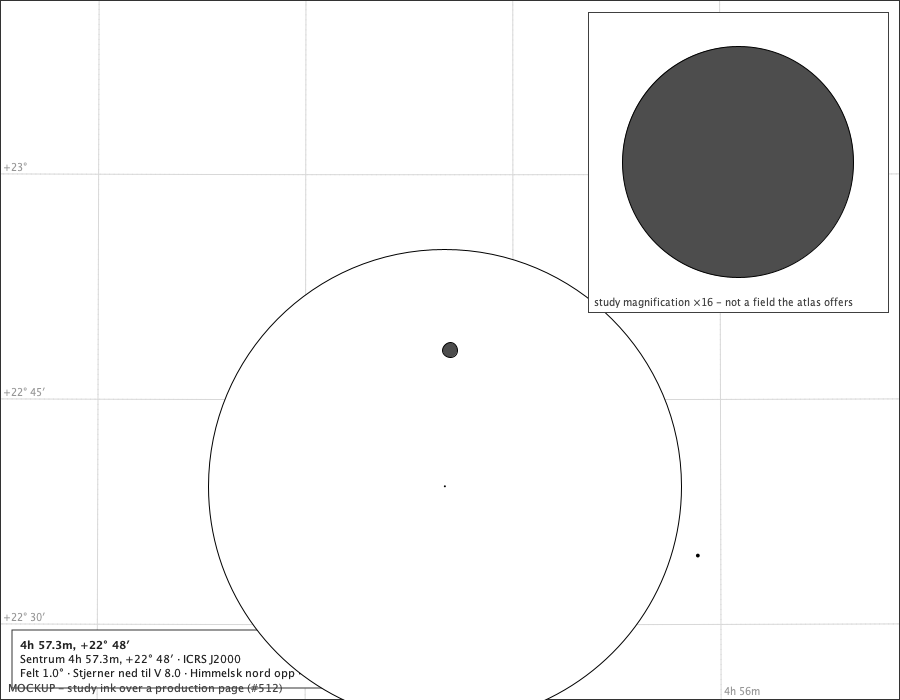

In front of the Sun: the nearer body painted last, Venus's dark disc inside the Sun's ring. Drawn on the page: the Sun's ring, 472.6 px; Venus by rule T, true disc 14.45 px, drawn 14.45 px, k = 0.00, χ = 177.9°;

### Rule T at the 2026 superior conjunction, 2026-01-06 16:00 UTC, Oslo, 1° field

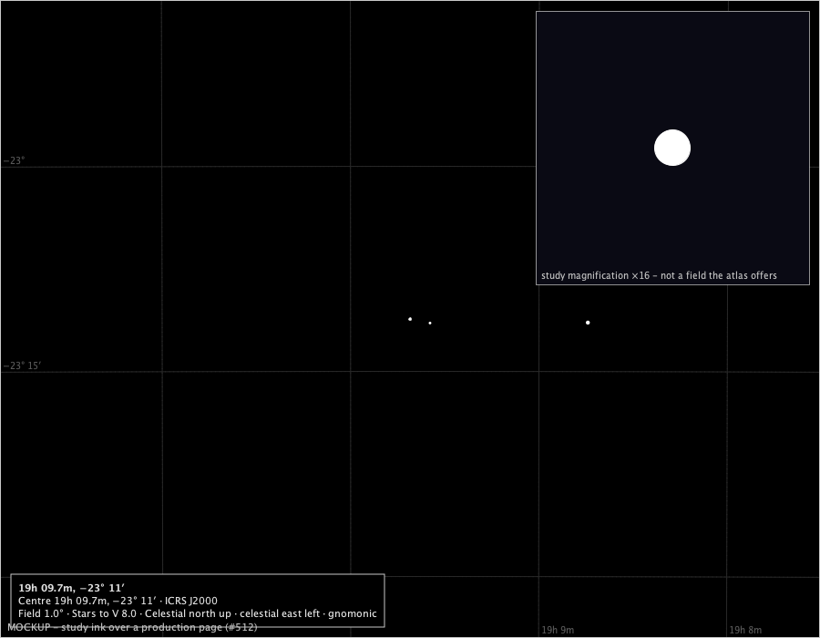

At the published hour Venus is 0.71° from the Sun - the conjunction is in ecliptic longitude, and the disc clears the Sun's - so the page shows a full disc beside the Sun's ring (k = 1.00); only inside the ring would the Sun's ground-filled disc cover it. Drawn on the page: Venus by rule T, true disc 2.44 px, drawn 2.44 px, k = 1.00, χ = 353.4°;

### The closer fields, as a strip

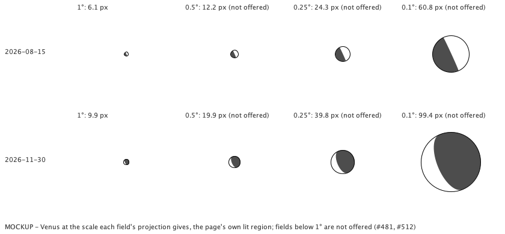

The greatest eastern elongation and the crescent appearance at the scale of each candidate field, through its projection; not a page the atlas offers below 1°.

### Rule T on the A4 sheet's chart area at 150 dpi (1754 × 1090 px), 1° field

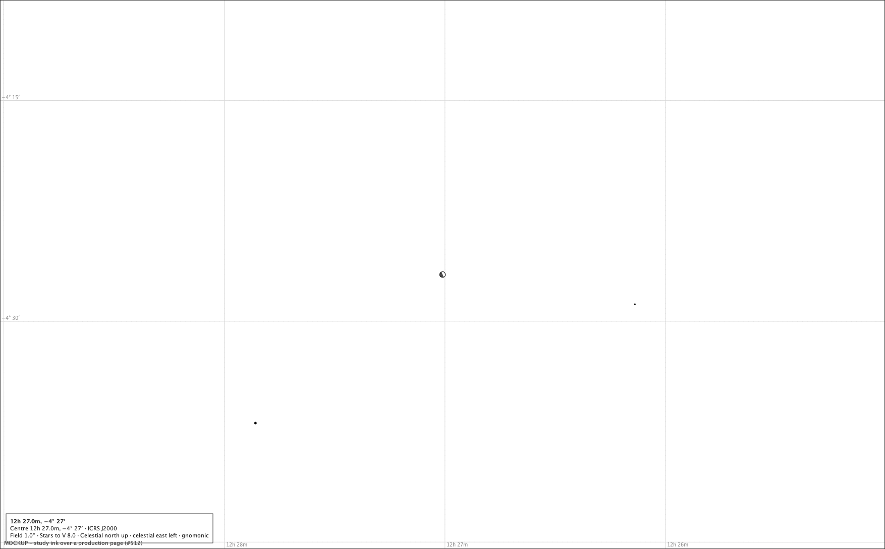

On paper the phase reads at 1° without magnification. Drawn on the page: Venus by rule T, true disc 11.85 px, drawn 11.85 px, k = 0.49, χ = 294.6°;

## G. For the rulings

1. **Size: rule T (true scale, always) or rule M (the larger of true scale and a 6 px mark).** At 1° the true disc is never under 2 px; at 3° it is 0.8-5.3 px, at 8° under a pixel - a dot the size of a faint star, as the Sun and Moon never are (C1) and Jupiter is (ruling 2 on #482); at 1° the true disc is under the 6 px mark in three quarters of the weeks. The study draws both; it recommends **rule M**, Jupiter's, with the mark phased: Venus is the second body to vanish at true scale on most pages, and a mark that keeps the phase tells the truth the table tells.
2. **At the conjunctions**: painting order and distance already give the transit (a dark disc in the Sun's ring) and the superior conjunction (covered); the dark disc near inferior conjunction is what the geometry gives. The study proposes no sliver be invented, and asks what the spoken description says at each.
3. **#481**: on screen the phase reads in a fifth of the century's weeks at 1°, half of them at about 0.5° and two thirds at 0.25° (section F); on A4 at 1° in two thirds. Venus can be drawn honestly at the ordinary floor under either rule; closer zoom is what makes its phase readable at most dates. The study asks the owner to rule whether 5.2.0 draws Venus at the ordinary ladder alone, or opens an object-dependent closer field; if the latter, which fields, the qualifying-object rule, the navigation back to the ordinary floor, and the proofs due first - projection, labels, export, keyboard zoom, persistence and evidence below 1°.
4. **The readability criterion** stays a study measure unless ruled otherwise.

