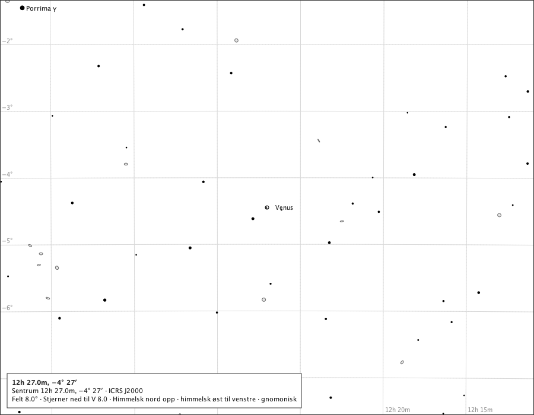
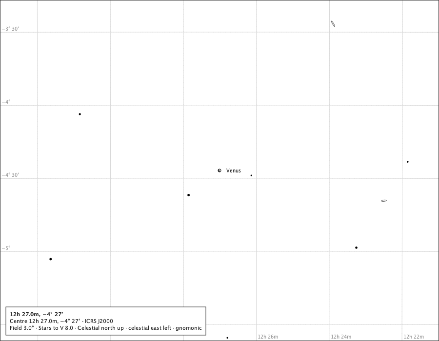
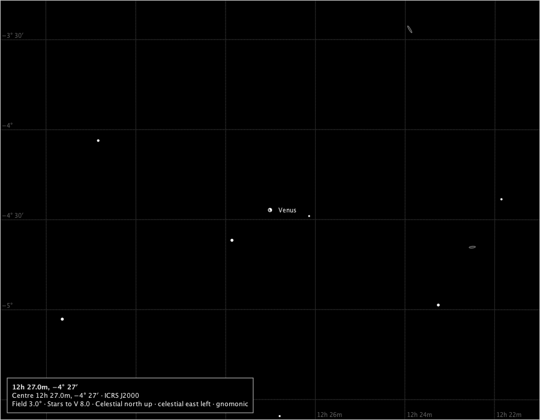
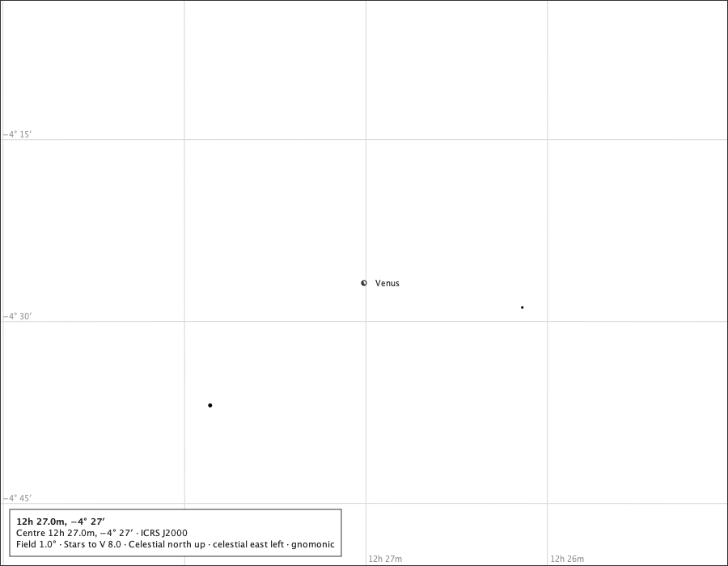
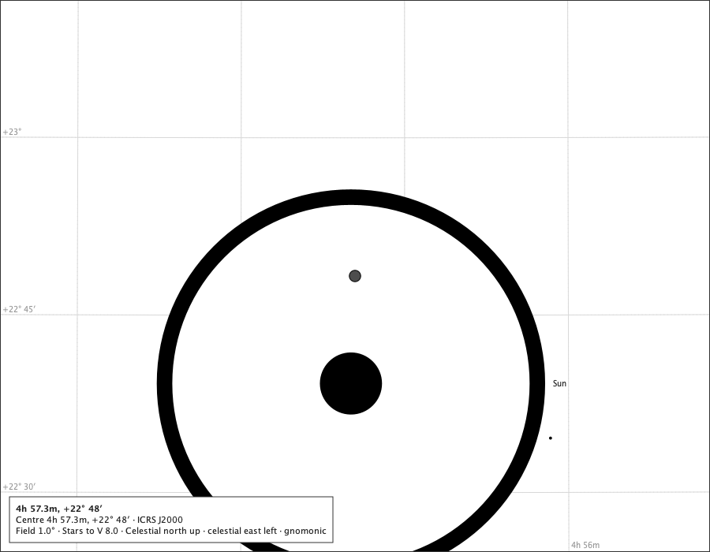
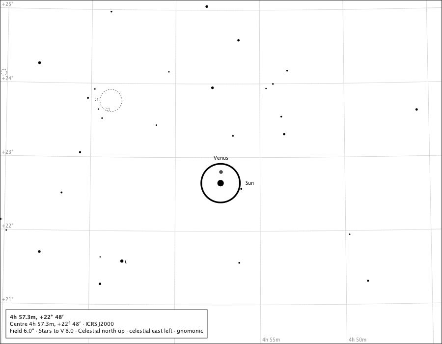
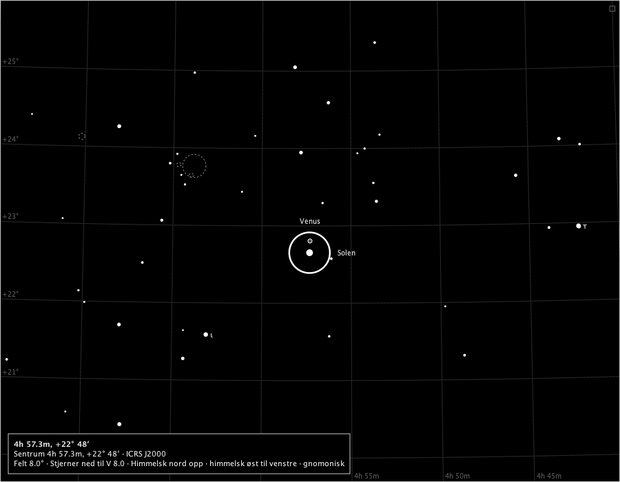
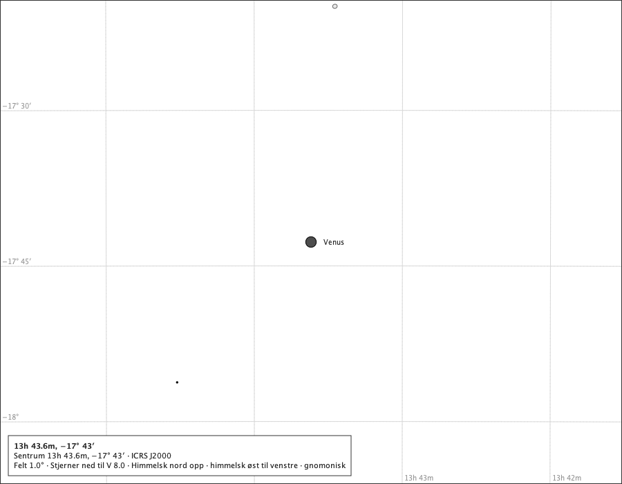
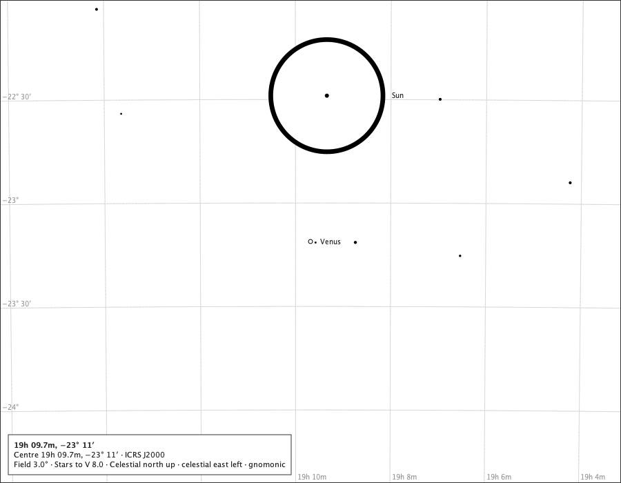
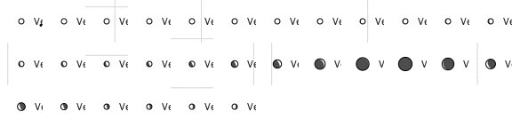

# Venus on the chart

Sprint 48, issue #514. The production composition - `ChartComponent` over the bundled catalogue, with the Solar System module attached and Venus switched on - under the rulings on #512: rule M, the larger of the true solid-body disc and a 6 px mark, phased either way by the page's own lit region (χ of date turned through the page's north and east at Venus); while the mark stands in, a cartographic symbol beneath the stars, spoken as one; no sliver invented near conjunction; the transit and the occultation by painting order; the geometric state spoken when Venus meets the Sun's disc. The instants are Espenak's rows in `docs/studies/venus/venus-events.txt`; positions and phases are the service's for the instant and observer stated (Oslo, sea level). Regenerate with `make venus-on-the-chart-study`.

## The 2026 greatest eastern elongation, Oslo

### Største østlige elongasjon, 8°, the page's words in Norwegian

The table: 48.7 % lit, nær halvt belyst, χ 294.6° (WNW (295°)). At 8° the true disc is under a pixel: the 6 px mark stands in, phased, and the page calls it a symbol. Drawn: Venus at (450.0, 350.0), symbol 6.0 px, name placed; Spoken: Venus' tilsynelatende diameter).

### The elongation at 3°

The true disc is about 2 px at 3°: the mark still stands in. Drawn: Venus at (450.0, 350.0), symbol 6.0 px, name placed; Spoken: Venus's apparent diameter).

### The elongation at 3° on the black sky

The lit side in the black sky's star ink, the dark side a little above the sky's ground. Drawn: Venus at (450.0, 350.0), symbol 6.0 px, name placed; Spoken: Venus's apparent diameter).

### The elongation at the minimum field, 1°

The table: 48.7 % lit, near half lit, χ 294.6° (WNW (295°)). About 6.1 px at 1°: the true disc, just over the mark, drawn as itself and opaque. Drawn: Venus at (450.0, 350.0), disc 6.1 px, name placed; Spoken: Venus.

## The conjunctions, Oslo, 1°, with the Sun

### The 2012 transit, 2012-06-06T01:00:00Z

In front of the Sun: the nearer body painted last, Venus's dark disc inside the Sun's ring, and the page says so beside the name. Drawn: Sun at (444.9, 486.3), disc 472.6 px, name placed; Venus at (450.0, 350.0), disc 14.5 px, state venus.inFront, name refused; Spoken: Venus, in front of the Sun.

### The 2012 transit at 6°

The true disc is under 6 px here, so the phased mark stands in - painted in the bodies layer over the Sun's ring, because a symbol in front of an opaque disc is that layer's to paint (the #514 checkpoint); its name takes the first clean box beside the mark, clear of the Sun's ink, or is refused where none is (C4). Drawn: Sun at (449.1, 372.7), disc 78.7 px, name placed; Venus at (450.0, 350.0), symbol 6.0 px, state venus.inFront, name placed; Spoken: Venus's apparent diameter).

### The 2012 transit at 8°, in Norwegian

The mark over the ring, and the name beside it where a box is clean. Drawn: Solen at (449.4, 367.0), disc 59.0 px, name placed; Venus at (450.0, 350.0), symbol 6.0 px, state venus.inFront, name placed; Spoken: Venus' tilsynelatende diameter).

### The 2026 inferior conjunction, 2026-10-24T03:00:00Z

The table: 0.6 % lit, nær nedre konjunksjon, χ 20.6° (not well-defined). The largest disc of the apparition, its lit sliver under a tenth of a pixel: drawn dark with its limb, as the geometry gives. Drawn: Venus at (450.0, 350.0), disc 15.3 px, name placed; Spoken: Venus.

### The 2026 superior conjunction at 3°, with the Sun

Venus 0.71° from the Sun at the published hour, near full: the mark beside the Sun's ring. Drawn: Venus at (450.0, 350.0), symbol 6.0 px, name placed; Sun at (473.7, 138.7), disc 162.6 px, name placed; Spoken: Venus's apparent diameter). Sun.

## The 2026-27 apparition as a row of phases

From the 2026 superior conjunction, 2026-01-06T16:00:00Z, every 14 days through the inferior conjunction and 120 days beyond, Oslo: each mark or disc cut from its own 1° page drawn by the production component (left to right, 12 to a row). Beside the Venus table's own cells, what the rendered pixels show - every pixel inside the mark classed as lit, dark side or the limb's own ink, which is left out: the share drawn lit, and the direction the lit side faces read back through the page's north and east at Venus. A mark of 6 px holds some two dozen pixels, so the share is coarse; what is held is that a disc the table calls crescent is drawn less than half lit and a gibbous one more where the table's k is at least five points from a half, and that the drawn lit side faces within 45° of the table's χ wherever the table says χ is well defined.

| step | instant (UTC) | table: lit | table: phase | table: χ | drawn | drawn: lit | drawn: facing | agrees |
|---:|---|---:|---|---:|---|---:|---|---|
| 0 | 2026-01-06 16:00 | 100.0 % | near full | 353.4° | symbol 6.0 px | 100 % | - | - |
| 1 | 2026-01-20 16:00 | 99.8 % | near full | 275.0° | symbol 6.0 px | 100 % | - | - |
| 2 | 2026-02-03 16:00 | 99.3 % | near full | 262.9° | symbol 6.0 px | 100 % | - | - |
| 3 | 2026-02-17 16:00 | 98.5 % | near full | 256.0° | symbol 6.0 px | 100 % | - | - |
| 4 | 2026-03-03 16:00 | 97.4 % | gibbous | 252.1° | symbol 6.0 px | 100 % | - | - |
| 5 | 2026-03-17 16:00 | 95.8 % | gibbous | 250.4° | symbol 6.0 px | 100 % | - | - |
| 6 | 2026-03-31 16:00 | 93.9 % | gibbous | 250.9° | symbol 6.0 px | 100 % | - | - |
| 7 | 2026-04-14 16:00 | 91.4 % | gibbous | 253.6° | symbol 6.0 px | 100 % | - | - |
| 8 | 2026-04-28 16:00 | 88.5 % | gibbous | 258.2° | symbol 6.0 px | 100 % | - | - |
| 9 | 2026-05-12 16:00 | 85.1 % | gibbous | 264.3° | symbol 6.0 px | 100 % | - | - |
| 10 | 2026-05-26 16:00 | 81.2 % | gibbous | 271.2° | symbol 6.0 px | 88 % | 270° | yes |
| 11 | 2026-06-09 16:00 | 76.7 % | gibbous | 278.0° | symbol 6.0 px | 88 % | 270° | yes |
| 12 | 2026-06-23 16:00 | 71.9 % | gibbous | 283.9° | symbol 6.0 px | 75 % | 270° | yes |
| 13 | 2026-07-07 16:00 | 66.5 % | gibbous | 288.5° | symbol 6.0 px | 69 % | 283° | yes |
| 14 | 2026-07-21 16:00 | 60.6 % | gibbous | 291.8° | symbol 6.0 px | 63 % | 286° | yes |
| 15 | 2026-08-04 16:00 | 54.1 % | gibbous | 293.8° | symbol 6.0 px | 56 % | 281° | yes |
| 16 | 2026-08-18 16:00 | 46.8 % | crescent | 294.8° | disc 6.3 px | 50 % | 293° | yes |
| 17 | 2026-09-01 16:00 | 38.4 % | crescent | 295.4° | disc 7.6 px | 31 % | 295° | yes |
| 18 | 2026-09-15 16:00 | 28.2 % | crescent | 296.6° | disc 9.4 px | 23 % | 297° | yes |
| 19 | 2026-09-29 16:00 | 16.3 % | crescent | 300.6° | disc 11.7 px | 10 % | 296° | yes |
| 20 | 2026-10-13 16:00 | 4.6 % | crescent | 314.6° | disc 14.3 px | 0 % | - | - |
| 21 | 2026-10-27 16:00 | 0.9 % | near inferior conjunction | 65.4° | disc 15.2 px | 0 % | - | - |
| 22 | 2026-11-10 16:00 | 9.5 % | crescent | 106.7° | disc 13.4 px | 3 % | 110° | yes |
| 23 | 2026-11-24 16:00 | 22.3 % | crescent | 112.1° | disc 10.8 px | 18 % | 111° | yes |
| 24 | 2026-12-08 16:00 | 33.8 % | crescent | 112.3° | disc 8.7 px | 30 % | 111° | yes |
| 25 | 2026-12-22 16:00 | 43.3 % | crescent | 110.0° | disc 7.2 px | 42 % | 120° | yes |
| 26 | 2027-01-05 16:00 | 51.2 % | near half lit | 105.8° | disc 6.1 px | 50 % | 90° | yes |
| 27 | 2027-01-19 16:00 | 57.9 % | gibbous | 99.9° | symbol 6.0 px | 63 % | 106° | yes |
| 28 | 2027-02-02 16:00 | 63.8 % | gibbous | 92.9° | symbol 6.0 px | 75 % | 90° | yes |
| 29 | 2027-02-16 16:00 | 68.9 % | gibbous | 85.3° | symbol 6.0 px | 75 % | 90° | yes |

**18 of the 18 steps where the table states χ agree**: the drawn half is the table's and the lit side faces within 45° of χ.

